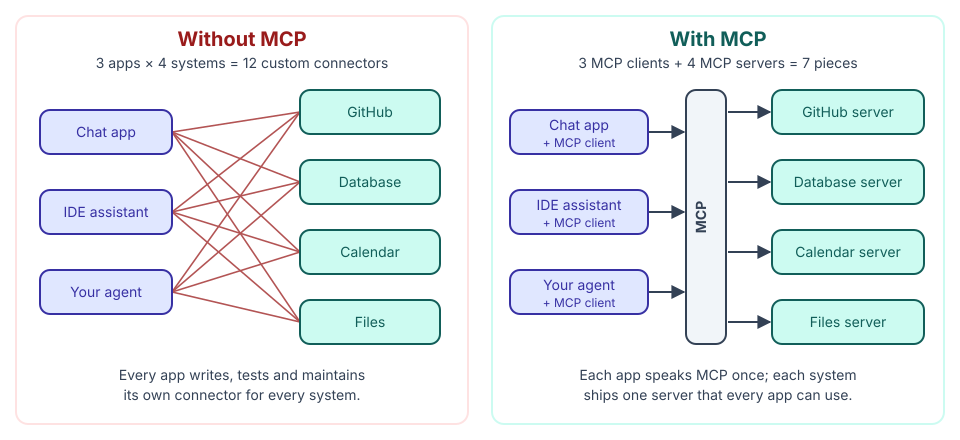
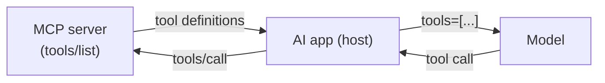

🏠 [Home](../../README.md) › [04 · Model Context Protocol (MCP)](./README.md) › 4.1 Why MCP exists

# 4.1 Why MCP exists

> **Difficulty:** 🟢 Beginner · **Reading time:** ~7 min · **Prerequisites:** [3.1 What is a tool?](../03-tools-and-function-calling/03.1-what-is-a-tool.md), [3.3 How function calling works](../03-tools-and-function-calling/03.3-how-function-calling-works.md)

**In one sentence:** The Model Context Protocol (MCP) is a shared plug shape for AI tools: write a tool once as an MCP server, and every AI app that speaks MCP can use it, so N apps and M systems need N + M pieces of glue instead of N × M.

📑 **On this page**

- [Why does this matter?](#-why-does-this-matter)
- [The idea, in plain words](#-the-idea-in-plain-words)
- [Picture it](#-picture-it)
- [How it works, step by step](#-how-it-works-step-by-step)
- [Worked example](#-worked-example)
- [Code](#-code)
- [Common mistakes & gotchas](#-common-mistakes--gotchas)
- [Key takeaways](#-key-takeaways)
- [Try it yourself](#-try-it-yourself)
- [Further reading](#-further-reading)

## 🤔 Why does this matter?

You built a [tool](../../GLOSSARY.md#tool) in chapter 03: `search_tickets`, which lets your support [agent](../../GLOSSARY.md#agent) look up customer tickets. It works. Then three requests arrive in the same week:

- A colleague wants the same tool in the AI assistant inside their code editor.
- Your manager wants it in the company's desktop chat app.
- Another team is building a second agent and wants it too.

Each of those apps has its own way of plugging in tools. So you write the tool's glue code three more times, in three shapes, and you now maintain four copies. When the ticket API changes, you fix it in four places.

Multiply that across a company: every AI app needs a connector for every system (GitHub, the database, the calendar, the wiki). That is the problem MCP was created to solve.

## 🧠 The idea, in plain words

Think of the plugs on your laptop before USB. Printers, keyboards and cameras each had their own connector, and every laptop needed every port. USB replaced that with one shape. The MCP website uses the same picture: *"Think of MCP like a USB-C port for AI applications."*

The [Model Context Protocol (MCP)](../../GLOSSARY.md#model-context-protocol-mcp) is an open standard, introduced by Anthropic in November 2024, that defines:

- **What a tool provider offers**, in one format: tools to call, data to read and prompt templates to use.
- **How an AI app asks for it**, in one message format.

A system wraps its features once as an **[MCP server](../../GLOSSARY.md#mcp-server)**. An AI app adds MCP support once, as an **[MCP client](../../GLOSSARY.md#mcp-client)**. After that, any app can use any server.

The arithmetic is the whole point:

| | Without MCP | With MCP |
| --- | --- | --- |
| 3 AI apps, 4 systems | 3 × 4 = **12** custom connectors | 3 clients + 4 servers = **7** pieces |
| 10 apps, 50 systems | **500** connectors | **60** pieces |
| Add one new system | Write a connector for every app | Write one server |

Engineers call this turning an **N × M** problem into an **N + M** problem. MCP's specification says it takes inspiration from the [Language Server Protocol](https://microsoft.github.io/language-server-protocol/), which did the same thing for code editors and programming languages.

## 👀 Picture it



*On the left, every new app or system adds a whole row or column of lines. On the right, it adds one box. The protocol in the middle is the only thing both sides have to agree on.*

## 🔍 How it works, step by step

MCP standardises four things. Each gets its own page in this chapter.

1. **Roles.** An AI app (the **[host](../../GLOSSARY.md#mcp-host)**) runs one **client** per server it connects to. The **server** wraps a system: GitHub, a database, your notes. See [4.2](./04.2-hosts-clients-and-servers.md).
2. **What servers offer.** Three kinds of thing, called *primitives*: **tools** the model can call, **[resources](../../GLOSSARY.md#mcp-resource)** the app can read, and **prompts** the user can pick. See [4.3](./04.3-tools-resources-and-prompts.md).
3. **The messages.** Every request and reply is a [JSON-RPC 2.0](../../GLOSSARY.md#json-rpc) message, such as `tools/list` ("what tools do you have?") and `tools/call` ("run this tool with these arguments").
4. **The transport.** How those messages travel: over a local process's standard input and output (**[stdio](../../GLOSSARY.md#stdio-transport)**), or over HTTP to a remote server (**[Streamable HTTP](../../GLOSSARY.md#streamable-http)**). See [4.2](./04.2-hosts-clients-and-servers.md).

Because tools are *discovered at runtime* with `tools/list`, an app doesn't need to know a server's tools in advance. You can add a server to an app's configuration and its tools appear.

**Where MCP fits with function calling.** MCP does not replace [function calling](../../GLOSSARY.md#function-calling) from [3.3](../03-tools-and-function-calling/03.3-how-function-calling-works.md). It feeds it. The app fetches tool definitions from MCP servers, hands them to the model as ordinary tools, and when the model asks for one, the app forwards the call to the right server:



*The model never talks to the MCP server. The app sits in the middle: MCP on one side, the model provider's tool format on the other.*

**Versions.** The specification is versioned by date. At the time of writing (November 2026) the current revision is **2026-07-28**, and the previous one is 2025-11-25. Clients and servers agree on a version before they work together, so older and newer implementations can still talk.

## 💡 Worked example

Your company has three AI apps and wants each to reach four systems.

**Without MCP**, the integration backlog looks like this:

```text
chat app       -> github, database, calendar, files     4 connectors
IDE assistant  -> github, database, calendar, files     4 connectors
support agent  -> github, database, calendar, files     4 connectors
                                                        ------------
                                                        12 to build, test, secure and update
```

**With MCP**, each system team ships one server and each app adds MCP support once:

```text
servers: github-mcp, database-mcp, calendar-mcp, files-mcp   4 servers
clients: chat app, IDE assistant, support agent             3 clients
                                                            ---------
                                                            7 pieces; a 5th system adds 1, not 3
```

Here is what an app sees when it connects to the small notes server you will build in [4.4](./04.4-build-a-simple-mcp-server.md). Nothing about notes was written into the app; it learned all of this by asking:

```text
Connected to notes 1.0.0 (protocol 2026-07-28)

TOOLS (the model decides when to call these)
  search_notes  [read-only]: Search notes by keyword. Returns every note that contains all the words, as 'title: text'.
  add_note: Save a note under a short title. Saving under an existing title replaces that note.
```

## 💻 Code

Without MCP, a tool lives *inside* one agent: a Python function plus a tool spec in that agent's format (as in [3.1](../03-tools-and-function-calling/03.1-what-is-a-tool.md)).

```python
# Only this agent can use it.
def search_notes(query: str) -> list[str]: ...

SEARCH_NOTES_SPEC = {
    "name": "search_notes",
    "description": "Search notes by keyword.",
    "input_schema": {"type": "object", "properties": {"query": {"type": "string"}}, "required": ["query"]},
}
```

With MCP, the same function becomes a server that any MCP host can launch. This uses the official Python SDK (`pip install mcp`; this book uses `mcp==2.3.0`):

```python
from mcp.server.mcpserver import MCPServer

NOTES = ["Dentist on Friday at 15:00", "Train to Lyon on Friday at 09:12"]
mcp = MCPServer("notes")

@mcp.tool()
def search_notes(query: str) -> list[str]:
    """Search notes by keyword."""
    return [n for n in NOTES if query.lower() in n.lower()]

if __name__ == "__main__":
    mcp.run()  # speaks MCP over stdio; the SDK writes the JSON Schema from the type hints
```

The full server, with tests, is in [`examples/04-mcp-server`](../../examples/04-mcp-server/README.md). Page [4.4](./04.4-build-a-simple-mcp-server.md) walks through it.

## 🚨 Common mistakes & gotchas

- **Thinking you need MCP to use tools.** You don't. For one agent with a few tools you own, plain function calling is simpler. MCP pays off when tools are shared across apps, teams or vendors.
- **Thinking MCP makes tools safe.** MCP standardises the plug, not the trust. A server can still be buggy or malicious, and its descriptions are text the model reads. See [4.6](./04.6-mcp-security.md).
- **Connecting every server you can find.** Each server's tool descriptions take up the model's [context window](../../GLOSSARY.md#context-window), and more tools mean more chances to pick the wrong one. Connect what the task needs.
- **Assuming every app supports every feature.** Hosts adopt parts of MCP at their own pace. Many support tools well before resources or prompts. Check what your host supports.
- **Copying old tutorials.** MCP changes quickly. The 2026-07-28 revision removed the old `initialize` handshake, and the Python SDK 2.x renamed `FastMCP` to `MCPServer`. Check the date of anything you copy.

## ✅ Key takeaways

- MCP is an open standard for connecting AI apps to tools and data.
- It turns N × M custom integrations into N + M: one client per app, one server per system.
- It standardises roles, primitives (tools, resources, prompts), messages (JSON-RPC) and transports (stdio, Streamable HTTP).
- MCP feeds function calling; the model still sees ordinary tools, and the app routes calls to servers.
- A shared plug is not a security guarantee.

## 🧪 Try it yourself

1. Your company has 6 AI apps and 15 internal systems. How many integrations do you need without MCP, and how many pieces with it? What happens to each number when you add a 16th system?
2. Name one situation where adding MCP would be over-engineering.

<details>
<summary>Show answer</summary>

1. Without MCP: 6 × 15 = 90 connectors. With MCP: 6 clients + 15 servers = 21 pieces. A 16th system adds 6 connectors without MCP (one per app), but only 1 server with MCP.
2. One example: a single internal agent with two small tools that no other app will ever use. Defining the tools directly with function calling is less code, has fewer moving parts and is easier to test. You can wrap them in an MCP server later if they need to be shared.

</details>

## 📚 Further reading

- [Introducing the Model Context Protocol](https://www.anthropic.com/news/model-context-protocol) (Anthropic, November 2024). The announcement and the problem it set out to solve.
- [What is the Model Context Protocol (MCP)?](https://modelcontextprotocol.io/docs/2026-07-28/getting-started/intro) (modelcontextprotocol.io). The official introduction, with the USB-C analogy and a list of supporting apps.
- [MCP specification](https://modelcontextprotocol.io/specification/2026-07-28) (revision 2026-07-28). The authoritative protocol definition.
- [Language Server Protocol](https://microsoft.github.io/language-server-protocol/) (Microsoft). The earlier N × M solution for code editors that inspired MCP.

<!-- FOOTER -->

---

⬅️ **Previous:** [3.7 Computer use & browser agents](../03-tools-and-function-calling/03.7-computer-use-and-browser-agents.md) ·
🏠 [Chapter home](./README.md) ·
➡️ **Next:** [4.2 Hosts, clients and servers](./04.2-hosts-clients-and-servers.md)
