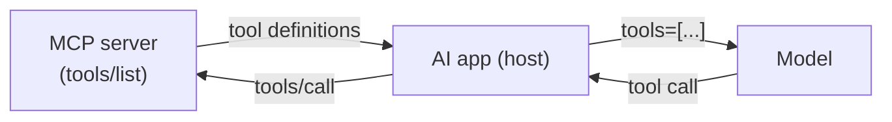

🏠 [Home](../../README.md) › [04 · Model Context Protocol (MCP)](./README.md) › 4.1 MCP kyun bana?

# 4.1 MCP kyun bana?

> **Level:** 🟢 Beginner · **Padhne ka time:** ~7 min · **Pehle padho:** [3.1 Tool kya hota hai?](../03-tools-and-function-calling/03.1-what-is-a-tool.md), [3.3 Function calling kaise kaam karta hai](../03-tools-and-function-calling/03.3-how-function-calling-works.md)

**Ek line mein:** Model Context Protocol (MCP) AI tools ke liye ek common plug shape hai. Tool ko ek baar MCP server ki tarah likho, aur har woh AI app jo MCP bolta hai usse use kar sakta hai. Isliye N apps aur M systems ke liye N × M ki jagah sirf N + M glue pieces chahiye.

📑 **Is page par**

- [Yeh kyun zaroori hai?](#-yeh-kyun-zaroori-hai)
- [Idea, simple words mein](#-idea-simple-words-mein)
- [Diagram se samjho](#-diagram-se-samjho)
- [Kaise kaam karta hai, step by step](#-kaise-kaam-karta-hai-step-by-step)
- [Example se samjho](#-example-se-samjho)
- [Code](#-code)
- [Aam galtiyan aur dhyan dene wali baatein](#-aam-galtiyan-aur-dhyan-dene-wali-baatein)
- [Yaad rakhne wali baatein](#-yaad-rakhne-wali-baatein)
- [Khud try karo](#-khud-try-karo)
- [Aur padhne ke liye](#-aur-padhne-ke-liye)

## 🤔 Yeh kyun zaroori hai?

Chapter 03 mein tumne ek [tool](../../GLOSSARY.md#tool) banaya tha: `search_tickets`. Isse tumhara support [agent](../../GLOSSARY.md#agent) customer tickets dhoondh sakta hai. Tool kaam karta hai. Phir ek hi hafte mein teen requests aati hain:

- Ek colleague ko yahi tool apne code editor ke andar wale AI assistant mein chahiye.
- Tumhare manager ko yeh company ke desktop chat app mein chahiye.
- Ek dusri team doosra agent bana rahi hai, unko bhi yeh chahiye.

In sab apps ka tools plug karne ka apna-apna tarika hai. Toh tum tool ka glue code teen baar aur likhte ho, teen alag shapes mein. Ab tumhare paas chaar copies hain jinko maintain karna hai. Ticket API badli, toh chaar jagah fix karo.

Ab yeh poori company mein socho. Har AI app ko har system ke liye connector chahiye (GitHub, database, calendar, wiki). Yahi woh problem hai jise solve karne ke liye MCP banaya gaya.

## 🧠 Idea, simple words mein

USB se pehle ke laptop ke plugs yaad karo. Printer, keyboard aur camera, sabka apna alag connector tha. Har laptop ko har port chahiye tha. USB ne yeh sab ek shape se replace kar diya. MCP ki website bhi yahi picture use karti hai: *"Think of MCP like a USB-C port for AI applications."* Matlab, MCP ko AI apps ke liye USB-C port jaisa samjho.

Apne ghar ka example lo. Pehle har phone ka charger alag hota tha, ab ek USB-C charger se phone, earbuds aur laptop sab charge ho jaate hain. MCP tools ke liye wahi "ek charger" hai.

[Model Context Protocol (MCP)](../../GLOSSARY.md#model-context-protocol-mcp) ek open standard hai. Isse Anthropic ne November 2024 mein introduce kiya tha. Yeh do cheezein define karta hai:

- **Tool provider kya offer karta hai**, ek format mein: call karne ke liye tools, padhne ke liye data, aur use karne ke liye prompt templates.
- **AI app usse kaise maangta hai**, ek message format mein.

Koi system apne features ko ek baar **[MCP server](../../GLOSSARY.md#mcp-server)** ki tarah wrap karta hai. Koi AI app ek baar MCP support add karta hai, **[MCP client](../../GLOSSARY.md#mcp-client)** ki tarah. Uske baad koi bhi app kisi bhi server ko use kar sakta hai.

Poora point is hisaab mein hai:

| | MCP ke bina | MCP ke saath |
| --- | --- | --- |
| 3 AI apps, 4 systems | 3 × 4 = **12** custom connectors | 3 clients + 4 servers = **7** pieces |
| 10 apps, 50 systems | **500** connectors | **60** pieces |
| Ek naya system add karo | Har app ke liye ek connector likho | Ek server likho |

Engineers isse kehte hain **N × M** problem ko **N + M** problem bana dena. MCP ki specification kehti hai ki isne [Language Server Protocol](https://microsoft.github.io/language-server-protocol/) se inspiration li hai. LSP ne code editors aur programming languages ke liye bilkul yahi kaam kiya tha.

## 👀 Diagram se samjho


*Left side par har naya app ya system lines ki ek poori row ya column add kar deta hai. Right side par sirf ek box add hota hai. Beech wala protocol hi woh cheez hai jis par dono sides ko agree karna padta hai.*

## 🔍 Kaise kaam karta hai, step by step

MCP chaar cheezon ko standard banata hai. Is chapter mein har ek ka apna page hai.

1. **Roles.** Ek AI app (**[host](../../GLOSSARY.md#mcp-host)**) har connected server ke liye ek **client** chalata hai. **Server** kisi system ko wrap karta hai: GitHub, database, tumhare notes. Dekho [4.2](./04.2-hosts-clients-and-servers.md).
2. **Servers kya offer karte hain.** Teen tarah ki cheezein, jinhe *primitives* kehte hain: **tools** jo model call kar sakta hai, **[resources](../../GLOSSARY.md#mcp-resource)** jo app padh sakta hai, aur **prompts** jo user choose kar sakta hai. Dekho [4.3](./04.3-tools-resources-and-prompts.md).
3. **Messages.** Har request aur reply ek [JSON-RPC 2.0](../../GLOSSARY.md#json-rpc) message hota hai. Jaise `tools/list` ("tumhare paas kaun se tools hain?") aur `tools/call` ("yeh tool in arguments ke saath chalao").
4. **Transport.** Yeh messages travel kaise karte hain. Ya toh ek local process ke standard input aur output se (**[stdio](../../GLOSSARY.md#stdio-transport)**), ya HTTP par kisi remote server tak (**[Streamable HTTP](../../GLOSSARY.md#streamable-http)**). Dekho [4.2](./04.2-hosts-clients-and-servers.md).

Tools `tools/list` se *runtime par discover* hote hain. Isliye app ko server ke tools pehle se pata hone ki zaroorat nahi hai. Server ko app ki configuration mein add karo, aur uske tools dikhne lagte hain.

**MCP aur function calling ka rishta.** MCP [function calling](../../GLOSSARY.md#function-calling) ([3.3](../03-tools-and-function-calling/03.3-how-function-calling-works.md) wali) ko replace nahi karta. Woh usse feed karta hai. App MCP servers se tool definitions laata hai. Phir unhe model ko normal tools ki tarah deta hai. Jab model kisi tool ko maangta hai, toh app woh call sahi server tak forward kar deta hai:



*Model kabhi MCP server se baat nahi karta. App beech mein baitha hai: ek taraf MCP, doosri taraf model provider ka tool format.*

**Versions.** Specification ka version date se hota hai. Likhte waqt (November 2026) current revision **2026-07-28** hai, aur pichla 2025-11-25 tha. Client aur server saath kaam karne se pehle ek version par agree karte hain. Isliye purane aur naye implementations bhi aapas mein baat kar sakte hain.

## 💡 Example se samjho

Tumhari company ke paas teen AI apps hain, aur har app ko chaar systems tak pahunchna hai.

**MCP ke bina**, integration backlog kuch aisa dikhta hai:

```text
chat app       -> github, database, calendar, files     4 connectors
IDE assistant  -> github, database, calendar, files     4 connectors
support agent  -> github, database, calendar, files     4 connectors
                                                        ------------
                                                        12 to build, test, secure and update
```

**MCP ke saath**, har system team ek server ship karti hai aur har app ek baar MCP support add karta hai:

```text
servers: github-mcp, database-mcp, calendar-mcp, files-mcp   4 servers
clients: chat app, IDE assistant, support agent             3 clients
                                                            ---------
                                                            7 pieces; a 5th system adds 1, not 3
```

Ab dekho ek app ko kya dikhta hai jab woh us chhote notes server se connect hota hai jo tum [4.4](./04.4-build-a-simple-mcp-server.md) mein banaoge. App mein notes ke baare mein kuch bhi likha nahi gaya tha. Usne yeh sab sirf poochh ke seekha:

```text
Connected to notes 1.0.0 (protocol 2026-07-28)

TOOLS (the model decides when to call these)
  search_notes  [read-only]: Search notes by keyword. Returns every note that contains all the words, as 'title: text'.
  add_note: Save a note under a short title. Saving under an existing title replaces that note.
```

## 💻 Code

MCP ke bina tool ek hi agent ke *andar* rehta hai: ek Python function plus us agent ke format mein ek tool spec (jaise [3.1](../03-tools-and-function-calling/03.1-what-is-a-tool.md) mein tha).

```python
# Sirf yahi agent isse use kar sakta hai.
def search_notes(query: str) -> list[str]: ...

SEARCH_NOTES_SPEC = {
    "name": "search_notes",
    "description": "Search notes by keyword.",
    "input_schema": {"type": "object", "properties": {"query": {"type": "string"}}, "required": ["query"]},
}
```

MCP ke saath wahi function ek server ban jaata hai jise koi bhi MCP host launch kar sakta hai. Yeh official Python SDK use karta hai (`pip install mcp`; yeh book `mcp==2.3.0` use karti hai):

```python
from mcp.server.mcpserver import MCPServer

NOTES = ["Dentist on Friday at 15:00", "Train to Lyon on Friday at 09:12"]
mcp = MCPServer("notes")

@mcp.tool()
def search_notes(query: str) -> list[str]:
    """Search notes by keyword."""
    return [n for n in NOTES if query.lower() in n.lower()]

if __name__ == "__main__":
    mcp.run()  # stdio par MCP bolta hai; SDK type hints se JSON Schema khud likh deta hai
```

Page [4.4](./04.4-build-a-simple-mcp-server.md) is server ka ek bada version banata hai, tests ke saath.

## 🚨 Aam galtiyan aur dhyan dene wali baatein

- **Yeh sochna ki tools use karne ke liye MCP chahiye.** Nahi chahiye. Ek agent aur apne kuch tools ke liye plain function calling zyada simple hai. MCP tab faayda deta hai jab tools apps, teams ya vendors ke beech share hote hain.
- **Yeh sochna ki MCP tools ko safe bana deta hai.** MCP plug ko standard banata hai, trust ko nahi. Server ab bhi buggy ya malicious ho sakta hai. Uske descriptions bhi text hain jo model padhta hai. Dekho [4.6](./04.6-mcp-security.md).
- **Jo bhi server mile, sab connect kar dena.** Har server ke tool descriptions model ki [context window](../../GLOSSARY.md#context-window) mein jagah lete hain. Aur zyada tools matlab galat tool choose hone ke zyada chances. Sirf woh connect karo jo task ko chahiye.
- **Maan lena ki har app har feature support karta hai.** Hosts MCP ke parts apni speed se adopt karte hain. Kai hosts tools ko resources ya prompts se kaafi pehle achhe se support karte hain. Apne host ka support check karo.
- **Purane tutorials copy karna.** MCP jaldi badalta hai. 2026-07-28 revision ne purana `initialize` handshake hata diya, aur Python SDK 2.x ne `FastMCP` ka naam badal ke `MCPServer` kar diya. Jo bhi copy karo, uski date check karo.

## ✅ Yaad rakhne wali baatein

- MCP AI apps ko tools aur data se jodne ka ek open standard hai.
- Yeh N × M custom integrations ko N + M bana deta hai: har app ke liye ek client, har system ke liye ek server.
- Yeh roles, primitives (tools, resources, prompts), messages (JSON-RPC) aur transports (stdio, Streamable HTTP) ko standard banata hai.
- MCP function calling ko feed karta hai. Model ko ab bhi normal tools dikhte hain, aur app calls ko servers tak route karta hai.
- Shared plug ka matlab security ki guarantee nahi hai.

## 🧪 Khud try karo

1. Tumhari company mein 6 AI apps aur 15 internal systems hain. MCP ke bina kitne integrations chahiye, aur MCP ke saath kitne pieces? 16th system add karne par dono numbers ka kya hota hai?
2. Ek situation batao jahan MCP add karna over-engineering hoga.

<details>
<summary>Answer dekho</summary>

1. MCP ke bina: 6 × 15 = 90 connectors. MCP ke saath: 6 clients + 15 servers = 21 pieces. 16th system MCP ke bina 6 connectors add karta hai (har app ke liye ek), lekin MCP ke saath sirf 1 server.
2. Ek example: ek single internal agent jiske paas do chhote tools hain, aur koi dusra app unhe kabhi use nahi karega. Tools ko seedha function calling se define karna kam code hai, kam moving parts hain, aur test karna aasaan hai. Baad mein share karna pade toh unhe MCP server mein wrap kar sakte ho.

</details>

## 📚 Aur padhne ke liye

- [Introducing the Model Context Protocol](https://www.anthropic.com/news/model-context-protocol) (Anthropic, November 2024). Announcement, aur woh problem jise yeh solve karna chahta tha.
- [What is the Model Context Protocol (MCP)?](https://modelcontextprotocol.io/docs/2026-07-28/getting-started/intro) (modelcontextprotocol.io). Official introduction, USB-C analogy aur supporting apps ki list ke saath.
- [MCP specification](https://modelcontextprotocol.io/specification/2026-07-28) (revision 2026-07-28). Protocol ki authoritative definition.
- [Language Server Protocol](https://microsoft.github.io/language-server-protocol/) (Microsoft). Code editors ke liye pehle wala N × M solution, jisse MCP ko inspiration mili.

<!-- FOOTER -->

---

⬅️ **Pichla:** [3.7 Computer use aur browser agents](../03-tools-and-function-calling/03.7-computer-use-and-browser-agents.md) ·
🏠 [Chapter home](./README.md) ·
➡️ **Agla:** [4.2 Hosts, clients aur servers](./04.2-hosts-clients-and-servers.md)
