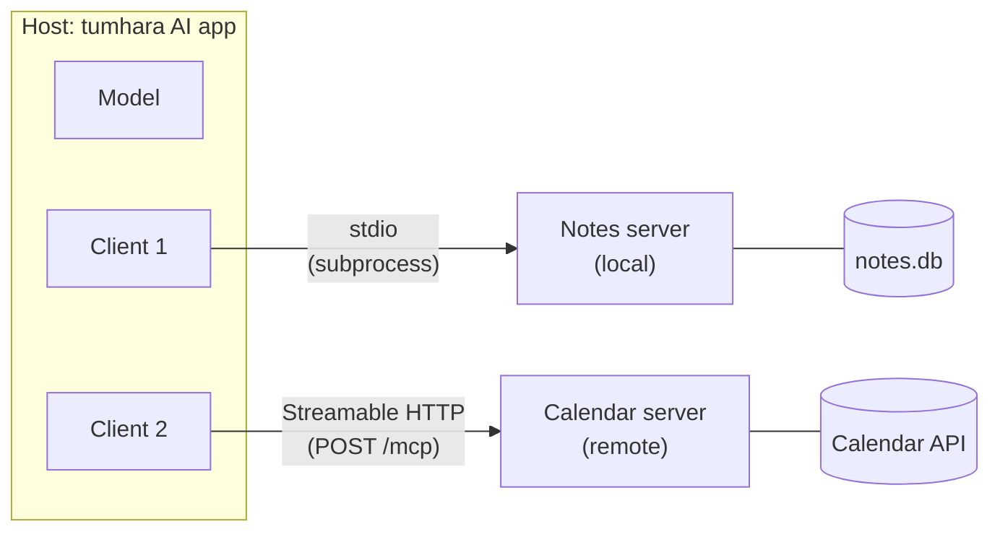
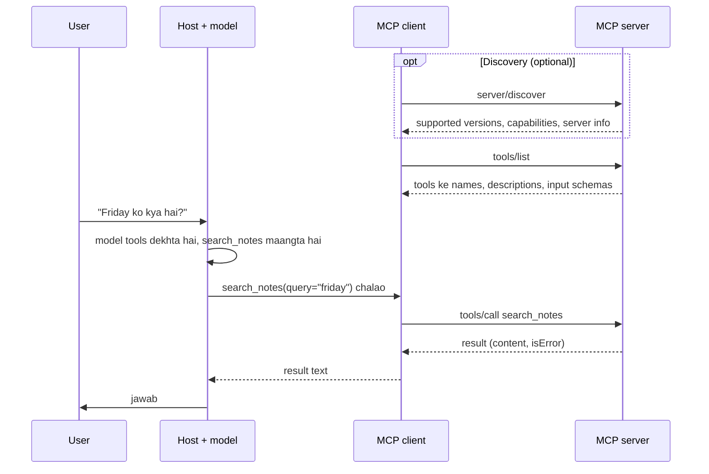

🏠 [Home](../../README.md) › [04 · Model Context Protocol (MCP)](./README.md) › 4.2 Hosts, clients aur servers

# 4.2 Hosts, clients aur servers

> **Level:** 🟢 Beginner · **Padhne ka time:** ~8 min · **Pehle padho:** [4.1 MCP kyun bana?](./04.1-why-mcp-exists.md)

**Ek line mein:** MCP **host** woh AI app hai jo har connection ke liye ek **client** chalata hai. Har client bilkul ek **server** se baat karta hai, JSON-RPC messages bhej ke, ya toh stdio (local subprocess) par ya Streamable HTTP (remote endpoint) par.

📑 **Is page par**

- [Yeh kyun zaroori hai?](#-yeh-kyun-zaroori-hai)
- [Idea, simple words mein](#-idea-simple-words-mein)
- [Diagram se samjho](#-diagram-se-samjho)
- [Kaise kaam karta hai, step by step](#-kaise-kaam-karta-hai-step-by-step)
- [Example se samjho](#-example-se-samjho)
- [Code](#-code)
- [Aam galtiyan aur dhyan dene wali baatein](#-aam-galtiyan-aur-dhyan-dene-wali-baatein)
- [Yaad rakhne wali baatein](#-yaad-rakhne-wali-baatein)
- [Khud try karo](#-khud-try-karo)
- [Aur padhne ke liye](#-aur-padhne-ke-liye)

## 🤔 Yeh kyun zaroori hai?

Tumne apne app ke config mein ek [MCP](../../GLOSSARY.md#model-context-protocol-mcp) server add kiya, restart kiya, aur uske [tools](../../GLOSSARY.md#tool) dikh hi nahi rahe. Kya server crash ho raha hai? Kya app usse baat bhi kar raha hai? Kya dono protocol version par agree nahi hue? In sawalon ka jawab tabhi de paoge jab pata ho ki kaun kisko kya bhejta hai.

Roles se yeh bhi pata chalta hai ki trust boundaries kahan hain. Server tumhari poori conversation kabhi nahi dekhta. Host decide karta hai ki har server ko kya milega. Yeh baat [4.6](./04.6-mcp-security.md) mein bahut kaam aayegi.

## 🧠 Idea, simple words mein

Ek travel agency ka office socho, jaise mohalle wala travel agent jo train, flight aur hotel sab book karta hai.

- **Office** hai **[host](../../GLOSSARY.md#mcp-host)**: woh AI app jismein user kaam karta hai, jaise desktop chat app, IDE, ya tumhara likha hua [agent](../../GLOSSARY.md#agent). Yeh user aur model dono se baat karta hai, aur decide karta hai ki kya allowed hai.
- Jis bhi supplier ke saath office kaam karta hai, uske liye ek **alag phone line** rakhta hai, apne notes ke saath. Woh line hai **[MCP client](../../GLOSSARY.md#mcp-client)**: host ke andar ek connector jo bilkul ek server se baat karta hai.
- Har **supplier** (airline, hotel chain) ek **[MCP server](../../GLOSSARY.md#mcp-server)** hai: ek program jo ek system ke tools aur data offer karta hai.

Suppliers ek dusre ki calls kabhi nahi sunte. Customer ki poori file bhi kabhi nahi dekhte. Office har ek ko sirf utna batata hai jitna usse chahiye.

Phone line physically kaise judi hai, woh hai **transport**. MCP do standard transports define karta hai:

- **[stdio](../../GLOSSARY.md#stdio-transport)**: host server ko ek local subprocess ki tarah start karta hai. Dono uske standard input aur output se messages exchange karte hain. Simple hai, aur sirf tumhari machine tak private hai.
- **[Streamable HTTP](../../GLOSSARY.md#streamable-http)**: server apne aap alag chalta hai, aksar remote. Client har message ko ek endpoint par HTTP POST ki tarah bhejta hai, jaise `https://example.com/mcp`.

## 👀 Diagram se samjho



*Ek host, do clients, do servers. Har client bilkul ek server ke saath paired hai. Model host ke andar baitha hai aur kabhi seedha server se connect nahi hota.*

Aur yeh raha ek tool call, shuru se end tak:



*Client ki har request apna protocol version aur capabilities saath le ke chalti hai. Model ka decision host ke andar hota hai. Server ko sirf woh `tools/call` dikhta hai jo usse chalane ko kaha gaya.*

## 🔍 Kaise kaam karta hai, step by step

**1. Host har server ke liye ek client banata hai.** Woh apni configuration padhta hai (launch karne ki command, ya ek URL). Phir har server ke liye ek client start karta hai aur unhe alag-alag rakhta hai. Host user consent enforce karta hai aur decide karta hai ki kaun sa server kya dekhega.

**2. Har message [JSON-RPC](../../GLOSSARY.md#json-rpc) 2.0 hai.** Request mein ek `id`, ek `method` (jaise `tools/list`), aur `params` hote hain. Response mein wahi `id` hota hai, aur ya toh `result` ya `error`. MCP isse *data layer* kehta hai. Bytes kaise travel karte hain, woh *transport layer* hai.

**3. Har request apne aap mein complete hai.** Revision 2026-07-28 se MCP [stateless](../../GLOSSARY.md#stateless) hai. Har request apne `_meta` field mein protocol version (`io.modelcontextprotocol/protocolVersion`), client ki capabilities, aur aam taur par client ka naam le ke chalti hai. Agar server maange gaye version ko support nahi karta, toh woh `UnsupportedProtocolVersionError` bhejta hai, jismein uske supported versions ki list hoti hai.

Socho chai ki tapri par har order ki parchi par poori detail likhi ho: "2 cutting, kam cheeni, table 4". Chaiwale ko pichli parchi yaad rakhne ki zaroorat nahi. Stateless request bhi aisi hi hai.

**4. Discovery optional hai, lekin kaam ki hai.** Servers ko `server/discover` ka jawab dena hi padta hai: apne supported versions, capabilities (jaise "mere paas tools aur resources hain") aur identity. Clients chahein toh pehle isse call karein, ya seedha requests bhejein aur version error aane par handle karein.

**5. Phir asli kaam.** `tools/list`, `tools/call`, `resources/read`, `prompts/get` waghera. [4.3](./04.3-tools-resources-and-prompts.md) har ek ko cover karta hai.

**6. Transport ki details.**

| | stdio | Streamable HTTP |
| --- | --- | --- |
| Server kaun start karta hai | Host, subprocess ki tarah | Koi aur; woh apne aap chalta hai |
| Kahan chalta hai | Tumhari machine par | Kahin bhi: localhost ya internet |
| Messages kaise travel karte hain | stdin/stdout par har line mein ek JSON-RPC message | Har message ek endpoint par HTTP POST hai; reply JSON hota hai, ya us request ke liye ek SSE stream |
| Logging | Server logs stderr par likhta hai, stdout par **kabhi nahi** | Normal server logs |
| Authentication | Credentials environment se (spec kehti hai stdio servers ko uska OAuth flow use nahi karna chahiye) | OAuth 2.1-based authorization, spec mein defined |
| Typical use | Local tools: files, git, local database | Shared ya hosted services |

Ek purana transport, 2024-11-05 revision wala HTTP+SSE, deprecated hai. Kuch bhi naya banao toh Streamable HTTP use karo.

**7. Purane servers ab bhi chalte hain.** 2025-11-25 tak ke revisions har connection `initialize` handshake se shuru karte the aur ek session rakhte the. Revision 2026-07-28 ne dono hata diye. Jo clients dono tarah ke servers se baat karna chahte hain, woh pehle `server/discover` se check karte hain, aur zaroorat ho toh `initialize` par fall back karte hain. Python SDK ka `Client` yeh by default tumhare liye kar deta hai.

## 💡 Example se samjho

Yeh rahe main messages jab ek client [4.4](./04.4-build-a-simple-mcp-server.md) wala notes server use karta hai. Yeh specification ke shapes follow karte hain; lambe fields chhote kar diye gaye hain.

**Discovery.** Client poochta hai ki server kaun hai:

```json
{"jsonrpc": "2.0", "id": 1, "method": "server/discover",
 "params": {"_meta": {"io.modelcontextprotocol/protocolVersion": "2026-07-28",
                      "io.modelcontextprotocol/clientInfo": {"name": "my-agent", "version": "0.1.0"},
                      "io.modelcontextprotocol/clientCapabilities": {}}}}
```

```json
{"jsonrpc": "2.0", "id": 1,
 "result": {"resultType": "complete", "supportedVersions": ["2026-07-28"],
            "capabilities": {"tools": {"listChanged": true}, "prompts": {"listChanged": true},
                             "resources": {"subscribe": true, "listChanged": true}},
            "instructions": "Personal notes. Search before you add, so you don't create duplicates.",
            "_meta": {"io.modelcontextprotocol/serverInfo": {"name": "notes", "version": "1.0.0"}}}}
```

**Tool call karna.** Baad mein model search maangta hai, aur client usse forward karta hai:

```json
{"jsonrpc": "2.0", "id": 3, "method": "tools/call",
 "params": {"name": "search_notes", "arguments": {"query": "friday"},
            "_meta": {"io.modelcontextprotocol/protocolVersion": "2026-07-28", "...": "..."}}}
```

```json
{"jsonrpc": "2.0", "id": 3,
 "result": {"resultType": "complete", "isError": false,
            "content": [{"type": "text", "text": "trip: Train to Lyon on Friday at 09:12, platform 4."}],
            "structuredContent": {"result": ["trip: Train to Lyon on Friday at 09:12, platform 4."]}}}
```

Python SDK yeh sab chhupa leta hai. stdio par connect karo ya HTTP par, output same aata hai:

```text
2026-07-28 notes
['search_notes', 'add_note']
trip: Train to Lyon on Friday at 09:12, platform 4.
```

## 💻 Code

Official Python SDK (`mcp==2.3.0`) ke saath ek client. Wahi `Client` class stdio launch command, ek URL, ya (tests mein) ek server object le leti hai:

```python
import asyncio
import sys

from mcp import Client, StdioServerParameters


async def main() -> None:
    # stdio: client server ko subprocess ki tarah launch karta hai aur uske stdin/stdout par baat karta hai
    local = StdioServerParameters(command=sys.executable, args=["notes_server.py"])

    # Streamable HTTP: server pehle se kahin chal raha hai, jaise is tarah start kiya gaya ho
    #   mcp.run(transport="streamable-http")   -> http://127.0.0.1:8000/mcp
    remote = "http://127.0.0.1:8000/mcp"

    async with Client(local) as client:  # HTTP ke liye `remote` daal do; baaki kuch nahi badalta
        print(client.protocol_version, client.server_info.name)  # discovery pehle hi ho chuki hai
        tools = (await client.list_tools()).tools
        print([t.name for t in tools])
        result = await client.call_tool("search_notes", {"query": "lyon"})
        print(result.content[0].text)


asyncio.run(main())
```

Isse us folder se chalao jismein `notes_server.py` hai ([4.4](./04.4-build-a-simple-mcp-server.md) wala server), taaki woh mil jaaye. `Client` ka default `mode="auto"` hai: yeh `server/discover` try karta hai, aur 2026 se pehle wale servers ke liye purane `initialize` handshake par fall back karta hai.

## 🚨 Aam galtiyan aur dhyan dene wali baatein

- **stdio server mein stdout par print karna.** stdout ki har line ek MCP message honi chahiye. Ek bhatka hua `print()` kam se kam parse errors deta hai, aur bura ho toh poora stream corrupt kar deta hai. Logs stderr par likho.
- **Yeh sochna ki server conversation dekhta hai.** Woh sirf wahi requests dekhta hai jo client usse bhejta hai, aur yeh design se hai. Agar tool ko context chahiye, toh usse tool ke arguments mein daalo.
- **Local HTTP server ko network par khol dena.** `0.0.0.0` nahi, `127.0.0.1` par bind karo, aur `Origin` header validate karo. Web pages se hone wale DNS rebinding attacks rokne ke liye spec yeh check zaroori batati hai. Python SDK localhost ke liye yeh protection apne aap on kar deta hai.
- **Session expect karna.** Current revision mein koi protocol-level session ya `Mcp-Session-Id` header nahi hai. Agar server ko calls ke beech state chahiye, toh woh ek explicit handle deta hai (jaise `cart_id`), jo model tool argument ki tarah wapas bhejta hai.
- **2025 ka tutorial line by line follow karna.** 2026 se pehle ke guides `initialize` se shuru hote hain; current servers shayad uska jawab na dein. Aisa SDK use karo jo negotiation tumhare liye kar de.

## ✅ Yaad rakhne wali baatein

- Host = AI app. Client = uske andar ek connection. Server = ek system ke around wrapper.
- Ek client bilkul ek server se baat karta hai; host unhe coordinate karta hai aur consent enforce karta hai.
- Messages JSON-RPC 2.0 hain, aur har request apna protocol version aur capabilities saath le ke chalti hai.
- Local subprocesses ke liye stdio, independent ya remote servers ke liye Streamable HTTP.
- 2026-07-28 se koi `initialize` handshake ya session nahi hai; `server/discover` optional discovery hai.

## 🧪 Khud try karo

1. [4.4](./04.4-build-a-simple-mcp-server.md) wale `notes_server.py` mein `build_server()` ke top par `print("hello")` add karo, phir upar wala client usse stdio par chalao. Kya hota hai, aur kyun?
2. Tumhari team 40 developers ke liye ek shared GitHub MCP server chahti hai. stdio ya Streamable HTTP? Kyun?

<details>
<summary>Answer dekho</summary>

1. Client ko ek aisi line milti hai jo JSON-RPC nahi hai, aur woh parse error report karta hai (`Invalid JSON ... input_value='hello'`). Python SDK ka client isse log karta hai, line skip karta hai aur aage badh jaata hai. Lekin tum har host se itni maafi ki ummeed nahi kar sakte. Aur agar faltu output kisi message ke beech mein aa gaya, toh woh message corrupt ho jaayega. Spec saaf kehti hai: stdio server stdout par aisa kuch nahi likh sakta jo MCP message na ho. Iski jagah `print("hello", file=sys.stderr)` use karo. (In-process `Client(server)` connection, jaise 4.4 ke tests mein, par koi asar nahi padta, kyunki wahan stdout involved hi nahi hai.)
2. Streamable HTTP. Ek server process central jagah chalta hai, ek hi jagah patch hota hai, aur protocol ka OAuth-based authorization use karta hai. Isliye har developer ko local config file mein apna GitHub token nahi rakhna padta. stdio ka matlab hoga 40 laptops par server ki 40 copies chalna.

</details>

## 📚 Aur padhne ke liye

- [Architecture overview](https://modelcontextprotocol.io/docs/2026-07-28/learn/architecture) (modelcontextprotocol.io). Participants, layers, aur message-by-message ek poora example.
- [Specification: Architecture](https://modelcontextprotocol.io/specification/2026-07-28/architecture) (revision 2026-07-28). Official roles aur design principles.
- [Specification: Transports](https://modelcontextprotocol.io/specification/2026-07-28/basic/transports): [stdio](https://modelcontextprotocol.io/specification/2026-07-28/basic/transports/stdio) aur [Streamable HTTP](https://modelcontextprotocol.io/specification/2026-07-28/basic/transports/streamable-http).
- [Key changes in 2026-07-28](https://modelcontextprotocol.io/specification/2026-07-28/changelog). 2025-11-25 se kya badla: na handshake, na sessions, aur `server/discover`.
- [JSON-RPC 2.0 specification](https://www.jsonrpc.org/specification). Neeche chalne wala message format.

<!-- FOOTER -->

---

⬅️ **Pichla:** [4.1 MCP kyun bana?](./04.1-why-mcp-exists.md) ·
🏠 [Chapter home](./README.md) ·
➡️ **Agla:** [4.3 Tools, resources aur prompts](./04.3-tools-resources-and-prompts.md)
