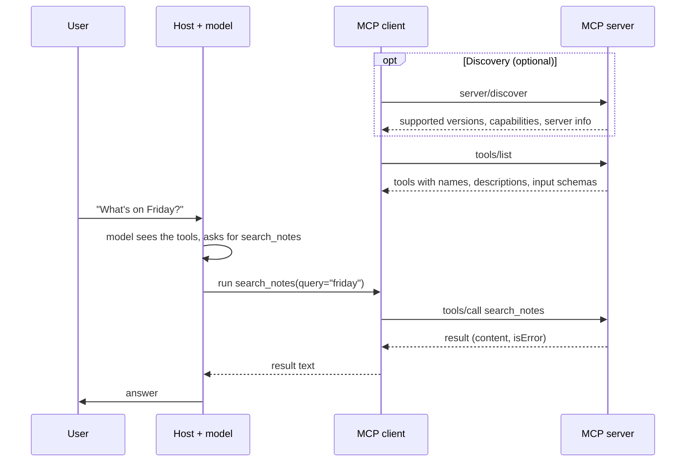

🏠 [Home](../../README.md) › [04 · Model Context Protocol (MCP)](./README.md) › 4.2 Hosts, clients and servers

# 4.2 Hosts, clients and servers

> **Difficulty:** 🟢 Beginner · **Reading time:** ~8 min · **Prerequisites:** [4.1 Why MCP exists](./04.1-why-mcp-exists.md)

**In one sentence:** An MCP **host** is the AI app, it runs one **client** per connection, and each client talks to exactly one **server** by sending JSON-RPC messages over stdio (a local subprocess) or Streamable HTTP (a remote endpoint).

📑 **On this page**

- [Why does this matter?](#-why-does-this-matter)
- [The idea, in plain words](#-the-idea-in-plain-words)
- [Picture it](#-picture-it)
- [How it works, step by step](#-how-it-works-step-by-step)
- [Worked example](#-worked-example)
- [Code](#-code)
- [Common mistakes & gotchas](#-common-mistakes--gotchas)
- [Key takeaways](#-key-takeaways)
- [Try it yourself](#-try-it-yourself)
- [Further reading](#-further-reading)

## 🤔 Why does this matter?

You add an [MCP](../../GLOSSARY.md#model-context-protocol-mcp) server to your app's config, restart, and its [tools](../../GLOSSARY.md#tool) don't appear. Is the server crashing? Is the app talking to it at all? Did they disagree on a protocol version? You can only answer those questions if you know who sends what to whom.

The roles also tell you where the trust boundaries are. The server never sees your whole conversation; the host decides what each server gets. That matters a lot in [4.6](./04.6-mcp-security.md).

## 🧠 The idea, in plain words

Picture a travel agency office.

- The **office** is the **[host](../../GLOSSARY.md#mcp-host)**: the AI app the user works in, such as a desktop chat app, an IDE, or the [agent](../../GLOSSARY.md#agent) you write. It talks to the user and the model, and it decides what is allowed.
- For each supplier it works with, the office keeps a **dedicated phone line** with its own notes. That line is an **[MCP client](../../GLOSSARY.md#mcp-client)**: a connector inside the host that talks to exactly one server.
- Each **supplier** (the airline, the hotel chain) is an **[MCP server](../../GLOSSARY.md#mcp-server)**: a program that offers tools and data from one system.

Suppliers never hear each other's calls, and they never see the customer's full file. The office passes on only what each one needs.

How the phone line is physically connected is the **transport**. MCP defines two standard ones:

- **[stdio](../../GLOSSARY.md#stdio-transport)**: the host starts the server as a local subprocess and they exchange messages through its standard input and output. Simple and private to your machine.
- **[Streamable HTTP](../../GLOSSARY.md#streamable-http)**: the server runs independently, often remotely, and the client sends each message as an HTTP POST to one endpoint, such as `https://example.com/mcp`.

## 👀 Picture it


*One host, two clients, two servers. Each client is paired with exactly one server. The model sits inside the host and never connects to a server directly.*

And here is one tool call from start to finish:



*Every request from the client carries its own protocol version and capabilities. The model's decision happens inside the host; the server only sees the `tools/call` it is asked to run.*

## 🔍 How it works, step by step

**1. The host creates a client per server.** It reads its configuration (a command to launch, or a URL), starts one client for each server, and keeps them separate. The host enforces user consent and decides which server sees what.

**2. Every message is [JSON-RPC](../../GLOSSARY.md#json-rpc) 2.0.** A request has an `id`, a `method` such as `tools/list`, and `params`. A response carries the same `id` and either a `result` or an `error`. MCP calls this the *data layer*. How the bytes travel is the *transport layer*.

**3. Each request is self-contained.** Since revision 2026-07-28, MCP is [stateless](../../GLOSSARY.md#stateless). Every request carries, in its `_meta` field, the protocol version (`io.modelcontextprotocol/protocolVersion`), the client's capabilities and, usually, the client's name. A server that doesn't support the requested version replies with an `UnsupportedProtocolVersionError` listing the versions it does support.

**4. Discovery is optional but useful.** Servers must answer `server/discover` with their supported versions, capabilities (for example "I have tools and resources") and identity. Clients may call it first, or simply send requests and handle a version error.

**5. Then the real work.** `tools/list`, `tools/call`, `resources/read`, `prompts/get` and so on. [4.3](./04.3-tools-resources-and-prompts.md) covers each.

**6. Transport details.**

| | stdio | Streamable HTTP |
| --- | --- | --- |
| Who starts the server | The host, as a subprocess | Someone else; it runs on its own |
| Where it runs | Your machine | Anywhere: localhost or the internet |
| How messages travel | One JSON-RPC message per line on stdin/stdout | Each message is an HTTP POST to one endpoint; the reply is JSON, or an SSE stream for that request |
| Logging | Server writes logs to stderr, **never** to stdout | Normal server logs |
| Authentication | Credentials from the environment (the spec says stdio servers should not use its OAuth flow) | OAuth 2.1-based authorization, defined in the spec |
| Typical use | Local tools: files, git, a local database | Shared or hosted services |

An older transport, HTTP+SSE from the 2024-11-05 revision, is deprecated. Use Streamable HTTP for anything new.

**7. Older servers still work.** Revisions up to 2025-11-25 started every connection with an `initialize` handshake and kept a session. Revision 2026-07-28 removed both. Clients that want to talk to both kinds probe with `server/discover` and fall back to `initialize` if needed. The Python SDK's `Client` does this for you by default.

## 💡 Worked example

Here are the main messages when a client uses the notes server from [4.4](./04.4-build-a-simple-mcp-server.md). They follow the shapes in the specification; long fields are shortened.

**Discovery.** The client asks who the server is:

```json
{"jsonrpc": "2.0", "id": 1, "method": "server/discover",
 "params": {"_meta": {"io.modelcontextprotocol/protocolVersion": "2026-07-28",
                      "io.modelcontextprotocol/clientInfo": {"name": "my-agent", "version": "0.1.0"},
                      "io.modelcontextprotocol/clientCapabilities": {}}}}
```

```json
{"jsonrpc": "2.0", "id": 1,
 "result": {"resultType": "complete", "supportedVersions": ["2026-07-28"],
            "capabilities": {"tools": {"listChanged": true}, "prompts": {"listChanged": true},
                             "resources": {"subscribe": true, "listChanged": true}},
            "instructions": "Personal notes. Search before you add, so you don't create duplicates.",
            "_meta": {"io.modelcontextprotocol/serverInfo": {"name": "notes", "version": "1.0.0"}}}}
```

**Calling a tool.** Later, the model asks to search, and the client forwards it:

```json
{"jsonrpc": "2.0", "id": 3, "method": "tools/call",
 "params": {"name": "search_notes", "arguments": {"query": "friday"},
            "_meta": {"io.modelcontextprotocol/protocolVersion": "2026-07-28", "...": "..."}}}
```

```json
{"jsonrpc": "2.0", "id": 3,
 "result": {"resultType": "complete", "isError": false,
            "content": [{"type": "text", "text": "trip: Train to Lyon on Friday at 09:12, platform 4."}],
            "structuredContent": {"result": ["trip: Train to Lyon on Friday at 09:12, platform 4."]}}}
```

The Python SDK hides all of this. Connecting over stdio and over HTTP prints the same thing:

```text
2026-07-28 notes
['search_notes', 'add_note']
trip: Train to Lyon on Friday at 09:12, platform 4.
```

## 💻 Code

A client with the official Python SDK (`mcp==2.3.0`). The same `Client` class takes a stdio launch command, a URL, or (in tests) a server object:

```python
import asyncio
import sys

from mcp import Client, StdioServerParameters


async def main() -> None:
    # stdio: the client launches the server as a subprocess and talks over its stdin/stdout
    local = StdioServerParameters(command=sys.executable, args=["notes_server.py"])

    # Streamable HTTP: the server is already running somewhere, e.g. started with
    #   mcp.run(transport="streamable-http")   -> http://127.0.0.1:8000/mcp
    remote = "http://127.0.0.1:8000/mcp"

    async with Client(local) as client:  # swap in `remote` to use HTTP; nothing else changes
        print(client.protocol_version, client.server_info.name)  # discovery already happened
        tools = (await client.list_tools()).tools
        print([t.name for t in tools])
        result = await client.call_tool("search_notes", {"query": "lyon"})
        print(result.content[0].text)


asyncio.run(main())
```

Run it from the folder that holds `notes_server.py` (the server from [4.4](./04.4-build-a-simple-mcp-server.md)) so it is found. `Client` defaults to `mode="auto"`: it tries `server/discover` and falls back to the older `initialize` handshake for pre-2026 servers.

## 🚨 Common mistakes & gotchas

- **Printing to stdout in a stdio server.** Every line on stdout must be an MCP message. A stray `print()` produces parse errors at best and a corrupted stream at worst. Log to stderr.
- **Thinking the server sees the conversation.** It sees only the requests the client sends it, by design. If a tool needs context, put it in the tool's arguments.
- **Exposing a local HTTP server to the network.** Bind to `127.0.0.1`, not `0.0.0.0`, and validate the `Origin` header; the spec requires this check to stop DNS rebinding attacks from web pages. The Python SDK turns on this protection automatically for localhost.
- **Expecting a session.** The current revision has no protocol-level session or `Mcp-Session-Id` header. If a server needs state across calls, it hands out an explicit handle (such as a `cart_id`) that the model passes back as a tool argument.
- **Following a 2025 tutorial line by line.** Pre-2026 guides start with `initialize`; current servers may not answer it. Use an SDK that negotiates for you.

## ✅ Key takeaways

- Host = the AI app. Client = one connection inside it. Server = a wrapper around one system.
- One client talks to exactly one server; the host coordinates them and enforces consent.
- Messages are JSON-RPC 2.0, and every request carries its protocol version and capabilities.
- stdio for local subprocesses, Streamable HTTP for independent or remote servers.
- Since 2026-07-28 there is no `initialize` handshake or session; `server/discover` is optional discovery.

## 🧪 Try it yourself

1. Add a `print("hello")` at the top of `build_server()` in the `notes_server.py` from [4.4](./04.4-build-a-simple-mcp-server.md), then run the client above against it over stdio. What happens, and why?
2. Your team wants one shared GitHub MCP server for 40 developers. stdio or Streamable HTTP? Why?

<details>
<summary>Show answer</summary>

1. The client receives a line that is not JSON-RPC and reports a parse error (`Invalid JSON ... input_value='hello'`). The Python SDK's client logs it, skips the line and carries on, but you can't count on every host being that forgiving, and stray output in the middle of a message would corrupt it. The spec is clear: a stdio server must not write anything to stdout that is not an MCP message. Use `print("hello", file=sys.stderr)` instead. (An in-process `Client(server)` connection, as in 4.4's tests, is unaffected, because no stdout is involved.)
2. Streamable HTTP. One server process runs centrally, is patched in one place, and uses the protocol's OAuth-based authorization, so developers don't each keep a GitHub token in a local config file. stdio would mean 40 copies of the server running on 40 laptops.

</details>

## 📚 Further reading

- [Architecture overview](https://modelcontextprotocol.io/docs/2026-07-28/learn/architecture) (modelcontextprotocol.io). Participants, layers and a full message-by-message example.
- [Specification: Architecture](https://modelcontextprotocol.io/specification/2026-07-28/architecture) (revision 2026-07-28). The normative roles and design principles.
- [Specification: Transports](https://modelcontextprotocol.io/specification/2026-07-28/basic/transports): [stdio](https://modelcontextprotocol.io/specification/2026-07-28/basic/transports/stdio) and [Streamable HTTP](https://modelcontextprotocol.io/specification/2026-07-28/basic/transports/streamable-http).
- [Key changes in 2026-07-28](https://modelcontextprotocol.io/specification/2026-07-28/changelog). What changed from 2025-11-25: no handshake, no sessions, `server/discover`.
- [JSON-RPC 2.0 specification](https://www.jsonrpc.org/specification). The message format underneath.

<!-- FOOTER -->

---

⬅️ **Previous:** [4.1 Why MCP exists](./04.1-why-mcp-exists.md) ·
🏠 [Chapter home](./README.md) ·
➡️ **Next:** [4.3 Tools, resources and prompts](./04.3-tools-resources-and-prompts.md)
