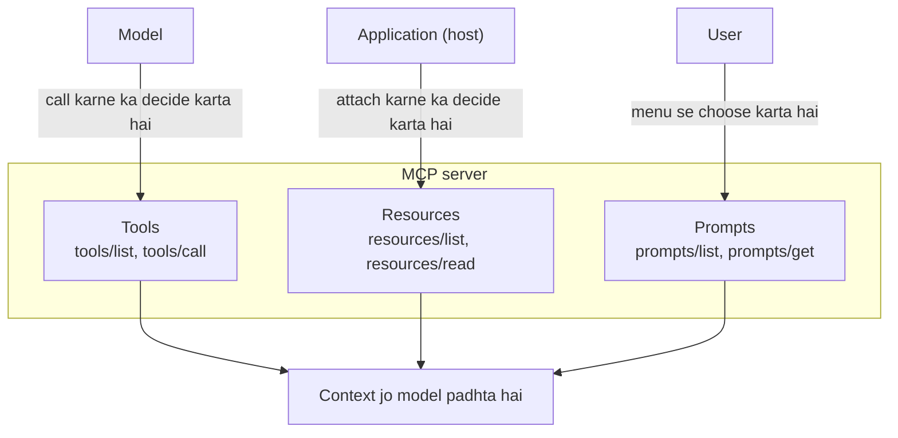

🏠 [Home](../../README.md) › [04 · Model Context Protocol (MCP)](./README.md) › 4.3 Tools, resources aur prompts

# 4.3 Tools, resources aur prompts

> **Level:** 🟡 Intermediate · **Padhne ka time:** ~10 min · **Pehle padho:** [4.2 Hosts, clients aur servers](./04.2-hosts-clients-and-servers.md), [3.2 Tool definitions ke liye JSON Schema](../03-tools-and-function-calling/03.2-json-schema-for-tools.md)

**Ek line mein:** MCP server teen tarah ki cheezein offer kar sakta hai, aur farak sirf itna hai ki kaun decide karta hai ki kab kya use hoga: **tools** model choose karta hai, **resources** application, aur **prompts** user.

📑 **Is page par**

- [Yeh kyun zaroori hai?](#-yeh-kyun-zaroori-hai)
- [Idea, simple words mein](#-idea-simple-words-mein)
- [Diagram se samjho](#-diagram-se-samjho)
- [Kaise kaam karta hai, step by step](#-kaise-kaam-karta-hai-step-by-step)
- [Example se samjho](#-example-se-samjho)
- [Code](#-code)
- [Aam galtiyan aur dhyan dene wali baatein](#-aam-galtiyan-aur-dhyan-dene-wali-baatein)
- [Yaad rakhne wali baatein](#-yaad-rakhne-wali-baatein)
- [Khud try karo](#-khud-try-karo)
- [Aur padhne ke liye](#-aur-padhne-ke-liye)

## 🤔 Yeh kyun zaroori hai?

Tum apni team ki wiki ke liye ek [MCP server](../../GLOSSARY.md#mcp-server) bana rahe ho. "Wiki page padho" ek [tool](../../GLOSSARY.md#tool) hona chahiye jo model call kare, ya kuch aur? Aur "team ki coding guidelines" ka kya, jo har request ko dikhni chahiye? Ya "hamari house style mein release note likho"?

Agar sab kuch tool bana diya, toh model ko guess karna padega ki guidelines kab laani hain. Aur aksar woh nahi laayega. Agar sab kuch [system prompt](../../GLOSSARY.md#system-prompt) mein daal diya, toh un pages par [tokens](../../GLOSSARY.md#token) waste honge jinke baare mein kisi ne poocha hi nahi. [MCP](../../GLOSSARY.md#model-context-protocol-mcp) tumhe teen alag building blocks deta hai, taaki context ka har piece sahi raaste se pahunche.

## 🧠 Idea, simple words mein

Ek achhe se chalne wale restaurant ki kitchen socho.

- **Tools** appliances hain. Chef (model) recipe ke beech mein decide karta hai ki ab mixer chalana hai. Har baar koi permission nahi maangta; yeh cooking ka hissa hai.
- **Resources** pantry ka saaman hain. Kitchen manager (application) decide karta hai ki cooking shuru hone se pehle counter par kya rakha jaayega.
- **Prompts** fixed menu hain, jaise thali. Customer (user) "special thali" choose karta hai, aur us choice ke saath ek poora taiyaar plan aa jaata hai.

MCP specification isi split ko *control hierarchy* kehti hai:

| Primitive | Kaun control karta hai | Yeh kya hai | Typical example |
| --- | --- | --- | --- |
| **Tool** | **Model** | Ek function jise model kuch karne ya information laane ke liye call kar sakta hai | `search_notes`, `create_issue`, `send_email` |
| **[Resource](../../GLOSSARY.md#mcp-resource)** | **Application** | URI wala read-only data, jise host context ki tarah attach karta hai | Ek file, database schema, `notes://index` |
| **[Prompt](../../GLOSSARY.md#mcp-prompt)** | **User** | Ek reusable message template, aksar slash command | `/weekly_review`, `/explain_error` |

"Control" ka matlab hai *kaun decide karta hai ki kab use hoga*, yeh nahi ki kisne likha. Teeno server hi likhta hai.

## 👀 Diagram se samjho



*Ek hi [context window](../../GLOSSARY.md#context-window) mein jaane ke teen darwaze. Data ke har piece ke liye yeh sawal poochho: yeh darwaza kise kholna chahiye?*

## 🔍 Kaise kaam karta hai, step by step

### Tools

1. Client `tools/list` call karta hai. Har tool ka ek `name`, ek `description`, ek `inputSchema` (JSON Schema, jaise [3.2](../03-tools-and-function-calling/03.2-json-schema-for-tools.md) mein) hota hai, aur optional `title`, `outputSchema` aur `annotations`.
2. [Host](../../GLOSSARY.md#mcp-host) yeh definitions model ko normal tools ki tarah deta hai. Jab model kisi ko maangta hai, client name aur arguments ke saath `tools/call` bhejta hai.
3. Result mein `content` hota hai (blocks ki list: text, image, audio, resources ke links, ya embedded resources), optional `structuredContent` (JSON jo `outputSchema` se match kare) aur `isError`.
4. **Do tarah ki failure.** *Protocol error* (unknown tool, galat bani request) [JSON-RPC](../../GLOSSARY.md#json-rpc) error ki tarah wapas aata hai. *Tool execution error* (galat date, API down) ek normal result ki tarah aata hai, `isError: true` aur ek message ke saath jise model padh ke fix kar sake. Spec kehti hai ki clients ko execution errors model tak pahunchane chahiye taaki woh khud ko correct kar sake; [3.3](../03-tools-and-function-calling/03.3-how-function-calling-works.md) yaad karo.
5. **Annotations** host ke liye hints hain: `readOnlyHint`, `destructiveHint`, `idempotentHint` aur `openWorldHint`. Host read-only tools ke liye confirmation dialog skip kar sakta hai. Spec warn karti hai ki jab tak server trusted na ho, clients ko annotations untrusted maanne chahiye. Ek malicious server delete tool par bhi "read-only" label laga sakta hai.

### Resources

1. Har resource ka ek URI hota hai, jaise `file:///repo/README.md` ya custom scheme jaise `notes://index`. Saath mein ek name, optional description aur ek MIME type.
2. `resources/list` fixed resources deta hai. `resources/templates/list` placeholders wale **templates** deta hai, jaise `notes://{title}`, URI template syntax (RFC 6570) use karke.
3. `resources/read` contents deta hai: text, ya base64-encoded binary.
4. Host decide karta hai ki inka kya karna hai: ek file picker jo user browse kare, project ka README apne aap include karna, ya model ko choose karne dena. Clients yeh bhi keh sakte hain ki resource badle toh unhe bataya jaaye, ek `subscriptions/listen` stream ke through.

### Prompts

1. `prompts/list` har prompt ka name, description aur arguments deta hai.
2. Argument values ke saath `prompts/get` **messages** ki list deta hai (role plus content), jo seedha conversation mein daalne ke liye ready hain.
3. Hosts inhe aam taur par slash commands ya menu items ki tarah dikhate hain. User ek choose karta hai; model kabhi khud se prompt trigger nahi karta.

### Server client se kya maang sakta hai

Spec server ko yeh bhi allow karti hai ki request ke beech mein host se kuch maange. **Elicitation** user se extra input maangta hai, jaise "kaun sa account?". 2026-07-28 revision mein server ek "input required" result return karta hai, aur client jawab ke saath request dobara bhejta hai. Do purane client features, **sampling** (server host ke model se text generate karwata hai) aur **roots** (host server ko batata hai ki woh kaun se folders use kar sakta hai), us revision mein deprecated hain. Naye servers ko in par depend nahi karna chahiye.

## 💡 Example se samjho

[4.4](./04.4-build-a-simple-mcp-server.md) wala notes server teeno mein se ek-ek offer karta hai. Jo client sab kuch list karta hai, usse yeh dikhta hai (real output):

```text
TOOLS (the model decides when to call these)
  search_notes  [read-only]: Search notes by keyword. Returns every note that contains all the words, as 'title: text'.
  add_note: Save a note under a short title. Saving under an existing title replaces that note.

RESOURCES (the application decides what to attach)
  notes://index  A list of every note title.
  notes://{title}  The full text of one note.  (template)

PROMPTS (the user picks these, e.g. as a slash command)
  /weekly_review(focus): Review all notes and suggest what to do this week.
```

Ab notes wale assistant ke saath ek din ke teen moments dekho:

| Moment | Kaun act karta hai | MCP request | Context mein kya aata hai |
| --- | --- | --- | --- |
| User poochta hai "What's on Friday?" | **Model** decide karta hai ki usse data chahiye | `tools/call search_notes {"query": "friday"}` | `trip: Train to Lyon on Friday at 09:12, platform 4.` |
| User "trip" ke baare mein chat kholta hai | **App** woh note attach karta hai jo khula hai | `resources/read notes://trip` | Note ka poora text, model ke kuch bolne se pehle |
| User `/weekly_review travel` type karta hai | **User** ek prompt choose karta hai | `prompts/get weekly_review {"focus": "travel"}` | Ek user message jismein har note ki list hai, aur end mein *"Give me a short plan for this week. Focus on travel."* |

Aur jab model kuch galat karta hai, toh error data ki tarah wapas aata hai, crash ki tarah nahi:

```text
tools/call add_note (bad input) -> is_error=True: Error executing tool add_note: title must not be empty
```

## 💻 Code

Python SDK ke high-level server `MCPServer` ke saath teeno primitives. Type hints JSON Schema ban jaate hain; docstrings descriptions ban jaate hain.

```python
from typing import Annotated

from mcp.server.mcpserver import MCPServer
from mcp.server.mcpserver.exceptions import ToolError
from mcp.types import ToolAnnotations
from pydantic import Field

NOTES = {"trip": "Train to Lyon on Friday at 09:12."}
mcp = MCPServer("notes", version="1.0.0")


# TOOL: model-controlled. Annotations host ke liye hints hain, guarantee nahi.
@mcp.tool(annotations=ToolAnnotations(read_only_hint=True))
def search_notes(query: Annotated[str, Field(description="Words to look for")]) -> list[str]:
    """Search notes by keyword."""
    return [f"{t}: {x}" for t, x in NOTES.items() if query.lower() in f"{t} {x}".lower()]


@mcp.tool()
def add_note(title: Annotated[str, Field(max_length=40)], text: str) -> str:
    """Save a note under a short title."""
    if not title.strip():
        raise ToolError("title must not be empty")  # -> isError: true wala result
    NOTES[title] = text
    return f"Saved note '{title}'."


# RESOURCES: application-controlled. Ek fixed URI, aur {placeholder} wala ek template.
@mcp.resource("notes://index", description="Every note title.")
def note_index() -> str:
    return "\n".join(sorted(NOTES))


@mcp.resource("notes://{title}", description="One note.")
def read_note(title: str) -> str:
    return NOTES[title]


# PROMPT: user-controlled. Arguments slash command ke parameters ban jaate hain.
@mcp.prompt()
def weekly_review(focus: str = "anything time-sensitive") -> str:
    """Review all notes and suggest what to do this week."""
    notes = "\n".join(f"- {t}: {x}" for t, x in NOTES.items())
    return f"Here are my notes:\n{notes}\n\nGive me a short plan for this week. Focus on {focus}."
```

Aur matching client calls, har primitive ke liye ek:

```python
async with Client(mcp) as client:  # in-process connection; stdio aur HTTP ke liye 4.2 dekho
    tools = await client.list_tools()
    found = await client.call_tool("search_notes", {"query": "friday"})
    index = await client.read_resource("notes://index")
    prompt = await client.get_prompt("weekly_review", {"focus": "travel"})
```

## 🚨 Aam galtiyan aur dhyan dene wali baatein

- **Sab kuch tool bana dena.** Agar app ko koi data hamesha chahiye (schema, current file), toh model ko usse laana yaad rakhna nahi padna chahiye. Usse resource banao aur host ko attach karne do.
- **Yeh expect karna ki model resources khud padhega.** Resources application-controlled hain. Kai hosts unhe sirf ek picker mein dikhate hain, aur kuch nahi karte. Agar model ko apne decision se data laana hai, toh saath mein ek tool bhi do.
- **Annotations par bharosa karna.** `readOnlyHint: true` server ka sirf ek daawa hai. Tumhara host sirf trusted servers ke liye confirmations dheele kare.
- **User ki galtiyon par exceptions raise karna.** Python SDK mein ek helpful message ke saath `ToolError` raise karo. Model usse `isError: true` ki tarah dekhta hai aur retry kar sakta hai. Isse model ke liye feedback samjho, crash nahi.
- **Descriptions sirf insaanon ke liye likhna.** Tool descriptions aur argument descriptions hi model padhta hai. [3.4 Achhe tools kaise design karein](../03-tools-and-function-calling/03.4-designing-good-tools.md) wali saari baatein yahan apply karo.
- **Naye server mein sampling ya roots par build karna.** Revision 2026-07-28 mein dono deprecated hain. Folders ko tool arguments ya configuration ki tarah pass karo, aur agar server ko model chahiye toh model APIs seedha call karo.

## ✅ Yaad rakhne wali baatein

- Tools model-controlled hain, resources application-controlled, prompts user-controlled.
- Tools ka input JSON Schema hota hai. Woh content blocks plus optional structured content return karte hain, aur failure `isError: true` se report karte hain.
- Resources URIs se pehchane jaane wala read-only data hain; templates se ek handler kai URIs serve kar sakta hai.
- Prompts reusable message templates hain jo user choose karta hai, aksar slash commands ki tarah.
- Tool annotations sirf hints hain, aur untrusted hain jab tak server trusted na ho.

## 🧪 Khud try karo

1. Ek GitHub MCP server ke liye decide karo ki har cheez tool hai, resource hai ya prompt: (a) repository ka `CONTRIBUTING.md`; (b) "pull request kholo"; (c) "code review ke liye is PR ka summary do"; (d) "label se issues search karo".
2. Ek tool fail hota hai kyunki user ne past ki date di. Server ko JSON-RPC error return karna chahiye ya `isError: true` wala result? Kyun?

<details>
<summary>Answer dekho</summary>

1. (a) Resource: read-only data jo app attach kar sakta hai, jaise jab bhi user us repo mein kaam kar raha ho. (b) Tool: ek action jo model lene ka decide karta hai (aur host ko isse confirm karwana chahiye, kyunki yeh cheezein badalta hai). (c) Prompt: ek template jo user choose karta hai, jaise `/review_pr`. (d) Tool: model decide karta hai ki kab search karna hai, aur kis label se. Yeh ek resource template bhi ho sakta hai, jaise `issues://label/{name}`, agar model ki jagah app ko isse drive karna ho.
2. `isError: true` wala result. Yeh tool execution error hai, galat bani request nahi. Message ("Date must be in the future; today is …") model ko khud correct karke retry karne deta hai. JSON-RPC errors protocol problems ke liye hain, jaise unknown tool name.

</details>

## 📚 Aur padhne ke liye

- [Understanding MCP servers](https://modelcontextprotocol.io/docs/2026-07-28/learn/server-concepts) (modelcontextprotocol.io). Teeno primitives, realistic examples ke saath.
- [Tools](https://modelcontextprotocol.io/specification/2026-07-28/server/tools), [resources](https://modelcontextprotocol.io/specification/2026-07-28/server/resources) aur [prompts](https://modelcontextprotocol.io/specification/2026-07-28/server/prompts) ke specification pages (revision 2026-07-28). Message formats, data types aur security notes.
- [MCP Python SDK documentation](https://py.sdk.modelcontextprotocol.io/). Upar use hue `MCPServer` decorators.

<!-- FOOTER -->

---

⬅️ **Pichla:** [4.2 Hosts, clients aur servers](./04.2-hosts-clients-and-servers.md) ·
🏠 [Chapter home](./README.md) ·
➡️ **Agla:** [4.4 Ek simple MCP server banao](./04.4-build-a-simple-mcp-server.md)
