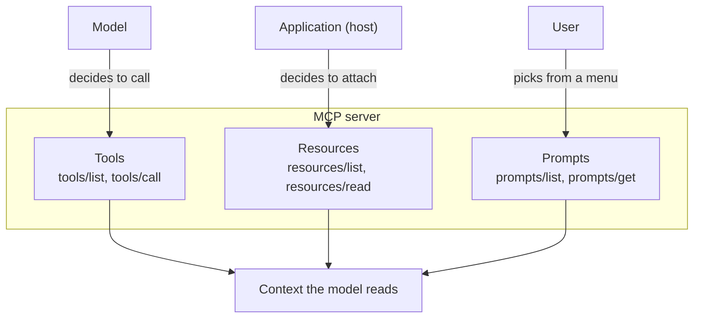

🏠 [Home](../../README.md) › [04 · Model Context Protocol (MCP)](./README.md) › 4.3 Tools, resources and prompts

# 4.3 Tools, resources and prompts

> **Difficulty:** 🟡 Intermediate · **Reading time:** ~10 min · **Prerequisites:** [4.2 Hosts, clients and servers](./04.2-hosts-clients-and-servers.md), [3.2 JSON Schema for tools](../03-tools-and-function-calling/03.2-json-schema-for-tools.md)

**In one sentence:** An MCP server can offer three kinds of thing, and the difference is who decides when each is used: **tools** are chosen by the model, **resources** by the application, and **prompts** by the user.

📑 **On this page**

- [Why does this matter?](#-why-does-this-matter)
- [The idea, in plain words](#-the-idea-in-plain-words)
- [Picture it](#-picture-it)
- [How it works, step by step](#-how-it-works-step-by-step)
- [Worked example](#-worked-example)
- [Code](#-code)
- [Common mistakes & gotchas](#-common-mistakes--gotchas)
- [Key takeaways](#-key-takeaways)
- [Try it yourself](#-try-it-yourself)
- [Further reading](#-further-reading)

## 🤔 Why does this matter?

You are building an [MCP server](../../GLOSSARY.md#mcp-server) for your team's wiki. Should "read a wiki page" be a [tool](../../GLOSSARY.md#tool) the model calls, or something else? What about "the team's coding guidelines", which every request should see? Or "write a release note in our house style"?

If you make everything a tool, the model has to guess when to fetch the guidelines, and it often won't. If you put everything in the [system prompt](../../GLOSSARY.md#system-prompt), you waste [tokens](../../GLOSSARY.md#token) on pages nobody asked about. [MCP](../../GLOSSARY.md#model-context-protocol-mcp) gives you three distinct building blocks so each piece of context arrives the right way.

## 🧠 The idea, in plain words

Think of a well-run kitchen.

- **Tools** are the appliances. The chef (the model) decides, mid-recipe, to use the blender. Nobody asks permission each time; it's part of cooking.
- **Resources** are the ingredients in the pantry. The kitchen manager (the application) decides what gets put on the counter before cooking starts.
- **Prompts** are the set menus. The customer (the user) picks "the tasting menu", and that choice brings a whole prepared plan with it.

The MCP specification describes the same split as a *control hierarchy*:

| Primitive | Who controls it | What it is | Typical example |
| --- | --- | --- | --- |
| **Tool** | The **model** | A function the model can call to act or fetch information | `search_notes`, `create_issue`, `send_email` |
| **[Resource](../../GLOSSARY.md#mcp-resource)** | The **application** | Read-only data with a URI, attached as context by the host | A file, a database schema, `notes://index` |
| **[Prompt](../../GLOSSARY.md#mcp-prompt)** | The **user** | A reusable message template, often a slash command | `/weekly_review`, `/explain_error` |

"Controls" means *who decides when it's used*, not who wrote it. The server authors all three.

## 👀 Picture it



*Three doors into the same [context window](../../GLOSSARY.md#context-window). The question to ask for each piece of data is: who should open this door?*

## 🔍 How it works, step by step

### Tools

1. The client calls `tools/list`. Each tool has a `name`, a `description`, an `inputSchema` (JSON Schema, as in [3.2](../03-tools-and-function-calling/03.2-json-schema-for-tools.md)) and optionally a `title`, an `outputSchema` and `annotations`.
2. The [host](../../GLOSSARY.md#mcp-host) passes those definitions to the model as ordinary tools. When the model asks for one, the client sends `tools/call` with the name and arguments.
3. The result has `content` (a list of blocks: text, image, audio, links to resources, or embedded resources), optional `structuredContent` (JSON that matches the `outputSchema`) and `isError`.
4. **Two kinds of failure.** A *protocol error* (unknown tool, malformed request) comes back as a [JSON-RPC](../../GLOSSARY.md#json-rpc) error. A *tool execution error* (bad date, API down) comes back as a normal result with `isError: true` and a message the model can read and fix. The spec says clients should pass execution errors to the model so it can self-correct; recall [3.3](../03-tools-and-function-calling/03.3-how-function-calling-works.md).
5. **Annotations** are hints for the host: `readOnlyHint`, `destructiveHint`, `idempotentHint` and `openWorldHint`. A host might skip the confirmation dialog for read-only tools. The spec warns that clients must treat annotations as untrusted unless the server is trusted: a malicious server can label a delete tool "read-only".

### Resources

1. Each resource has a URI, such as `file:///repo/README.md` or a custom scheme like `notes://index`, plus a name, an optional description and a MIME type.
2. `resources/list` returns fixed resources. `resources/templates/list` returns **templates** with placeholders, like `notes://{title}`, using URI template syntax (RFC 6570).
3. `resources/read` returns the contents: text, or base64-encoded binary.
4. The host decides how to use them: a file picker the user browses, automatic inclusion of a project's README, or letting the model choose. Clients can also ask to be told when a resource changes, through a `subscriptions/listen` stream.

### Prompts

1. `prompts/list` returns each prompt's name, description and arguments.
2. `prompts/get` with argument values returns a list of **messages** (role plus content), ready to drop into the conversation.
3. Hosts usually show them as slash commands or menu items. The user picks one; the model never triggers a prompt by itself.

### Things a server can ask of the client

The spec also lets a server ask the host for something in the middle of a request. **Elicitation** asks the user for extra input, such as "which account?". In the 2026-07-28 revision, the server returns an "input required" result and the client retries the request with the answer. Two older client features, **sampling** (the server asks the host's model to generate text) and **roots** (the host tells the server which folders it may use), are deprecated in that revision. New servers shouldn't rely on them.

## 💡 Worked example

The notes server from [4.4](./04.4-build-a-simple-mcp-server.md) offers one of each. A client that lists everything sees this (real output):

```text
TOOLS (the model decides when to call these)
  search_notes  [read-only]: Search notes by keyword. Returns every note that contains all the words, as 'title: text'.
  add_note: Save a note under a short title. Saving under an existing title replaces that note.

RESOURCES (the application decides what to attach)
  notes://index  A list of every note title.
  notes://{title}  The full text of one note.  (template)

PROMPTS (the user picks these, e.g. as a slash command)
  /weekly_review(focus): Review all notes and suggest what to do this week.
```

Now three moments in one day with a notes-enabled assistant:

| Moment | Who acts | MCP request | What lands in the context |
| --- | --- | --- | --- |
| User asks "What's on Friday?" | The **model** decides it needs data | `tools/call search_notes {"query": "friday"}` | `trip: Train to Lyon on Friday at 09:12, platform 4.` |
| User opens a chat about "trip" | The **app** attaches the note it has open | `resources/read notes://trip` | The full text of the note, before the model says anything |
| User types `/weekly_review travel` | The **user** picks a prompt | `prompts/get weekly_review {"focus": "travel"}` | A user message listing every note, ending *"Give me a short plan for this week. Focus on travel."* |

And when the model gets something wrong, the error comes back as data, not a crash:

```text
tools/call add_note (bad input) -> is_error=True: Error executing tool add_note: title must not be empty
```

## 💻 Code

All three primitives with the Python SDK's high-level server, `MCPServer`. Type hints become the JSON Schema; docstrings become descriptions.

```python
from typing import Annotated

from mcp.server.mcpserver import MCPServer
from mcp.server.mcpserver.exceptions import ToolError
from mcp.types import ToolAnnotations
from pydantic import Field

NOTES = {"trip": "Train to Lyon on Friday at 09:12."}
mcp = MCPServer("notes", version="1.0.0")


# TOOL: model-controlled. Annotations are hints for the host, not guarantees.
@mcp.tool(annotations=ToolAnnotations(read_only_hint=True))
def search_notes(query: Annotated[str, Field(description="Words to look for")]) -> list[str]:
    """Search notes by keyword."""
    return [f"{t}: {x}" for t, x in NOTES.items() if query.lower() in f"{t} {x}".lower()]


@mcp.tool()
def add_note(title: Annotated[str, Field(max_length=40)], text: str) -> str:
    """Save a note under a short title."""
    if not title.strip():
        raise ToolError("title must not be empty")  # -> result with isError: true
    NOTES[title] = text
    return f"Saved note '{title}'."


# RESOURCES: application-controlled. A fixed URI, and a template with a {placeholder}.
@mcp.resource("notes://index", description="Every note title.")
def note_index() -> str:
    return "\n".join(sorted(NOTES))


@mcp.resource("notes://{title}", description="One note.")
def read_note(title: str) -> str:
    return NOTES[title]


# PROMPT: user-controlled. Arguments become the slash command's parameters.
@mcp.prompt()
def weekly_review(focus: str = "anything time-sensitive") -> str:
    """Review all notes and suggest what to do this week."""
    notes = "\n".join(f"- {t}: {x}" for t, x in NOTES.items())
    return f"Here are my notes:\n{notes}\n\nGive me a short plan for this week. Focus on {focus}."
```

And the matching client calls, one per primitive:

```python
async with Client(mcp) as client:  # in-process connection; see 4.2 for stdio and HTTP
    tools = await client.list_tools()
    found = await client.call_tool("search_notes", {"query": "friday"})
    index = await client.read_resource("notes://index")
    prompt = await client.get_prompt("weekly_review", {"focus": "travel"})
```

## 🚨 Common mistakes & gotchas

- **Making everything a tool.** If the app always needs a piece of data (a schema, the current file), the model shouldn't have to remember to fetch it. Make it a resource and let the host attach it.
- **Expecting the model to read resources on its own.** Resources are application-controlled. Many hosts show them in a picker and do nothing else. If you need the model to fetch data when it decides to, offer a tool too.
- **Trusting annotations.** `readOnlyHint: true` is a claim by the server. Your host should only relax confirmations for servers you trust.
- **Raising exceptions for user mistakes.** In the Python SDK, raise `ToolError` with a helpful message; the model sees it as `isError: true` and can retry. Treat it as feedback for the model, not a crash.
- **Writing descriptions for humans only.** Tool descriptions and argument descriptions are what the model reads. Apply everything from [3.4 Designing good tools](../03-tools-and-function-calling/03.4-designing-good-tools.md).
- **Building on sampling or roots in a new server.** Both are deprecated in revision 2026-07-28. Pass folders as tool arguments or configuration, and call model APIs directly if your server needs a model.

## ✅ Key takeaways

- Tools are model-controlled, resources application-controlled, prompts user-controlled.
- Tools have a JSON Schema input, return content blocks plus optional structured content, and report failures with `isError: true`.
- Resources are read-only data identified by URIs; templates let one handler serve many URIs.
- Prompts are reusable message templates the user picks, often as slash commands.
- Tool annotations are hints, and untrusted unless the server is.

## 🧪 Try it yourself

1. For a GitHub MCP server, decide whether each is a tool, a resource or a prompt: (a) the repository's `CONTRIBUTING.md`; (b) "open a pull request"; (c) "summarise this PR for a code review"; (d) "search issues by label".
2. A tool fails because the user gave a date in the past. Should the server return a JSON-RPC error or a result with `isError: true`? Why?

<details>
<summary>Show answer</summary>

1. (a) Resource: read-only data the app can attach, for example whenever the user is working in that repo. (b) Tool: an action the model decides to take (and one the host should confirm, since it changes things). (c) Prompt: a template the user chooses, such as `/review_pr`. (d) Tool: the model decides when it needs to search, and with which label. It could also be a resource template such as `issues://label/{name}` if the app, rather than the model, should drive it.
2. A result with `isError: true`. It is a tool execution error, not a malformed request. The message ("Date must be in the future; today is …") lets the model correct itself and retry. JSON-RPC errors are for protocol problems like an unknown tool name.

</details>

## 📚 Further reading

- [Understanding MCP servers](https://modelcontextprotocol.io/docs/2026-07-28/learn/server-concepts) (modelcontextprotocol.io). The three primitives with realistic examples.
- Specification pages for [tools](https://modelcontextprotocol.io/specification/2026-07-28/server/tools), [resources](https://modelcontextprotocol.io/specification/2026-07-28/server/resources) and [prompts](https://modelcontextprotocol.io/specification/2026-07-28/server/prompts) (revision 2026-07-28). Message formats, data types and security notes.
- [MCP Python SDK documentation](https://py.sdk.modelcontextprotocol.io/). The `MCPServer` decorators used above.

<!-- FOOTER -->

---

⬅️ **Previous:** [4.2 Hosts, clients and servers](./04.2-hosts-clients-and-servers.md) ·
🏠 [Chapter home](./README.md) ·
➡️ **Next:** [4.4 Build a simple MCP server](./04.4-build-a-simple-mcp-server.md)
