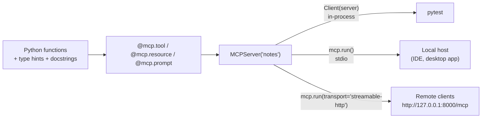

🏠 [Home](../../README.md) › [04 · Model Context Protocol (MCP)](./README.md) › 4.4 Build a simple MCP server

# 4.4 Build a simple MCP server

> **Difficulty:** 🟡 Intermediate · **Reading time:** ~15 min · **Prerequisites:** [4.3 Tools, resources and prompts](./04.3-tools-resources-and-prompts.md), [0.3 Setup](../00-start-here/00.3-setup.md)
>
> Last verified: November 2026 with mcp==2.3.0 (MCP specification revision 2026-07-28)

**In one sentence:** With the official Python SDK, an MCP server is a handful of decorated, type-hinted functions; you test it in-process with `Client(server)`, run it over stdio for local hosts, and switch to Streamable HTTP with one argument.

📑 **On this page**

- [Why does this matter?](#-why-does-this-matter)
- [The idea, in plain words](#-the-idea-in-plain-words)
- [Picture it](#-picture-it)
- [How it works, step by step](#-how-it-works-step-by-step)
- [Worked example](#-worked-example)
- [Code](#-code)
- [Common mistakes & gotchas](#-common-mistakes--gotchas)
- [Key takeaways](#-key-takeaways)
- [Try it yourself](#-try-it-yourself)
- [Further reading](#-further-reading)

## 🤔 Why does this matter?

Reading about [MCP](../../GLOSSARY.md#model-context-protocol-mcp) only goes so far. Once you have built one server, you will recognise the pattern in every server you install, you will know what its [tool](../../GLOSSARY.md#tool) descriptions really are, and you can wrap your own team's systems so any MCP [host](../../GLOSSARY.md#mcp-host) can use them.

This page builds a small **notes server** with two tools, two [resources](../../GLOSSARY.md#mcp-resource) and a prompt, tests it without a model, and runs it the three ways a host might connect to it.

## 🧠 The idea, in plain words

Writing an [MCP server](../../GLOSSARY.md#mcp-server) is like writing a small web API, except that the "documentation" is read by a model, and the SDK writes the schema for you.

You write ordinary Python functions with type hints and docstrings. You mark each one with a decorator that says what it is: `@mcp.tool()`, `@mcp.resource("uri")` or `@mcp.prompt()`. The SDK does the rest: it turns `title: str` into JSON Schema, answers `tools/list`, validates arguments, catches errors and speaks [JSON-RPC](../../GLOSSARY.md#json-rpc) on whatever transport you choose.

> **SDK version note.** This book uses `mcp==2.3.0`. In the 2.x SDK the high-level server class is **`MCPServer`** (`from mcp.server.mcpserver import MCPServer`). Tutorials written for 1.x use `FastMCP` from `mcp.server.fastmcp`, which no longer exists in 2.x. The decorators work the same way.

## 👀 Picture it



*One server object, three ways to reach it. Test in-process, ship over [stdio](../../GLOSSARY.md#stdio-transport) or HTTP. The server code doesn't change.*

## 🔍 How it works, step by step

**1. Install the SDK.** It is already in the examples' requirements:

```bash
pip install mcp==2.3.0          # or: pip install -r examples/requirements.txt
```

**2. Create the server.** Give it a name, a version and, optionally, `instructions`, a short note the host may show to the model about how to use the server.

**3. Add tools.** Decorate functions with `@mcp.tool()`. The function name becomes the tool name, the docstring the description, the type hints the `inputSchema`. Use `Annotated[str, Field(description=..., max_length=...)]` for argument descriptions and limits. The return type becomes an `outputSchema`, and the value comes back both as text content and as `structuredContent`.

**4. Report problems the model can fix.** Raise `ToolError("...")`. The SDK turns it into a result with `isError: true` and your message, which the model can read and act on. Arguments that don't match the schema are rejected the same way, before your function runs.

**5. Add resources and prompts.** `@mcp.resource("notes://index")` for fixed data; `@mcp.resource("notes://{title}")` for a template, where `{title}` becomes a function argument. `@mcp.prompt()` returns the text of a user message, and its arguments become the prompt's arguments.

**6. Test without a model.** `Client(server)` connects to the server object in-process: no subprocess, no network. Call `list_tools()`, `call_tool()`, `read_resource()` and `get_prompt()`, and assert on what comes back.

**7. Run it for real.**

- `mcp.run()` serves over **stdio**: a host launches `python notes_server.py` and talks over its stdin and stdout.
- `mcp.run(transport="streamable-http")` serves over **HTTP**, by default at `http://127.0.0.1:8000/mcp`, with protection against DNS rebinding turned on for localhost.

**8. Plug it into a host.** Desktop hosts usually take a command to launch. For example, Claude Desktop reads a `claude_desktop_config.json` file with an `mcpServers` section (other hosts use a similar shape; check their docs):

```json
{
  "mcpServers": {
    "notes": {
      "command": "python",
      "args": ["/full/path/to/examples/04-mcp-server/notes_server.py"]
    }
  }
}
```

## 💡 Worked example

Running the example client against the server ([`examples/04-mcp-server`](../../examples/04-mcp-server/README.md)). This is real output; `--stdio` launches the server as a subprocess and prints the same:

```text
Connected to notes 1.0.0 (protocol 2026-07-28)

TOOLS (the model decides when to call these)
  search_notes  [read-only]: Search notes by keyword. Returns every note that contains all the words, as 'title: text'.
    input_schema: {"query": {"description": "One or more words to look for, e.g. 'friday train'.", "title": "Query", "type": "string"}}
  add_note: Save a note under a short title. Saving under an existing title replaces that note.
    input_schema: {"title": {"description": "A short title such as 'dentist'.", "maxLength": 40, "title": "Title", "type": "string"}, "text": {"description": "The full note text.", "title": "Text", "type": "string"}}

RESOURCES (the application decides what to attach)
  notes://index  A list of every note title.
  notes://{title}  The full text of one note.  (template)

PROMPTS (the user picks these, e.g. as a slash command)
  /weekly_review(focus): Review all notes and suggest what to do this week.

CALLS
  tools/call add_note -> Saved note 'dentist'.
  tools/call search_notes -> {'result': ['trip: Train to Lyon on Friday at 09:12, platform 4.', 'dentist: Dentist on Friday at 15:00.']}
  tools/call add_note (bad input) -> is_error=True: Error executing tool add_note: title must not be empty
  resources/read notes://index -> ['dentist', 'groceries', 'trip']
  prompts/get weekly_review -> user message, 205 chars, ending
    'Give me a short plan for this week. Focus on travel.'
```

Three things to notice:

- The `input_schema` lines were generated from `Annotated[str, Field(...)]`. `maxLength: 40` is now enforced *before* `add_note` runs.
- `search_notes` returns a Python `list[str]`, so the result carries `structuredContent` as `{"result": [...]}` as well as text.
- The empty title came back as `is_error=True` with the message from `ToolError`. Nothing crashed.

## 💻 Code

The server, slightly shortened from [`examples/04-mcp-server/notes_server.py`](../../examples/04-mcp-server/notes_server.py):

```python
from typing import Annotated

from mcp.server.mcpserver import MCPServer
from mcp.server.mcpserver.exceptions import ResourceError, ToolError
from mcp.types import ToolAnnotations
from pydantic import Field


def build_server(notes: dict[str, str] | None = None) -> MCPServer:
    """A factory, so tests can start each server with fresh data."""
    store = {"trip": "Train to Lyon on Friday at 09:12, platform 4."} if notes is None else dict(notes)
    mcp = MCPServer("notes", version="1.0.0",
                    instructions="Personal notes. Search before you add, so you don't create duplicates.")

    @mcp.tool(annotations=ToolAnnotations(read_only_hint=True))
    def search_notes(
        query: Annotated[str, Field(description="One or more words to look for, e.g. 'friday train'.")],
    ) -> list[str]:
        """Search notes by keyword. Returns every note that contains all the words, as 'title: text'."""
        words = query.lower().split()
        return [f"{t}: {x}" for t, x in store.items() if all(w in f"{t} {x}".lower() for w in words)]

    @mcp.tool(annotations=ToolAnnotations(read_only_hint=False, destructive_hint=False, idempotent_hint=True))
    def add_note(
        title: Annotated[str, Field(description="A short title such as 'dentist'.", max_length=40)],
        text: Annotated[str, Field(description="The full note text.")],
    ) -> str:
        """Save a note under a short title. Saving under an existing title replaces that note."""
        title = title.strip().lower()
        if not title:
            raise ToolError("title must not be empty")  # the model sees this, with isError: true
        store[title] = text.strip()
        return f"Saved note '{title}'."

    @mcp.resource("notes://index", description="A list of every note title.")
    def note_index() -> str:
        return "\n".join(sorted(store))

    @mcp.resource("notes://{title}", description="The full text of one note.")
    def read_note(title: str) -> str:
        if title not in store:
            raise ResourceError(f"No note called {title!r}")
        return store[title]

    @mcp.prompt()
    def weekly_review(focus: str = "anything time-sensitive") -> str:
        """Review all notes and suggest what to do this week."""
        listing = "\n".join(f"- {t}: {x}" for t, x in sorted(store.items()))
        return f"Here are my notes:\n\n{listing}\n\nGive me a short plan for this week. Focus on {focus}."

    return mcp


mcp = build_server()

if __name__ == "__main__":
    mcp.run()  # stdio. For HTTP: mcp.run(transport="streamable-http")
```

Tests talk to it through a real [MCP client](../../GLOSSARY.md#mcp-client), in-process. There is no pytest plugin needed: each test runs its async code with `asyncio.run`:

```python
import asyncio

from mcp import Client


def test_add_then_search() -> None:
    async def scenario():
        async with Client(build_server(notes={})) as client:
            await client.call_tool("add_note", {"title": "Dentist", "text": "Friday at 15:00"})
            return await client.call_tool("search_notes", {"query": "friday"})

    result = asyncio.run(scenario())
    assert result.is_error is False
    assert result.structured_content == {"result": ["dentist: Friday at 15:00"]}
```

The example's test file also checks the schemas and annotations, bad input, resources, the prompt, and a real stdio subprocess: [`examples/04-mcp-server/tests/test_main.py`](../../examples/04-mcp-server/tests/test_main.py).

## 🚨 Common mistakes & gotchas

- **Copying 1.x code.** `from mcp.server.fastmcp import FastMCP` fails on the 2.x SDK with `ModuleNotFoundError`. Use `from mcp.server.mcpserver import MCPServer`. Transport options such as `host` and `port` now go to `run()`, not the constructor.
- **`print()` in a stdio server.** stdout is the protocol channel. Log to stderr (or use the SDK's logging).
- **Vague docstrings.** "Does notes stuff" gives the model nothing. The docstring *is* the tool description: say what it does, what it returns and when to use it.
- **Blocking code in `async def` tools.** In the 2.x SDK, plain `def` handlers run in a worker thread, so a slow synchronous call doesn't freeze other requests. An `async def` handler that calls blocking code does freeze them.
- **Module-level state in tests.** If your tools change a global dict, tests leak into each other. A `build_server()` factory gives each test a fresh server.
- **Binding HTTP to `0.0.0.0` on a laptop.** That exposes your tools to your whole network. Keep the default `127.0.0.1` unless you add authentication.

## ✅ Key takeaways

- `MCPServer` plus `@mcp.tool()`, `@mcp.resource(...)` and `@mcp.prompt()` is all most servers need.
- Type hints and `Field(...)` become the JSON Schema; docstrings become descriptions. Both are part of the interface.
- Raise `ToolError` for problems the model can fix; it arrives as `isError: true`.
- Test in-process with `Client(server)`; run with `mcp.run()` (stdio) or `mcp.run(transport="streamable-http")`.
- In SDK 2.x, `FastMCP` is now `MCPServer`.

## 🧪 Try it yourself

1. Add a `delete_note(title)` tool. Which annotations should it carry? What should it return if the note doesn't exist?
2. Change `search_notes` so the model can limit results: add `limit: int = 5`, capped at 20. Where does the cap belong: in the schema, in the code, or both?

<details>
<summary>Show answer</summary>

1. `ToolAnnotations(read_only_hint=False, destructive_hint=True, idempotent_hint=True)`: it changes data and can't be undone, but deleting twice has the same effect as deleting once. If the note doesn't exist, raise `ToolError(f"No note called {title!r}. Use search_notes to find titles.")` so the model can recover. A host may use `destructive_hint` to ask the user before running it, but as [4.6](./04.6-mcp-security.md) explains, it's only a hint.
2. Both. Use `Annotated[int, Field(ge=1, le=20, description="Maximum results to return")] = 5`, so the model sees the limit in the schema and out-of-range values are rejected with a clear error. Then slice the result list in code (`[:limit]`), because the code is what actually enforces it.

</details>

## 📚 Further reading

- [MCP Python SDK documentation](https://py.sdk.modelcontextprotocol.io/) and its [migration guide from v1 to v2](https://py.sdk.modelcontextprotocol.io/v2/migration/). Read the second one before copying any older example.
- [Build an MCP server](https://modelcontextprotocol.io/docs/2026-07-28/develop/build-server) (modelcontextprotocol.io). The official tutorial, in several languages.
- [MCP Inspector](https://modelcontextprotocol.io/docs/2026-07-28/tools/inspector). Browse and call a server's tools, resources and prompts without a model.
- [Connect to local MCP servers](https://modelcontextprotocol.io/docs/2026-07-28/develop/connect-local-servers). How a desktop host is configured to launch servers.

<!-- FOOTER -->

---

⬅️ **Previous:** [4.3 Tools, resources and prompts](./04.3-tools-resources-and-prompts.md) ·
🏠 [Chapter home](./README.md) ·
➡️ **Next:** [4.5 Connect MCP to an agent](./04.5-connect-mcp-to-an-agent.md)
