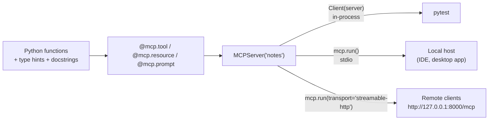

🏠 [Home](../../README.md) › [04 · Model Context Protocol (MCP)](./README.md) › 4.4 Ek simple MCP server banao

# 4.4 Ek simple MCP server banao

> **Level:** 🟡 Intermediate · **Padhne ka time:** ~15 min · **Pehle padho:** [4.3 Tools, resources aur prompts](./04.3-tools-resources-and-prompts.md), [0.3 Setup](../00-start-here/00.3-setup.md)
>
> Last verified: November 2026 with mcp==2.3.0 (MCP specification revision 2026-07-28)

**Ek line mein:** Official Python SDK ke saath MCP server bas kuch decorated, type-hinted functions hai. Tum usse `Client(server)` se in-process test karte ho, local hosts ke liye stdio par chalate ho, aur ek argument badal ke Streamable HTTP par switch kar dete ho.

📑 **Is page par**

- [Yeh kyun zaroori hai?](#-yeh-kyun-zaroori-hai)
- [Idea, simple words mein](#-idea-simple-words-mein)
- [Diagram se samjho](#-diagram-se-samjho)
- [Kaise kaam karta hai, step by step](#-kaise-kaam-karta-hai-step-by-step)
- [Example se samjho](#-example-se-samjho)
- [Code](#-code)
- [Aam galtiyan aur dhyan dene wali baatein](#-aam-galtiyan-aur-dhyan-dene-wali-baatein)
- [Yaad rakhne wali baatein](#-yaad-rakhne-wali-baatein)
- [Khud try karo](#-khud-try-karo)
- [Aur padhne ke liye](#-aur-padhne-ke-liye)

## 🤔 Yeh kyun zaroori hai?

[MCP](../../GLOSSARY.md#model-context-protocol-mcp) ke baare mein sirf padhne se ek had tak hi samajh aata hai. Ek baar khud server bana liya, toh tum har install kiye server mein yahi pattern pehchan loge. Tumhe pata hoga ki uske [tool](../../GLOSSARY.md#tool) descriptions asal mein kya hain. Aur tum apni team ke systems ko wrap kar paoge, taaki koi bhi MCP [host](../../GLOSSARY.md#mcp-host) unhe use kar sake.

Yeh page ek chhota **notes server** banata hai: do tools, do [resources](../../GLOSSARY.md#mcp-resource) aur ek prompt ke saath. Phir usse bina model ke test karta hai, aur un teen tariko se chalata hai jinse ek host usse connect kar sakta hai.

## 🧠 Idea, simple words mein

[MCP server](../../GLOSSARY.md#mcp-server) likhna ek chhoti web API likhne jaisa hai. Farak bas itna hai ki "documentation" ek model padhta hai, aur schema SDK tumhare liye likh deta hai.

Tum normal Python functions likhte ho, type hints aur docstrings ke saath. Har function par ek decorator lagate ho jo batata hai ki woh kya hai: `@mcp.tool()`, `@mcp.resource("uri")` ya `@mcp.prompt()`. Baaki SDK karta hai. Woh `title: str` ko JSON Schema mein badalta hai, `tools/list` ka jawab deta hai, arguments validate karta hai, errors pakadta hai, aur jo bhi transport tum chuno us par [JSON-RPC](../../GLOSSARY.md#json-rpc) bolta hai.

Socho tum kirana dukaan chalate ho. Tum sirf shelf par saaman aur uska label lagate ho. Billing machine, barcode aur receipt ka kaam POS system khud kar deta hai. Yahan tumhare functions shelf ka saaman hain, docstrings label hain, aur SDK woh POS system hai.

> **SDK version note.** Yeh book `mcp==2.3.0` use karti hai. 2.x SDK mein high-level server class **`MCPServer`** hai (`from mcp.server.mcpserver import MCPServer`). 1.x ke liye likhe tutorials `mcp.server.fastmcp` se `FastMCP` use karte hain, jo 2.x mein ab exist nahi karta. Decorators same tarike se kaam karte hain.

## 👀 Diagram se samjho



*Ek server object, usse pahunchne ke teen raaste. In-process test karo, [stdio](../../GLOSSARY.md#stdio-transport) ya HTTP par ship karo. Server ka code nahi badalta.*

## 🔍 Kaise kaam karta hai, step by step

**1. SDK install karo.** Is page wala version pin karo:

```bash
pip install mcp==2.3.0
```

**2. Server banao.** Usse ek name, ek version, aur chaho toh `instructions` do. `instructions` ek chhota note hai jo host model ko dikha sakta hai, ki server kaise use karna hai.

**3. Tools add karo.** Functions par `@mcp.tool()` lagao. Function ka naam tool ka naam banta hai, docstring description, aur type hints `inputSchema`. Argument descriptions aur limits ke liye `Annotated[str, Field(description=..., max_length=...)]` use karo. Return type `outputSchema` ban jaata hai, aur value text content aur `structuredContent` dono ki tarah wapas aati hai.

**4. Aisi problems report karo jo model fix kar sake.** `ToolError("...")` raise karo. SDK usse `isError: true` aur tumhare message wale result mein badal deta hai, jise model padh ke uske hisaab se kaam kar sakta hai. Jo arguments schema se match nahi karte, woh bhi isi tarah reject hote hain, tumhara function chalne se pehle.

**5. Resources aur prompts add karo.** Fixed data ke liye `@mcp.resource("notes://index")`; template ke liye `@mcp.resource("notes://{title}")`, jahan `{title}` function argument ban jaata hai. `@mcp.prompt()` ek user message ka text return karta hai, aur uske arguments prompt ke arguments ban jaate hain.

**6. Bina model ke test karo.** `Client(server)` server object se in-process connect hota hai: na subprocess, na network. `list_tools()`, `call_tool()`, `read_resource()` aur `get_prompt()` call karo, aur jo wapas aaye us par assert karo.

**7. Asli mein chalao.**

- `mcp.run()` **stdio** par serve karta hai: host `python notes_server.py` launch karta hai aur uske stdin aur stdout par baat karta hai.
- `mcp.run(transport="streamable-http")` **HTTP** par serve karta hai, by default `http://127.0.0.1:8000/mcp` par, aur localhost ke liye DNS rebinding se protection on rehti hai.

**8. Host mein plug karo.** Desktop hosts aam taur par launch karne ke liye ek command lete hain. Jaise, Claude Desktop ek `claude_desktop_config.json` file padhta hai jismein `mcpServers` section hota hai (dusre hosts bhi milta-julta shape use karte hain; unke docs check karo):

```json
{
  "mcpServers": {
    "notes": {
      "command": "python",
      "args": ["/full/path/to/notes_server.py"]
    }
  }
}
```

## 💡 Example se samjho

Ek chhota client jo server se in-process connect hota hai aur uski har offer ki hui cheez ka tour karta hai. Yeh real output hai; stdio par connect karo, server ko subprocess ki tarah launch karke, toh bhi yahi print hota hai:

```text
Connected to notes 1.0.0 (protocol 2026-07-28)

TOOLS (the model decides when to call these)
  search_notes  [read-only]: Search notes by keyword. Returns every note that contains all the words, as 'title: text'.
    input_schema: {"query": {"description": "One or more words to look for, e.g. 'friday train'.", "title": "Query", "type": "string"}}
  add_note: Save a note under a short title. Saving under an existing title replaces that note.
    input_schema: {"title": {"description": "A short title such as 'dentist'.", "maxLength": 40, "title": "Title", "type": "string"}, "text": {"description": "The full note text.", "title": "Text", "type": "string"}}

RESOURCES (the application decides what to attach)
  notes://index  A list of every note title.
  notes://{title}  The full text of one note.  (template)

PROMPTS (the user picks these, e.g. as a slash command)
  /weekly_review(focus): Review all notes and suggest what to do this week.

CALLS
  tools/call add_note -> Saved note 'dentist'.
  tools/call search_notes -> {'result': ['trip: Train to Lyon on Friday at 09:12, platform 4.', 'dentist: Dentist on Friday at 15:00.']}
  tools/call add_note (bad input) -> is_error=True: Error executing tool add_note: title must not be empty
  resources/read notes://index -> ['dentist', 'groceries', 'trip']
  prompts/get weekly_review -> user message, 205 chars, ending
    'Give me a short plan for this week. Focus on travel.'
```

Teen cheezein dhyan se dekho:

- `input_schema` wali lines `Annotated[str, Field(...)]` se generate hui hain. `maxLength: 40` ab `add_note` chalne se *pehle* enforce hota hai.
- `search_notes` ek Python `list[str]` return karta hai, isliye result mein text ke saath `structuredContent` bhi `{"result": [...]}` ki tarah aata hai.
- Khaali title `ToolError` ke message ke saath `is_error=True` ki tarah wapas aaya. Kuch crash nahi hua.

## 💻 Code

Server, `notes_server.py`, thoda chhota karke:

```python
from typing import Annotated

from mcp.server.mcpserver import MCPServer
from mcp.server.mcpserver.exceptions import ResourceError, ToolError
from mcp.types import ToolAnnotations
from pydantic import Field


def build_server(notes: dict[str, str] | None = None) -> MCPServer:
    """Ek factory, taaki tests har server ko fresh data se start kar sakein."""
    store = {"trip": "Train to Lyon on Friday at 09:12, platform 4."} if notes is None else dict(notes)
    mcp = MCPServer("notes", version="1.0.0",
                    instructions="Personal notes. Search before you add, so you don't create duplicates.")

    @mcp.tool(annotations=ToolAnnotations(read_only_hint=True))
    def search_notes(
        query: Annotated[str, Field(description="One or more words to look for, e.g. 'friday train'.")],
    ) -> list[str]:
        """Search notes by keyword. Returns every note that contains all the words, as 'title: text'."""
        words = query.lower().split()
        return [f"{t}: {x}" for t, x in store.items() if all(w in f"{t} {x}".lower() for w in words)]

    @mcp.tool(annotations=ToolAnnotations(read_only_hint=False, destructive_hint=False, idempotent_hint=True))
    def add_note(
        title: Annotated[str, Field(description="A short title such as 'dentist'.", max_length=40)],
        text: Annotated[str, Field(description="The full note text.")],
    ) -> str:
        """Save a note under a short title. Saving under an existing title replaces that note."""
        title = title.strip().lower()
        if not title:
            raise ToolError("title must not be empty")  # model yeh dekhta hai, isError: true ke saath
        store[title] = text.strip()
        return f"Saved note '{title}'."

    @mcp.resource("notes://index", description="A list of every note title.")
    def note_index() -> str:
        return "\n".join(sorted(store))

    @mcp.resource("notes://{title}", description="The full text of one note.")
    def read_note(title: str) -> str:
        if title not in store:
            raise ResourceError(f"No note called {title!r}")
        return store[title]

    @mcp.prompt()
    def weekly_review(focus: str = "anything time-sensitive") -> str:
        """Review all notes and suggest what to do this week."""
        listing = "\n".join(f"- {t}: {x}" for t, x in sorted(store.items()))
        return f"Here are my notes:\n\n{listing}\n\nGive me a short plan for this week. Focus on {focus}."

    return mcp


mcp = build_server()

if __name__ == "__main__":
    mcp.run()  # stdio. HTTP ke liye: mcp.run(transport="streamable-http")
```

Tests isse ek real [MCP client](../../GLOSSARY.md#mcp-client) ke through, in-process baat karte hain. Koi pytest plugin nahi chahiye: har test apna async code `asyncio.run` se chalata hai:

```python
import asyncio

from mcp import Client


def test_add_then_search() -> None:
    async def scenario():
        async with Client(build_server(notes={})) as client:
            await client.call_tool("add_note", {"title": "Dentist", "text": "Friday at 15:00"})
            return await client.call_tool("search_notes", {"query": "friday"})

    result = asyncio.run(scenario())
    assert result.is_error is False
    assert result.structured_content == {"result": ["dentist: Friday at 15:00"]}
```

Ek poori test file schemas aur annotations, galat input, resources, prompt, aur ek real stdio subprocess bhi check karegi.

## 🚨 Aam galtiyan aur dhyan dene wali baatein

- **1.x ka code copy karna.** `from mcp.server.fastmcp import FastMCP` 2.x SDK par `ModuleNotFoundError` deta hai. `from mcp.server.mcpserver import MCPServer` use karo. Transport options jaise `host` aur `port` ab constructor mein nahi, `run()` mein jaate hain.
- **stdio server mein `print()`.** stdout protocol ka channel hai. Logs stderr par likho (ya SDK ki logging use karo).
- **Gol-mol docstrings.** "Does notes stuff" se model ko kuch nahi milta. Docstring *hi* tool description hai: batao ki tool kya karta hai, kya return karta hai, aur kab use karna hai.
- **`async def` tools mein blocking code.** 2.x SDK mein plain `def` handlers ek worker thread mein chalte hain, isliye ek slow synchronous call baaki requests ko freeze nahi karti. Lekin jo `async def` handler blocking code call karta hai, woh unhe freeze kar deta hai.
- **Tests mein module-level state.** Agar tumhare tools ek global dict badalte hain, toh tests ek dusre mein leak hote hain. `build_server()` factory har test ko fresh server deti hai.
- **Laptop par HTTP ko `0.0.0.0` par bind karna.** Isse tumhare tools poore network ke saamne khul jaate hain. Jab tak authentication add na karo, default `127.0.0.1` hi rakho.

## ✅ Yaad rakhne wali baatein

- Zyadatar servers ke liye `MCPServer` plus `@mcp.tool()`, `@mcp.resource(...)` aur `@mcp.prompt()` kaafi hai.
- Type hints aur `Field(...)` JSON Schema bante hain; docstrings descriptions bante hain. Dono interface ka hissa hain.
- Jo problems model fix kar sake, unke liye `ToolError` raise karo; woh `isError: true` ki tarah pahunchta hai.
- `Client(server)` se in-process test karo; `mcp.run()` (stdio) ya `mcp.run(transport="streamable-http")` se chalao.
- SDK 2.x mein `FastMCP` ab `MCPServer` hai.

## 🧪 Khud try karo

1. Ek `delete_note(title)` tool add karo. Uspar kaun si annotations honi chahiye? Agar note exist nahi karta toh kya return karna chahiye?
2. `search_notes` ko aisa badlo ki model results limit kar sake: `limit: int = 5` add karo, maximum 20. Yeh cap kahan hona chahiye: schema mein, code mein, ya dono mein?

<details>
<summary>Answer dekho</summary>

1. `ToolAnnotations(read_only_hint=False, destructive_hint=True, idempotent_hint=True)`: yeh data badalta hai aur undo nahi ho sakta, lekin do baar delete karne ka asar ek baar delete karne jaisa hi hai. Agar note exist nahi karta, toh `ToolError(f"No note called {title!r}. Use search_notes to find titles.")` raise karo, taaki model recover kar sake. Host `destructive_hint` dekh ke chalane se pehle user se pooch sakta hai, lekin jaisa [4.6](./04.6-mcp-security.md) samjhata hai, yeh sirf ek hint hai.
2. Dono. `Annotated[int, Field(ge=1, le=20, description="Maximum results to return")] = 5` use karo, taaki model ko schema mein limit dikhe aur range ke bahar ki values clear error ke saath reject hon. Phir code mein result list ko slice karo (`[:limit]`), kyunki asal mein code hi isse enforce karta hai.

</details>

## 📚 Aur padhne ke liye

- [MCP Python SDK documentation](https://py.sdk.modelcontextprotocol.io/) aur uski [migration guide from v1 to v2](https://py.sdk.modelcontextprotocol.io/v2/migration/). Koi bhi purana example copy karne se pehle doosri wali padho.
- [Build an MCP server](https://modelcontextprotocol.io/docs/2026-07-28/develop/build-server) (modelcontextprotocol.io). Official tutorial, kai languages mein.
- [MCP Inspector](https://modelcontextprotocol.io/docs/2026-07-28/tools/inspector). Bina model ke kisi server ke tools, resources aur prompts browse aur call karo.
- [Connect to local MCP servers](https://modelcontextprotocol.io/docs/2026-07-28/develop/connect-local-servers). Desktop host ko servers launch karne ke liye kaise configure karte hain.

<!-- FOOTER -->

---

⬅️ **Pichla:** [4.3 Tools, resources aur prompts](./04.3-tools-resources-and-prompts.md) ·
🏠 [Chapter home](./README.md) ·
➡️ **Agla:** [4.5 MCP ko agent se jodo](./04.5-connect-mcp-to-an-agent.md)
