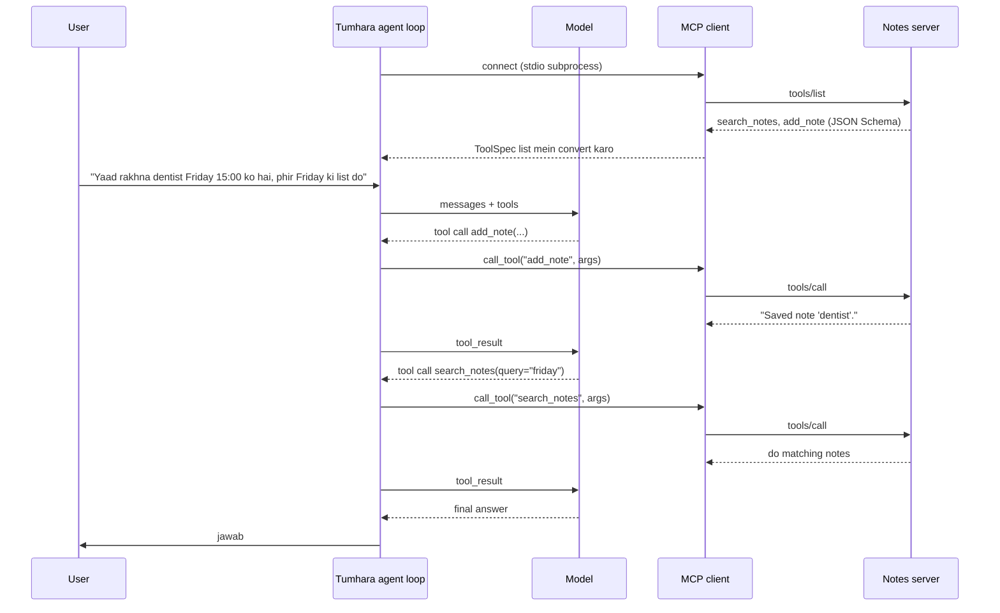

🏠 [Home](../../README.md) › [04 · Model Context Protocol (MCP)](./README.md) › 4.5 MCP ko agent se jodo

# 4.5 MCP ko agent se jodo

> **Level:** 🟡 Intermediate · **Padhne ka time:** ~12 min · **Pehle padho:** [4.4 Ek simple MCP server banao](./04.4-build-a-simple-mcp-server.md), [2.3 50 lines mein agent, bilkul zero se](../02-the-agent-loop/02.3-a-50-line-agent-from-scratch.md)
>
> Last verified: November 2026 with mcp==2.3.0, anthropic==2.8.0 and openai==3.49.0

**Ek line mein:** Apne agent ko MCP tools dene ke liye ek client session kholo, `tools/list` se aaye har tool ko apni model API ke tool format mein convert karo, aur model ki har tool call ko `tools/call` tak forward karo. Ya phir provider ko hi apne liye remote MCP server se connect karne do.

📑 **Is page par**

- [Yeh kyun zaroori hai?](#-yeh-kyun-zaroori-hai)
- [Idea, simple words mein](#-idea-simple-words-mein)
- [Diagram se samjho](#-diagram-se-samjho)
- [Kaise kaam karta hai, step by step](#-kaise-kaam-karta-hai-step-by-step)
- [Example se samjho](#-example-se-samjho)
- [Code](#-code)
- [Aam galtiyan aur dhyan dene wali baatein](#-aam-galtiyan-aur-dhyan-dene-wali-baatein)
- [Yaad rakhne wali baatein](#-yaad-rakhne-wali-baatein)
- [Khud try karo](#-khud-try-karo)
- [Aur padhne ke liye](#-aur-padhne-ke-liye)

## 🤔 Yeh kyun zaroori hai?

Desktop apps aur IDEs ko pehle se pata hai ki [MCP servers](../../GLOSSARY.md#mcp-server) kaise use karne hain. Lekin tum apna khud ka [agent](../../GLOSSARY.md#agent) bana rahe ho, chapter 02 wale apne [agent loop](../../GLOSSARY.md#agent-loop) ke saath. Tum chahte ho ki woh abhi banaya hua notes server use kare, aur shayad kal koi public GitHub ya database server bhi. Aur yeh sab har ek ke liye custom [tool](../../GLOSSARY.md#tool) wrapper likhe bina.

Iska matlab *tumhara agent* hi [MCP host](../../GLOSSARY.md#mcp-host) hai. Yeh page woh chhota adapter dikhata hai jo kisi bhi MCP server ke tools ko aise tools mein badal deta hai jinhe tumhara model call kar sake. Saath mein woh shortcut bhi jo kuch providers dete hain: woh apni side par tumhare liye remote MCP server se connect kar dete hain.

## 🧠 Idea, simple words mein

Tumhara agent model se pehle se ek language bolta hai: tools ki ek list, har tool ka name, description aur JSON Schema ([3.2](../03-tools-and-function-calling/03.2-json-schema-for-tools.md)). MCP server bhi lagbhag wahi language bolta hai: uske tools ka bhi name, description aur JSON Schema hota hai.

Toh adapter ek **border par baitha translator** hai:

- Andar jaate waqt: MCP tool definitions → tumhare model ki tool definitions.
- Wapas aate waqt: model ki tool call → ek MCP `tools/call` request.
- Aur phir wapas: MCP result (content blocks, `isError`) → ek tool result message.

Ise aise socho: tum Chennai mein ho aur tamil nahi aati. Auto wale se baat karne ke liye ek dost beech mein translate karta hai. Auto wala aur tum dono apni-apni bhasha bolte ho, dost bas dono taraf convert karta hai. Model ko kabhi pata nahi chalta ki tools kisi aur process mein rehte hain. Is page ka code ek neutral tool format use karta hai, `{"name", "description", "input_schema"}`, jo Anthropic aur OpenAI dono ke shapes mein aasaani se convert ho jaata hai.

## 👀 Diagram se samjho



*Loop wahi hai jo chapter 02 mein tha. Sirf "tool chalao" wala step badla hai: local Python function call karne ki jagah agent ek server ko `tools/call` bhejta hai.*

## 🔍 Kaise kaam karta hai, step by step

1. **Connect karo.** `async with Client(target)`, jahan `target` ek `StdioServerParameters` (local server launch karo), ek URL ([Streamable HTTP](../../GLOSSARY.md#streamable-http)), ya tests mein khud server object ho sakta hai.
2. **Discover karo.** `await client.list_tools()` `Tool` objects deta hai, jinmein `name`, `description` aur `input_schema` hote hain.
3. **Filter karo.** Sirf woh tools rakho jo is agent ko chahiye. Kam tools matlab kam context aur kam galat choices. Aur yeh tumhari defence ki pehli line bhi hai ([4.6](./04.6-mcp-security.md)).
4. **Convert karo.** Har tool ko `{"name", "description", "input_schema"}` mein map karo. Schema seedha copy ho jaata hai. Agar kai servers combine kar rahe ho, toh names par prefix lagao (`notes__search`), taaki do `search` tools aapas mein na takrayein. MCP spec aisi disambiguation strategy recommend karti hai, aur warn karti hai ki server names unique hone ki guarantee nahi hai. MCP tool names mein dots allow karta hai, isliye apne model provider ke naming rules bhi check karo.
5. **Loop chalao.** Tools ke saath model ko call karo. Har tool call ke liye check karo ki naam unhi mein se hai jo tumne expose kiye, phir `await client.call_tool(name, arguments)`.
6. **Result convert karo.** Text blocks ko jod do. Non-text blocks (images, audio) ko chupchaap drop mat karo, unka description likho, ya agar provider accept karta hai toh aage bhej do. `is_error` ko saath le ke jao, taaki model ko pata chale ki call fail hui ([2.5](../02-the-agent-loop/02.5-handling-errors-in-the-loop.md)).
7. **Band karo.** `async with` block se bahar nikalte hi connection band ho jaata hai, aur [stdio](../../GLOSSARY.md#stdio-transport) ke case mein server process bhi.

### Ya provider ko yeh karne do

Kuch model APIs khud ek **remote** MCP server se connect kar sakti hain. Tum request mein server ka URL dete ho. Provider uske tools list karta hai, model ko unhe call karne deta hai, aur calls aur results response mein daal deta hai. Tumhe koi client code nahi likhna padta.

| | Tumhara apna MCP client (is page ka example) | Anthropic MCP connector | OpenAI remote MCP tool |
| --- | --- | --- | --- |
| MCP connection kahan chalta hai | Tumhare process mein | Anthropic ke servers par | OpenAI ke servers par |
| Request shape | Tumhari tools list, `tools/list` se bani | `mcp_servers=[...]` plus `tools` mein ek `{"type": "mcp_toolset"}` entry, beta header `mcp-client-2025-11-20` | `tools` mein ek `{"type": "mcp", "server_url": ...}` entry, Responses API |
| Local stdio servers | Haan | Nahi: server HTTP par reachable hona chahiye | Remote URLs (OpenAI local servers ke liye ek tunnel option bhi document karta hai) |
| MCP features | Jo bhi tumhara client implement kare | Sirf tools | Tools |
| Call se pehle approval | Tumhara code decide karta hai | Har tool ke liye configure karo (allowlist ya denylist) | `require_approval`, jo by default poochta hai; `allowed_tools` |

Practically, hum recommend karte hain: jab local servers, tests, logging ya fine control chahiye, toh apna client use karo. Public remote servers tak jaldi pahunchna ho, toh provider-side option use karo.

## 💡 Example se samjho

Model ke replies ek [mock LLM](../../GLOSSARY.md#mockllm) se scripted hain, lekin server real hai: agent 4.4 wala `notes_server.py` stdio par launch karta hai.

```text
Goal: Remember that my dentist appointment is on Friday at 15:00. Then tell me everything I have on Friday.

tools/list -> ['search_notes', 'add_note']; exposing ['search_notes', 'add_note']
step 1: tools/call add_note({'title': 'dentist', 'text': 'Dentist appointment on Friday at 15:00.'}) -> "Saved note 'dentist'."
step 2: tools/call search_notes({'query': 'friday'}) -> 'trip: Train to Lyon on Friday at 09:12, platform 4.\ndentist: Dentist appointment on Friday at 15:00.'
step 3: answer

Answer: Saved. On Friday you have: Train to Lyon on Friday at 09:12, platform 4; Dentist appointment on Friday at 15:00.
```

Pehli call par model ko do normal tools mile, `search_notes` aur `add_note`. Har ek ke saath woh description aur JSON Schema tha jo server ne publish kiya tha (title par `maxLength: 40` bhi). Ek in-process test bilkul yahi check kar sakta hai.

Aur `allowed_tools={"search_notes"}` ke saath model ko sirf `search_notes` dikhta hai. Agar woh phir bhi `add_note` maange, toh agent ek error result (`Tool 'add_note' is not available.`) ke saath reply karta hai aur server se contact hi nahi karta.

## 💻 Code

Adapter aur loop. `llm` koi bhi chat-model client hai, jaise [2.1](../02-the-agent-loop/02.1-the-observe-think-act-loop.md#-code) mein. `user()` aur `tool_result()` bas neutral message dicts banate hain:

```python
from mcp import Client
from mcp.types import CallToolResult, Tool


def to_tool_spec(tool: Tool, prefix: str = "") -> dict:
    """MCP tool -> ek neutral {name, description, input_schema} spec."""
    return {"name": prefix + tool.name, "description": tool.description or "", "input_schema": tool.input_schema}


def to_text(result: CallToolResult) -> str:
    """MCP result -> tool_result message ke liye text."""
    parts = [b.text if b.type == "text" else f"[{b.type} content omitted]" for b in result.content]
    return "\n".join(parts)


async def run_agent(llm, goal: str, client: Client, allowed: set[str] | None = None) -> str:
    tools = [t for t in (await client.list_tools()).tools if allowed is None or t.name in allowed]
    specs = [to_tool_spec(t) for t in tools]
    names = {s["name"] for s in specs}
    messages = [user(goal)]
    for _ in range(6):                                    # step limit
        reply = llm.chat(messages, system="You manage the user's notes.", tools=specs)
        messages.append(reply.to_message())
        if not reply.tool_calls:
            return reply.text
        for call in reply.tool_calls:
            if call.name not in names:                    # jo tool expose nahi kiya, use kabhi forward mat karo
                messages.append(tool_result(call.id, f"Tool {call.name!r} is not available.", is_error=True))
                continue
            result = await client.call_tool(call.name, call.arguments)
            messages.append(tool_result(call.id, to_text(result), is_error=bool(result.is_error)))
    return "I could not finish within the step limit."
```

Ise stdio par ek local server se connect karna:

```python
import asyncio
import sys

from mcp import StdioServerParameters

params = StdioServerParameters(command=sys.executable, args=["notes_server.py"])

async def main() -> None:
    async with Client(params) as client:
        print(await run_agent(llm, "What do I have on Friday?", client))   # llm: tumhara chat-model client

asyncio.run(main())
```

**Offline tests** `Client(server_object)` se in-process connect karte hain: na subprocess, na network, aur real model ki jagah ek scripted fake model. Check karo ki tool specs server se match karte hain, writes server tak pahunchte hain, `is_error` aage jaata hai, aur allowlist calls ko block karti hai.

**Provider-side, Anthropic.** MCP connector (beta). Dono hisse zaroori hain: `mcp_servers` mein server, aur `tools` mein ek `mcp_toolset` entry jo uska naam leti hai.

```python
import anthropic

client = anthropic.Anthropic()  # ANTHROPIC_API_KEY chahiye
response = client.beta.messages.create(
    model="claude-opus-5-5",
    max_tokens=4000,
    betas=["mcp-client-2025-11-20"],
    mcp_servers=[{"type": "url", "url": "https://notes.example.com/mcp", "name": "notes",
                  "authorization_token": "YOUR_TOKEN"}],          # optional, OAuth wale servers ke liye
    tools=[{"type": "mcp_toolset", "mcp_server_name": "notes"}],
    messages=[{"role": "user", "content": "What do I have on Friday?"}],
)
```

**Provider-side, OpenAI.** Responses API mein remote MCP tool:

```python
import os
from openai import OpenAI

client = OpenAI()  # OPENAI_API_KEY chahiye
response = client.responses.create(
    model=os.environ["OPENAI_MODEL"],
    tools=[{
        "type": "mcp",
        "server_label": "notes",
        "server_url": "https://notes.example.com/mcp",
        "allowed_tools": ["search_notes"],   # sirf woh import karo jo chahiye
        "require_approval": "always",        # response har call se pehle approval maangta hai
    }],
    input="What do I have on Friday?",
)
print(response.output_text)
```

## 🚨 Aam galtiyan aur dhyan dene wali baatein

- **Har model call par tools dobara list karna.** Aam taur par har session mein ek baar list karna kaafi hai. Conversation ke beech tool list badalne se [prompt caching](../16-cost-and-performance/16.2-prompt-caching.md) toot sakti hai. Isme madad ke liye spec servers se kehti hai ki tools ek stable order mein return karein.
- **Model jo bhi tool name bole, use forward kar dena.** Usse us list se match karo jo tumne expose ki. Models kabhi-kabhi naam bana lete hain, aur prompt-injected model un tools ko try kar sakta hai jo tumne jaan-boojh ke chhupaye.
- **`isError` gira dena.** Agar failure ko bina error flag ke plain text ki tarah wapas bheja, toh model usse data samajh sakta hai.
- **Bina prefix ke servers merge karna.** Do servers mein `search` tool hai, toh ek chupchaap dusre ko dhak lega.
- **Maan lena ki provider connector sab support karta hai.** Anthropic ka MCP connector sirf tool calls support karta hai, aur woh bhi sirf HTTP par exposed servers ke liye. Local stdio servers ke liye apna client chahiye.
- **Jo remote servers tumhare control mein nahi, unke liye approvals off chhodna.** OpenAI ka tool by default approval maangta hai, aur iski wajah hai. Isse sirf un servers aur tools ke liye off karo jin par bharosa hai.

## ✅ Yaad rakhne wali baatein

- Jab tum MCP ko apne agent se jodte ho, toh tumhara agent hi host hai.
- Adapter chhota hai: `tools/list` ke tools → tumhara tool format; tool calls → `tools/call`; results → `is_error` ke saath `tool_result`.
- Sirf zaroori tools expose karo, servers merge karte waqt names par prefix lagao, aur jo expose nahi kiya us par call refuse karo.
- In-process `Client(server)` aur scripted model ke saath offline test karo.
- Provider-side MCP (Anthropic ka MCP connector, OpenAI ka remote MCP tool) remote servers ke liye code bachata hai, lekin control ki keemat par.

## 🧪 Khud try karo

1. Upar ke code mein `to_tool_spec` ko prefix `"notes__"` do. Model ki calls server tak pahunchein, iske liye aur kya badalna padega?
2. Notes server `search_notes` ke liye `structured_content` return karta hai. Tum model ko joda hua text bhejne ki jagah woh JSON kab bhejoge?

<details>
<summary>Answer dekho</summary>

1. Ab model `notes__search_notes` call karta hai, lekin server sirf `search_notes` jaanta hai. Exposed name se `(client, original_name)` tak ek mapping rakho, aur `call_tool` se pehle prefix hata do. Kai servers hon, toh isi mapping se har call sahi client tak route hoti hai.
2. Jab agle step ko exact fields chahiye, jaise jab model ko records ki list mein se ek ID chunni ho, ya jab tumhara apna code result ko post-process karta ho. JSON mein koi confusion nahi hoti; joda hua text padhne mein aasaan hai. Kai agents text bhejte hain aur structured content ko logging aur checks ke liye rakh lete hain.

</details>

## 📚 Aur padhne ke liye

- [Build an MCP client](https://modelcontextprotocol.io/docs/2026-07-28/develop/build-client) (modelcontextprotocol.io). Official client tutorial.
- [MCP connector](https://platform.claude.com/docs/en/agents-and-tools/mcp-connector) (Anthropic docs). Messages API se remote MCP servers, tool allowlists, aur server ki tool list pin karna.
- [MCP servers](https://developers.openai.com/api/docs/guides/tools-connectors-mcp) (OpenAI docs). Responses API mein remote MCP tool, approvals aur risks.
- [Client best practices](https://modelcontextprotocol.io/docs/2026-07-28/develop/clients/client-best-practices) (modelcontextprotocol.io). Un hosts ke patterns jo kai servers aur tools connect karte hain.

<!-- FOOTER -->

---

⬅️ **Pichla:** [4.4 Ek simple MCP server banao](./04.4-build-a-simple-mcp-server.md) ·
🏠 [Chapter home](./README.md) ·
➡️ **Agla:** [4.6 MCP servers ki security](./04.6-mcp-security.md)
