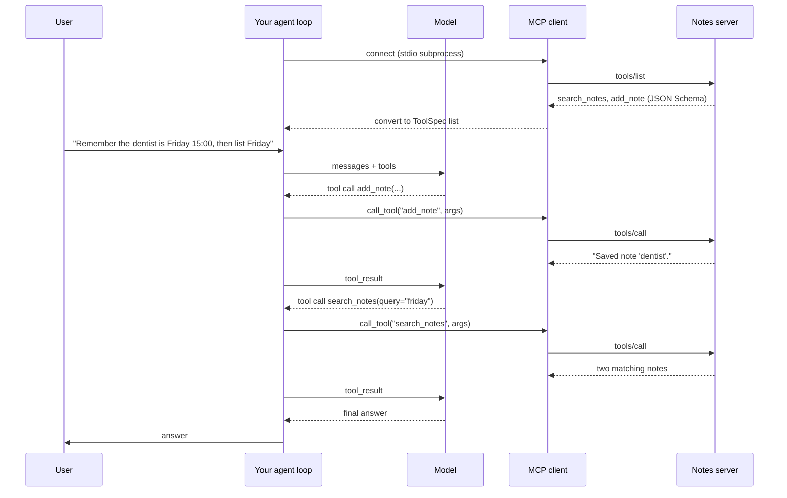

🏠 [Home](../../README.md) › [04 · Model Context Protocol (MCP)](./README.md) › 4.5 Connect MCP to an agent

# 4.5 Connect MCP to an agent

> **Difficulty:** 🟡 Intermediate · **Reading time:** ~12 min · **Prerequisites:** [4.4 Build a simple MCP server](./04.4-build-a-simple-mcp-server.md), [2.3 A 50-line agent from scratch](../02-the-agent-loop/02.3-a-50-line-agent-from-scratch.md)
>
> Last verified: November 2026 with mcp==2.3.0, anthropic==2.8.0 and openai==3.49.0

**In one sentence:** To give your own agent MCP tools, open a client session, convert each tool from `tools/list` into the tool format your model API expects, and forward every tool call the model makes to `tools/call`; or let the provider connect to a remote MCP server for you.

📑 **On this page**

- [Why does this matter?](#-why-does-this-matter)
- [The idea, in plain words](#-the-idea-in-plain-words)
- [Picture it](#-picture-it)
- [How it works, step by step](#-how-it-works-step-by-step)
- [Worked example](#-worked-example)
- [Code](#-code)
- [Common mistakes & gotchas](#-common-mistakes--gotchas)
- [Key takeaways](#-key-takeaways)
- [Try it yourself](#-try-it-yourself)
- [Further reading](#-further-reading)

## 🤔 Why does this matter?

Desktop apps and IDEs already know how to use [MCP servers](../../GLOSSARY.md#mcp-server). But you're building your own [agent](../../GLOSSARY.md#agent), with your own [agent loop](../../GLOSSARY.md#agent-loop) from chapter 02. You want it to use the notes server you just built, and maybe a public GitHub or database server tomorrow, without writing a custom [tool](../../GLOSSARY.md#tool) wrapper for each.

That makes *your agent* the [MCP host](../../GLOSSARY.md#mcp-host). This page shows the small adapter that turns any MCP server's tools into tools your model can call, plus the shortcut some providers offer: connecting to a remote MCP server for you, on their side.

## 🧠 The idea, in plain words

Your agent already speaks one language to the model: a list of tools, each with a name, a description and a JSON Schema ([3.2](../03-tools-and-function-calling/03.2-json-schema-for-tools.md)). An MCP server speaks almost the same language: its tools also have a name, a description and a JSON Schema.

So the adapter is a **translator at a border crossing**:

- Going in: MCP tool definitions → your model's tool definitions.
- Coming back: the model's tool call → an MCP `tools/call` request.
- And back again: the MCP result (content blocks, `isError`) → a tool result message.

The model never knows the tools live in another process. The code on this page uses a neutral tool format, `{"name", "description", "input_schema"}`, which converts easily to both Anthropic and OpenAI shapes.

## 👀 Picture it



*The loop is the same as in chapter 02. Only the "run the tool" step changed: instead of calling a local Python function, the agent sends `tools/call` to a server.*

## 🔍 How it works, step by step

1. **Connect.** `async with Client(target)` where `target` is a `StdioServerParameters` (launch a local server), a URL ([Streamable HTTP](../../GLOSSARY.md#streamable-http)), or, in tests, the server object itself.
2. **Discover.** `await client.list_tools()` returns `Tool` objects with `name`, `description` and `input_schema`.
3. **Filter.** Keep only the tools this agent needs. Fewer tools means less context and fewer wrong choices, and it is your first line of defence ([4.6](./04.6-mcp-security.md)).
4. **Convert.** Map each tool to `{"name", "description", "input_schema"}`. The schema copies straight across. If you combine several servers, prefix names (`notes__search`) so two `search` tools can't collide; the MCP spec recommends a disambiguation strategy like this and warns that server names aren't guaranteed to be unique. MCP allows dots in tool names, so also check your model provider's naming rules.
5. **Loop.** Call the model with the tools. For each tool call, check that the name is one you exposed, then `await client.call_tool(name, arguments)`.
6. **Convert the result.** Join the text blocks. Describe non-text blocks (images, audio) rather than dropping them silently, or pass them on if your provider accepts them. Carry `is_error` across, so the model knows the call failed ([2.5](../02-the-agent-loop/02.5-handling-errors-in-the-loop.md)).
7. **Close.** Leaving the `async with` block shuts the connection and, for [stdio](../../GLOSSARY.md#stdio-transport), the server process.

### Or let the provider do it

Some model APIs can connect to a **remote** MCP server themselves. You pass the server's URL in the request; the provider lists its tools, lets the model call them and puts the calls and results in the response. You write no client code.

| | Your own MCP client (this page's example) | Anthropic MCP connector | OpenAI remote MCP tool |
| --- | --- | --- | --- |
| Where the MCP connection runs | Your process | Anthropic's servers | OpenAI's servers |
| Request shape | Your tools list, built from `tools/list` | `mcp_servers=[...]` plus a `{"type": "mcp_toolset"}` entry in `tools`, beta header `mcp-client-2025-11-20` | A `{"type": "mcp", "server_url": ...}` entry in `tools`, Responses API |
| Local stdio servers | Yes | No: the server must be reachable over HTTP | Remote URLs (OpenAI also documents a tunnel option for local servers) |
| MCP features | Whatever your client implements | Tools only | Tools |
| Approval before a call | Your code decides | Configure per tool (allowlist or denylist) | `require_approval`, which asks by default; `allowed_tools` |

In practice, we recommend your own client when you need local servers, tests, logging or fine control, and the provider-side option for quick access to public remote servers.

## 💡 Worked example

The model's replies are scripted with a [mock LLM](../../GLOSSARY.md#mockllm), but the server is real: the agent launches `notes_server.py` from 4.4 over stdio.

```text
Goal: Remember that my dentist appointment is on Friday at 15:00. Then tell me everything I have on Friday.

tools/list -> ['search_notes', 'add_note']; exposing ['search_notes', 'add_note']
step 1: tools/call add_note({'title': 'dentist', 'text': 'Dentist appointment on Friday at 15:00.'}) -> "Saved note 'dentist'."
step 2: tools/call search_notes({'query': 'friday'}) -> 'trip: Train to Lyon on Friday at 09:12, platform 4.\ndentist: Dentist appointment on Friday at 15:00.'
step 3: answer

Answer: Saved. On Friday you have: Train to Lyon on Friday at 09:12, platform 4; Dentist appointment on Friday at 15:00.
```

On its first call, the model received two ordinary tools, `search_notes` and `add_note`, each with the description and JSON Schema the server published (including `maxLength: 40` on the title). An in-process test can check exactly that.

And with `allowed_tools={"search_notes"}`, the model only sees `search_notes`; if it still asks for `add_note`, the agent replies with an error result (`Tool 'add_note' is not available.`) and never contacts the server.

## 💻 Code

The adapter and the loop. `llm` is any chat-model client, as in [2.1](../02-the-agent-loop/02.1-the-observe-think-act-loop.md#-code), and `user()` and `tool_result()` just build neutral message dicts:

```python
from mcp import Client
from mcp.types import CallToolResult, Tool


def to_tool_spec(tool: Tool, prefix: str = "") -> dict:
    """MCP tool -> a neutral {name, description, input_schema} spec."""
    return {"name": prefix + tool.name, "description": tool.description or "", "input_schema": tool.input_schema}


def to_text(result: CallToolResult) -> str:
    """MCP result -> text for a tool_result message."""
    parts = [b.text if b.type == "text" else f"[{b.type} content omitted]" for b in result.content]
    return "\n".join(parts)


async def run_agent(llm, goal: str, client: Client, allowed: set[str] | None = None) -> str:
    tools = [t for t in (await client.list_tools()).tools if allowed is None or t.name in allowed]
    specs = [to_tool_spec(t) for t in tools]
    names = {s["name"] for s in specs}
    messages = [user(goal)]
    for _ in range(6):                                    # step limit
        reply = llm.chat(messages, system="You manage the user's notes.", tools=specs)
        messages.append(reply.to_message())
        if not reply.tool_calls:
            return reply.text
        for call in reply.tool_calls:
            if call.name not in names:                    # never forward a tool we didn't expose
                messages.append(tool_result(call.id, f"Tool {call.name!r} is not available.", is_error=True))
                continue
            result = await client.call_tool(call.name, call.arguments)
            messages.append(tool_result(call.id, to_text(result), is_error=bool(result.is_error)))
    return "I could not finish within the step limit."
```

Connecting it to a local server over stdio:

```python
import asyncio
import sys

from mcp import StdioServerParameters

params = StdioServerParameters(command=sys.executable, args=["notes_server.py"])

async def main() -> None:
    async with Client(params) as client:
        print(await run_agent(llm, "What do I have on Friday?", client))   # llm: your chat-model client

asyncio.run(main())
```

**Offline tests** connect in-process with `Client(server_object)`: no subprocess, no network, and a scripted fake model in place of a real one. Check that the tool specs match the server, that writes reach the server, that `is_error` is passed on, and that the allowlist blocks calls.

**Provider-side, Anthropic.** The MCP connector (beta). Both halves are required: the server in `mcp_servers`, and an `mcp_toolset` entry in `tools` that names it.

```python
import anthropic

client = anthropic.Anthropic()  # needs ANTHROPIC_API_KEY
response = client.beta.messages.create(
    model="claude-opus-5-5",
    max_tokens=4000,
    betas=["mcp-client-2025-11-20"],
    mcp_servers=[{"type": "url", "url": "https://notes.example.com/mcp", "name": "notes",
                  "authorization_token": "YOUR_TOKEN"}],          # optional, for servers that need OAuth
    tools=[{"type": "mcp_toolset", "mcp_server_name": "notes"}],
    messages=[{"role": "user", "content": "What do I have on Friday?"}],
)
```

**Provider-side, OpenAI.** The remote MCP tool in the Responses API:

```python
import os
from openai import OpenAI

client = OpenAI()  # needs OPENAI_API_KEY
response = client.responses.create(
    model=os.environ["OPENAI_MODEL"],
    tools=[{
        "type": "mcp",
        "server_label": "notes",
        "server_url": "https://notes.example.com/mcp",
        "allowed_tools": ["search_notes"],   # import only what you need
        "require_approval": "always",        # the response asks for approval before each call
    }],
    input="What do I have on Friday?",
)
print(response.output_text)
```

## 🚨 Common mistakes & gotchas

- **Re-listing tools on every model call.** Listing once per session is usually enough, and changing the tool list mid-conversation can break [prompt caching](../16-cost-and-performance/16.2-prompt-caching.md). The spec asks servers to return tools in a stable order to help with this.
- **Forwarding any tool name the model produces.** Check it against the list you exposed. Models occasionally invent names, and a prompt-injected model may try tools you deliberately hid.
- **Dropping `isError`.** If you pass a failure back as plain text without the error flag, the model may treat it as data.
- **Merging servers without prefixes.** Two servers with a `search` tool means one silently shadows the other.
- **Assuming the provider connector supports everything.** Anthropic's MCP connector supports tool calls only, and only for servers exposed over HTTP; local stdio servers need your own client.
- **Leaving approvals off for remote servers you don't control.** OpenAI's tool asks for approval by default for a reason. Turn it off only for servers and tools you trust.

## ✅ Key takeaways

- When you connect MCP to your own agent, your agent is the host.
- The adapter is small: tools from `tools/list` → your tool format; tool calls → `tools/call`; results → `tool_result` with `is_error`.
- Expose only the tools you need, prefix names when merging servers, and refuse calls to anything you didn't expose.
- Test offline with an in-process `Client(server)` and a scripted model.
- Provider-side MCP (Anthropic's MCP connector, OpenAI's remote MCP tool) saves code for remote servers, at the cost of control.

## 🧪 Try it yourself

1. In the code above, give `to_tool_spec` the prefix `"notes__"`. What else must change for the model's calls to reach the server?
2. The notes server returns `structured_content` for `search_notes`. When would you send the model that JSON instead of the joined text?

<details>
<summary>Show answer</summary>

1. The model now calls `notes__search_notes`, but the server only knows `search_notes`. Keep a mapping from exposed name to `(client, original_name)`, and strip the prefix before `call_tool`. With several servers, that mapping is also how you route each call to the right client.
2. When the next step needs exact fields, for example when the model must pick an ID out of a list of records, or when your own code post-processes the result. JSON is unambiguous; joined text is easier to read. Many agents send the text and keep the structured content for logging and checks.

</details>

## 📚 Further reading

- [Build an MCP client](https://modelcontextprotocol.io/docs/2026-07-28/develop/build-client) (modelcontextprotocol.io). The official client tutorial.
- [MCP connector](https://platform.claude.com/docs/en/agents-and-tools/mcp-connector) (Anthropic docs). Remote MCP servers from the Messages API, tool allowlists and pinning a server's tool list.
- [MCP servers](https://developers.openai.com/api/docs/guides/tools-connectors-mcp) (OpenAI docs). The remote MCP tool in the Responses API, approvals and risks.
- [Client best practices](https://modelcontextprotocol.io/docs/2026-07-28/develop/clients/client-best-practices) (modelcontextprotocol.io). Patterns for hosts that connect many servers and tools.

<!-- FOOTER -->

---

⬅️ **Previous:** [4.4 Build a simple MCP server](./04.4-build-a-simple-mcp-server.md) ·
🏠 [Chapter home](./README.md) ·
➡️ **Next:** [4.6 Security for MCP servers](./04.6-mcp-security.md)
