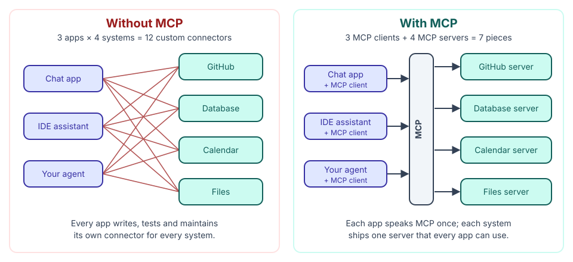

🏠 [Home](../../README.md) › 04 · Model Context Protocol (MCP)

# 04 · Model Context Protocol (MCP)

> **Padhne ka time:** ~64 min · **Level:** 🟢 Beginner se 🔴 Advanced · **Pehle padho:** [03 · Tools & Function Calling](../03-tools-and-function-calling/README.md)

Chapter 03 mein tumne agent ko tools diye, unhe apne code mein likh ke. Yeh tab tak chalta hai jab tak wahi tool paanch apps mein na chahiye, ya tum kisi aur ke likhe tools use na karna chaho. Model Context Protocol (MCP) woh open standard hai jo yeh problem solve karta hai. Kisi system ko ek baar MCP server ki tarah wrap karo, aur jo bhi AI app MCP bolta hai woh usse use kar sakta hai.

Yeh chapter samjhata hai ki MCP kyun bana, uske pieces kaise fit hote hain, Python mein server kaise banate aur test karte hain, MCP tools ko apne agent loop mein kaise plug karte hain, aur jab server tumhara na ho toh safe kaise rehte hain. Sab kuch current specification (revision 2026-07-28) aur Python SDK 2.x (`mcp==2.3.0`) ke hisaab se likha gaya hai.

## 🎯 Is chapter mein kya seekhoge

- N × M integration problem, aur MCP usse N + M kaise banata hai
- Teen roles (host, client, server) aur do transports (stdio aur Streamable HTTP)
- Revision 2026-07-28 mein kya badla: na `initialize` handshake, na sessions, aur optional `server/discover`
- Teen server primitives aur har ek ko kaun control karta hai: tools (model), resources (application), prompts (user)
- Python SDK ke `MCPServer` se MCP server kaise banate, test karte aur chalate hain
- MCP tools ko apne agent loop mein kaise daalte hain, aur kab Anthropic ya OpenAI ko tumhare liye remote server se connect karne dena chahiye
- MCP ke main security risks (tool poisoning, results mein prompt injection, rug pulls, confused deputy, token passthrough) aur unse practical bachav

## 📋 Pehle se kya aana chahiye

- [3.1 Tool kya hota hai?](../03-tools-and-function-calling/03.1-what-is-a-tool.md), [3.2 Tool definitions ke liye JSON Schema](../03-tools-and-function-calling/03.2-json-schema-for-tools.md) aur [3.3 Function calling kaise kaam karta hai](../03-tools-and-function-calling/03.3-how-function-calling-works.md)
- [2.3 50 lines mein agent, bilkul zero se](../02-the-agent-loop/02.3-a-50-line-agent-from-scratch.md), page 4.5 ke liye
- [0.3 Setup](../00-start-here/00.3-setup.md), taaki code snippets chala sako
- Python mein basic `async`/`await` aata ho toh madad milegi; code snippets jo use karte hain woh samjha dete hain

## 👀 Chapter ek nazar mein

*Poora chapter ek picture mein. Pages 4.1 se 4.3 right side samjhate hain, 4.4 ek server banata hai, 4.5 ek client banata hai, aur 4.6 poochta hai ki jab right side ke kisi box par bharosa na kiya ja sake tab kya hota hai.*

## 📄 Is chapter ke pages

<!-- PAGES:START -->
| # | Page | Level | Time |
| --- | --- | --- | --- |
| 4.1 | [MCP kyun bana?](./04.1-why-mcp-exists.md) — Woh integration problem jo MCP solve karta hai. | 🟢 Beginner | ~7 min |
| 4.2 | [Hosts, clients aur servers](./04.2-hosts-clients-and-servers.md) — MCP ke teen roles aur woh aapas mein kaise baat karte hain. | 🟢 Beginner | ~8 min |
| 4.3 | [Tools, resources aur prompts](./04.3-tools-resources-and-prompts.md) — Teen cheezein jo ek MCP server offer kar sakta hai. | 🟡 Intermediate | ~10 min |
| 4.4 | [Ek simple MCP server banao](./04.4-build-a-simple-mcp-server.md) — Python mein apna pehla MCP server likho aur test karo. | 🟡 Intermediate | ~15 min |
| 4.5 | [MCP ko agent se jodo](./04.5-connect-mcp-to-an-agent.md) — Apne agent loop se ek MCP server ke tools use karo. | 🟡 Intermediate | ~12 min |
| 4.6 | [MCP servers ki security](./04.6-mcp-security.md) — Trust, permissions aur third-party servers ke risks. | 🔴 Advanced | ~12 min |
<!-- PAGES:END -->

<!-- FOOTER -->

---

⬅️ **Pichla chapter:** [03 · Tools & Function Calling](../03-tools-and-function-calling/README.md) ·
▶️ **Padhna shuru karo:** [4.1 MCP kyun bana?](./04.1-why-mcp-exists.md) ·
➡️ **Agla chapter:** [05 · Memory](../05-memory/README.md)
