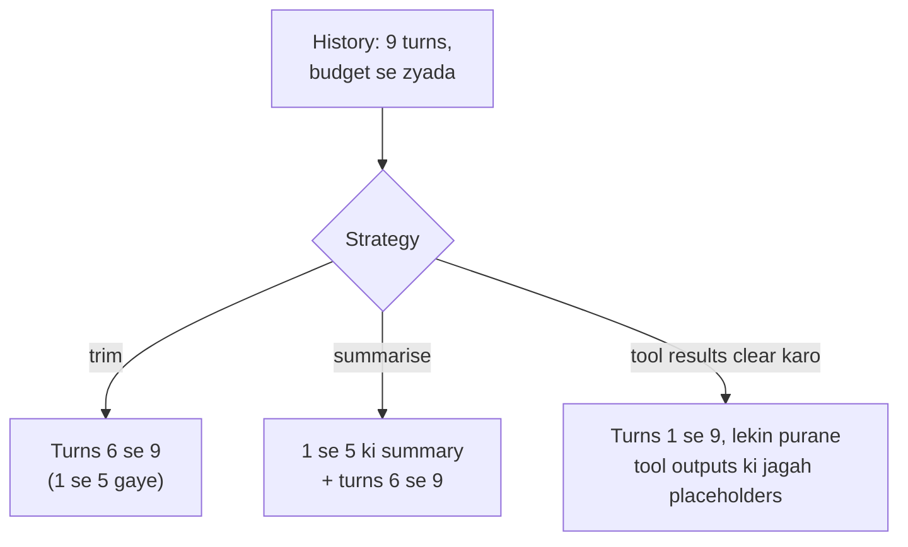

🏠 [Home](../../README.md) › [05 · Memory](./README.md) › 5.2 Summarisation aur context compaction

# 5.2 Summarisation aur context compaction

> **Level:** 🟡 Intermediate · **Padhne ka time:** ~10 min · **Pehle padho:** [5.1 Short-term vs long-term memory](./05.1-short-term-vs-long-term-memory.md), [2.4 Agent kab ruke: stopping conditions](../02-the-agent-loop/02.4-stopping-conditions.md)
>
> Last verified: November 2026 with anthropic==2.8.0 and openai==3.49.0

**Ek line mein:** Jab conversation apne budget se badi ho jaaye, tab tum purane turns hata sakte ho (sasta, lekin bhoolne wala), unki ek chalti summary bana sakte ho (main baat bachi rehti hai), ya bhaari purane tool results clear kar sakte ho (structure bacha rehta hai). Aur ab Anthropic aur OpenAI dono server par tumhare liye compaction kar sakte hain.

📑 **Is page par**

- [Yeh kyun zaroori hai?](#-yeh-kyun-zaroori-hai)
- [Idea, simple words mein](#-idea-simple-words-mein)
- [Diagram se samjho](#-diagram-se-samjho)
- [Kaise kaam karta hai, step by step](#-kaise-kaam-karta-hai-step-by-step)
- [Example se samjho](#-example-se-samjho)
- [Code](#-code)
- [Aam galtiyan aur dhyan dene wali baatein](#-aam-galtiyan-aur-dhyan-dene-wali-baatein)
- [Yaad rakhne wali baatein](#-yaad-rakhne-wali-baatein)
- [Khud try karo](#-khud-try-karo)
- [Aur padhne ke liye](#-aur-padhne-ke-liye)

## 🤔 Yeh kyun zaroori hai?

Ek [agent](../../GLOSSARY.md#agent) bug fix kar raha hai. Woh bees files padhta hai, chhe baar tests chalata hai aur teen patches try karta hai. Har file aur har test log conversation mein reh jaata hai. Aur poori conversation har step par dobara bheji jaati hai. Step 40 tak har call mein lakhon [tokens](../../GLOSSARY.md#token) ho jaate hain. Yeh slow hai, mehenga hai, aur model woh details miss karne lagta hai jo step 5 par bilkul clear thi. Aakhir mein request fit hi nahi hoti.

Ek chat assistant bhi isi deewar se takraata hai, bas dheere. Kuch hafte roz use karne ke baad, ek lamba thread itni history rakhta hai jitni kisi model call mein nahi honi chahiye.

Tumhe ek tarika chahiye jo conversation ko budget ke andar rakhe, aur zaroori cheezein bhi na khoye.

## 🧠 Idea, simple words mein

Ek lambi project meeting ke baare mein socho. Koi bhi nayi meeting se pehle pichhle mahine ki meetings ki recording dobara nahi chalata. Uski jagah:

- Koi **minutes** likhta hai: chhote notes ki kya decide hua aur kya abhi open hai. Yeh hai **summarisation**.
- Log hafton purani idhar-udhar ki baatein bas **bhool jaate hain**. Yeh hai **trimming**.
- Bade attachments (80 page ki report) discuss hone ke baad **file mein rakh diye jaate hain**. Minutes mein bas likha hota hai "report review ho gayi, file dekho". Yeh hai **purane [tool](../../GLOSSARY.md#tool) results clear karna**.

Desi version chahiye? Exam ki taiyari socho. Tum poori textbook dobara nahi padhte. Tum apne short notes padhte ho (summary), aur last chapter jo abhi padha hai woh poora dimaag mein hai (recent turns).

**[Context compaction](../../GLOSSARY.md#context-compaction)** ek general naam hai conversation ko chhota karne ka, taaki woh chalti rahe. Purane turns ki jagah ek summary rakh do, taaki model poori history ki jagah summary se aage badhe. Yeh tum apne code mein kar sakte ho, ya provider ka koi feature on kar sakte ho jo yeh server par karta hai.

| Strategy | Kya bachta hai | Kya khota hai | Cost |
| --- | --- | --- | --- |
| **Trim** (sliding window) | Last N turns, word for word | Usse purana sab kuch, poora | Free |
| **Summarise** (rolling summary) | Purane turns ki main baat + recent turns word for word | Woh details jo summary ne chhod di | Har baar ek extra model call |
| **Purane tool results clear karo** ([context editing](../../GLOSSARY.md#context-editing)) | Har turn aur har tool call, bas purane bhaari results nahi | Purane raw outputs (model tool dobara call kar sakta hai) | Free, lekin us point se prompt cache invalid ho jaata hai |
| **Long-term memory mein offload karo** | Woh notes jo agent ne file ya store mein likhe | Jo kuch usne likha nahi | Likhne aur padhne ke liye tool calls |

## 👀 Diagram se samjho



*Teeno request ko budget ke andar le aate hain. Sirf summary turn 1 ke facts bachati hai. Aur sirf clearing poora sequence bachati hai ki kya-kya try kiya gaya.*

## 🔍 Kaise kaam karta hai, step by step

**1. Measure karo.** Pata hona chahiye ki agli request kitni badi hogi. Provider ka token counter use karo, ya last reply ka `usage.input_tokens`. Characters ÷ 4 sirf ek rough andaaza hai ([1.4](../01-foundations/01.4-how-llms-work.md)).

**2. Trigger set karo.** Jaise "jab history budget ka 60% paar kare tab compact karo". Bahut jaldi compact karoge toh calls waste hongi. Bahut der se karoge toh summary wali request khud shayad fit na ho.

**3. Decide karo kya word for word rahega.** Aam taur par [system prompt](../../GLOSSARY.md#system-prompt), original task aur last kuch turns. Recent detail sabse zyada matter karti hai.

**4. Safe boundary par kaato.** Kabhi bhi tool call ko uske result se alag mat karo. Zyadatar APIs bina call ke tool result ko reject kar deti hain. User message se theek pehle kaatna hamesha safe hai.

**5. Baaki ki summary banao.** Purane turns (aur koi pichhli summary) ek model ko bhejo, aise prompt ke saath jo bataye kya rakhna hai: decisions, facts, naam, numbers, open sawal aur user ki preferences. Ek chhota, sasta model aksar yeh achhe se kar leta hai.

**6. Summary wahan rakho jahan model use use karega.** System prompt mein (jaise neeche wale example mein), ya nayi history ke pehle message ke roop mein. Phir recent turns ke saath aage badho.

**7. Repeat karo.** Summaries aage roll hoti hain: agli summary mein pichhli summary bhi shaamil hoti hai.

### Provider se karwao

**Anthropic (beta).** Messages API par do server-side options, plus context editing:

- *Token threshold par compaction:* beta header `compact-2026-01-12` ke saath `context_management={"edits": [{"type": "compact_20260112"}]}` add karo. Jab input tokens trigger tak pahunchte hain (default 150,000; tum set kar sakte ho, minimum 50,000), Claude ek `compaction` block mein summary likhta hai aur aage chalta hai. Tumhe apni history mein **poora** `response.content` append karna hoga, sirf text nahi. Kyunki agli request par API usi block ko use karke usse pehle ka sab hata deti hai. Optional: summary ke liye custom `instructions`, aur `pause_after_compaction`.
- *Demand par compaction:* beta `compact-2026-09-04` ke saath, jab *tum* chaho tab conversation `compaction={"type": "summarize"}` ke saath bhejo. Tumhe ek `compaction` block wapas milta hai. Use `messages` mein sabse pehle rakho, un turns ki jagah jinki woh summary hai. Anthropic ke docs kehte hain ki jahan available ho, yahi form use karo.
- *Context editing* (beta `context-management-2025-06-27`): `clear_tool_uses_20250919` trigger aane par purane tool results clear karta hai, sabse recent wale rakh ke. `clear_thinking_20251015` purane thinking blocks clear karta hai. Yeh kaant-chhaant karta hai; summary nahi banata.

**OpenAI.** Responses API `context_management=[{"type": "compaction", "compact_threshold": ...}]` ke saath server-side compaction support karti hai, aur ek alag `/responses/compact` endpoint bhi hai. Iska compaction item encrypted hai aur insaan ke padhne ke liye nahi bana. Tum use wapas bhejte ho, lekin use dekh ya edit nahi kar sakte.

Practice mein hamari salah hai: ek hi provider par chalne wale long-running agents ke liye provider compaction se shuru karo. Apna summariser tab rakho jab tumhe readable summary chahiye, provider-neutral design chahiye, ya exactly kya bachega uspe control chahiye.

## 💡 Example se samjho

Yahan same aath turn wali travel chat do baar chalti hai, lagbhag 150 tokens ke budget ke saath (bahut chhota, taaki tum hote hue dekh sako). Turn 1 kehta hai *"My budget is 900 euros and I'm vegetarian."* Turn 8 poochta hai *"Remind me: what is my budget?"*

```text
=== TrimmingMemory (budget ~150 tokens) ===
turn 1: sent ~ 38 tokens, 1 msgs
turn 2: sent ~ 69 tokens, 3 msgs
turn 3: sent ~106 tokens, 5 msgs
turn 4: sent ~137 tokens, 7 msgs
turn 5: sent ~116 tokens, 7 msgs  <- trimmed 2 messages
turn 6: sent ~142 tokens, 9 msgs
turn 7: sent ~129 tokens, 9 msgs  <- trimmed 2 messages
turn 8: sent ~134 tokens, 9 msgs  <- trimmed 2 messages
Is '900 euros' still in the context of the last turn? NO

=== SummarisingMemory (budget ~150 tokens) ===
turn 1: sent ~ 38 tokens, 1 msgs
turn 2: sent ~ 69 tokens, 3 msgs
turn 3: sent ~106 tokens, 5 msgs
turn 4: sent ~137 tokens, 7 msgs
turn 5: sent ~109 tokens, 5 msgs  <- summarised 4 messages into 17 tokens
turn 6: sent ~136 tokens, 7 msgs
turn 7: sent ~131 tokens, 5 msgs  <- summarised 4 messages into 47 tokens
turn 8: sent ~141 tokens, 5 msgs  <- summarised 2 messages into 47 tokens
Is '900 euros' still in the context of the last turn? yes
Running summary:
- Budget: 900 euros for four days in Lisbon in May.
- Diet: vegetarian.
- Decided: stay in Alfama (guesthouse about 70 euros a night).
- Day trip: Sintra, train from Rossio, about 40 minutes.
```

Dono budget ke andar rehte hain. Trimming turn 5 par budget bhool gaya, toh ek asli model turn 8 ka jawab nahi de paata. Summarising ne use kuch hi tokens mein bacha ke rakha. (Is run mein summaries ek rule-based stand-in se aayi thi; asli provider ke saath, model unhe likhta hai.)

## 💻 Code

Client-side summarising memory ka core:

```python
from dataclasses import dataclass, field
from typing import Callable

BASE_SYSTEM = "You are a friendly travel planner."
SUMMARY_REQUEST = ("Summarise the conversation below for an assistant who will continue it. Write short bullet "
                   "points. Keep names, numbers, dates and the user's preferences.\n\n")


def estimate_tokens(messages, system=""):
    return (len(system) + sum(len(str(m.get("content") or "")) for m in messages)) // 4  # bas rough andaaza!


def safe_cut(messages, keep_recent):
    """Rakha hua tail user message se shuru karo, taaki tool call kabhi apne result se alag na ho."""
    cut = max(0, len(messages) - keep_recent)
    while cut > 0 and messages[cut]["role"] != "user":
        cut -= 1
    return cut


@dataclass
class SummarisingMemory:
    summarise: Callable[[str], str]   # prompt -> text: koi bhi model call, chat model se sasta bhi ho sakta hai
    max_tokens: int = 4000
    keep_recent: int = 6
    summary: str = ""
    messages: list = field(default_factory=list)

    def system(self) -> str:
        return BASE_SYSTEM + (f"\n\n<conversation_summary>\n{self.summary}\n</conversation_summary>" if self.summary else "")

    def fit(self) -> None:
        if estimate_tokens(self.messages, self.system()) <= self.max_tokens:
            return
        cut = safe_cut(self.messages, self.keep_recent)
        if cut == 0:
            return
        old, self.messages = self.messages[:cut], self.messages[cut:]
        transcript = "\n".join(f"{m['role']}: {m['content']}" for m in old if m.get("content"))
        if self.summary:                                   # pichhli summary ko aage roll karo
            transcript = f"Earlier summary:\n{self.summary}\n\nNewer turns:\n{transcript}"
        self.summary = self.summarise(SUMMARY_REQUEST + transcript).strip()
```

Har turn: user message append karo, `fit()` call karo, phir `memory.messages` ko `system=memory.system()` ke saath bhejo.

**Server-side, Anthropic** (beta; threshold par compaction):

```python
import anthropic

client = anthropic.Anthropic()  # ANTHROPIC_API_KEY chahiye
messages = [{"role": "user", "content": "Help me plan four days in Lisbon."}]

response = client.beta.messages.create(
    betas=["compact-2026-01-12"],
    model="claude-opus-5-5",
    max_tokens=16000,
    messages=messages,
    context_management={"edits": [{"type": "compact_20260112",
                                    "trigger": {"type": "input_tokens", "value": 150000}}]},
)
# POORA content append karo: isme ek `compaction` block ho sakta hai jo API ko agli baar chahiye.
messages.append({"role": "assistant", "content": response.content})
```

**Server-side, OpenAI** (Responses API):

```python
import os
from openai import OpenAI

client = OpenAI()  # OPENAI_API_KEY chahiye
conversation = [{"type": "message", "role": "user", "content": "Help me plan four days in Lisbon."}]

response = client.responses.create(
    model=os.environ["OPENAI_MODEL"],
    input=conversation,
    context_management=[{"type": "compaction", "compact_threshold": 200000}],
)
conversation.extend(response.output)  # jab compaction item bane, toh woh (encrypted) item bhi isme hota hai
```

## 🚨 Aam galtiyan aur dhyan dene wali baatein

- **Tool call ko uske result se alag kar dena.** Tab trimmed history ek akele `tool_result` se shuru hoti hai, aur API use reject kar deti hai. Sirf user message se pehle kaato.
- **Server-side compaction on ho tab reply ka sirf text append karna.** `compaction` block kho jaata hai aur API purani history hata nahi paati. Poora content append karo (Anthropic) ya saare output items (OpenAI).
- **Dhundhla summary prompt.** "Summarise this" ek pyaara sa paragraph deta hai jisme numbers gayab ho jaate hain. List karo kya bachna hi chahiye: decisions, constraints, naam, IDs, numbers, open sawal.
- **Summary ki summary hamesha banate rehna.** Har round thoda kuch khota hai. Zaroori facts (budget, diet) ko sirf summary mein nahi, [long-term memory](../../GLOSSARY.md#long-term-memory) mein bhi rakho ([5.4](./05.4-episodic-semantic-and-procedural-memory.md)).
- **Prompt cache ko bhool jaana.** History rewrite ya clear karne se request ka prefix badalta hai, isliye us point se cache dobara banta hai ([16.2](../16-cost-and-performance/16.2-prompt-caching.md)). Har turn par thoda-thoda nahi, bade aur kam steps mein compact karo.
- **Sirf chhoti conversations test karna.** Compaction ke bugs turn 50 par dikhte hain, turn 3 par nahi. Ek test likho jo lambi scripted conversation chalaye, jaise example wali aath turn ki chat.

## ✅ Yaad rakhne wali baatein

- Har lambi conversation ko ek plan chahiye ki jab woh budget se badi ho jaaye tab kya karna hai.
- Trimming free hai lekin bhoolta hai. Summarising ek extra call mein main baat bachata hai. Tool results clear karna structure bachata hai.
- User-message boundaries par kaato, recent turns word for word rakho, aur summaries aage roll karo.
- Anthropic (threshold ya on-demand compaction, context editing) aur OpenAI (Responses API compaction) yeh server-side kar sakte hain. Jo compaction data wapas aaye, use bilkul waisa hi append karo.
- Jo facts kabhi nahi khone chahiye, unhe sirf summary mein nahi, long-term memory mein bhi rakho.

## 🧪 Khud try karo

1. Example mein `keep_recent=4` use hua tha. Maan lo tum ise 2 kar do. Summary calls ki ginti ka kya hoga, aur asli system mein yeh ek bura sauda kyun ho sakta hai?
2. Ek coding agent ka 80% context purane test logs hain. Kaunsi strategy sabse sahi baithti hai, aur kyun?

<details>
<summary>Answer dekho</summary>

1. Ab har compaction zyada messages hatata hai, toh requests chhoti hoti hain. Lekin model kam recent turns word for word dekhta hai, aur wahi jagah hai jahan usse sabse zaroori detail aksar milti hai. Agar tum summariser ke roop mein asli model use karte ho, toh conversation ka zyada hissa jaldi ek lossy summary se guzarta hai. Chhota hona apne aap behtar nahi hai: sirf tokens nahi, jawab ki quality measure karo.
2. Purane tool results clear karna (context editing). Logs bhaari hain, jaldi purane ho jaate hain, aur tests dobara chala ke aasani se wapas ban sakte hain. Unhe clear karne se har decision aur code change history mein bacha rehta hai. Jabki summarising bilkul wahi details dhundhli kar dega (kaunsa test fail hua, kaunsa patch try hua) jo coding agent ko chahiye.

</details>

## 📚 Aur padhne ke liye

- [Compaction overview](https://platform.claude.com/docs/en/build-with-claude/compaction) (Anthropic docs). On-demand versus threshold compaction, aur apna summariser kab likhna chahiye.
- [Context editing](https://platform.claude.com/docs/en/build-with-claude/context-editing) (Anthropic docs). Tool results aur thinking blocks clear karna, aur caching par uska asar.
- [Compaction](https://developers.openai.com/api/docs/guides/compaction) (OpenAI docs). Responses API mein server-side compaction aur alag compact endpoint.
- [Effective context engineering for AI agents](https://www.anthropic.com/engineering/effective-context-engineering-for-ai-agents) (Anthropic). Compaction pehla lever kyun hai, aur compaction prompt ko kaise tune karein: pehle recall maximise karo, phir precision.
- [MemGPT: Towards LLMs as Operating Systems](https://arxiv.org/abs/2310.08560) (Packer et al., 2023). [Context window](../../GLOSSARY.md#context-window) ko RAM ki tarah treat karta hai, information ko andar-bahar page karta hai.

<!-- FOOTER -->

---

⬅️ **Pichla:** [5.1 Short-term vs long-term memory](./05.1-short-term-vs-long-term-memory.md) ·
🏠 [Chapter home](./README.md) ·
➡️ **Agla:** [5.3 Vector memory](./05.3-vector-memory.md)
