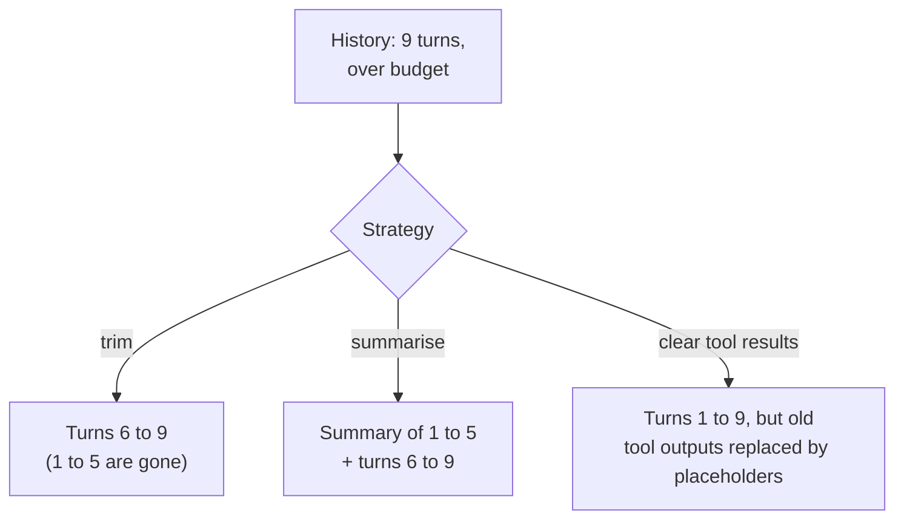

🏠 [Home](../../README.md) › [05 · Memory](./README.md) › 5.2 Summarisation & context compaction

# 5.2 Summarisation & context compaction

> **Difficulty:** 🟡 Intermediate · **Reading time:** ~10 min · **Prerequisites:** [5.1 Short-term vs long-term memory](./05.1-short-term-vs-long-term-memory.md), [2.4 Stopping conditions](../02-the-agent-loop/02.4-stopping-conditions.md)
>
> Last verified: November 2026 with anthropic==2.8.0 and openai==3.49.0

**In one sentence:** When a conversation outgrows its budget you can drop old turns (cheap, forgetful), summarise them into a running summary (keeps the gist), or clear bulky old tool results (keeps the structure), and both Anthropic and OpenAI can now do compaction for you on the server.

📑 **On this page**

- [Why does this matter?](#-why-does-this-matter)
- [The idea, in plain words](#-the-idea-in-plain-words)
- [Picture it](#-picture-it)
- [How it works, step by step](#-how-it-works-step-by-step)
- [Worked example](#-worked-example)
- [Code](#-code)
- [Common mistakes & gotchas](#-common-mistakes--gotchas)
- [Key takeaways](#-key-takeaways)
- [Try it yourself](#-try-it-yourself)
- [Further reading](#-further-reading)

## 🤔 Why does this matter?

An [agent](../../GLOSSARY.md#agent) fixing a bug reads twenty files, runs the tests six times and tries three patches. Every file and every test log stays in the conversation, and the whole conversation is resent on every step. By step 40 each call carries hundreds of thousands of [tokens](../../GLOSSARY.md#token). It is slow, it is expensive, and the model starts missing details that were perfectly clear at step 5. Eventually the request no longer fits at all.

A chat assistant hits the same wall more slowly: after a few weeks of daily use, one long thread holds far more history than any model call should carry.

You need a way to keep the conversation inside a budget without losing what matters.

## 🧠 The idea, in plain words

Think about a long project meeting. Nobody replays the recording of last month's meetings before each new one. Instead:

- Someone keeps **minutes**: short notes of what was decided and what is still open. That's **summarisation**.
- People simply **forget small talk** from weeks ago. That's **trimming**.
- Big attachments (the 80-page report) are **filed away** once discussed; the minutes just say "report reviewed, see file". That's **clearing old [tool](../../GLOSSARY.md#tool) results**.

**[Context compaction](../../GLOSSARY.md#context-compaction)** is the general name for shrinking a conversation so it keeps working: replacing older turns with a summary, so the model continues from the summary instead of the full history. You can do it in your own code, or turn on a provider feature that does it on the server.

| Strategy | What it keeps | What it loses | Cost |
| --- | --- | --- | --- |
| **Trim** (sliding window) | The last N turns, word for word | Everything older, completely | Free |
| **Summarise** (rolling summary) | The gist of older turns + recent turns word for word | Details the summary left out | One extra model call each time |
| **Clear old tool results** ([context editing](../../GLOSSARY.md#context-editing)) | Every turn and every tool call, minus old bulky results | Old raw outputs (the model can call the tool again) | Free, but it invalidates the prompt cache from that point |
| **Offload to long-term memory** | Notes the agent wrote to a file or store | Anything it didn't write down | Tool calls to write and read |

## 👀 Picture it



*All three get the request under budget. Only the summary keeps facts from turn 1, and only clearing keeps the full sequence of what was tried.*

## 🔍 How it works, step by step

**1. Measure.** Know how big the next request will be. Use the provider's token counter or the `usage.input_tokens` of the last reply; characters ÷ 4 is only a rough guide ([1.4](../01-foundations/01.4-how-llms-work.md)).

**2. Set a trigger.** For example "compact when the history passes 60% of the budget". Compacting too early wastes calls; too late, and the summary request itself may not fit.

**3. Decide what stays word for word.** Usually the [system prompt](../../GLOSSARY.md#system-prompt), the original task and the last few turns. Recent detail matters most.

**4. Cut at a safe boundary.** Never separate a tool call from its result: most APIs reject a tool result without its call. Cutting just before a user message is always safe.

**5. Summarise the rest.** Send the old turns (and any previous summary) to a model with a prompt that says what to keep: decisions, facts, names, numbers, open questions and the user's preferences. A smaller, cheaper model often does this well.

**6. Put the summary where the model will use it.** In the system prompt (as in the example below), or as the first message of the new history. Then continue with the recent turns.

**7. Repeat.** Summaries roll forward: the next summary includes the previous one.

### Letting the provider do it

**Anthropic (beta).** Two server-side options on the Messages API, plus context editing:

- *Compaction at a token threshold:* add `context_management={"edits": [{"type": "compact_20260112"}]}` with the beta header `compact-2026-01-12`. When input tokens reach the trigger (by default 150,000; you can set it, with a minimum of 50,000), Claude writes a summary into a `compaction` block and continues. You must append the **whole** `response.content` to your history, not just the text, because the API uses that block to drop everything before it on the next request. Optional: custom `instructions` for the summary, and `pause_after_compaction`.
- *Compaction on demand:* with beta `compact-2026-09-04`, you send the conversation with `compaction={"type": "summarize"}` when *you* choose, get back a `compaction` block, and put it first in `messages` in place of the turns it summarises. Anthropic's docs recommend this form wherever it is available.
- *Context editing* (beta `context-management-2025-06-27`): `clear_tool_uses_20250919` clears old tool results when a trigger is reached, keeping the most recent ones; `clear_thinking_20251015` clears old thinking blocks. This prunes; it doesn't summarise.

**OpenAI.** The Responses API supports server-side compaction with `context_management=[{"type": "compaction", "compact_threshold": ...}]`, and a standalone `/responses/compact` endpoint. Its compaction item is encrypted and not meant to be human-readable: you pass it back, but you can't inspect or edit it.

In practice, we suggest starting with provider compaction for long-running agents on a single provider, and keeping your own summariser when you need a readable summary, a provider-neutral design, or control over exactly what is kept.

## 💡 Worked example

[`examples/05-summarising-memory`](../../examples/05-summarising-memory/README.md) runs the same eight-turn travel chat twice with a budget of about 150 tokens (tiny, so you can see it happen). Turn 1 says *"My budget is 900 euros and I'm vegetarian."* Turn 8 asks *"Remind me: what is my budget?"*

```text
=== TrimmingMemory (budget ~150 tokens) ===
turn 1: sent ~ 38 tokens, 1 msgs
turn 2: sent ~ 69 tokens, 3 msgs
turn 3: sent ~106 tokens, 5 msgs
turn 4: sent ~137 tokens, 7 msgs
turn 5: sent ~116 tokens, 7 msgs  <- trimmed 2 messages
turn 6: sent ~142 tokens, 9 msgs
turn 7: sent ~129 tokens, 9 msgs  <- trimmed 2 messages
turn 8: sent ~134 tokens, 9 msgs  <- trimmed 2 messages
Is '900 euros' still in the context of the last turn? NO

=== SummarisingMemory (budget ~150 tokens) ===
turn 1: sent ~ 38 tokens, 1 msgs
turn 2: sent ~ 69 tokens, 3 msgs
turn 3: sent ~106 tokens, 5 msgs
turn 4: sent ~137 tokens, 7 msgs
turn 5: sent ~109 tokens, 5 msgs  <- summarised 4 messages into 17 tokens
turn 6: sent ~136 tokens, 7 msgs
turn 7: sent ~131 tokens, 5 msgs  <- summarised 4 messages into 47 tokens
turn 8: sent ~141 tokens, 5 msgs  <- summarised 2 messages into 47 tokens
Is '900 euros' still in the context of the last turn? yes
Running summary:
- Budget: 900 euros for four days in Lisbon in May.
- Diet: vegetarian.
- Decided: stay in Alfama (guesthouse about 70 euros a night).
- Day trip: Sintra, train from Rossio, about 40 minutes.
```

Both stay under budget. Trimming forgot the budget at turn 5, so a real model couldn't answer turn 8. Summarising kept it in a few tokens. (Offline, the summaries come from a rule-based stand-in; with a real provider, the model writes them.)

## 💻 Code

The core of a client-side summarising memory, from [`examples/05-summarising-memory/main.py`](../../examples/05-summarising-memory/main.py):

```python
from dataclasses import dataclass, field

from common import LLM, user

BASE_SYSTEM = "You are a friendly travel planner."
SUMMARY_REQUEST = ("Summarise the conversation below for an assistant who will continue it. Write short bullet "
                   "points. Keep names, numbers, dates and the user's preferences.\n\n")


def estimate_tokens(messages, system=""):
    return (len(system) + sum(len(str(m.get("content") or "")) for m in messages)) // 4  # rough!


def safe_cut(messages, keep_recent):
    """Start the kept tail on a user message, so a tool call is never split from its result."""
    cut = max(0, len(messages) - keep_recent)
    while cut > 0 and messages[cut]["role"] != "user":
        cut -= 1
    return cut


@dataclass
class SummarisingMemory:
    llm: LLM                      # can be a cheaper model than the one you chat with
    max_tokens: int = 4000
    keep_recent: int = 6
    summary: str = ""
    messages: list = field(default_factory=list)

    def system(self) -> str:
        return BASE_SYSTEM + (f"\n\n<conversation_summary>\n{self.summary}\n</conversation_summary>" if self.summary else "")

    def fit(self) -> None:
        if estimate_tokens(self.messages, self.system()) <= self.max_tokens:
            return
        cut = safe_cut(self.messages, self.keep_recent)
        if cut == 0:
            return
        old, self.messages = self.messages[:cut], self.messages[cut:]
        transcript = "\n".join(f"{m['role']}: {m['content']}" for m in old if m.get("content"))
        if self.summary:                                   # roll the previous summary forward
            transcript = f"Earlier summary:\n{self.summary}\n\nNewer turns:\n{transcript}"
        self.summary = self.llm.chat([user(SUMMARY_REQUEST + transcript)], max_tokens=1000).text.strip()
```

Each turn: append the user message, call `fit()`, then send `memory.messages` with `system=memory.system()`.

**Server-side, Anthropic** (beta; compaction at a threshold):

```python
import anthropic

client = anthropic.Anthropic()  # needs ANTHROPIC_API_KEY
messages = [{"role": "user", "content": "Help me plan four days in Lisbon."}]

response = client.beta.messages.create(
    betas=["compact-2026-01-12"],
    model="claude-opus-5-5",
    max_tokens=16000,
    messages=messages,
    context_management={"edits": [{"type": "compact_20260112",
                                    "trigger": {"type": "input_tokens", "value": 150000}}]},
)
# Append the FULL content: it may contain a `compaction` block the API needs next time.
messages.append({"role": "assistant", "content": response.content})
```

**Server-side, OpenAI** (Responses API):

```python
import os
from openai import OpenAI

client = OpenAI()  # needs OPENAI_API_KEY
conversation = [{"type": "message", "role": "user", "content": "Help me plan four days in Lisbon."}]

response = client.responses.create(
    model=os.environ["OPENAI_MODEL"],
    input=conversation,
    context_management=[{"type": "compaction", "compact_threshold": 200000}],
)
conversation.extend(response.output)  # includes the (encrypted) compaction item when one is produced
```

## 🚨 Common mistakes & gotchas

- **Splitting a tool call from its result.** The trimmed history then starts with an orphan `tool_result`, and the API rejects it. Cut only before a user message.
- **Appending only the text of a reply when server-side compaction is on.** The `compaction` block is lost and the API can't drop the old history. Append the full content (Anthropic) or all output items (OpenAI).
- **A vague summary prompt.** "Summarise this" yields a pleasant paragraph that loses the numbers. List what must survive: decisions, constraints, names, IDs, numbers, open questions.
- **Summarising the summary forever.** Each round loses a little. Keep durable facts (the budget, the diet) in [long-term memory](../../GLOSSARY.md#long-term-memory) too, not only in a summary ([5.4](./05.4-episodic-semantic-and-procedural-memory.md)).
- **Forgetting the prompt cache.** Rewriting or clearing history changes the request prefix, so the cache is rebuilt from that point ([16.2](../16-cost-and-performance/16.2-prompt-caching.md)). Compact in larger, rarer steps rather than a little on every turn.
- **Testing only short conversations.** Compaction bugs appear at turn 50, not turn 3. Write a test that drives a long scripted conversation, as the example does.

## ✅ Key takeaways

- Every long conversation needs a plan for when it outgrows its budget.
- Trimming is free but forgets; summarising keeps the gist for one extra call; clearing tool results keeps the structure.
- Cut at user-message boundaries, keep recent turns word for word, and roll summaries forward.
- Anthropic (threshold or on-demand compaction, context editing) and OpenAI (Responses API compaction) can do this server-side; append the returned compaction data exactly as given.
- Put facts that must never be lost in long-term memory, not only in a summary.

## 🧪 Try it yourself

1. In the example, change `keep_recent` from 4 to 2. Run it. What happens to the number of summary calls, and why might that be a bad trade in a real system?
2. A coding agent's context is 80% old test logs. Which strategy fits best, and why?

<details>
<summary>Show answer</summary>

1. Each compaction now removes more messages, so the requests are smaller, but the model sees fewer recent turns word for word, which is where the detail it needs most usually is. If you use a real model as the summariser, more of the conversation also passes through a lossy summary sooner. Smaller isn't automatically better: measure answer quality, not only tokens.
2. Clearing old tool results (context editing). The logs are bulky, quickly out of date, and easy to regenerate by running the tests again. Clearing them keeps every decision and code change in the history, while summarising would blur exactly the details (which test failed, which patch was tried) that a coding agent needs.

</details>

## 📚 Further reading

- [Compaction overview](https://platform.claude.com/docs/en/build-with-claude/compaction) (Anthropic docs). On-demand versus threshold compaction, and when to write your own summariser.
- [Context editing](https://platform.claude.com/docs/en/build-with-claude/context-editing) (Anthropic docs). Clearing tool results and thinking blocks, and the effect on caching.
- [Compaction](https://developers.openai.com/api/docs/guides/compaction) (OpenAI docs). Server-side compaction and the standalone compact endpoint in the Responses API.
- [Effective context engineering for AI agents](https://www.anthropic.com/engineering/effective-context-engineering-for-ai-agents) (Anthropic). Why compaction is the first lever, and how to tune a compaction prompt: maximise recall first, then precision.
- [MemGPT: Towards LLMs as Operating Systems](https://arxiv.org/abs/2310.08560) (Packer et al., 2023). Treats the [context window](../../GLOSSARY.md#context-window) like RAM, paging information in and out.

<!-- FOOTER -->

---

⬅️ **Previous:** [5.1 Short-term vs long-term memory](./05.1-short-term-vs-long-term-memory.md) ·
🏠 [Chapter home](./README.md) ·
➡️ **Next:** [5.3 Vector memory](./05.3-vector-memory.md)
