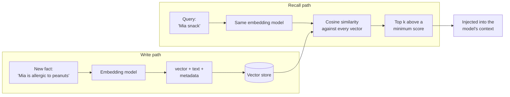

🏠 [Home](../../README.md) › [05 · Memory](./README.md) › 5.3 Vector memory

# 5.3 Vector memory

> **Difficulty:** 🟡 Intermediate · **Reading time:** ~10 min · **Prerequisites:** [5.1 Short-term vs long-term memory](./05.1-short-term-vs-long-term-memory.md)
>
> Last verified: November 2026 with openai==3.49.0

**In one sentence:** Vector memory stores each memory with an embedding (a list of numbers that captures its meaning), and recalls memories by finding the stored vectors closest to the query's vector, so "food restrictions" can find "allergic to peanuts" even though they share no words.

📑 **On this page**

- [Why does this matter?](#-why-does-this-matter)
- [The idea, in plain words](#-the-idea-in-plain-words)
- [Picture it](#-picture-it)
- [How it works, step by step](#-how-it-works-step-by-step)
- [Worked example](#-worked-example)
- [Code](#-code)
- [Common mistakes & gotchas](#-common-mistakes--gotchas)
- [Key takeaways](#-key-takeaways)
- [Try it yourself](#-try-it-yourself)
- [Further reading](#-further-reading)

## 🤔 Why does this matter?

The JSON-file memory from [5.1](./05.1-short-term-vs-long-term-memory.md) loads every fact into every prompt. That works for ten facts. After a year of use, an assistant might hold two thousand: preferences, people, past trips, decisions. Loading them all is expensive and distracting, so you must pick the few that matter for *this* request.

Keyword search is the obvious [tool](../../GLOSSARY.md#tool), and it fails in a familiar way. The user asks *"Does anyone in my family have food restrictions?"* The stored memory says *"Mia is allergic to peanuts."* Not one word in common. A memory that can't be found might as well not exist.

## 🧠 The idea, in plain words

Imagine a huge map where every sentence has a position, and sentences with similar meanings sit close together. "Allergic to peanuts", "nut allergy" and "can't eat nuts" are neighbours. "Window seat on flights" is far away, near "prefers the aisle".

An **[embedding](../../GLOSSARY.md#embedding)** is a sentence's coordinates on that map: a list of hundreds or thousands of numbers, produced by an **embedding model**. To recall memories:

1. Turn the question into coordinates with the same model.
2. Find the stored memories nearest to it.
3. Hand those few to the [agent](../../GLOSSARY.md#agent).

"Nearest" is usually measured with **[cosine similarity](../../GLOSSARY.md#cosine-similarity)**: how closely two vectors point in the same direction. 1.0 means the same direction, around 0 means unrelated.

That is **[vector memory](../../GLOSSARY.md#vector-memory)**: [long-term memory](../../GLOSSARY.md#long-term-memory) stored as text plus vectors, searched by similarity. It is the same machinery as [RAG](../../GLOSSARY.md#retrieval-augmented-generation-rag) in chapter 06. The difference is what's stored: RAG searches documents written beforehand; vector memory searches things the agent learned while working with the user.

> **About the examples.** To run offline, the code here uses a tiny *bag-of-words hashing* embedder: it only notices shared words, not meaning. It shows the mechanics honestly, and it shows exactly why real systems use an embedding model instead.

## 👀 Picture it



*Both paths must use the same embedding model, or the coordinates mean different things. The model never sees vectors; it only sees the recalled text.*

## 🔍 How it works, step by step

**Writing**

1. **Keep each memory small and self-contained.** One fact per item, written so it makes sense alone: "The user's daughter Mia is allergic to peanuts", not "she's allergic to them".
2. **Embed it.** Call an embedding model. OpenAI offers an embeddings API. Anthropic does not offer its own embedding model; its documentation points to providers such as Voyage AI. Open-weight models you run yourself are a third option.
3. **Store the vector with the text and metadata:** who it belongs to (user ID), when it was written, where it came from (the user said it, the model inferred it, a form), and an ID so you can update or delete it.

**Recalling**

1. **Embed the query** with the same model.
2. **Filter by metadata first:** this user's memories only.
3. **Score the remaining memories** by cosine similarity. (At scale, a vector database uses an approximate index so it doesn't compare against everything; see [6.2](../06-rag-for-agents/06.2-embeddings-and-vector-databases.md).)
4. **Keep the top *k* above a minimum score**, so weak matches don't sneak in.
5. **Inject** the recalled text into the context.

**Who decides when to recall?** Two common designs:

| | Automatic recall | Recall as a tool |
| --- | --- | --- |
| How | Your code searches with the user's message before every model call and adds the hits to the prompt | The model gets `remember` and `recall` tools and calls them when it thinks it should |
| Good | Never forgets to look; predictable | Better queries ("flight seat preference" rather than the whole message); no cost when not needed |
| Bad | Searches even when pointless; the user's message may be a poor query | The model may forget to recall, or save trivia |

The example uses the tool design. Many production systems combine both: a small automatic recall plus a tool for deeper searches.

## 💡 Worked example

From [`examples/05-vector-memory`](../../examples/05-vector-memory/README.md), offline. Session 1 saves two facts through the `remember` tool; the app had already stored one from a signup form. Session 2 is a brand-new conversation that recalls them:

```text
SESSION 2 (new conversation, memory loaded from disk): Find me a flight to Oslo next week, and suggest a snack for Mia for the trip.
  answer: I'll look for flights to Oslo with a window seat, and pack a peanut-free snack for Mia.
  recall({'query': 'flight seat preference'}) -> '[0.58] The user prefers window seats on flights.'
  recall({'query': 'Mia snack'}) -> "[0.35] The user's daughter Mia is allergic to peanuts."
```

Each recall returned only the relevant memory, with its score; "lives in Manchester" stayed out because it scored below the minimum of 0.2. Now the limitation, scoring two queries against all three memories:

```text
WHERE BAG-OF-WORDS FAILS (scores against every memory)
  'window seat': #3=0.71, #1=0.0, #2=0.0
  'Does anyone in my family have food restrictions?': #1=0.0, #2=0.0, #3=0.0
  The second query shares no words with 'allergic to peanuts', so it scores 0.0.
  A good embedding model should score memory #2 highest: it compares meaning, not just words.
```

The toy embedder can only match words that appear in both texts. That's the gap an embedding model closes: it was trained so that texts with related meanings get nearby vectors, even with no words in common.

## 💻 Code

The toy embedder, cosine similarity and the store, from [`examples/05-vector-memory/main.py`](../../examples/05-vector-memory/main.py). Pure Python, no downloads:

```python
import hashlib
import math
import re
from dataclasses import dataclass, field

STOPWORDS = {"a", "an", "and", "the", "is", "my", "of", "on", "to", "user"}  # the example uses a longer list


def tokenize(text: str) -> list[str]:
    words = re.findall(r"[a-z0-9]+", text.lower())
    return [w[:-1] if len(w) > 3 and w.endswith("s") else w for w in words if len(w) > 1 and w not in STOPWORDS]


class HashingEmbedder:
    """Bag of words hashed into `dims` slots. A teaching toy: it knows nothing about meaning."""

    def __init__(self, dims: int = 1024) -> None:
        self.dims = dims

    def embed(self, text: str) -> list[float]:
        vec = [0.0] * self.dims
        for word in tokenize(text):
            h = int(hashlib.md5(word.encode()).hexdigest(), 16)   # stable across runs, unlike hash()
            vec[h % self.dims] += 1.0 if (h >> 64) & 1 else -1.0
        norm = math.sqrt(sum(x * x for x in vec)) or 1.0
        return [x / norm for x in vec]


def cosine(a: list[float], b: list[float]) -> float:
    dot = sum(x * y for x, y in zip(a, b))
    na, nb = math.sqrt(sum(x * x for x in a)), math.sqrt(sum(y * y for y in b))
    return dot / (na * nb) if na and nb else 0.0


@dataclass
class VectorMemory:
    embedder: HashingEmbedder = field(default_factory=HashingEmbedder)
    items: list[tuple[str, list[float]]] = field(default_factory=list)

    def add(self, text: str) -> None:
        self.items.append((text, self.embedder.embed(text)))

    def search(self, query: str, k: int = 3, min_score: float = 0.2) -> list[tuple[float, str]]:
        q = self.embedder.embed(query)
        scored = sorted(((cosine(q, v), t) for t, v in self.items), reverse=True)
        return [(round(s, 2), t) for s, t in scored[:k] if s >= min_score]


memory = VectorMemory()
memory.add("The user prefers window seats on flights.")
memory.add("The user's daughter Mia is allergic to peanuts.")
print(memory.search("window seat on the flight"))   # [(0.87, 'The user prefers window seats on flights.')]
```

To use a real embedding model, swap the embedder. With OpenAI's embeddings API:

```python
import os

from openai import OpenAI


class OpenAIEmbedder:
    def __init__(self) -> None:
        self.client = OpenAI()                                   # needs OPENAI_API_KEY
        self.model = os.environ["OPENAI_EMBEDDING_MODEL"]        # e.g. a current model from the embeddings guide

    def embed(self, text: str) -> list[float]:
        return self.client.embeddings.create(model=self.model, input=text).data[0].embedding


memory = VectorMemory(embedder=OpenAIEmbedder())
```

Nothing else changes. That is the point of keeping the embedder behind one small interface. The full example adds metadata, saving to and loading from JSON, and an agent with `remember` and `recall` tools.

## 🚨 Common mistakes & gotchas

- **Mixing embedding models.** Vectors from different models (or different versions or sizes of one model) live on different maps. If you change models, re-embed everything.
- **Forgetting to filter by user.** A similarity search across all users' memories can hand one user's private facts to another. Filter by owner *before* ranking.
- **Storing long blobs.** A whole conversation as one memory gets a blurry, averaged vector that matches everything weakly. Store one fact per item.
- **No minimum score.** Top-*k* always returns *k* results, even when nothing is relevant. Set a threshold and test it on real queries.
- **Never updating or deleting.** "Prefers aisle seats" and the older "prefers window seats" will both be recalled, and the model must guess which is true. See [5.5](./05.5-memory-design-trade-offs.md).
- **Treating similarity as truth.** A high score means "related", not "correct" or "current". Keep the source and date with each memory so the model can weigh it.

## ✅ Key takeaways

- Vector memory = text + embedding + metadata, recalled by similarity to the query.
- Use one embedding model for both writing and querying; re-embed if you change models.
- Store small, self-contained facts; filter by owner; keep the top *k* above a minimum score.
- Recall automatically, through a tool, or both.
- Real systems need a real embedding model. Anthropic doesn't offer one (its docs point to providers such as Voyage AI); OpenAI has an embeddings API.

## 🧪 Try it yourself

1. Run the example, then add the memory "The user now prefers aisle seats." Search for "seat preference". What comes back, and what should happen instead?
2. Why does the toy embedder strip a trailing "s" from words? What breaks without it?

<details>
<summary>Show answer</summary>

1. Both seat memories come back, and the agent can't tell which is current. Better: when writing a new fact, search for similar existing ones first and replace (or mark as superseded) the older one, and store a timestamp so the newest wins. [5.5](./05.5-memory-design-trade-offs.md) covers this as *staleness*.
2. Without it, "seats" and "seat", or "flights" and "flight", are different words with different hash slots, so "window seat" barely matches "prefers window seats". It's a crude stand-in for what an embedding model does much better: treating related forms and synonyms as close in meaning.

</details>

## 📚 Further reading

- [Vector embeddings](https://developers.openai.com/api/docs/guides/embeddings) (OpenAI docs). The embeddings API, models and use cases.
- [Embeddings](https://platform.claude.com/docs/en/build-with-claude/embeddings) (Anthropic docs). Confirms Anthropic has no embedding model of its own and walks through Voyage AI.
- [Generative Agents: Interactive Simulacra of Human Behavior](https://arxiv.org/abs/2304.03442) (Park et al., 2023). Agents that store a complete record of their experiences in natural language, reflect on it and retrieve it to plan.
- [6.2 Embeddings & vector databases](../06-rag-for-agents/06.2-embeddings-and-vector-databases.md). How vector search scales.

<!-- FOOTER -->

---

⬅️ **Previous:** [5.2 Summarisation & context compaction](./05.2-summarisation-and-context-compaction.md) ·
🏠 [Chapter home](./README.md) ·
➡️ **Next:** [5.4 Episodic, semantic & procedural memory](./05.4-episodic-semantic-and-procedural-memory.md)
