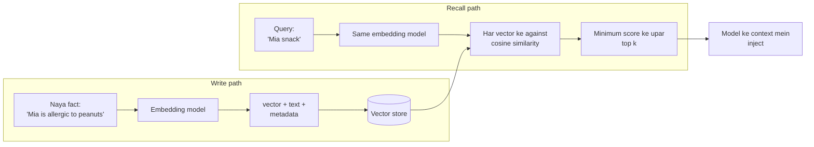

🏠 [Home](../../README.md) › [05 · Memory](./README.md) › 5.3 Vector memory

# 5.3 Vector memory

> **Level:** 🟡 Intermediate · **Padhne ka time:** ~10 min · **Pehle padho:** [5.1 Short-term vs long-term memory](./05.1-short-term-vs-long-term-memory.md)
>
> Last verified: November 2026 with openai==3.49.0

**Ek line mein:** Vector memory har memory ko ek embedding ke saath store karti hai (numbers ki ek list jo uska matlab pakadti hai). Aur memories recall karne ke liye woh un stored vectors ko dhundhti hai jo query ke vector ke sabse paas hain. Isliye "food restrictions" se "allergic to peanuts" mil jaata hai, bhale hi dono mein ek bhi word common na ho.

📑 **Is page par**

- [Yeh kyun zaroori hai?](#-yeh-kyun-zaroori-hai)
- [Idea, simple words mein](#-idea-simple-words-mein)
- [Diagram se samjho](#-diagram-se-samjho)
- [Kaise kaam karta hai, step by step](#-kaise-kaam-karta-hai-step-by-step)
- [Example se samjho](#-example-se-samjho)
- [Code](#-code)
- [Aam galtiyan aur dhyan dene wali baatein](#-aam-galtiyan-aur-dhyan-dene-wali-baatein)
- [Yaad rakhne wali baatein](#-yaad-rakhne-wali-baatein)
- [Khud try karo](#-khud-try-karo)
- [Aur padhne ke liye](#-aur-padhne-ke-liye)

## 🤔 Yeh kyun zaroori hai?

[5.1](./05.1-short-term-vs-long-term-memory.md) wali JSON-file memory har fact ko har prompt mein load karti hai. Das facts ke liye yeh chalta hai. Ek saal use hone ke baad, ek assistant ke paas do hazaar facts ho sakte hain: preferences, log, purani trips, decisions. Sabko load karna mehenga bhi hai aur distracting bhi. Isliye tumhe woh kuch facts chunne padenge jo *is* request ke liye matter karte hain.

Keyword search sabse seedha [tool](../../GLOSSARY.md#tool) lagta hai, aur woh ek jaane-pehchane tarike se fail hota hai. User poochta hai *"Does anyone in my family have food restrictions?"* Stored memory kehti hai *"Mia is allergic to peanuts."* Ek bhi word common nahi. Jo memory mil hi na sake, woh hone na hone ke barabar hai.

## 🧠 Idea, simple words mein

Ek bahut bada map imagine karo jahan har sentence ki ek position hai. Milte-julte matlab wale sentences paas-paas baithte hain. "Allergic to peanuts", "nut allergy" aur "can't eat nuts" padosi hain. "Window seat on flights" door hai, "prefers the aisle" ke paas.

Isko aise socho: kisi sheher mein mithai ki saari dukaanein ek hi bazaar mein hain, aur kapde ki dukaanein doosre bazaar mein. Tumhe rasgulla chahiye toh tum mithai wale bazaar jaate ho, chahe dukaan ke board par "rasgulla" likha ho ya nahi.

Ek **[embedding](../../GLOSSARY.md#embedding)** us map par sentence ke coordinates hain: sainkdon ya hazaaron numbers ki ek list, jo ek **embedding model** banata hai. Memories recall karne ke liye:

1. Sawal ko same model se coordinates mein badlo.
2. Uske sabse paas wali stored memories dhundho.
3. Woh kuch memories [agent](../../GLOSSARY.md#agent) ko de do.

"Sabse paas" aam taur par **[cosine similarity](../../GLOSSARY.md#cosine-similarity)** se measure hota hai: do vectors kitna ek hi direction mein point karte hain. 1.0 matlab same direction, lagbhag 0 matlab koi rishta nahi.

Yahi hai **[vector memory](../../GLOSSARY.md#vector-memory)**: [long-term memory](../../GLOSSARY.md#long-term-memory) jo text plus vectors ke roop mein stored hai, aur similarity se search hoti hai. Yeh wahi machinery hai jo chapter 06 ke [RAG](../../GLOSSARY.md#retrieval-augmented-generation-rag) mein hai. Farak bas yeh hai ki kya stored hai. RAG pehle se likhe documents search karta hai. Vector memory woh cheezein search karti hai jo agent ne user ke saath kaam karte hue seekhi.

> **Examples ke baare mein.** Sab kuch self-contained rakhne ke liye, yahan ka code ek chhota sa *bag-of-words hashing* embedder use karta hai. Woh sirf common words notice karta hai, matlab nahi. Yeh mechanics imaandaari se dikhata hai, aur yeh bhi exactly dikhata hai ki asli systems iski jagah embedding model kyun use karte hain.

## 👀 Diagram se samjho



*Dono paths ko same embedding model use karna chahiye, warna coordinates ka matlab alag hoga. Model kabhi vectors nahi dekhta; woh sirf recall kiya hua text dekhta hai.*

## 🔍 Kaise kaam karta hai, step by step

**Writing**

1. **Har memory chhoti aur apne aap mein poori rakho.** Ek item mein ek fact, aise likha ki akele padhne par bhi samajh aaye: "The user's daughter Mia is allergic to peanuts", na ki "she's allergic to them".
2. **Use embed karo.** Ek embedding model call karo. OpenAI ek embeddings API deta hai. Anthropic apna embedding model nahi deta; uske docs Voyage AI jaise providers ki taraf point karte hain. Open-weight models jo tum khud chalao, woh teesra option hain.
3. **Vector ko text aur metadata ke saath store karo:** yeh kiska hai (user ID), kab likha gaya, kahan se aaya (user ne bola, model ne andaaza lagaya, koi form), aur ek ID taaki tum ise update ya delete kar sako.

**Recalling**

1. **Query ko embed karo**, same model se.
2. **Pehle metadata se filter karo:** sirf is user ki memories.
3. **Bachi hui memories ko score karo**, cosine similarity se. (Bade scale par, vector database ek approximate index use karta hai taaki har cheez se compare na karna pade; dekho [6.2](../06-rag-for-agents/06.2-embeddings-and-vector-databases.md).)
4. **Minimum score ke upar top *k* rakho**, taaki kamzor matches chupke se andar na aa jaayein.
5. **Inject karo**, recall kiya text context mein.

**Recall kab karna hai, yeh kaun decide karta hai?** Do common designs:

| | Automatic recall | Recall ek tool ke roop mein |
| --- | --- | --- |
| Kaise | Tumhara code har model call se pehle user ke message se search karta hai aur hits ko prompt mein jodta hai | Model ko `remember` aur `recall` tools milte hain aur jab use lage tab woh unhe call karta hai |
| Achha | Dekhna kabhi nahi bhoolta; predictable | Behtar queries (poore message ki jagah "flight seat preference"); zaroorat na ho toh koi cost nahi |
| Bura | Bekaar mein bhi search karta hai; user ka message ek kharab query ho sakta hai | Model recall karna bhool sakta hai, ya faltu cheezein save kar sakta hai |

Example tool wala design use karta hai. Kai production systems dono ko milate hain: ek chhota automatic recall plus gehre search ke liye ek tool.

## 💡 Example se samjho

Ek travel assistant jiske paas `remember` aur `recall` tools hain, neeche wala toy embedder use karke. Session 1 `remember` tool se do facts save karta hai; app ne ek fact pehle hi signup form se store kar liya tha. Session 2 ek bilkul nayi conversation hai jo unhe recall karti hai:

```text
SESSION 2 (new conversation, memory loaded from disk): Find me a flight to Oslo next week, and suggest a snack for Mia for the trip.
  answer: I'll look for flights to Oslo with a window seat, and pack a peanut-free snack for Mia.
  recall({'query': 'flight seat preference'}) -> '[0.58] The user prefers window seats on flights.'
  recall({'query': 'Mia snack'}) -> "[0.35] The user's daughter Mia is allergic to peanuts."
```

Har recall ne sirf relevant memory lautai, apne score ke saath. "Lives in Manchester" bahar raha kyunki uska score 0.2 ke minimum se neeche tha. Ab limitation dekho, do queries ko teeno memories ke against score karke:

```text
WHERE BAG-OF-WORDS FAILS (scores against every memory)
  'window seat': #3=0.71, #1=0.0, #2=0.0
  'Does anyone in my family have food restrictions?': #1=0.0, #2=0.0, #3=0.0
  The second query shares no words with 'allergic to peanuts', so it scores 0.0.
  A good embedding model should score memory #2 highest: it compares meaning, not just words.
```

Toy embedder sirf woh words match kar sakta hai jo dono texts mein hain. Embedding model yahi gap bharta hai. Use aise train kiya gaya hai ki milte-julte matlab wale texts ko paas-paas vectors milein, chahe ek bhi word common na ho.

## 💻 Code

Toy embedder, cosine similarity aur store. Pure Python, koi download nahi:

```python
import hashlib
import math
import re
from dataclasses import dataclass, field

STOPWORDS = {"a", "an", "and", "the", "is", "my", "of", "on", "to", "user"}  # asli list isse lambi hogi


def tokenize(text: str) -> list[str]:
    words = re.findall(r"[a-z0-9]+", text.lower())
    return [w[:-1] if len(w) > 3 and w.endswith("s") else w for w in words if len(w) > 1 and w not in STOPWORDS]


class HashingEmbedder:
    """Bag of words, `dims` slots mein hash kiya hua. Sikhane ka khilona hai: isko matlab ka kuch nahi pata."""

    def __init__(self, dims: int = 1024) -> None:
        self.dims = dims

    def embed(self, text: str) -> list[float]:
        vec = [0.0] * self.dims
        for word in tokenize(text):
            h = int(hashlib.md5(word.encode()).hexdigest(), 16)   # hash() ke ulat, har run mein same rehta hai
            vec[h % self.dims] += 1.0 if (h >> 64) & 1 else -1.0
        norm = math.sqrt(sum(x * x for x in vec)) or 1.0
        return [x / norm for x in vec]


def cosine(a: list[float], b: list[float]) -> float:
    dot = sum(x * y for x, y in zip(a, b))
    na, nb = math.sqrt(sum(x * x for x in a)), math.sqrt(sum(y * y for y in b))
    return dot / (na * nb) if na and nb else 0.0


@dataclass
class VectorMemory:
    embedder: HashingEmbedder = field(default_factory=HashingEmbedder)
    items: list[tuple[str, list[float]]] = field(default_factory=list)

    def add(self, text: str) -> None:
        self.items.append((text, self.embedder.embed(text)))

    def search(self, query: str, k: int = 3, min_score: float = 0.2) -> list[tuple[float, str]]:
        q = self.embedder.embed(query)
        scored = sorted(((cosine(q, v), t) for t, v in self.items), reverse=True)
        return [(round(s, 2), t) for s, t in scored[:k] if s >= min_score]


memory = VectorMemory()
memory.add("The user prefers window seats on flights.")
memory.add("The user's daughter Mia is allergic to peanuts.")
print(memory.search("window seat on the flight"))   # [(0.87, 'The user prefers window seats on flights.')]
```

Asli embedding model use karne ke liye, embedder badal do. OpenAI ki embeddings API ke saath:

```python
import os

from openai import OpenAI


class OpenAIEmbedder:
    def __init__(self) -> None:
        self.client = OpenAI()                                   # OPENAI_API_KEY chahiye
        self.model = os.environ["OPENAI_EMBEDDING_MODEL"]        # jaise embeddings guide ka koi current model

    def embed(self, text: str) -> list[float]:
        return self.client.embeddings.create(model=self.model, input=text).data[0].embedding


memory = VectorMemory(embedder=OpenAIEmbedder())
```

Aur kuch nahi badalta. Embedder ko ek chhote interface ke peeche rakhne ka yahi fayda hai. Poore example mein metadata, JSON mein save aur load, aur `remember` aur `recall` tools wala ek agent bhi hai.

## 🚨 Aam galtiyan aur dhyan dene wali baatein

- **Embedding models mix karna.** Alag models ke vectors (ya ek hi model ke alag versions ya sizes ke) alag maps par rehte hain. Model badlo toh sab kuch dobara embed karo.
- **User se filter karna bhool jaana.** Saare users ki memories par similarity search ek user ke private facts doosre ko de sakta hai. Ranking se *pehle* owner se filter karo.
- **Lambe blobs store karna.** Poori conversation ko ek memory banaoge toh uska vector dhundhla, average sa hoga jo har cheez se thoda-thoda match karega. Ek item mein ek fact rakho.
- **Koi minimum score nahi.** Top-*k* hamesha *k* results deta hai, chahe kuch bhi relevant na ho. Ek threshold set karo aur use asli queries par test karo.
- **Kabhi update ya delete na karna.** "Prefers aisle seats" aur purana "prefers window seats" dono recall honge, aur model ko guess karna padega ki sach kaunsa hai. Dekho [5.5](./05.5-memory-design-trade-offs.md).
- **Similarity ko sach maan lena.** High score ka matlab hai "related", "sahi" ya "current" nahi. Har memory ke saath source aur date rakho taaki model use tol sake.

## ✅ Yaad rakhne wali baatein

- Vector memory = text + embedding + metadata, jo query se similarity ke basis par recall hoti hai.
- Likhne aur query karne dono ke liye ek hi embedding model use karo; model badlo toh dobara embed karo.
- Chhote, apne aap mein poore facts store karo; owner se filter karo; minimum score ke upar top *k* rakho.
- Recall automatically karo, tool se karo, ya dono.
- Asli systems ko asli embedding model chahiye. Anthropic ek nahi deta (uske docs Voyage AI jaise providers ki taraf point karte hain); OpenAI ke paas embeddings API hai.

## 🧪 Khud try karo

1. Upar wala store use karke, example ki memories ke baad, yeh memory add karo: "The user now prefers aisle seats." Phir "seat preference" search karo. Kya wapas aata hai, aur iski jagah kya hona chahiye?
2. Toy embedder words ke end se "s" kyun hata deta hai? Iske bina kya toot jaata hai?

<details>
<summary>Answer dekho</summary>

1. Dono seat wali memories wapas aati hain, aur agent bata nahi sakta ki current kaunsi hai. Behtar tarika: naya fact likhte waqt pehle milte-julte purane facts search karo aur purane wale ko replace karo (ya superseded mark karo). Saath mein timestamp store karo taaki sabse naya jeete. [5.5](./05.5-memory-design-trade-offs.md) isko *staleness* ke naam se cover karta hai.
2. Iske bina "seats" aur "seat", ya "flights" aur "flight", alag words hain jinke hash slots alag hain. Toh "window seat" mushkil se "prefers window seats" se match karta hai. Yeh ek kachcha sa jugaad hai us cheez ka jo embedding model kahin behtar karta hai: related forms aur synonyms ko matlab mein paas maanna.

</details>

## 📚 Aur padhne ke liye

- [Vector embeddings](https://developers.openai.com/api/docs/guides/embeddings) (OpenAI docs). Embeddings API, models aur use cases.
- [Embeddings](https://platform.claude.com/docs/en/build-with-claude/embeddings) (Anthropic docs). Confirm karta hai ki Anthropic ka apna koi embedding model nahi hai, aur Voyage AI ke saath step by step le jaata hai.
- [Generative Agents: Interactive Simulacra of Human Behavior](https://arxiv.org/abs/2304.03442) (Park et al., 2023). Aise agents jo apne experiences ka poora record natural language mein store karte hain, us par reflect karte hain aur plan karne ke liye use retrieve karte hain.
- [6.2 Embeddings aur vector databases](../06-rag-for-agents/06.2-embeddings-and-vector-databases.md). Vector search scale kaise hota hai.

<!-- FOOTER -->

---

⬅️ **Pichla:** [5.2 Summarisation aur context compaction](./05.2-summarisation-and-context-compaction.md) ·
🏠 [Chapter home](./README.md) ·
➡️ **Agla:** [5.4 Episodic, semantic aur procedural memory](./05.4-episodic-semantic-and-procedural-memory.md)
