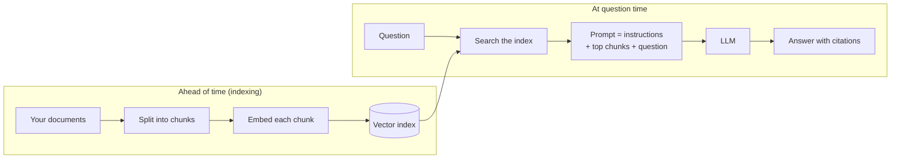

🏠 [Home](../../README.md) › [06 · RAG for Agents](./README.md) › 6.1 RAG in 5 minutes

# 6.1 RAG in 5 minutes

> **Difficulty:** 🟢 Beginner · **Reading time:** ~5 min · **Prerequisites:** [1.4 How LLMs work](../01-foundations/01.4-how-llms-work.md), [1.5 Anatomy of an agent](../01-foundations/01.5-anatomy-of-an-agent.md)

**In one sentence:** Retrieval-augmented generation (RAG) finds the few passages of your documents that matter for a question and puts them in the prompt, so the model answers from your facts instead of from memory.

📑 **On this page**

- [Why does this matter?](#-why-does-this-matter)
- [The idea, in plain words](#-the-idea-in-plain-words)
- [Picture it](#-picture-it)
- [How it works, step by step](#-how-it-works-step-by-step)
- [Worked example](#-worked-example)
- [Code](#-code)
- [Common mistakes & gotchas](#-common-mistakes--gotchas)
- [Key takeaways](#-key-takeaways)
- [Try it yourself](#-try-it-yourself)
- [Further reading](#-further-reading)

## 🤔 Why does this matter?

You build a support assistant for your product. A customer asks: *"How long do you keep backups on the Pro plan?"* The model has never seen your pricing page. It either says it doesn't know, or worse, it makes up a plausible number. That made-up answer is a [hallucination](../../GLOSSARY.md#hallucination).

You can't paste your whole knowledge base into every request: it may be thousands of pages, and every [token](../../GLOSSARY.md#token) costs money and time ([1.4](../01-foundations/01.4-how-llms-work.md)). You need to send *just the right page*. That is what RAG does.

## 🧠 The idea, in plain words

[Retrieval-augmented generation (RAG)](../../GLOSSARY.md#retrieval-augmented-generation-rag) is an open-book exam. Before answering, the model gets to look up the relevant pages in your documents, and it answers from those pages.

It has two halves:

1. **Retrieve.** Search your documents for the passages most related to the question.
2. **Generate.** Put those passages in the prompt next to the question, and ask the model to answer *using them*.

The model doesn't learn anything permanently. You change what it knows by changing the documents, not by retraining it. The term comes from [Lewis et al. (2020)](https://arxiv.org/abs/2005.11401), who combined a retriever with a text generator; today "RAG" means any system that retrieves text and adds it to the prompt.

## 👀 Picture it



*Two phases. Indexing happens once, before any question. At question time, retrieval picks a handful of chunks and only those reach the model.*

## 🔍 How it works, step by step

1. **Chunk.** Split each document into small pieces, usually a few hundred tokens each. Small pieces make search precise. How you split matters a lot ([6.3](./06.3-chunking-strategies.md)).
2. **Embed and index.** Turn each chunk into an [embedding](../../GLOSSARY.md#embedding), a list of numbers that captures its meaning, and store it in an index. Many systems also keep a keyword index ([6.2](./06.2-embeddings-and-vector-databases.md), [6.5](./06.5-re-ranking-and-retrieval-evaluation.md)).
3. **Retrieve.** When a question arrives, embed it the same way and find the chunks whose embeddings are closest. Keep the top *k* (often 3 to 20).
4. **Augment the prompt.** Put the chunks in the prompt, clearly marked, with an instruction such as *"Answer only from these documents and cite them. If they don't contain the answer, say so."*
5. **Generate.** The model writes the answer. Because the facts are in front of it, it can quote them and cite where they came from.

This fixed "retrieve, then generate" pipeline is **classic RAG**. In an agent, retrieval becomes a [tool](../../GLOSSARY.md#tool) the model can call when *it* decides it needs to look something up: that is agentic RAG ([6.4](./06.4-agentic-rag.md)).

## 💡 Worked example

The knowledge base is eight short help-centre documents. Classic RAG retrieves the top 2 for the raw question and builds this prompt:

```text
<document id='sso.md'>
Single sign-on (SSO). Staff can log in with Okta or Azure AD. SSO is available on the Business plan only.
</document>

<document id='changelog.md'>
Changelog, October 2026. New SSO login page. Faster database restores. Dark mode for the dashboard.
</document>

Question: How much does the plan with SSO cost?
```

The [system prompt](../../GLOSSARY.md#system-prompt) says *"Answer using only the documents provided. Cite document ids in [brackets]. If they do not contain the answer, say so."* A good model replies:

```text
SSO is available on the Business plan [sso.md], but the documents provided don't say what the Business plan costs.
```

That is RAG working as designed: grounded, cited and honest. It is also RAG's classic limit. The price is in `pricing.md`, but that document shares no words with the question, so one search for the raw question never finds it. An agent that can search twice ("SSO plan", then "Business plan price") gets it; see [6.4](./06.4-agentic-rag.md).

## 💻 Code

Classic RAG is a few lines around one search and one model call. Here with the Anthropic SDK (needs `ANTHROPIC_API_KEY`); `retrieve` is your search function:

```python
import anthropic

client = anthropic.Anthropic()

def answer(question: str) -> str:
    hits = retrieve(question, k=3)                       # [(doc_id, text), ...] from your index
    context = "\n\n".join(f"<document id='{d}'>\n{text}\n</document>" for d, text in hits)
    response = client.messages.create(
        model="claude-opus-5-5",
        max_tokens=1024,
        system="Answer using only the documents provided. Cite document ids in [brackets]. "
               "If they do not contain the answer, say so.",
        messages=[{"role": "user", "content": f"{context}\n\nQuestion: {question}"}],
    )
    return next(b.text for b in response.content if b.type == "text")
```

With OpenAI's Chat Completions API, the same prompt goes in `messages`, with the instructions as a `system` message, and you call `client.chat.completions.create(model=os.environ["OPENAI_MODEL"], messages=...)`.

## 🚨 Common mistakes & gotchas

- **Using RAG when the documents would fit.** If your whole knowledge base is small, you may not need retrieval at all: put it in the prompt and use [prompt caching](../16-cost-and-performance/16.2-prompt-caching.md) to keep repeat requests cheap. Anthropic's [Contextual Retrieval post](https://www.anthropic.com/research/contextual-retrieval) suggests this for knowledge bases under about 200,000 tokens.
- **No "say so if it's not there" instruction.** Without it, a model given unhelpful chunks may fill the gap from memory. Always give it permission to say "I don't know".
- **Not marking where documents start and end.** Wrap each chunk in clear tags with an id, so the model can cite it and can't confuse document text with your instructions. Retrieved text is untrusted input: it can contain [prompt injection](../../GLOSSARY.md#prompt-injection).
- **Blaming the model for retrieval failures.** If the right chunk never reached the prompt, no model can use it. Check what was retrieved first ([6.5](./06.5-re-ranking-and-retrieval-evaluation.md)).

## ✅ Key takeaways

- RAG = retrieve the relevant passages, then generate an answer from them.
- It grounds answers in your data, without retraining, and lets the model cite sources.
- Indexing (chunk, embed, store) happens ahead of time; retrieval happens per question.
- Classic RAG retrieves once for the raw question; agents make retrieval a tool they call when needed.
- Most RAG failures are retrieval failures. Check what reached the prompt.

## 🧪 Try it yourself

1. Look again at the classic RAG prompt in the worked example. Which document would have to be retrieved for a full answer, and why wasn't it?
2. Your company handbook is 40 pages (about 30,000 tokens) and rarely changes. Do you need RAG?

<details>
<summary>Show answer</summary>

1. `pricing.md`. Its text ("Prices. Starter is free. Pro is $49 per month. Business is $199 per month...") shares no words with *"How much does the plan with SSO cost?"*, and the SSO documents fill both slots. Finding it needs a second search for "Business plan price".
2. Probably not. 30,000 tokens fits easily in current context windows. Putting the whole handbook in the system prompt and caching it is simpler, and the model can see everything. Consider RAG when the material grows far beyond that, changes often, or must be filtered by user permissions.

</details>

## 📚 Further reading

- [Retrieval-Augmented Generation for Knowledge-Intensive NLP Tasks](https://arxiv.org/abs/2005.11401) (Lewis et al., 2020). The paper that named RAG.
- [Contextual Retrieval](https://www.anthropic.com/research/contextual-retrieval) (Anthropic). A clear primer on a production RAG pipeline, and a technique that cut failed retrievals by 49% in their tests (67% with re-ranking).
- [Building effective agents](https://www.anthropic.com/engineering/building-effective-agents) (Anthropic). Retrieval as one of the "augmentations" of an LLM.

<!-- FOOTER -->

---

⬅️ **Previous:** [5.5 Memory design trade-offs](../05-memory/05.5-memory-design-trade-offs.md) ·
🏠 [Chapter home](./README.md) ·
➡️ **Next:** [6.2 Embeddings & vector databases](./06.2-embeddings-and-vector-databases.md)
