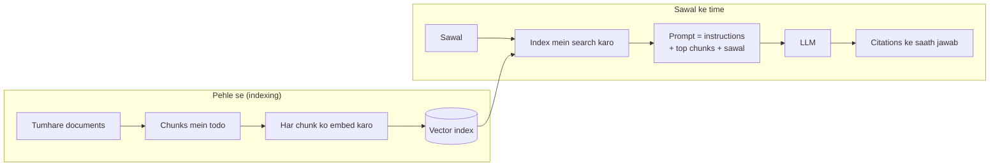

🏠 [Home](../../README.md) › [06 · RAG for Agents](./README.md) › 6.1 RAG, 5 minute mein

# 6.1 RAG, 5 minute mein

> **Level:** 🟢 Beginner · **Padhne ka time:** ~5 min · **Pehle padho:** [1.4 LLMs kaise kaam karte hain (bas utna jitna zaroori hai)](../01-foundations/01.4-how-llms-work.md), [1.5 Agent ke andar kya-kya hota hai](../01-foundations/01.5-anatomy-of-an-agent.md)

**Ek line mein:** Retrieval-augmented generation (RAG) tumhare documents mein se sirf woh kuch passages dhoondhta hai jo sawal ke liye zaroori hain, aur unhe prompt mein daal deta hai. Isse model memory se nahi, tumhare facts se jawab deta hai.

📑 **Is page par**

- [Yeh kyun zaroori hai?](#-yeh-kyun-zaroori-hai)
- [Idea, simple words mein](#-idea-simple-words-mein)
- [Diagram se samjho](#-diagram-se-samjho)
- [Kaise kaam karta hai, step by step](#-kaise-kaam-karta-hai-step-by-step)
- [Example se samjho](#-example-se-samjho)
- [Code](#-code)
- [Aam galtiyan aur dhyan dene wali baatein](#-aam-galtiyan-aur-dhyan-dene-wali-baatein)
- [Yaad rakhne wali baatein](#-yaad-rakhne-wali-baatein)
- [Khud try karo](#-khud-try-karo)
- [Aur padhne ke liye](#-aur-padhne-ke-liye)

## 🤔 Yeh kyun zaroori hai?

Socho tum apne product ke liye ek support assistant bana rahe ho. Ek customer poochta hai: *"How long do you keep backups on the Pro plan?"* Model ne tumhara pricing page kabhi dekha hi nahi. Toh ya toh woh bolega ki use nahi pata. Ya isse bhi bura, woh ek sahi-sa lagne wala number bana dega. Yeh bana hua jawab [hallucination](../../GLOSSARY.md#hallucination) kehlata hai.

Tum har request mein apna poora knowledge base paste nahi kar sakte. Woh hazaaron pages ka ho sakta hai. Aur har [token](../../GLOSSARY.md#token) mein paisa aur time lagta hai ([1.4](../01-foundations/01.4-how-llms-work.md)). Tumhe *sirf sahi page* bhejna hai. RAG yahi karta hai.

## 🧠 Idea, simple words mein

[Retrieval-augmented generation (RAG)](../../GLOSSARY.md#retrieval-augmented-generation-rag) ek open-book exam jaisa hai. Jawab dene se pehle model tumhare documents mein relevant pages dekh leta hai. Phir unhi pages se jawab deta hai.

Iske do hisse hain:

1. **Retrieve.** Apne documents mein woh passages dhoondho jo sawal se sabse zyada related hain.
2. **Generate.** Un passages ko prompt mein sawal ke saath rakho. Phir model se kaho ki *unhi ko use karke* jawab de.

Model permanently kuch nahi seekhta. Model kya jaanta hai, yeh tum documents badal ke badalte ho, model ko retrain karke nahi. Yeh term [Lewis et al. (2020)](https://arxiv.org/abs/2005.11401) se aaya. Unhone ek retriever ko text generator ke saath joda tha. Aaj "RAG" ka matlab hai koi bhi system jo text retrieve karke prompt mein add karta hai.

## 👀 Diagram se samjho



*Do phases hain. Indexing ek baar hoti hai, kisi bhi sawal se pehle. Sawal ke time retrieval kuch chunks chunta hai, aur sirf wahi model tak pahunchte hain.*

## 🔍 Kaise kaam karta hai, step by step

1. **Chunk.** Har document ko chhote pieces mein todo. Aam taur par har piece kuch sau tokens ka hota hai. Chhote pieces se search precise hota hai. Kaise todte ho, yeh bahut matter karta hai ([6.3](./06.3-chunking-strategies.md)).
2. **Embed aur index.** Har chunk ko ek [embedding](../../GLOSSARY.md#embedding) mein badlo. Embedding numbers ki ek list hai jo uska meaning pakadti hai. Isse ek index mein store karo. Bahut saare systems ek keyword index bhi rakhte hain ([6.2](./06.2-embeddings-and-vector-databases.md), [6.5](./06.5-re-ranking-and-retrieval-evaluation.md)).
3. **Retrieve.** Jab sawal aaye, use bhi same tarike se embed karo. Phir woh chunks dhoondho jinki embeddings sabse paas hain. Top *k* rakh lo (aksar 3 se 20).
4. **Prompt ko augment karo.** Chunks ko prompt mein saaf mark karke daalo. Saath mein ek instruction do, jaise *"Answer only from these documents and cite them. If they don't contain the answer, say so."*
5. **Generate.** Model jawab likhta hai. Facts uske saamne hain, isliye woh unhe quote kar sakta hai aur bata sakta hai ki kahan se aaye.

Yeh fixed "pehle retrieve, phir generate" pipeline **classic RAG** hai. Agent mein retrieval ek [tool](../../GLOSSARY.md#tool) ban jaata hai. Model use tab call karta hai jab *woh khud* decide kare ki kuch dekhna hai. Yahi agentic RAG hai ([6.4](./06.4-agentic-rag.md)).

## 💡 Example se samjho

Knowledge base mein help-centre ke aath chhote documents hain. Classic RAG raw sawal ke liye top 2 retrieve karta hai aur yeh prompt banata hai:

```text
<document id='sso.md'>
Single sign-on (SSO). Staff can log in with Okta or Azure AD. SSO is available on the Business plan only.
</document>

<document id='changelog.md'>
Changelog, October 2026. New SSO login page. Faster database restores. Dark mode for the dashboard.
</document>

Question: How much does the plan with SSO cost?
```

[System prompt](../../GLOSSARY.md#system-prompt) kehta hai *"Answer using only the documents provided. Cite document ids in [brackets]. If they do not contain the answer, say so."* Ek accha model aisa jawab deta hai:

```text
SSO is available on the Business plan [sso.md], but the documents provided don't say what the Business plan costs.
```

Matlab: SSO Business plan par milta hai, lekin documents mein uski price nahi likhi. Yeh RAG bilkul design ke hisaab se kaam kar raha hai: grounded, cited aur honest. Lekin yahi RAG ki classic limit bhi hai. Price `pricing.md` mein hai. Par us document mein sawal ka ek bhi word nahi hai. Isliye raw sawal par ek search use kabhi nahi dhoondh paata. Jo agent do baar search kar sake ("SSO plan", phir "Business plan price"), use mil jaata hai; [6.4](./06.4-agentic-rag.md) dekho.

Socho kirana dukaan par tum poochte ho "woh wala sabun kitne ka hai jo TV ad mein aata hai?" Dukaandaar pehle sochega kaun sa sabun, phir uska rate dekhega. Do step. Ek hi baar mein dhoondhne wala system yeh doosra step miss kar deta hai.

## 💻 Code

Classic RAG bas ek search aur ek model call ke around kuch lines hai. Yahan Anthropic SDK ke saath (`ANTHROPIC_API_KEY` chahiye). `retrieve` tumhara search function hai:

```python
import anthropic

client = anthropic.Anthropic()

def answer(question: str) -> str:
    hits = retrieve(question, k=3)                       # tumhare index se [(doc_id, text), ...]
    context = "\n\n".join(f"<document id='{d}'>\n{text}\n</document>" for d, text in hits)
    response = client.messages.create(
        model="claude-opus-5-5",
        max_tokens=1024,
        system="Answer using only the documents provided. Cite document ids in [brackets]. "
               "If they do not contain the answer, say so.",
        messages=[{"role": "user", "content": f"{context}\n\nQuestion: {question}"}],
    )
    return next(b.text for b in response.content if b.type == "text")
```

OpenAI ke Chat Completions API mein yahi prompt `messages` mein jaata hai. Instructions ek `system` message banti hain. Aur tum `client.chat.completions.create(model=os.environ["OPENAI_MODEL"], messages=...)` call karte ho.

## 🚨 Aam galtiyan aur dhyan dene wali baatein

- **Documents fit ho sakte the, phir bhi RAG use kiya.** Agar tumhara poora knowledge base chhota hai, toh shayad retrieval ki zaroorat hi nahi. Sab prompt mein daal do aur [prompt caching](../16-cost-and-performance/16.2-prompt-caching.md) use karo, taaki baar-baar wali requests sasti rahein. Anthropic ka [Contextual Retrieval post](https://www.anthropic.com/research/contextual-retrieval) lagbhag 200,000 tokens se chhote knowledge bases ke liye yahi suggest karta hai.
- **"Nahi hai toh bata do" wala instruction nahi diya.** Iske bina, bekaar chunks milne par model gap ko memory se bhar sakta hai. Hamesha use "I don't know" bolne ki permission do.
- **Documents kahan shuru aur khatam hote hain, yeh mark nahi kiya.** Har chunk ko saaf tags mein ek id ke saath wrap karo. Isse model cite kar payega aur document text ko tumhari instructions se confuse nahi karega. Retrieved text untrusted input hai: usme [prompt injection](../../GLOSSARY.md#prompt-injection) ho sakta hai.
- **Retrieval ki galti ka blame model par daalna.** Agar sahi chunk prompt tak pahuncha hi nahi, toh koi bhi model use use nahi kar sakta. Pehle check karo ki kya retrieve hua ([6.5](./06.5-re-ranking-and-retrieval-evaluation.md)).

## ✅ Yaad rakhne wali baatein

- RAG = relevant passages retrieve karo, phir unse jawab generate karo.
- Yeh jawab ko tumhare data par ground karta hai, bina retraining ke, aur model ko sources cite karne deta hai.
- Indexing (chunk, embed, store) pehle se hoti hai. Retrieval har sawal par hota hai.
- Classic RAG raw sawal ke liye ek baar retrieve karta hai. Agents retrieval ko ek tool bana dete hain jo zaroorat padne par call hota hai.
- RAG ki zyadatar failures asal mein retrieval failures hoti hain. Check karo ki prompt tak kya pahuncha.

## 🧪 Khud try karo

1. Example wala classic RAG prompt dobara dekho. Poore jawab ke liye kaun sa document retrieve hona chahiye tha, aur woh kyun nahi hua?
2. Tumhari company ki handbook 40 pages ki hai (lagbhag 30,000 tokens) aur kabhi-kabhi hi badalti hai. Kya tumhe RAG chahiye?

<details>
<summary>Answer dekho</summary>

1. `pricing.md`. Uske text ("Prices. Starter is free. Pro is $49 per month. Business is $199 per month...") mein *"How much does the plan with SSO cost?"* ka ek bhi word nahi hai. Aur SSO wale documents ne dono slots bhar diye. Use dhoondhne ke liye "Business plan price" ka doosra search chahiye.
2. Shayad nahi. 30,000 tokens aaj ke context windows mein aaram se fit ho jaate hain. Poori handbook system prompt mein daal ke cache kar lo. Yeh simple hai, aur model sab kuch dekh sakta hai. RAG tab socho jab material isse kahin zyada bada ho jaaye, baar-baar badle, ya user permissions ke hisaab se filter karna pade.

</details>

## 📚 Aur padhne ke liye

- [Retrieval-Augmented Generation for Knowledge-Intensive NLP Tasks](https://arxiv.org/abs/2005.11401) (Lewis et al., 2020). Woh paper jisne RAG ko naam diya.
- [Contextual Retrieval](https://www.anthropic.com/research/contextual-retrieval) (Anthropic). Production RAG pipeline ka ek saaf primer. Saath mein ek technique jisne unke tests mein failed retrievals 49% kam kiye (re-ranking ke saath 67%).
- [Building effective agents](https://www.anthropic.com/engineering/building-effective-agents) (Anthropic). Retrieval ko LLM ke ek "augmentation" ki tarah dikhata hai.

<!-- FOOTER -->

---

⬅️ **Pichla:** [5.5 Memory design ke trade-offs](../05-memory/05.5-memory-design-trade-offs.md) ·
🏠 [Chapter home](./README.md) ·
➡️ **Agla:** [6.2 Embeddings aur vector databases](./06.2-embeddings-and-vector-databases.md)
