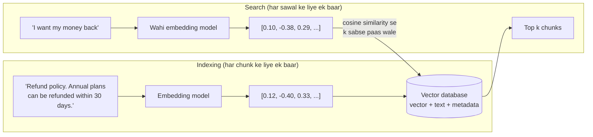

🏠 [Home](../../README.md) › [06 · RAG for Agents](./README.md) › 6.2 Embeddings aur vector databases

# 6.2 Embeddings aur vector databases

> **Level:** 🟢 Beginner · **Padhne ka time:** ~10 min · **Pehle padho:** [6.1 RAG, 5 minute mein](./06.1-rag-in-5-minutes.md)

**Ek line mein:** Embedding model text ko numbers ki ek list mein badalta hai, taaki milte-julte meaning wale texts paas-paas aa jaayein. Vector database un lists ko store karta hai aur sawal ke sabse paas wali lists jaldi dhoondh deta hai.

📑 **Is page par**

- [Yeh kyun zaroori hai?](#-yeh-kyun-zaroori-hai)
- [Idea, simple words mein](#-idea-simple-words-mein)
- [Diagram se samjho](#-diagram-se-samjho)
- [Kaise kaam karta hai, step by step](#-kaise-kaam-karta-hai-step-by-step)
- [Example se samjho](#-example-se-samjho)
- [Code](#-code)
- [Aam galtiyan aur dhyan dene wali baatein](#-aam-galtiyan-aur-dhyan-dene-wali-baatein)
- [Yaad rakhne wali baatein](#-yaad-rakhne-wali-baatein)
- [Khud try karo](#-khud-try-karo)
- [Aur padhne ke liye](#-aur-padhne-ke-liye)

## 🤔 Yeh kyun zaroori hai?

Ek customer type karta hai *"I want my money back"*. Tumhare help page ka title hai *"Refund policy"*. Keyword search ko ek bhi common word nahi dikhta, toh woh kuch return nahi karta. Lekin insaan ko turant samajh aata hai ki dono ek hi sawal hain.

[Embeddings](../../GLOSSARY.md#embedding) computer ko bhi yeh dekhne dete hain. Yeh texts ko spelling se nahi, **meaning** se compare karte hain. Zyadatar [RAG](../../GLOSSARY.md#retrieval-augmented-generation-rag) retrieval aur [vector memory](../05-memory/05.3-vector-memory.md) ke peeche yahi engine hai. Aur jab tumhare paas inke millions ho jaate hain, tab tumhe ek aisa store chahiye jo milliseconds mein search kare. Yahi vector database hai.

## 🧠 Idea, simple words mein

Socho har sentence ko ek bahut bade map par rakh diya gaya hai. Milti-julti cheezon wale sentences ek doosre ke paas baithte hain. "Refund policy" aur "I want my money back" padosi ban jaate hain. "Data regions" kahin door baitha hai. Sawal ka jawab dhoondhne ke liye tum sawal ko map par rakhte ho aur uske sabse paas wale padosi utha lete ho.

Jaise shaadi mein seating: rishtedaar ek table par, office wale doosri table par, school ke dost teesri par. Kisi naye mehmaan ko dekh ke tum andaaza laga lete ho ki woh kis table ke paas jayega.

[Embedding](../../GLOSSARY.md#embedding) us map par sentence ke coordinates hain. Asli maps mein do nahi, sainkdon ya hazaaron dimensions hote hain (OpenAI ka `text-embedding-3-small` default mein 1,536 numbers deta hai). Lekin idea wahi hai. **Embedding model** ek neural network hai jo yeh coordinates banane ke liye train kiya gaya hai. Yeh us chat model se alag model hai jo jawab likhta hai.

"Sabse paas" aksar [cosine similarity](../../GLOSSARY.md#cosine-similarity) se naapa jaata hai. Matlab do vectors kitna ek hi direction mein point karte hain. 1 ka matlab same direction, 0 ka matlab koi rishta nahi.

[Vector database](../../GLOSSARY.md#vector-database) vectors ko unke text aur metadata ke saath store karta hai. Aur "is vector ke *k* sabse paas wale vectors do" jaise sawal ka jawab deta hai. Bade scale par fast rehne ke liye yeh [approximate nearest neighbour (ANN)](../../GLOSSARY.md#approximate-nearest-neighbour-ann-search) index use karta hai. Isme thodi si accuracy jaati hai, lekin speed bahut badh jaati hai.

## 👀 Diagram se samjho



*Sawal aur documents dono same embedding model se guzarne chahiye. Warna unke coordinates ek hi map par nahi honge. Dikhaye gaye numbers sirf samjhane ke liye hain.*

## 🔍 Kaise kaam karta hai, step by step

**1. Documents ko embed karo.** Har chunk embedding model ko bhejo aur fixed length ka ek vector wapas lo. Yeh ek baar karo, jab documents add ya change hon, aur result store kar lo.

**2. Unhe store karo.** Har vector ko uske text, ek id, aur us metadata ke saath save karo jis par tum filter karna chahoge (source, date, customer, access level).

**3. Sawal ko embed karo.** Query ke time sawal ko **same model** se embed karo. Kuch models ko hint chahiye hota hai ki kaun sa side kaun sa hai. Jaise Voyage AI ka `input_type="query"` ya `"document"`.

**4. Compare karo.** Vectors *a* aur *b* ki cosine similarity `(a · b) / (|a| × |b|)` hai: dot product ko dono lengths se divide karo. Bahut saare embedding models pehle se length 1 par normalised vectors dete hain. Tab cosine similarity bas dot product hai.

**5. Sabse paas wale jaldi dhoondho.** Sawal ko har stored vector se compare karna (exact ya "flat" search) hazaaron vectors tak theek hai. Millions ke liye ANN indexes zyadatar vectors ko dekhte hi nahi:

| Index | Idea | Trade-off |
| --- | --- | --- |
| Flat (exact) | Har vector se compare karo | Perfect results, bade scale par slow |
| HNSW | Padosiyon ka ek layered graph; query ki taraf hop karte jao ([Malkov & Yashunin](https://arxiv.org/abs/1603.09320)) | Fast aur accurate, zyada memory, build karne mein slow |
| IVF | Vectors ko clusters ki lists mein baanto; sirf query ke paas wali lists search karo | Kam memory, jaldi build, thoda kam accurate |

**6. Store chuno.** Yeh tum khud kam hi banate ho. Common choices:

| Option | Kya hai | Kab accha hai |
| --- | --- | --- |
| [pgvector](https://github.com/pgvector/pgvector) | Ek PostgreSQL extension, jisme exact search ke saath HNSW aur IVFFlat indexes hain | Jab tum pehle se Postgres chala rahe ho aur vectors apne data ke paas chahte ho |
| [FAISS](https://github.com/facebookresearch/faiss) | Meta ki ek C++ library, Python wrappers ke saath | Jab tumhe in-process index aur algorithm par control chahiye |
| [Chroma](https://docs.trychroma.com/) | Ek open-source (Apache 2.0) vector store, simple Python API ke saath | Prototypes aur chhote se medium apps |
| [Qdrant](https://qdrant.tech/documentation/) | Rust mein likha ek open-source vector database | Bade scale par filtering ke saath ek dedicated service |

Managed cloud options bhi hain. Practice mein hamari salah hai: jo database tum pehle se chala rahe ho, agar woh vectors support karta hai, toh usi se shuru karo. Badlo tabhi jab measure karke zaroorat dikhe.

**Embeddings aate kahan se hain?** Ek embeddings API se, ya ek open model se jo tum khud chalate ho. OpenAI `client.embeddings.create` ke through `text-embedding-3-small` aur `text-embedding-3-large` deta hai. **Anthropic apna khud ka embedding model nahi deta.** Uski [embeddings guide](https://platform.claude.com/docs/en/build-with-claude/embeddings) Voyage AI (MongoDB ka) ko ek provider ke roop mein point karti hai, jiske general-purpose, code, multilingual, multimodal aur domain-specific models hain. Aur suggest karti hai ki apne use case ke liye vendors compare karo.

## 💡 Example se samjho

Yahan chapter ke aath help-centre documents par ek toy embedding (neeche samjhaya hai) use ho rahi hai. Index par sawal hai *"Business plan price per month"*:

```text
pricing.md   0.67   "Prices. Starter is free. Pro is $49 per month. Business is $199 per month. ..."
sso.md       0.23   "... SSO is available on the Business plan only."
limits.md    0.21   "API limits. Starter includes 10,000 API requests per month ..."
support.md   0.18   "... for Pro and Business customers."
```

`pricing.md` mein sawal ke chaar words common hain (business, plan, price, month), isliye woh saaf jeetta hai. `sso.md` mein do common hain. 0.2 ke threshold se neeche sab kuch noise maana jaata hai.

Ab toy ki limit dekho. *"I want my money back"* ka kisi bhi document se ek bhi word common nahi hai. Uska best score, `pricing.md` ke against 0.12, meaning se nahi aaya. Woh do alag words ke same hash slot mein girne (collision) se aaya. Ek asli embedding model, jo bahut saare text par train hua hai, "money back" ko "refund" aur "prices" ke paas rakhta hai. Ek asli model use karne ki poori wajah yahi hai.

## 💻 Code

**Pure Python mein idea.** Yeh ek *hashed bag-of-words* hai. Har word 512 slots mein se ek mein 1 add karta hai. Phir hum vector ko length 1 par scale karte hain. Isse mechanics samajh aate hain, lekin yeh meaning nahi, spelling pakadta hai. **Asli systems embedding model use karte hain.**

```python
import hashlib, math, re

DIM = 512

def embed(text: str) -> list[float]:
    vec = [0.0] * DIM
    for word in re.findall(r"[a-z0-9]+", text.lower()):
        slot = int(hashlib.md5(word.encode()).hexdigest(), 16) % DIM  # hash() ke ulat, har run mein same rehta hai
        vec[slot] += 1.0
    norm = math.sqrt(sum(v * v for v in vec)) or 1.0
    return [v / norm for v in vec]

def cosine(a: list[float], b: list[float]) -> float:
    return sum(x * y for x, y in zip(a, b))  # dono ki length 1 hai, isliye dot product hi cosine hai
```

**Ek asli embeddings API: OpenAI** (`OPENAI_API_KEY` chahiye):

```python
from openai import OpenAI

client = OpenAI()
resp = client.embeddings.create(
    model="text-embedding-3-small",
    input=["Refund policy. Annual plans can be refunded within 30 days.", "I want my money back"],
)
doc_vec, query_vec = (d.embedding for d in resp.data)  # default mein har ek 1,536 floats
```

**Claude ke saath: Voyage AI**, jaisa Anthropic ki embeddings guide mein dikhaya hai (`pip install voyageai` aur `VOYAGE_API_KEY` chahiye):

```python
import voyageai

vo = voyageai.Client()  # VOYAGE_API_KEY padhta hai
docs = vo.embed(["Refund policy. Annual plans can be refunded within 30 days."],
                model="voyage-4", input_type="document").embeddings
query = vo.embed(["I want my money back"], model="voyage-4", input_type="query").embeddings[0]
```

**Postgres mein pgvector ke saath store aur search karna** (SQL, pgvector README se; `<=>` cosine *distance* hai, toh jitna chhota utna paas):

```sql
CREATE EXTENSION vector;
CREATE TABLE chunks (id bigserial PRIMARY KEY, text text, embedding vector(1536));
CREATE INDEX ON chunks USING hnsw (embedding vector_cosine_ops);
SELECT id, text FROM chunks ORDER BY embedding <=> '[...query vector...]' LIMIT 5;
```

## 🚨 Aam galtiyan aur dhyan dene wali baatein

- **Embedding models mix karna.** Alag models (ya versions) ke vectors alag maps par rehte hain. Model badlo toh har document ko dobara embed karo.
- **Query/document ka farak bhool jaana.** Kuch models ko hint chahiye (Voyage AI ka `input_type`). Use chhod doge toh retrieval quality gir sakti hai.
- **Exact identifiers ke liye similarity par bharosa karna.** Embeddings meaning mein acchi hain, lekin exact strings jaise error codes, SKUs aur names mein kamzor. Inhe keyword search ke saath combine karo ([6.5](./06.5-re-ranking-and-retrieval-evaluation.md)).
- **Store hone wali kisi cheez ke liye Python ka `hash()` use karna.** Strings ke liye yeh har run mein badal jaata hai. `hashlib` use karo.
- **Alag models ya queries ke raw scores compare karna.** 0.4 ka cosine ek model ke liye strong aur doosre ke liye weak ho sakta hai. Thresholds apne evaluation se chuno, gut feeling se nahi.
- **Permissions ko ignore karna.** Agar users sirf kuch documents dekh sakte hain, toh metadata par filter *search ke andar* karo, model ke text dekhne ke baad nahi.

## ✅ Yaad rakhne wali baatein

- Embedding numbers ki ek list hai jo text ko ek "meaning map" par rakhti hai. Milte-julte texts paas-paas aate hain.
- Cosine similarity nazdeeki naapti hai. Length-1 vectors ke liye yeh bas dot product hai.
- Vector databases vectors ko text aur metadata ke saath store karte hain, aur speed ke liye HNSW jaise ANN indexes use karte hain.
- Anthropic ka apna embedding model nahi hai, woh Voyage AI ki taraf point karta hai. OpenAI ke paas `text-embedding-3-*` hai.
- Sawal aur documents hamesha same model se embed karo, aur model badlo toh dobara embed karo.

## 🧪 Khud try karo

1. Do vectors: a = [1, 0] aur b = [0.6, 0.8]. Inki cosine similarity kya hai?
2. Upar wale `embed` aur `cosine` functions use karke query *"refund"* ko har help-centre document ke against score karo. Sab 0 kyun aate hain, aur ek asli embedding model kya karta?

<details>
<summary>Answer dekho</summary>

1. Dono ki length 1 hai (0.6² + 0.8² = 1), toh cosine = dot product = 1 × 0.6 + 0 × 0.8 = **0.6**.
2. Kisi bhi document mein "refund" word nahi hai, aur toy embedding sirf identical words match karti hai. Ek asli embedding model phir bhi `pricing.md` (prices, billing) ko `regions.md` jaise unrelated documents se upar score karta. Kyunki usne seekha hai ki refunds aur prices related topics hain.

</details>

## 📚 Aur padhne ke liye

- [Embeddings](https://platform.claude.com/docs/en/build-with-claude/embeddings) (Anthropic docs). Embeddings provider mein kya dekhna chahiye, aur Claude ke saath Voyage AI kaise use karein.
- [Vector embeddings](https://developers.openai.com/api/docs/guides/embeddings) (OpenAI docs). OpenAI ke embedding models, dimensions aur use cases.
- [Efficient and robust approximate nearest neighbor search using HNSW graphs](https://arxiv.org/abs/1603.09320) (Malkov & Yashunin). Zyadatar vector databases ke peeche wala index.
- [pgvector](https://github.com/pgvector/pgvector) README. Postgres mein exact aur approximate vector search ka chhota, practical tour.

<!-- FOOTER -->

---

⬅️ **Pichla:** [6.1 RAG, 5 minute mein](./06.1-rag-in-5-minutes.md) ·
🏠 [Chapter home](./README.md) ·
➡️ **Agla:** [6.3 Chunking ke tarike](./06.3-chunking-strategies.md)
