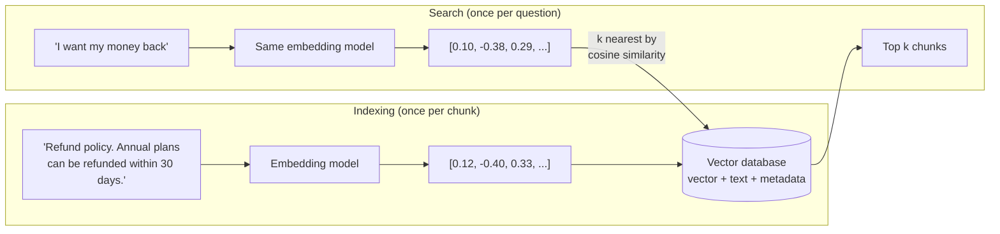

🏠 [Home](../../README.md) › [06 · RAG for Agents](./README.md) › 6.2 Embeddings & vector databases

# 6.2 Embeddings & vector databases

> **Difficulty:** 🟢 Beginner · **Reading time:** ~10 min · **Prerequisites:** [6.1 RAG in 5 minutes](./06.1-rag-in-5-minutes.md)

**In one sentence:** An embedding model turns text into a list of numbers so that similar meanings land close together, and a vector database stores those lists and finds the closest ones to a question fast.

📑 **On this page**

- [Why does this matter?](#-why-does-this-matter)
- [The idea, in plain words](#-the-idea-in-plain-words)
- [Picture it](#-picture-it)
- [How it works, step by step](#-how-it-works-step-by-step)
- [Worked example](#-worked-example)
- [Code](#-code)
- [Common mistakes & gotchas](#-common-mistakes--gotchas)
- [Key takeaways](#-key-takeaways)
- [Try it yourself](#-try-it-yourself)
- [Further reading](#-further-reading)

## 🤔 Why does this matter?

A customer types *"I want my money back"*. Your help page is titled *"Refund policy"*. A keyword search sees no shared words and returns nothing. A human sees the same question.

[Embeddings](../../GLOSSARY.md#embedding) let a computer see it too: they compare texts by **meaning**, not by spelling. They are the engine behind most [RAG](../../GLOSSARY.md#retrieval-augmented-generation-rag) retrieval and behind [vector memory](../05-memory/05.3-vector-memory.md). And once you have millions of them, you need a store that can search them in milliseconds: a vector database.

## 🧠 The idea, in plain words

Imagine placing every sentence on a giant map, where sentences about similar things sit near each other. "Refund policy" and "I want my money back" end up neighbours; "Data regions" sits far away. To answer a question, you put the question on the map and pick its nearest neighbours.

An [embedding](../../GLOSSARY.md#embedding) is a sentence's coordinates on that map. Real maps have hundreds or thousands of dimensions instead of two (OpenAI's `text-embedding-3-small` returns 1,536 numbers by default), but the idea is the same. An **embedding model** is a neural network trained to produce these coordinates. It is a different model from the chat model that writes answers.

"Nearest" is usually measured with [cosine similarity](../../GLOSSARY.md#cosine-similarity): how closely two vectors point in the same direction. 1 means the same direction, 0 means unrelated.

A [vector database](../../GLOSSARY.md#vector-database) stores vectors with their text and metadata, and answers "give me the *k* nearest vectors to this one". To stay fast at scale it uses an [approximate nearest neighbour (ANN)](../../GLOSSARY.md#approximate-nearest-neighbour-ann-search) index, which trades a tiny bit of accuracy for a huge gain in speed.

## 👀 Picture it



*The question and the documents must go through the same embedding model, or their coordinates are not on the same map. The numbers shown are illustrative.*

## 🔍 How it works, step by step

**1. Embed the documents.** Send each chunk to an embedding model and get back a vector of fixed length. Do this once, when documents are added or changed, and store the result.

**2. Store them.** Save each vector with its text, an id, and metadata you may want to filter on (source, date, customer, access level).

**3. Embed the question.** At query time, embed the question with the **same model**. Some models take a hint about which side is which: Voyage AI's `input_type="query"` or `"document"`, for example.

**4. Compare.** Cosine similarity of vectors *a* and *b* is `(a · b) / (|a| × |b|)`: the dot product divided by both lengths. Many embedding models return vectors already normalised to length 1, and then cosine similarity is just the dot product.

**5. Find the nearest, fast.** Comparing the question with every stored vector (exact or "flat" search) is fine for thousands of vectors. For millions, ANN indexes avoid looking at most of them:

| Index | The idea | Trade-off |
| --- | --- | --- |
| Flat (exact) | Compare with every vector | Perfect results, slow at scale |
| HNSW | A layered graph of neighbours; hop towards the query ([Malkov & Yashunin](https://arxiv.org/abs/1603.09320)) | Fast and accurate, more memory, slower to build |
| IVF | Cluster vectors into lists; search only the lists nearest the query | Less memory, faster to build, a little less accurate |

**6. Pick a store.** You rarely build this yourself. Common choices:

| Option | What it is | Good when |
| --- | --- | --- |
| [pgvector](https://github.com/pgvector/pgvector) | A PostgreSQL extension with exact search plus HNSW and IVFFlat indexes | You already run Postgres and want vectors next to your data |
| [FAISS](https://github.com/facebookresearch/faiss) | A C++ library with Python wrappers, from Meta | You want an in-process index and control over the algorithm |
| [Chroma](https://docs.trychroma.com/) | An open-source (Apache 2.0) vector store with a simple Python API | Prototypes and small to medium apps |
| [Qdrant](https://qdrant.tech/documentation/) | An open-source vector database written in Rust | A dedicated service with filtering at scale |

Managed cloud options exist too. In practice, we recommend starting with whatever database you already run, if it supports vectors, and moving only when you measure a need.

**Where do embeddings come from?** From an embeddings API or an open model you run yourself. OpenAI offers `text-embedding-3-small` and `text-embedding-3-large` through `client.embeddings.create`. **Anthropic does not offer its own embedding model**; its [embeddings guide](https://platform.claude.com/docs/en/build-with-claude/embeddings) points to Voyage AI (by MongoDB) as one provider with general-purpose, code, multilingual, multimodal and domain-specific models, and suggests you compare vendors for your use case.

## 💡 Worked example

This uses a toy embedding (explained below) over the chapter's eight help-centre documents. The question *"Business plan price per month"* against the index:

```text
pricing.md   0.67   "Prices. Starter is free. Pro is $49 per month. Business is $199 per month. ..."
sso.md       0.23   "... SSO is available on the Business plan only."
limits.md    0.21   "API limits. Starter includes 10,000 API requests per month ..."
support.md   0.18   "... for Pro and Business customers."
```

`pricing.md` shares four words with the question (business, plan, price, month) and wins clearly. `sso.md` shares two. Everything below a threshold of 0.2 is treated as noise.

Now the limit of the toy: *"I want my money back"* shares no words with any document. Its best score, 0.12 against `pricing.md`, comes from two different words landing in the same hash slot (a collision), not from meaning. A real embedding model, trained on huge amounts of text, places "money back" near "refund" and "prices". That is the whole reason to use one.

## 💻 Code

**The idea in pure Python.** This is a *hashed bag-of-words*: each word adds 1 to one of 512 slots, then we scale the vector to length 1. It shows the mechanics, but it captures spelling, not meaning. **Real systems use an embedding model.**

```python
import hashlib, math, re

DIM = 512

def embed(text: str) -> list[float]:
    vec = [0.0] * DIM
    for word in re.findall(r"[a-z0-9]+", text.lower()):
        slot = int(hashlib.md5(word.encode()).hexdigest(), 16) % DIM  # stable across runs, unlike hash()
        vec[slot] += 1.0
    norm = math.sqrt(sum(v * v for v in vec)) or 1.0
    return [v / norm for v in vec]

def cosine(a: list[float], b: list[float]) -> float:
    return sum(x * y for x, y in zip(a, b))  # both have length 1, so the dot product is the cosine
```

**A real embeddings API: OpenAI** (needs `OPENAI_API_KEY`):

```python
from openai import OpenAI

client = OpenAI()
resp = client.embeddings.create(
    model="text-embedding-3-small",
    input=["Refund policy. Annual plans can be refunded within 30 days.", "I want my money back"],
)
doc_vec, query_vec = (d.embedding for d in resp.data)  # 1,536 floats each by default
```

**With Claude: Voyage AI**, as shown in Anthropic's embeddings guide (needs `pip install voyageai` and `VOYAGE_API_KEY`):

```python
import voyageai

vo = voyageai.Client()  # reads VOYAGE_API_KEY
docs = vo.embed(["Refund policy. Annual plans can be refunded within 30 days."],
                model="voyage-4", input_type="document").embeddings
query = vo.embed(["I want my money back"], model="voyage-4", input_type="query").embeddings[0]
```

**Storing and searching in Postgres with pgvector** (SQL, from the pgvector README; `<=>` is cosine *distance*, so smaller is closer):

```sql
CREATE EXTENSION vector;
CREATE TABLE chunks (id bigserial PRIMARY KEY, text text, embedding vector(1536));
CREATE INDEX ON chunks USING hnsw (embedding vector_cosine_ops);
SELECT id, text FROM chunks ORDER BY embedding <=> '[...query vector...]' LIMIT 5;
```

## 🚨 Common mistakes & gotchas

- **Mixing embedding models.** Vectors from different models (or versions) live on different maps. If you change the model, re-embed every document.
- **Forgetting the query/document distinction.** Some models expect a hint (Voyage AI's `input_type`). Leaving it out can lower retrieval quality.
- **Trusting similarity for exact identifiers.** Embeddings are good at meaning and weak at exact strings such as error codes, SKUs and names. Combine them with keyword search ([6.5](./06.5-re-ranking-and-retrieval-evaluation.md)).
- **Using Python's `hash()` for anything stored.** It changes between runs for strings. Use `hashlib`.
- **Comparing raw scores across models or queries.** A cosine of 0.4 can be strong for one model and weak for another. Pick thresholds from your own evaluation, not from intuition.
- **Ignoring permissions.** If users may only see some documents, filter on metadata *in the search*, not after the model has seen the text.

## ✅ Key takeaways

- An embedding is a list of numbers that places text on a "meaning map"; similar texts land close together.
- Cosine similarity measures closeness; with length-1 vectors it is just the dot product.
- Vector databases store vectors with text and metadata, and use ANN indexes such as HNSW for speed.
- Anthropic has no embedding model of its own and points to Voyage AI; OpenAI has `text-embedding-3-*`.
- Always embed questions and documents with the same model, and re-embed when you switch.

## 🧪 Try it yourself

1. Two vectors: a = [1, 0] and b = [0.6, 0.8]. What is their cosine similarity?
2. Using the `embed` and `cosine` functions above, score the query *"refund"* against each of the help-centre documents. Why are they all 0, and what would a real embedding model do?

<details>
<summary>Show answer</summary>

1. Both have length 1 (0.6² + 0.8² = 1), so cosine = dot product = 1 × 0.6 + 0 × 0.8 = **0.6**.
2. No document contains the word "refund", and the toy embedding only matches identical words. A real embedding model would still score `pricing.md` (prices, billing) above unrelated documents like `regions.md`, because it has learned that refunds and prices are related topics.

</details>

## 📚 Further reading

- [Embeddings](https://platform.claude.com/docs/en/build-with-claude/embeddings) (Anthropic docs). What to look for in an embeddings provider, and how to use Voyage AI with Claude.
- [Vector embeddings](https://developers.openai.com/api/docs/guides/embeddings) (OpenAI docs). OpenAI's embedding models, dimensions and use cases.
- [Efficient and robust approximate nearest neighbor search using HNSW graphs](https://arxiv.org/abs/1603.09320) (Malkov & Yashunin). The index behind most vector databases.
- [pgvector](https://github.com/pgvector/pgvector) README. A short, practical tour of exact and approximate vector search in Postgres.

<!-- FOOTER -->

---

⬅️ **Previous:** [6.1 RAG in 5 minutes](./06.1-rag-in-5-minutes.md) ·
🏠 [Chapter home](./README.md) ·
➡️ **Next:** [6.3 Chunking strategies](./06.3-chunking-strategies.md)
