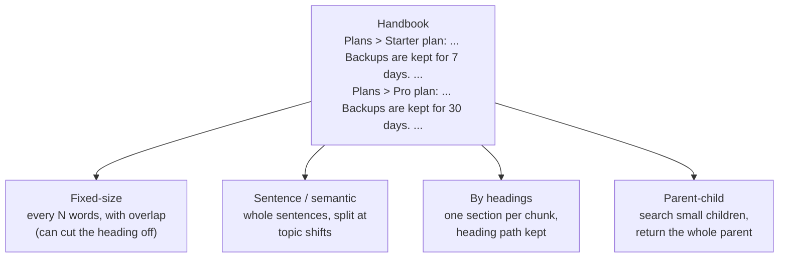

🏠 [Home](../../README.md) › [06 · RAG for Agents](./README.md) › 6.3 Chunking strategies

# 6.3 Chunking strategies

> **Difficulty:** 🟡 Intermediate · **Reading time:** ~10 min · **Prerequisites:** [6.1 RAG in 5 minutes](./06.1-rag-in-5-minutes.md), [6.2 Embeddings & vector databases](./06.2-embeddings-and-vector-databases.md)

**In one sentence:** How you cut documents into chunks decides what retrieval can find, so choose chunks that are small enough to match precisely but keep enough context to make sense on their own.

📑 **On this page**

- [Why does this matter?](#-why-does-this-matter)
- [The idea, in plain words](#-the-idea-in-plain-words)
- [Picture it](#-picture-it)
- [How it works, step by step](#-how-it-works-step-by-step)
- [Worked example](#-worked-example)
- [Code](#-code)
- [Common mistakes & gotchas](#-common-mistakes--gotchas)
- [Key takeaways](#-key-takeaways)
- [Try it yourself](#-try-it-yourself)
- [Further reading](#-further-reading)

## 🤔 Why does this matter?

Your handbook says, under the heading **Starter plan**: *"Backups are kept for 7 days."* Under **Pro plan** it says: *"Backups are kept for 30 days."* You split the handbook every 40 words. The chunk holding *"30 days"* starts mid-sentence, after the Pro plan heading, so nothing in it says "Pro". The chunk before it straddles the boundary: Starter's *"Backups are kept for 7 days"*, then the heading *"Pro plan"*. A customer asks how long backups are kept on the Pro plan. The straddling chunk matches best, and the model confidently answers **7 days**.

Nothing was wrong with the model or the [embeddings](../../GLOSSARY.md#embedding). The chunk was wrong. [Chunking](../../GLOSSARY.md#chunking) is the least glamorous step of [RAG](../../GLOSSARY.md#retrieval-augmented-generation-rag) and one of the most important.

## 🧠 The idea, in plain words

Think of making index cards from a textbook. If each card holds a whole chapter, you can never find the one fact you need: the card is about everything. If each card holds half a sentence, the fact is there but you can't tell what it refers to. Good cards hold one idea, with a title that says what it is about.

Chunks are those cards. Two forces pull against each other:

- **Small chunks** match questions precisely and cost few [tokens](../../GLOSSARY.md#token) in the prompt.
- **Large chunks** keep context: which product, which plan, which year.

Each strategy below is a different way to balance them.

## 👀 Picture it



*Four ways to cut the same document. Only the structure-aware ones keep "Pro plan" attached to "30 days".*

## 🔍 How it works, step by step

**1. Fixed-size with overlap.** Cut every *N* tokens (or words, or characters), and let each chunk repeat the last few tokens of the previous one, so a sentence cut at a boundary still appears whole somewhere. Simple, predictable, works on any text. It ignores meaning and structure, so it can split a table, a code block or a heading from its content.

**2. Sentence packing.** Split into sentences, then pack whole sentences into a chunk until it reaches the size limit. Never cuts mid-sentence. Still blind to headings.

**3. Semantic chunking.** Embed each sentence and start a new chunk where neighbouring sentences stop being similar: a "topic shift". Chunks follow the meaning of the text. It costs an embedding call per sentence at indexing time, and it depends on a good embedding model; with weak embeddings it makes many tiny chunks.

**4. By structure (headings, sections, functions).** Use the document's own structure: Markdown or HTML headings, PDF sections, one function per chunk for code. Write the **heading path** at the top of each chunk (`Plans > Pro plan: ...`) so the chunk says what it is about. Sections that are too long still need splitting with one of the methods above.

**5. Parent-child (small-to-big).** Index small *child* chunks (a sentence or two) for precise matching, but when one matches, hand the model its whole *parent* (the section). You get precise search and full context. It needs a mapping from child to parent, and the prompt grows with the parent's size.

**Trade-offs at a glance:**

| Strategy | Precision of match | Context kept | Cost and effort | Use it for |
| --- | --- | --- | --- | --- |
| Fixed-size + overlap | Medium | Low | Lowest | Plain, unstructured text; a first baseline |
| Sentence packing | Medium | Low-medium | Low | Prose without useful headings |
| Semantic | Medium-high | Medium | Embedding call per sentence | Long prose that drifts across topics |
| By headings | Medium | High | Low, needs a parser | Docs, wikis, Markdown, HTML |
| Parent-child | High | High | Two levels to store | Q&A over structured documents |

**Two more knobs:**

- **Size.** Anthropic's [Contextual Retrieval post](https://www.anthropic.com/research/contextual-retrieval) describes chunks of "usually no more than a few hundred tokens". Start there and measure ([6.5](./06.5-re-ranking-and-retrieval-evaluation.md)).
- **Add context to each chunk.** The same post prepends a short, model-written description of where the chunk sits in its document (for example *"This chunk is from an SEC filing on ACME corp's performance in Q2 2023"*) before embedding it. That is the automated version of keeping the heading path.

## 💡 Worked example

A small handbook is chunked five ways and asked six questions. A hit means the top-ranked chunk contains the answer. (Retrieval here uses a toy word-based embedding, so absolute numbers mean little; the *differences* are the point.)

```text
Strategy                             chunks avg words top-1 hits
fixed-size (40 words, 10 overlap)         7      35.9      5/6
sentence-packed (<= 40 words)             5      34.6      5/6
semantic (break on topic shift)           8      21.6      4/6
by headings                               6      31.2      6/6
parent-child                             20      32.5      6/6
```

Here is the fixed-size miss from the opening story. These are the two neighbouring fixed-size chunks:

```text
chunk 2: free. It includes one project and 10,000 API requests per month. Backups are kept for
         7 days. Support is by email only. ### Pro plan The Pro plan costs $49 per month. It
         includes ten projects and 1,000,000 API requests
chunk 3: per month. It includes ten projects and 1,000,000 API requests per month. Backups are
         kept for 30 days. Pro customers can open live chat during business hours. ## Backups ...
```

For *"How long are backups kept on the Pro plan?"*, chunk 2 wins (score 0.37): it contains "backups", "kept" **and** "Pro plan". The right answer is in chunk 3, which lost its heading. A model reading chunk 2 sees "7 days" a few words before "Pro plan" and gets it wrong.

The heading-based chunk wins instead with a higher score (0.46), and it carries its subject in the text:

```text
Plans > Pro plan: The Pro plan costs $49 per month. It includes ten projects and 1,000,000 API
requests per month. Backups are kept for 30 days. Pro customers can open live chat during business hours.
```

Parent-child also scores 6/6: the child *"Plans > Pro plan: Backups are kept for 30 days."* matches the question precisely, and the model receives the whole Pro plan section.

## 💻 Code

The core of three strategies:

```python
def fixed_size(doc: str, size: int = 40, overlap: int = 10) -> list[Chunk]:
    """Windows of `size` words; each starts `size - overlap` words after the last."""
    words = doc.split()
    step = size - overlap
    return [Chunk(" ".join(words[i : i + size])) for i in range(0, max(len(words) - overlap, 1), step)]


def by_headings(doc: str) -> list[Chunk]:
    """One chunk per section, with its heading path written at the top."""
    return [Chunk(f"{heading}: {body}") for heading, body in _sections(doc)]  # "Plans > Pro plan: ..."


def parent_child(doc: str) -> list[Chunk]:
    """Search small children (one sentence + its heading), but return the whole parent section."""
    chunks = []
    for heading, body in _sections(doc):
        parent = f"{heading}: {body}"
        chunks += [Chunk(text=f"{heading}: {s}", context=parent) for s in split_sentences(body)]
    return chunks
```

`Chunk.text` is what gets embedded and searched; `Chunk.context` is what the model receives. For most chunkers they are the same; for parent-child they differ.

Libraries such as LangChain and LlamaIndex ship ready-made splitters (by characters, tokens, Markdown headers, code, sentences). They do the same jobs as these functions; check their current docs for names and options.

## 🚨 Common mistakes & gotchas

- **Never looking at your chunks.** Print twenty random chunks before you tune anything. Cut tables, orphaned headings and half code blocks are obvious to the eye.
- **Losing the subject.** "It costs $49" is useless without "Pro plan". Keep heading paths, titles or a short generated context in every chunk.
- **One size for everything.** Code, tables, FAQs and long prose want different strategies. Route by document type.
- **Chunks bigger than the embedding model's input limit.** Text past the limit may be cut off or rejected, depending on the provider. Check the model's maximum input tokens.
- **Changing chunking without re-indexing and re-measuring.** Every change means re-embedding and rerunning your retrieval [eval](../../GLOSSARY.md#eval) ([6.5](./06.5-re-ranking-and-retrieval-evaluation.md)).
- **Overlap as a cure-all.** Overlap stops sentences being cut in half; it does not bring back a heading that is 200 words away.

## ✅ Key takeaways

- Chunking decides what retrieval *can* find; a bad cut can produce a confident wrong answer.
- Small chunks match precisely; big chunks keep context. Every strategy trades one for the other.
- Use the document's structure when it has one, and keep the heading path in each chunk.
- Parent-child gives you both: search small, return big.
- Start with a few hundred tokens, then measure with a retrieval eval.

## 🧪 Try it yourself

1. In the worked example, suppose you call `fixed_size` with `size=60, overlap=20` instead. Would the Pro-plan question pass? What else might change?
2. In `parent_child`, embed only the sentence (drop the `f"{heading}: "` prefix from `text`). Which question breaks first, and why?

<details>
<summary>Show answer</summary>

1. Yes, the Pro-plan question passes (the bigger window keeps the Pro section together), but two other questions miss: the live chat hours and the Pro plan price. Bigger windows blend more topics into each chunk, so they match less precisely. There is no free lunch, which is why you measure.
2. *"How long are backups kept on the Pro plan?"* breaks. The children "Backups are kept for 7 days." and "Backups are kept for 30 days." look almost the same without their headings, so the Starter one can win. The heading prefix is what tells the two apart.

</details>

## 📚 Further reading

- [Contextual Retrieval](https://www.anthropic.com/research/contextual-retrieval) (Anthropic). Why chunks lose context, and how prepending a generated context to each chunk reduced failed retrievals.
- [Contextual embeddings cookbook](https://github.com/anthropics/claude-cookbooks/tree/main/capabilities/contextual-embeddings) (Anthropic). Runnable notebooks for the technique above.
- [Embeddings](https://platform.claude.com/docs/en/build-with-claude/embeddings) (Anthropic docs). Includes Voyage AI's contextualized chunk embedding models, which embed chunks with their document's context.

<!-- FOOTER -->

---

⬅️ **Previous:** [6.2 Embeddings & vector databases](./06.2-embeddings-and-vector-databases.md) ·
🏠 [Chapter home](./README.md) ·
➡️ **Next:** [6.4 Agentic RAG](./06.4-agentic-rag.md)
