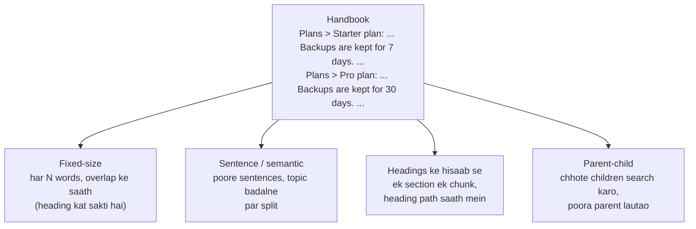

🏠 [Home](../../README.md) › [06 · RAG for Agents](./README.md) › 6.3 Chunking ke tarike

# 6.3 Chunking ke tarike

> **Level:** 🟡 Intermediate · **Padhne ka time:** ~10 min · **Pehle padho:** [6.1 RAG, 5 minute mein](./06.1-rag-in-5-minutes.md), [6.2 Embeddings aur vector databases](./06.2-embeddings-and-vector-databases.md)

**Ek line mein:** Tum documents ko chunks mein kaise kaatte ho, isi se tay hota hai ki retrieval kya dhoondh payega. Isliye chunks itne chhote rakho ki precisely match ho sakein, lekin itna context bhi rakho ki akele padhne par samajh aayein.

📑 **Is page par**

- [Yeh kyun zaroori hai?](#-yeh-kyun-zaroori-hai)
- [Idea, simple words mein](#-idea-simple-words-mein)
- [Diagram se samjho](#-diagram-se-samjho)
- [Kaise kaam karta hai, step by step](#-kaise-kaam-karta-hai-step-by-step)
- [Example se samjho](#-example-se-samjho)
- [Code](#-code)
- [Aam galtiyan aur dhyan dene wali baatein](#-aam-galtiyan-aur-dhyan-dene-wali-baatein)
- [Yaad rakhne wali baatein](#-yaad-rakhne-wali-baatein)
- [Khud try karo](#-khud-try-karo)
- [Aur padhne ke liye](#-aur-padhne-ke-liye)

## 🤔 Yeh kyun zaroori hai?

Tumhari handbook mein heading **Starter plan** ke neeche likha hai: *"Backups are kept for 7 days."* **Pro plan** ke neeche likha hai: *"Backups are kept for 30 days."* Tum handbook ko har 40 words par kaat dete ho.

Jis chunk mein *"30 days"* hai, woh Pro plan heading ke baad, sentence ke beech se shuru hota hai. Toh usme kahin "Pro" likha hi nahi hai. Usse pehle wala chunk boundary ke dono taraf faila hai: pehle Starter ka *"Backups are kept for 7 days"*, phir heading *"Pro plan"*.

Ek customer poochta hai ki Pro plan par backups kitne din rakhe jaate hain. Woh beech wala chunk sabse accha match karta hai. Aur model poore confidence se jawab deta hai: **7 days**.

Na model mein galti thi, na [embeddings](../../GLOSSARY.md#embedding) mein. Chunk galat tha. [Chunking](../../GLOSSARY.md#chunking) [RAG](../../GLOSSARY.md#retrieval-augmented-generation-rag) ka sabse kam glamorous step hai, aur sabse zaroori steps mein se ek.

## 🧠 Idea, simple words mein

Socho tum exam ki taiyari ke liye textbook se flash cards bana rahe ho. Agar har card par poora chapter likh do, toh jo ek fact chahiye woh kabhi nahi milega: card har cheez ke baare mein hai. Agar har card par aadha sentence likho, toh fact wahan hai, par pata nahi chalta ki woh kis cheez ke baare mein hai. Acche card par ek idea hota hai, aur upar ek title jo batata hai ki card kis baare mein hai.

Chunks yahi cards hain. Do cheezein ek doosre ke against kheenchti hain:

- **Chhote chunks** sawalon se precisely match karte hain aur prompt mein kam [tokens](../../GLOSSARY.md#token) lete hain.
- **Bade chunks** context bachaate hain: kaun sa product, kaun sa plan, kaun sa saal.

Neeche har strategy in dono ko balance karne ka ek alag tarika hai.

## 👀 Diagram se samjho



*Ek hi document ko kaatne ke chaar tarike. Sirf structure samajhne wale tarike "Pro plan" ko "30 days" ke saath jode rakhte hain.*

## 🔍 Kaise kaam karta hai, step by step

**1. Fixed-size, overlap ke saath.** Har *N* tokens (ya words, ya characters) par kaato. Har chunk pichhle chunk ke aakhri kuch tokens dobara rakhe. Isse boundary par kata hua sentence kahin na kahin poora dikh jaata hai. Simple hai, predictable hai, kisi bhi text par chalta hai. Lekin yeh meaning aur structure ko ignore karta hai. Toh yeh table, code block, ya heading ko uske content se alag kar sakta hai.

**2. Sentence packing.** Text ko sentences mein todo. Phir poore sentences ek chunk mein bharte jao jab tak size limit na aa jaaye. Sentence ke beech se kabhi nahi kaatta. Lekin headings ko ab bhi nahi dekhta.

**3. Semantic chunking.** Har sentence ko embed karo. Jahan padosi sentences similar hona band ho jaayein, wahan naya chunk shuru karo: yeh ek "topic shift" hai. Chunks text ke meaning ke saath chalte hain. Indexing ke time har sentence par ek embedding call lagti hai. Aur yeh acche embedding model par depend karta hai. Kamzor embeddings ke saath yeh bahut saare chhote-chhote chunks bana deta hai.

**4. Structure ke hisaab se (headings, sections, functions).** Document ka apna structure use karo: Markdown ya HTML headings, PDF sections, code ke liye ek function ek chunk. Har chunk ke upar **heading path** likho (`Plans > Pro plan: ...`), taaki chunk khud bataye ki woh kis baare mein hai. Jo sections bahut lambe hain, unhe phir bhi upar wale kisi tarike se todna padega.

**5. Parent-child (small-to-big).** Precise matching ke liye chhote *child* chunks (ek-do sentences) index karo. Lekin jab koi match ho, toh model ko uska poora *parent* (section) do. Isse search precise rehta hai aur context bhi poora milta hai. Iske liye child se parent ki mapping chahiye, aur parent jitna bada, prompt utna bada.

**Trade-offs ek nazar mein:**

| Strategy | Match kitna precise | Kitna context bachta hai | Cost aur mehnat | Kab use karo |
| --- | --- | --- | --- | --- |
| Fixed-size + overlap | Medium | Low | Sabse kam | Plain, unstructured text; pehla baseline |
| Sentence packing | Medium | Low-medium | Low | Aisa prose jisme kaam ki headings nahi |
| Semantic | Medium-high | Medium | Har sentence par embedding call | Lamba prose jo topics ke beech bhatakta hai |
| Headings ke hisaab se | Medium | High | Low, parser chahiye | Docs, wikis, Markdown, HTML |
| Parent-child | High | High | Do levels store karne padte hain | Structured documents par Q&A |

**Do aur knobs:**

- **Size.** Anthropic ka [Contextual Retrieval post](https://www.anthropic.com/research/contextual-retrieval) aise chunks batata hai jo "usually no more than a few hundred tokens" hote hain (matlab aam taur par kuch sau tokens se zyada nahi). Wahin se shuru karo aur measure karo ([6.5](./06.5-re-ranking-and-retrieval-evaluation.md)).
- **Har chunk mein context jodo.** Wahi post embed karne se pehle har chunk ke aage ek chhota, model ka likha description lagata hai ki chunk document mein kahan baitha hai (jaise *"This chunk is from an SEC filing on ACME corp's performance in Q2 2023"*). Yeh heading path rakhne ka automated version hai.

## 💡 Example se samjho

Ek chhoti handbook ko paanch tarike se chunk kiya gaya aur chhe sawal pooche gaye. Hit ka matlab hai top-ranked chunk mein jawab hai. (Yahan retrieval ek toy word-based embedding se hai, toh absolute numbers ka zyada matlab nahi. Asli baat *differences* mein hai.)

```text
Strategy                             chunks avg words top-1 hits
fixed-size (40 words, 10 overlap)         7      35.9      5/6
sentence-packed (<= 40 words)             5      34.6      5/6
semantic (break on topic shift)           8      21.6      4/6
by headings                               6      31.2      6/6
parent-child                             20      32.5      6/6
```

Shuru wali kahani ka fixed-size miss yeh raha. Yeh do padosi fixed-size chunks hain:

```text
chunk 2: free. It includes one project and 10,000 API requests per month. Backups are kept for
         7 days. Support is by email only. ### Pro plan The Pro plan costs $49 per month. It
         includes ten projects and 1,000,000 API requests
chunk 3: per month. It includes ten projects and 1,000,000 API requests per month. Backups are
         kept for 30 days. Pro customers can open live chat during business hours. ## Backups ...
```

*"How long are backups kept on the Pro plan?"* ke liye chunk 2 jeetta hai (score 0.37). Usme "backups", "kept" **aur** "Pro plan" teeno hain. Sahi jawab chunk 3 mein hai, jiski heading kho gayi. Chunk 2 padhne wala model "Pro plan" se kuch words pehle "7 days" dekhta hai aur galat jawab deta hai.

Iske badle heading-based chunk zyada score (0.46) se jeetta hai, aur uska subject text mein hi likha hai:

```text
Plans > Pro plan: The Pro plan costs $49 per month. It includes ten projects and 1,000,000 API
requests per month. Backups are kept for 30 days. Pro customers can open live chat during business hours.
```

Parent-child bhi 6/6 laata hai. Child *"Plans > Pro plan: Backups are kept for 30 days."* sawal se precisely match karta hai, aur model ko poora Pro plan section milta hai.

## 💻 Code

Teen strategies ka core:

```python
def fixed_size(doc: str, size: int = 40, overlap: int = 10) -> list[Chunk]:
    """`size` words ki windows; har window pichhli se `size - overlap` words baad shuru hoti hai."""
    words = doc.split()
    step = size - overlap
    return [Chunk(" ".join(words[i : i + size])) for i in range(0, max(len(words) - overlap, 1), step)]


def by_headings(doc: str) -> list[Chunk]:
    """Har section ka ek chunk, upar uska heading path likha hua."""
    return [Chunk(f"{heading}: {body}") for heading, body in _sections(doc)]  # jaise "Plans > Pro plan: ..."


def parent_child(doc: str) -> list[Chunk]:
    """Chhote children search karo (ek sentence + uski heading), lekin poora parent section lautao."""
    chunks = []
    for heading, body in _sections(doc):
        parent = f"{heading}: {body}"
        chunks += [Chunk(text=f"{heading}: {s}", context=parent) for s in split_sentences(body)]
    return chunks
```

`Chunk.text` woh hai jo embed aur search hota hai. `Chunk.context` woh hai jo model ko milta hai. Zyadatar chunkers mein dono same hote hain. Parent-child mein alag.

LangChain aur LlamaIndex jaisi libraries ready-made splitters deti hain (characters, tokens, Markdown headers, code, sentences ke hisaab se). Woh wahi kaam karti hain jo yeh functions karte hain. Names aur options ke liye unke current docs dekho.

## 🚨 Aam galtiyan aur dhyan dene wali baatein

- **Apne chunks kabhi dekhna hi nahi.** Kuch bhi tune karne se pehle bees random chunks print karo. Kati hui tables, akeli headings aur aadhe code blocks aankh se turant dikh jaate hain.
- **Subject kho dena.** "It costs $49" bina "Pro plan" ke bekaar hai. Har chunk mein heading path, title, ya ek chhota generated context rakho.
- **Sab ke liye ek hi size.** Code, tables, FAQs aur lamba prose, sabko alag strategy chahiye. Document type ke hisaab se route karo.
- **Embedding model ki input limit se bade chunks.** Limit ke baad wala text provider ke hisaab se kat sakta hai ya reject ho sakta hai. Model ke maximum input tokens check karo.
- **Re-index aur re-measure kiye bina chunking badalna.** Har change ka matlab hai dobara embed karna aur apna retrieval [eval](../../GLOSSARY.md#eval) dobara chalana ([6.5](./06.5-re-ranking-and-retrieval-evaluation.md)).
- **Overlap ko har bimari ki dawa samajhna.** Overlap sentences ko aadha katne se bachata hai. Lekin 200 words door padi heading wapas nahi laata.

## ✅ Yaad rakhne wali baatein

- Chunking tay karti hai ki retrieval kya dhoondh *sakta* hai. Ek galat cut confident galat jawab de sakta hai.
- Chhote chunks precisely match karte hain, bade chunks context bachaate hain. Har strategy ek ke badle doosra deti hai.
- Document ka structure ho toh use karo, aur har chunk mein heading path rakho.
- Parent-child dono deta hai: chhota search karo, bada lautao.
- Kuch sau tokens se shuru karo, phir retrieval eval se measure karo.

## 🧪 Khud try karo

1. Example mein maan lo tum `fixed_size` ko `size=60, overlap=20` ke saath call karte ho. Kya Pro-plan wala sawal pass hoga? Aur kya badal sakta hai?
2. `parent_child` mein sirf sentence embed karo (`text` se `f"{heading}: "` prefix hata do). Sabse pehle kaun sa sawal tootega, aur kyun?

<details>
<summary>Answer dekho</summary>

1. Haan, Pro-plan wala sawal pass hota hai (badi window Pro section ko saath rakhti hai). Lekin do aur sawal miss ho jaate hain: live chat ke hours aur Pro plan ki price. Badi windows har chunk mein zyada topics mila deti hain, toh woh kam precisely match karte hain. Free lunch kuch nahi hota, isiliye measure karte hain.
2. *"How long are backups kept on the Pro plan?"* tootta hai. Children "Backups are kept for 7 days." aur "Backups are kept for 30 days." headings ke bina lagbhag ek jaise dikhte hain, toh Starter wala jeet sakta hai. Heading prefix hi dono mein farak batata hai.

</details>

## 📚 Aur padhne ke liye

- [Contextual Retrieval](https://www.anthropic.com/research/contextual-retrieval) (Anthropic). Chunks context kyun kho dete hain, aur har chunk ke aage generated context lagane se failed retrievals kaise kam hue.
- [Contextual embeddings cookbook](https://github.com/anthropics/claude-cookbooks/tree/main/capabilities/contextual-embeddings) (Anthropic). Upar wali technique ke runnable notebooks.
- [Embeddings](https://platform.claude.com/docs/en/build-with-claude/embeddings) (Anthropic docs). Isme Voyage AI ke contextualized chunk embedding models bhi hain, jo chunks ko unke document ke context ke saath embed karte hain.

<!-- FOOTER -->

---

⬅️ **Pichla:** [6.2 Embeddings aur vector databases](./06.2-embeddings-and-vector-databases.md) ·
🏠 [Chapter home](./README.md) ·
➡️ **Agla:** [6.4 Agentic RAG](./06.4-agentic-rag.md)
