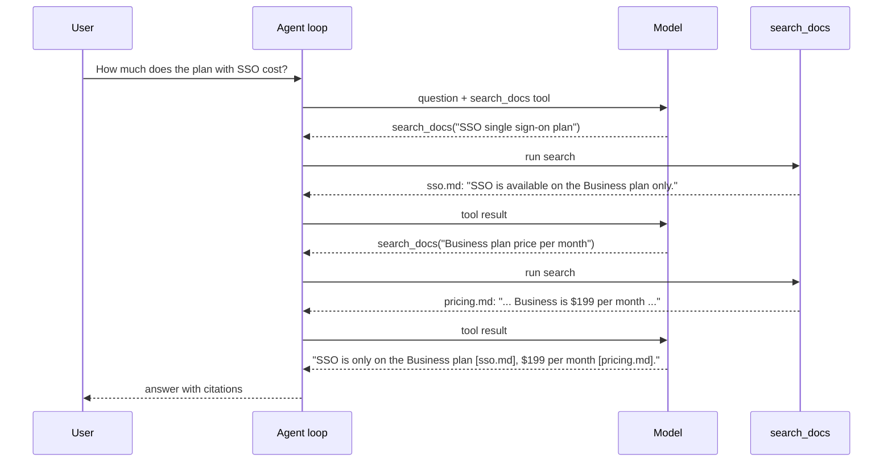

🏠 [Home](../../README.md) › [06 · RAG for Agents](./README.md) › 6.4 Agentic RAG

# 6.4 Agentic RAG

> **Difficulty:** 🟡 Intermediate · **Reading time:** ~12 min · **Prerequisites:** [6.1 RAG in 5 minutes](./06.1-rag-in-5-minutes.md), [3.3 How function calling works](../03-tools-and-function-calling/03.3-how-function-calling-works.md), [2.2 ReAct explained](../02-the-agent-loop/02.2-react-explained.md)

**In one sentence:** In agentic RAG, search is a tool the model calls, so the agent decides whether to search, what to search for, when to search again, and when to admit the answer isn't there.

📑 **On this page**

- [Why does this matter?](#-why-does-this-matter)
- [The idea, in plain words](#-the-idea-in-plain-words)
- [Picture it](#-picture-it)
- [How it works, step by step](#-how-it-works-step-by-step)
- [Worked example](#-worked-example)
- [Code](#-code)
- [Common mistakes & gotchas](#-common-mistakes--gotchas)
- [Key takeaways](#-key-takeaways)
- [Try it yourself](#-try-it-yourself)
- [Further reading](#-further-reading)

## 🤔 Why does this matter?

Classic [RAG](../../GLOSSARY.md#retrieval-augmented-generation-rag) ([6.1](./06.1-rag-in-5-minutes.md)) searches once, with the user's exact words, every time. Real questions break that in three ways:

- **Two-step questions.** *"How much does the plan with SSO cost?"* First you must learn *which* plan has SSO; only then can you look up its price. The price page doesn't mention SSO at all.
- **Bad wording.** Users write *"on-prem"* when your docs say *"self-hosted"*, or *"it"* when they mean the product from three messages ago.
- **Questions that need no search, or have no answer.** *"Thanks!"* doesn't need a search. *"Can I install it on my own servers?"* may have no answer in your docs, and the right response is to say so.

A fixed pipeline can't adapt to any of these. An agent can.

## 🧠 The idea, in plain words

Classic RAG is a librarian who fetches three books for every question before you've finished asking. [Agentic RAG](../../GLOSSARY.md#agentic-rag) is a researcher with a library card: they decide whether they need the library, look something up, read it, realise they need a second book, rephrase their search when the catalogue finds nothing, and tell you honestly when the library doesn't have it.

Technically, you give the model a `search_docs` [tool](../../GLOSSARY.md#tool) and let the normal [agent loop](../../GLOSSARY.md#agent-loop) run. The model writes the search queries. That one change unlocks:

- **Deciding when:** search only for questions that need facts.
- **[Query rewriting](../../GLOSSARY.md#query-rewriting):** turn the user's words into good search terms, and try different words if the first search fails.
- **[Multi-hop](../../GLOSSARY.md#multi-hop-question) retrieval:** use what one search returned to write the next search.
- **Saying "not found":** stop after a few honest attempts instead of guessing.

## 👀 Picture it



*The second query, "Business plan price", uses a fact from the first result. Classic RAG can't write that query, because it only ever searches with the user's words.*

## 🔍 How it works, step by step

1. **Wrap your retriever as a tool.** Give it a clear name, a description that says what the corpus contains and how to write queries, and a small input schema (`query`, maybe `top_k` or filters). Recall [designing good tools](../03-tools-and-function-calling/03.4-designing-good-tools.md): the description is the model's only manual.
2. **Return results the model can use.** Include a document id (for citations), a relevance score, and the text. Return a clear *"No relevant documents found"* when nothing passes a score threshold, rather than the least-bad irrelevant chunks.
3. **Write the instructions.** Tell the model: search before stating facts; one fact per query; rewrite once if a search fails; search again for the next hop; cite ids; say "I couldn't find that" when you can't. These rules are what turn "a model with a search tool" into reliable agentic RAG.
4. **Run the loop with limits.** It is the same loop as in [chapter 02](../02-the-agent-loop/README.md): call the model, run any tool calls, append results, repeat until it answers. Cap the number of steps (and searches) so a confused agent can't search forever.
5. **Evaluate.** Check both the final answers and the trajectory: did it search when it should, find the right documents, and stop at the right time? ([12.2](../12-evaluation/12.2-task-trajectory-and-tool-metrics.md))

**Classic vs agentic RAG:**

| | Classic RAG | Agentic RAG |
| --- | --- | --- |
| Who writes the query | Your code (the user's words) | The model |
| Searches per question | Exactly one | Zero, one or several |
| Multi-hop questions | Usually fails | Handles them, one hop per search |
| "Not in the docs" | Depends on the prompt | Can retry, then say so |
| Model calls | 1 | 1 + one per search round |
| Latency and cost | Low, predictable | Higher, variable |
| Debugging | One retrieval to inspect | A trajectory to inspect |

In practice, we recommend classic RAG for simple, high-volume Q&A where questions look alike, and agentic RAG when questions are varied, multi-part, or conversational. Research versions of the idea include interleaving retrieval with reasoning steps ([IRCoT, Trivedi et al.](https://arxiv.org/abs/2212.10509)) and training models to decide when to retrieve ([Self-RAG, Asai et al.](https://arxiv.org/abs/2310.11511)).

## 💡 Worked example

A run with scripted model replies over a real (toy) search index:

```text
Q: How much does the plan with SSO cost?

1) CLASSIC RAG  retrieved ['sso.md', 'changelog.md'] for the raw question
   SSO is available on the Business plan [sso.md], but the documents provided don't say what the Business plan costs.

2) AGENTIC RAG
   Q: How much does the plan with SSO cost?
      step 1: search_docs('SSO single sign-on plan') -> ['sso.md']
      step 2: search_docs('Business plan price per month') -> ['pricing.md', 'sso.md', 'limits.md']
      step 3: answer
   A: SSO is only on the Business plan [sso.md], which costs $199 per month, excluding VAT [pricing.md].

   Q: Can I install Acme Cloud on my own servers?
      step 1: search_docs('on-premises install') -> nothing
      step 2: search_docs('self-hosted deployment own servers') -> nothing
      step 3: answer
   A: I couldn't find that in the Acme Cloud docs: they say nothing about running it on your own servers.

   Q: Hi! What can you help me with?
      step 1: answer
   A: I can answer questions about Acme Cloud's plans, pricing, backups, data regions, support and API limits.
```

Walk through it:

- **Classic RAG** searched for the user's words. "SSO" dominated, so both slots went to SSO documents; the price page never had a chance. The answer is honest but incomplete.
- **Multi-hop.** The agent's first query found the plan name. Its second query, *"Business plan price per month"*, contains a word ("Business") that came from the first result, not from the user. That query ranks `pricing.md` first with a score of 0.67.
- **Not found.** The first query returned nothing above the threshold. The agent rewrote it with different words, got nothing again, and stopped, as instructed. No invented answer.
- **No search.** The greeting went straight to an answer: one model call instead of a search round.

## 💻 Code

The tool and its function:

```python
SEARCH_SPEC = {
    "name": "search_docs",
    "description": (
        "Search the Acme Cloud documentation. Returns up to top_k matching documents with their id, "
        "relevance score (0-1) and full text, or a 'no relevant documents' message. "
        "Write short keyword queries about one fact at a time, e.g. 'Business plan price'."
    ),
    "input_schema": {
        "type": "object",
        "properties": {
            "query": {"type": "string", "description": "Keywords for one fact, e.g. 'SSO plan'."},
            "top_k": {"type": "integer", "description": "How many documents to return (1-5). Default 3."},
        },
        "required": ["query"],
    },
}

def search_docs(query: str, top_k: int = 3) -> str:
    hits = retrieve(query, max(1, min(int(top_k), 5)))   # vector search, drops scores below MIN_SCORE
    if not hits:
        return f"No relevant documents found for: {query!r}"
    return json.dumps([{"id": d, "score": s, "text": DOCS[d]} for d, s in hits])
```

The [system prompt](../../GLOSSARY.md#system-prompt) carries the behaviour:

```text
- For any factual question about Acme Cloud, call search_docs before answering. Never answer from memory.
- Search for one fact at a time with short keyword queries. If a question needs two facts
  (for example "the plan that has X" and then "that plan's price"), search for the first, read the result,
  then search for the second.
- If a search returns nothing useful, rewrite the query once with different words (synonyms, product names).
- If you still find nothing, say "I couldn't find that in the Acme Cloud docs." Do not guess.
- Greetings and questions about what you can do need no search.
- Cite the document ids you used in [brackets]. Keep answers to one or two sentences.
```

The loop is the standard one from [1.5](../01-foundations/01.5-anatomy-of-an-agent.md#-code), with `search_docs` as its only tool and `max_steps=6`. Because the tool uses the neutral `{"name", "description", "input_schema"}` format, the same agent can run on Claude or OpenAI models.

**Provider extras worth knowing.** With Claude, a tool can return its hits as `search_result` content blocks; with citations enabled, Claude's answer then cites them with the source and title you provided ([search results docs](https://platform.claude.com/docs/en/build-with-claude/search-results)). OpenAI offers a hosted file search tool in its Responses API. Both are optional: the plain-text version above works everywhere.

## 🚨 Common mistakes & gotchas

- **A vague tool description.** "Searches documents" tells the model nothing. Say what the corpus covers, how to phrase queries, and what comes back.
- **Always returning *something*.** If the tool returns the top 3 even when they are irrelevant, the model will try to use them. A score threshold plus an explicit "nothing found" message makes "I don't know" possible.
- **No search budget.** A model that keeps rephrasing can loop for many steps. Cap steps, and say in the prompt how many rewrites are allowed.
- **Searching for everything.** Without "greetings need no search", some models search on every turn, adding latency and cost. Equally, without "never answer from memory", some answer factual questions without searching.
- **Huge tool results.** Returning ten full documents per search fills the [context window](../../GLOSSARY.md#context-window) fast across several hops. Return snippets or chunks, and fetch a full document with a separate tool only when needed.
- **Trusting retrieved text.** Documents can contain instructions ("ignore previous instructions..."). Treat tool results as data, not commands ([13.2](../13-safety-and-guardrails/13.2-prompt-injection.md)).

## ✅ Key takeaways

- Agentic RAG = retrieval as a tool; the model decides whether, what and how often to search.
- It handles multi-hop questions, poor wording and "not in the docs", which classic RAG can't.
- The tool's description and the system prompt's search rules matter as much as the retriever.
- Return ids, scores and a clear "nothing found"; cap the number of searches.
- It costs more calls and latency than classic RAG; use it where questions vary.

## 🧪 Try it yourself

1. In the code above, suppose `MIN_SCORE` is set to `0.0` and you call `search_docs("on-premises install")`. What comes back, and why is that worse for the agent?
2. A user asks *"Which region stores our data, and can I change it later?"* Would the agent need one search or two? Write the query or queries you would expect.
3. Write a test that checks the agent never searches more than three times for one question, using a scripted fake model ([Mock LLM](../../GLOSSARY.md#mockllm)) and the agent's `log`.

<details>
<summary>Show answer</summary>

1. Three documents with a score of 0.0 (the first three in the index), presented as results. The agent may now try to answer from irrelevant text instead of seeing a clear "nothing found" and saying so.
2. One search is enough: `regions.md` says both facts ("stored in Frankfurt or Virginia" and "cannot be changed later"). A query like `"data region change"` finds it. Two facts don't always mean two hops; hops are needed when the second *query* depends on the first *answer*.
3. For example:

   ```python
   from types import SimpleNamespace as NS

   class AlwaysSearch:
       """Fake model: every reply asks for one more search."""
       def chat(self, messages, **kwargs):
           call = NS(id=f"c{len(messages)}", name="search_docs", arguments={"query": "try again"})
           return NS(text="", tool_calls=[call], to_message=lambda: {"role": "assistant", "content": ""})

   def test_search_budget() -> None:
       agent = RagAgent(AlwaysSearch(), max_steps=3)   # your agent, with the model passed in
       agent.run("anything")
       assert sum("search_docs" in line for line in agent.log) <= 3
   ```

</details>

## 📚 Further reading

- [Building effective agents](https://www.anthropic.com/engineering/building-effective-agents) (Anthropic). When an agent is worth it, and the augmented LLM with retrieval as a building block.
- [Interleaving Retrieval with Chain-of-Thought Reasoning for Knowledge-Intensive Multi-Step Questions](https://arxiv.org/abs/2212.10509) (Trivedi et al., 2022). Multi-hop retrieval guided by reasoning steps.
- [Self-RAG: Learning to Retrieve, Generate, and Critique through Self-Reflection](https://arxiv.org/abs/2310.11511) (Asai et al., 2023). A model trained to decide when to retrieve and to check its own use of sources.
- [How we built our multi-agent research system](https://www.anthropic.com/engineering/multi-agent-research-system) (Anthropic). Agentic search at scale, with many searches across parallel agents.

<!-- FOOTER -->

---

⬅️ **Previous:** [6.3 Chunking strategies](./06.3-chunking-strategies.md) ·
🏠 [Chapter home](./README.md) ·
➡️ **Next:** [6.5 Re-ranking & retrieval evaluation](./06.5-re-ranking-and-retrieval-evaluation.md)
