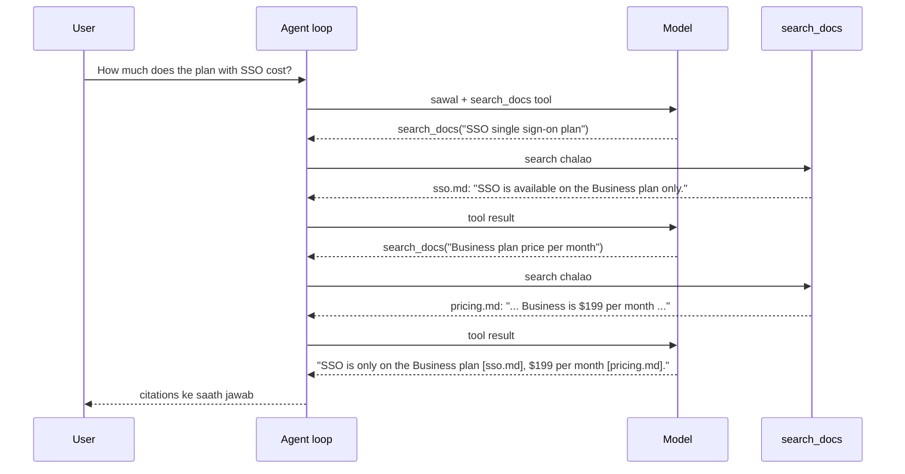

🏠 [Home](../../README.md) › [06 · RAG for Agents](./README.md) › 6.4 Agentic RAG

# 6.4 Agentic RAG

> **Level:** 🟡 Intermediate · **Padhne ka time:** ~12 min · **Pehle padho:** [6.1 RAG, 5 minute mein](./06.1-rag-in-5-minutes.md), [3.3 Function calling kaise kaam karta hai](../03-tools-and-function-calling/03.3-how-function-calling-works.md), [2.2 ReAct ko samjho](../02-the-agent-loop/02.2-react-explained.md)

**Ek line mein:** Agentic RAG mein search ek tool hai jise model call karta hai. Toh agent khud decide karta hai ki search karna hai ya nahi, kya search karna hai, kab dobara search karna hai, aur kab maan lena hai ki jawab yahan nahi hai.

📑 **Is page par**

- [Yeh kyun zaroori hai?](#-yeh-kyun-zaroori-hai)
- [Idea, simple words mein](#-idea-simple-words-mein)
- [Diagram se samjho](#-diagram-se-samjho)
- [Kaise kaam karta hai, step by step](#-kaise-kaam-karta-hai-step-by-step)
- [Example se samjho](#-example-se-samjho)
- [Code](#-code)
- [Aam galtiyan aur dhyan dene wali baatein](#-aam-galtiyan-aur-dhyan-dene-wali-baatein)
- [Yaad rakhne wali baatein](#-yaad-rakhne-wali-baatein)
- [Khud try karo](#-khud-try-karo)
- [Aur padhne ke liye](#-aur-padhne-ke-liye)

## 🤔 Yeh kyun zaroori hai?

Classic [RAG](../../GLOSSARY.md#retrieval-augmented-generation-rag) ([6.1](./06.1-rag-in-5-minutes.md)) har baar ek hi search karta hai, user ke exact words ke saath. Asli sawal ise teen tarike se tod dete hain:

- **Do-step wale sawal.** *"How much does the plan with SSO cost?"* Pehle tumhe pata karna hai ki SSO *kis* plan mein hai. Tabhi tum uski price dekh sakte ho. Price wale page par SSO ka zikr hi nahi hai.
- **Galat wording.** Users *"on-prem"* likhte hain jabki tumhare docs mein *"self-hosted"* likha hai. Ya *"it"* likhte hain jabki unka matlab teen message pehle wale product se hai.
- **Aise sawal jinhe search nahi chahiye, ya jinka jawab hi nahi hai.** *"Thanks!"* ke liye search nahi chahiye. *"Can I install it on my own servers?"* ka jawab shayad tumhare docs mein ho hi nahi. Tab sahi response yahi hai ki yeh saaf bata do.

Ek fixed pipeline inmein se kisi ke saath adjust nahi kar sakti. Agent kar sakta hai.

## 🧠 Idea, simple words mein

Classic RAG ek aisa librarian hai jo tumhare sawal poora karne se pehle hi har sawal ke liye teen kitaabein utha laata hai. [Agentic RAG](../../GLOSSARY.md#agentic-rag) library card wala ek researcher hai. Woh decide karta hai ki library chahiye bhi ya nahi. Kuch dhoondhta hai, padhta hai, aur samajhta hai ki doosri kitaab bhi chahiye. Catalogue mein kuch na mile toh search ke words badalta hai. Aur library mein woh cheez na ho toh imaandari se bata deta hai.

Technically, tum model ko ek `search_docs` [tool](../../GLOSSARY.md#tool) dete ho aur normal [agent loop](../../GLOSSARY.md#agent-loop) chalne dete ho. Search queries model khud likhta hai. Bas is ek change se yeh sab khul jaata hai:

- **Kab search karna hai, yeh decide karna:** sirf un sawalon par search jinhe facts chahiye.
- **[Query rewriting](../../GLOSSARY.md#query-rewriting):** user ke words ko acche search terms mein badalna, aur pehla search fail ho toh alag words try karna.
- **[Multi-hop](../../GLOSSARY.md#multi-hop-question) retrieval:** ek search se jo mila, usse agla search likhna.
- **"Nahi mila" bolna:** kuch imaandaar koshishon ke baad ruk jaana, guess karne ki jagah.

Socho tum train ticket book kar rahe ho aur poochte ho "Mumbai se Delhi wali sabse sasti train ka 3AC fare kitna hai?" Pehle tum trains ki list dekhte ho, sabse sasti train chunte ho, phir uska fare check karte ho. Doosra search pehle wale ke result par tika hai. Multi-hop yahi hai.

## 👀 Diagram se samjho



*Doosri query, "Business plan price", pehle result se mila ek fact use karti hai. Classic RAG yeh query nahi likh sakta, kyunki woh hamesha sirf user ke words se search karta hai.*

## 🔍 Kaise kaam karta hai, step by step

1. **Apne retriever ko ek tool mein wrap karo.** Use ek saaf naam do. Ek description do jo bataye ki corpus mein kya hai aur queries kaise likhni hain. Aur ek chhota input schema do (`query`, shayad `top_k` ya filters). [Acche tools design karna](../03-tools-and-function-calling/03.4-designing-good-tools.md) yaad karo: description hi model ka akela manual hai.
2. **Aise results lautao jo model use kar sake.** Ek document id (citations ke liye), ek relevance score, aur text do. Jab koi bhi result score threshold paar na kare, toh saaf *"No relevant documents found"* lautao. Sabse kam bure irrelevant chunks mat bhejo.
3. **Instructions likho.** Model ko batao: facts bolne se pehle search karo; ek query mein ek fact; search fail ho toh ek baar rewrite karo; agle hop ke liye dobara search karo; ids cite karo; na mile toh "I couldn't find that" bolo. Yahi rules "search tool wala model" ko reliable agentic RAG banate hain.
4. **Limits ke saath loop chalao.** Yeh wahi loop hai jo [chapter 02](../02-the-agent-loop/README.md) mein hai: model call karo, tool calls chalao, results jodo, jawab aane tak repeat karo. Steps (aur searches) ki limit lagao, taaki confuse hua agent hamesha search karta na reh jaaye.
5. **Evaluate karo.** Final jawab aur trajectory dono check karo: kya usne sahi time par search kiya, sahi documents dhoondhe, aur sahi time par ruka? ([12.2](../12-evaluation/12.2-task-trajectory-and-tool-metrics.md))

**Classic vs agentic RAG:**

| | Classic RAG | Agentic RAG |
| --- | --- | --- |
| Query kaun likhta hai | Tumhara code (user ke words) | Model |
| Har sawal par searches | Exactly ek | Zero, ek ya kai |
| Multi-hop sawal | Aksar fail | Handle karta hai, har search mein ek hop |
| "Docs mein nahi hai" | Prompt par depend | Retry kar sakta hai, phir bata deta hai |
| Model calls | 1 | 1 + har search round ki ek |
| Latency aur cost | Kam, predictable | Zyada, badalti rehti hai |
| Debugging | Check karne ko ek retrieval | Check karne ko ek trajectory |

Practice mein hamari salah: simple, high-volume Q&A ke liye classic RAG, jahan sawal ek jaise dikhte hain. Aur agentic RAG tab, jab sawal alag-alag, kai hisson wale, ya conversational hon. Is idea ke research versions mein retrieval ko reasoning steps ke saath interleave karna ([IRCoT, Trivedi et al.](https://arxiv.org/abs/2212.10509)) aur models ko train karna ki kab retrieve karein ([Self-RAG, Asai et al.](https://arxiv.org/abs/2310.11511)) shamil hain.

## 💡 Example se samjho

Ek asli (toy) search index par scripted model replies ke saath ek run:

```text
Q: How much does the plan with SSO cost?

1) CLASSIC RAG  retrieved ['sso.md', 'changelog.md'] for the raw question
   SSO is available on the Business plan [sso.md], but the documents provided don't say what the Business plan costs.

2) AGENTIC RAG
   Q: How much does the plan with SSO cost?
      step 1: search_docs('SSO single sign-on plan') -> ['sso.md']
      step 2: search_docs('Business plan price per month') -> ['pricing.md', 'sso.md', 'limits.md']
      step 3: answer
   A: SSO is only on the Business plan [sso.md], which costs $199 per month, excluding VAT [pricing.md].

   Q: Can I install Acme Cloud on my own servers?
      step 1: search_docs('on-premises install') -> nothing
      step 2: search_docs('self-hosted deployment own servers') -> nothing
      step 3: answer
   A: I couldn't find that in the Acme Cloud docs: they say nothing about running it on your own servers.

   Q: Hi! What can you help me with?
      step 1: answer
   A: I can answer questions about Acme Cloud's plans, pricing, backups, data regions, support and API limits.
```

Ek-ek karke dekho:

- **Classic RAG** ne user ke words se search kiya. "SSO" haavi ho gaya, toh dono slots SSO documents ko mile. Price page ko mauka hi nahi mila. Jawab imaandaar hai, lekin adhoora.
- **Multi-hop.** Agent ki pehli query ne plan ka naam dhoondha. Doosri query, *"Business plan price per month"*, mein ek word ("Business") hai jo user se nahi, pehle result se aaya. Yeh query `pricing.md` ko 0.67 score ke saath pehle number par rakhti hai.
- **Nahi mila.** Pehli query ne threshold ke upar kuch nahi lautaya. Agent ne alag words se rewrite kiya, phir kuch nahi mila, aur instruction ke hisaab se ruk gaya. Koi bana hua jawab nahi.
- **Koi search nahi.** Greeting seedha jawab tak gayi: search round ki jagah sirf ek model call.

## 💻 Code

Tool aur uska function:

```python
SEARCH_SPEC = {
    "name": "search_docs",
    "description": (
        "Search the Acme Cloud documentation. Returns up to top_k matching documents with their id, "
        "relevance score (0-1) and full text, or a 'no relevant documents' message. "
        "Write short keyword queries about one fact at a time, e.g. 'Business plan price'."
    ),
    "input_schema": {
        "type": "object",
        "properties": {
            "query": {"type": "string", "description": "Keywords for one fact, e.g. 'SSO plan'."},
            "top_k": {"type": "integer", "description": "How many documents to return (1-5). Default 3."},
        },
        "required": ["query"],
    },
}

def search_docs(query: str, top_k: int = 3) -> str:
    hits = retrieve(query, max(1, min(int(top_k), 5)))   # vector search, MIN_SCORE se neeche wale scores hata deta hai
    if not hits:
        return f"No relevant documents found for: {query!r}"
    return json.dumps([{"id": d, "score": s, "text": DOCS[d]} for d, s in hits])
```

Behaviour [system prompt](../../GLOSSARY.md#system-prompt) mein hota hai:

```text
- For any factual question about Acme Cloud, call search_docs before answering. Never answer from memory.
- Search for one fact at a time with short keyword queries. If a question needs two facts
  (for example "the plan that has X" and then "that plan's price"), search for the first, read the result,
  then search for the second.
- If a search returns nothing useful, rewrite the query once with different words (synonyms, product names).
- If you still find nothing, say "I couldn't find that in the Acme Cloud docs." Do not guess.
- Greetings and questions about what you can do need no search.
- Cite the document ids you used in [brackets]. Keep answers to one or two sentences.
```

Loop wahi standard wala hai jo [1.5](../01-foundations/01.5-anatomy-of-an-agent.md#-code) mein hai. Bas `search_docs` uska akela tool hai aur `max_steps=6` hai. Tool neutral `{"name", "description", "input_schema"}` format use karta hai, isliye wahi agent Claude ya OpenAI models par chal sakta hai.

**Provider ki extra cheezein jo jaanna kaam ki hai.** Claude ke saath ek tool apne hits `search_result` content blocks ke roop mein lauta sakta hai. Citations on hon toh Claude ka jawab unhe tumhare diye source aur title ke saath cite karta hai ([search results docs](https://platform.claude.com/docs/en/build-with-claude/search-results)). OpenAI apne Responses API mein ek hosted file search tool deta hai. Dono optional hain: upar wala plain-text version har jagah chalta hai.

## 🚨 Aam galtiyan aur dhyan dene wali baatein

- **Dhundhla tool description.** "Searches documents" se model ko kuch pata nahi chalta. Batao ki corpus mein kya hai, queries kaise likhni hain, aur wapas kya aata hai.
- **Hamesha *kuch na kuch* lautana.** Agar tool irrelevant hone par bhi top 3 lautata hai, toh model unhe use karne ki koshish karega. Score threshold aur ek saaf "nothing found" message se "I don't know" bolna possible hota hai.
- **Koi search budget nahi.** Jo model baar-baar rephrase karta rahe, woh kai steps tak loop kar sakta hai. Steps ki limit lagao, aur prompt mein batao ki kitne rewrites allowed hain.
- **Har cheez ke liye search.** "Greetings need no search" ke bina kuch models har turn par search karte hain, jisse latency aur cost badhti hai. Waise hi, "never answer from memory" ke bina kuch models factual sawalon ka jawab bina search ke de dete hain.
- **Bahut bade tool results.** Har search mein das poore documents lautane se kai hops mein [context window](../../GLOSSARY.md#context-window) jaldi bhar jaati hai. Snippets ya chunks lautao. Poora document sirf zaroorat par ek alag tool se lao.
- **Retrieved text par bharosa karna.** Documents mein instructions ho sakti hain ("ignore previous instructions..."). Tool results ko data samjho, commands nahi ([13.2](../13-safety-and-guardrails/13.2-prompt-injection.md)).

## ✅ Yaad rakhne wali baatein

- Agentic RAG = retrieval ek tool ki tarah. Model decide karta hai ki search karna hai ya nahi, kya, aur kitni baar.
- Yeh multi-hop sawal, kharab wording aur "docs mein nahi hai" handle karta hai, jo classic RAG nahi kar sakta.
- Tool ka description aur system prompt ke search rules utne hi zaroori hain jitna retriever.
- Ids, scores aur ek saaf "nothing found" lautao. Searches ki ginti par limit lagao.
- Isme classic RAG se zyada calls aur latency lagti hai. Ise wahan use karo jahan sawal alag-alag hon.

## 🧪 Khud try karo

1. Upar wale code mein maan lo `MIN_SCORE` ko `0.0` set kiya hai aur tum `search_docs("on-premises install")` call karte ho. Kya wapas aata hai, aur yeh agent ke liye kyun bura hai?
2. Ek user poochta hai *"Which region stores our data, and can I change it later?"* Agent ko ek search chahiye ya do? Jo query ya queries tum expect karte ho, woh likho.
3. Ek test likho jo check kare ki agent ek sawal ke liye teen se zyada baar search nahi karta. Iske liye ek scripted fake model ([Mock LLM](../../GLOSSARY.md#mockllm)) aur agent ka `log` use karo.

<details>
<summary>Answer dekho</summary>

1. 0.0 score wale teen documents (index ke pehle teen), results ki tarah pesh kiye hue. Ab agent saaf "nothing found" dekh ke bata dene ki jagah irrelevant text se jawab dene ki koshish kar sakta hai.
2. Ek search kaafi hai: `regions.md` dono facts bolta hai ("stored in Frankfurt or Virginia" aur "cannot be changed later"). `"data region change"` jaisi query use dhoondh leti hai. Do facts ka matlab hamesha do hops nahi hota. Hops tab chahiye jab doosri *query* pehle *jawab* par depend kare.
3. Jaise:

   ```python
   from types import SimpleNamespace as NS

   class AlwaysSearch:
       """Fake model: har reply ek aur search maangta hai."""
       def chat(self, messages, **kwargs):
           call = NS(id=f"c{len(messages)}", name="search_docs", arguments={"query": "try again"})
           return NS(text="", tool_calls=[call], to_message=lambda: {"role": "assistant", "content": ""})

   def test_search_budget() -> None:
       agent = RagAgent(AlwaysSearch(), max_steps=3)   # tumhara agent, model pass karke
       agent.run("anything")
       assert sum("search_docs" in line for line in agent.log) <= 3
   ```

</details>

## 📚 Aur padhne ke liye

- [Building effective agents](https://www.anthropic.com/engineering/building-effective-agents) (Anthropic). Agent kab worth hai, aur retrieval ke saath augmented LLM ek building block ki tarah.
- [Interleaving Retrieval with Chain-of-Thought Reasoning for Knowledge-Intensive Multi-Step Questions](https://arxiv.org/abs/2212.10509) (Trivedi et al., 2022). Reasoning steps se guide hone wala multi-hop retrieval.
- [Self-RAG: Learning to Retrieve, Generate, and Critique through Self-Reflection](https://arxiv.org/abs/2310.11511) (Asai et al., 2023). Ek model jo train kiya gaya hai yeh decide karne ke liye ki kab retrieve kare, aur sources ka apna use khud check kare.
- [How we built our multi-agent research system](https://www.anthropic.com/engineering/multi-agent-research-system) (Anthropic). Bade scale par agentic search, parallel agents mein kai searches ke saath.

<!-- FOOTER -->

---

⬅️ **Pichla:** [6.3 Chunking ke tarike](./06.3-chunking-strategies.md) ·
🏠 [Chapter home](./README.md) ·
➡️ **Agla:** [6.5 Re-ranking aur retrieval evaluation](./06.5-re-ranking-and-retrieval-evaluation.md)
