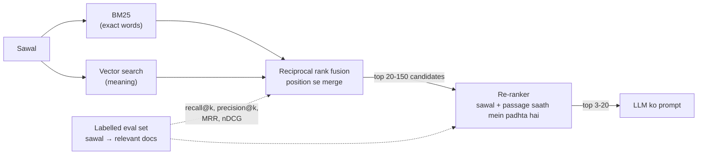

🏠 [Home](../../README.md) › [06 · RAG for Agents](./README.md) › 6.5 Re-ranking aur retrieval evaluation

# 6.5 Re-ranking aur retrieval evaluation

> **Level:** 🔴 Advanced · **Padhne ka time:** ~12 min · **Pehle padho:** [6.2 Embeddings aur vector databases](./06.2-embeddings-and-vector-databases.md), [6.3 Chunking ke tarike](./06.3-chunking-strategies.md)

**Ek line mein:** Keyword aur vector search ko milao, candidates ko ek aise model se re-rank karo jo sawal aur har passage ko saath mein padhta hai, aur har change ko labelled sawalon ke set par recall@k, precision@k, MRR aur nDCG se measure karo.

📑 **Is page par**

- [Yeh kyun zaroori hai?](#-yeh-kyun-zaroori-hai)
- [Idea, simple words mein](#-idea-simple-words-mein)
- [Diagram se samjho](#-diagram-se-samjho)
- [Kaise kaam karta hai, step by step](#-kaise-kaam-karta-hai-step-by-step)
- [Example se samjho](#-example-se-samjho)
- [Code](#-code)
- [Aam galtiyan aur dhyan dene wali baatein](#-aam-galtiyan-aur-dhyan-dene-wali-baatein)
- [Yaad rakhne wali baatein](#-yaad-rakhne-wali-baatein)
- [Khud try karo](#-khud-try-karo)
- [Aur padhne ke liye](#-aur-padhne-ke-liye)

## 🤔 Yeh kyun zaroori hai?

Ek user tumhare support agent mein *"error E-4021"* paste karta hai. Vector search general errors ke pages lauta deta hai. E-4021 wala page paanchve number par hai. Doosra user *"cancelling my subscription"* type karta hai, aur keyword search kuch nahi lautata, kyunki tumhare page par *"Cancel plan"* likha hai.

Tum ek ko theek karne ke liye chunk size badalte ho aur doosra toot jaata hai. Aur yeh tumhe sirf complaints se pata chalta hai.

Isko do cheezein theek karti hain. Behtar retrieval (hybrid search aur re-ranking). Aur retrieval ko **measure** karne ka tarika, taaki pata chale ki change se fayda hua. [RAG](../../GLOSSARY.md#retrieval-augmented-generation-rag) ki zyadatar failures retrieval failures hoti hain ([6.1](./06.1-rag-in-5-minutes.md)), toh quality yahin jeeti jaati hai.

## 🧠 Idea, simple words mein

[Hybrid search](../../GLOSSARY.md#hybrid-search) do alag librarians se poochta hai aur unki lists ko mila deta hai. Ek ([BM25](../../GLOSSARY.md#bm25)) exact words match karta hai, aur names, codes aur jargon mein bahut accha hai. Doosra (vector search) meaning match karta hai, aur paraphrases mein bahut accha hai. Har ek woh pakadta hai jo doosra miss karta hai. [Reciprocal rank fusion (RRF)](../../GLOSSARY.md#reciprocal-rank-fusion-rrf) lists ko sirf positions se milata hai. Isliye tumhe unke alag-alag tarah ke scores compare hi nahi karne padte.

**Re-ranking** ek doosri, dhyan se padhai hai. First-stage search fast hai kyunki woh pehle se bane vectors ya word counts compare karta hai. Ek [re-ranker](../../GLOSSARY.md#re-ranker) (aksar ek *cross-encoder*) sawal aur har candidate passage ko **saath mein** padhta hai. Phir score deta hai ki woh passage sawal ka kitna accha jawab hai. Yeh ek million passages ke liye bahut slow hai, lekin top 20 se 150 ke liye theek hai.

Cricket team selection jaisa socho. Pehle district level par bahut saare players ko unke stats dekh ke jaldi shortlist kar lete hain. Phir selectors un thode players ko net session mein dhyan se dekhte hain. Pehla step fast aur mota hai, doosra slow aur bareek.

**Evaluation** ek answer key wala quiz hai. Tum sawal likhte ho, har sawal ke liye relevant documents mark karte ho, retriever chalate ho, aur ranked lists ko standard metrics se score karte ho: [precision and recall at k](../../GLOSSARY.md#precision-and-recall-at-k), [mean reciprocal rank (MRR)](../../GLOSSARY.md#mean-reciprocal-rank-mrr) aur [nDCG](../../GLOSSARY.md#ndcg). Ab "kya mere change se fayda hua?" ka jawab ek number hai. Yeh [evals](../../GLOSSARY.md#eval) ka retrieval wala hissa hai.

## 👀 Diagram se samjho



*Do saste retrievers ek bada jaal phenkte hain. Re-ranker unmein se sabse acche kuch chunta hai. Dotted lines woh measurements hain jo tum har stage par lete ho.*

## 🔍 Kaise kaam karta hai, step by step

### 1. BM25 se keyword search

BM25 us document ko zyada score deta hai jisme query ke words hon, khaaskar **rare** words (ek inverse-document-frequency weight). Words repeat hone ka fayda dheere-dheere kam hota jaata hai, aur lambe documents ke liye ek correction hota hai. Query *q* aur document *d* ke liye:

```text
score(d, q) = Σ over words w in q:  IDF(w) × f(w,d) × (k1 + 1) / ( f(w,d) + k1 × (1 − b + b × |d| / avgdl) )
```

`f(w,d)` matlab *w* kitni baar *d* mein aata hai. `|d|` document ki length hai, `avgdl` average length. `k1` (aksar 1.2 se 2) aur `b` (aksar 0.75) tuning constants hain. Isme koi model nahi chahiye, aur yeh `E-4021` ya `HTTP 429` jaise identifiers ke liye bahut badhiya hai.

### 2. Reciprocal rank fusion se merge karo

BM25 scores aur cosine similarities alag scales par hain, toh tum unhe seedha jod nahi sakte. RRF ([Cormack et al., 2009](https://plg.uwaterloo.ca/~gvcormac/cormacksigir09-rrf.pdf)) scores ko ignore karke ranks use karta hai:

```text
RRF(d) = Σ over result lists:  1 / (k + rank of d in that list)
```

`k` ek constant hai jo bilkul top ranks ka advantage thoda naram karta hai. 60 ek common default hai (yeh Elasticsearch ka default `rank_constant` hai). Jo document dono lists mein kaafi upar hai, woh us document ko hara deta hai jo ek list mein top par hai aur doosri mein gayab.

### 3. Top candidates ko re-rank karo

Ek **bi-encoder** (tumhara [embedding](../../GLOSSARY.md#embedding) model) sawal aur har passage ko *alag-alag* embed karta hai. Isiliye passage vectors pehle se compute ho sakte hain. Ek **cross-encoder** sawal aur ek passage ko *saath mein* padhta hai aur relevance score deta hai. Woh aisi cheezein dekhta hai jaise "is passage mein Pro plan *aur* 30 days *saath mein* hain". Isliye woh aksar zyada accurate hota hai. Lekin use query ke time har (sawal, passage) pair par ek baar chalna padta hai. Toh: bahut saare sasta retrieve karo, thode dhyan se re-rank karo.

Options mein open cross-encoder models (jaise Sentence Transformers library ke through) aur hosted rerank APIs (Cohere aur Voyage AI dono dete hain) shamil hain. Ek [LLM](../../GLOSSARY.md#large-language-model-llm) bhi prompt mein passages ko score karke re-ranker ban sakta hai, zyada cost par. Anthropic ka [Contextual Retrieval post](https://www.anthropic.com/research/contextual-retrieval) batata hai ki unke improved retrieval ke upar re-ranking step jodne se unke tests mein top-20 retrieval failure rate 5.7% se 1.9% ho gaya (unhone top 150 ko re-rank karke 20 tak laaya).

### 4. Measure karo: chaar metrics

Tumhe ek eval set chahiye: sawal, aur har sawal ke saath uske relevant documents. nDCG ke liye relevance graded ho sakti hai (2 = jawab deta hai, 1 = kaam ka background, 0 = relevant nahi). Phir har sawal ki ranked list ke liye:

| Metric | Definition | Kis sawal ka jawab deta hai |
| --- | --- | --- |
| **precision@k** | (top *k* mein relevant docs) ÷ *k* | Jo main model ko bhej raha hoon, usme kitna kaam ka hai? |
| **recall@k** | (top *k* mein relevant docs) ÷ (is sawal ke saare relevant docs) | Kya sahi documents andar pahunche bhi? |
| **MRR** | Saare sawalon par 1 ÷ (pehle relevant doc ka rank) ka mean; kuch na mile toh 0 | Pehla accha result kitna upar hai? |
| **nDCG@k** | DCG@k ÷ IDCG@k, jahan DCG@k = Σ<sub>i=1..k</sub> rel<sub>i</sub> ÷ log<sub>2</sub>(i + 1) aur IDCG perfect ordering ka DCG hai | Kya *sabse* relevant docs upar ke paas hain? (1.0 = ideal order) |

Har metric ko saare sawalon par average karo. DCG ki kuch definitions gain ke liye rel ki jagah 2<sup>rel</sup> − 1 use karti hain. Dono standard hain, toh batao ki tum kaun si use kar rahe ho.

**RAG ke liye kaun sa zaroori hai?** Aksar sabse pehle **recall@k**. Agar jawab un top *k* mein nahi hai jo tum model ko bhejte ho, toh aage kuch bhi use theek nahi kar sakta. Phir MRR ya nDCG, kyunki models kuch positions par baaki se zyada dhyan dete hain, aur tumhe best passages pehle chahiye. Precision@k track karta hai ki tum prompt mein kitna noise (aur cost) jod rahe ho.

## 💡 Example se samjho

Ek chhote eval set mein 13 help-centre documents aur 12 labelled queries hain. Hum chaar retrievers ko *k* = 3 par score karte hain. (Iska "vector" side ek toy character-trigram embedding hai aur re-ranker ek toy scoring function. Toh numbers ko method ka demo samjho, asli quality ka nahi.)

```text
Retriever                   recall@3   precision@3           MRR        nDCG@3
BM25                            0.79          0.33          0.79          0.77
vector (trigram toy)            0.92          0.39          0.96          0.92
hybrid (RRF)                    0.92          0.39          0.92          0.89
hybrid + re-rank                0.96          0.42          1.00          0.98
```

Chalo ek row haath se compute karte hain. Query: *"how long are backups kept"*, relevant: `{backups: 2}`. Hybrid search ne `[restore, backups, err-e5003]` lautaya:

```text
precision@3 = 1 relevant in top 3 / 3                 = 0.33
recall@3    = 1 found / 1 relevant                    = 1.00
RR          = 1 / rank of first relevant = 1 / 2      = 0.50
DCG@3       = 0/log2(2) + 2/log2(3) + 0/log2(4)        = 1.26
IDCG@3      = 2/log2(2)  (backups first)              = 2.00
nDCG@3      = 1.26 / 2.00                             = 0.63
```

Re-ranking ke baad list `[backups, restore, err-e5003]` hai: RR aur nDCG dono 1.0 ho jaate hain. Recall nahi badla (backups pehle se top 3 mein tha), lekin best passage upar aa gaya.

Is chhote run se teen sabak:

- **BM25 ko *"cancelling my subscription"* ke liye kuch nahi mila.** "Cancel plan" ya "Cancellation" ke saath exact word ka koi overlap nahi tha. Trigram vectors ne common spelling match kar li.
- **Hybrid apne aap behtar nahi tha.** Backups wali query ke liye BM25 poore confidence se galat tha (`restore` mein "Backups" naam se likha hai), aur fusion ne woh galti upar kheench di. Bade asli corpora par asli embedding model ke saath embeddings aur BM25 ko milana aksar fayda karta hai (Anthropic ke post ne ise sirf embeddings se behtar paaya). Lekin tumhare data ke liye yeh sirf tumhara eval set bata sakta hai.
- **Yahan precision@3 1.0 tak nahi pahunch sakta**, kyunki zyadatar queries ka sirf ek relevant document hai. Metrics ko is hisaab se padho ki kya possible hai.

## 💻 Code

Metrics. `ranking` doc ids ki list hai, best pehle. `relevant` doc ids ko grades se map karta hai:

```python
import math

def precision_at_k(ranking, relevant, k):
    return sum(1 for d in ranking[:k] if relevant.get(d, 0) > 0) / k

def recall_at_k(ranking, relevant, k):
    total = sum(1 for g in relevant.values() if g > 0)
    return sum(1 for d in ranking[:k] if relevant.get(d, 0) > 0) / total if total else 0.0

def reciprocal_rank(ranking, relevant):
    for rank, d in enumerate(ranking, start=1):
        if relevant.get(d, 0) > 0:
            return 1.0 / rank
    return 0.0  # MRR = saari queries par iska mean

def ndcg_at_k(ranking, relevant, k):
    def dcg(grades):
        return sum(g / math.log2(i + 2) for i, g in enumerate(grades))  # i 0 se shuru hota hai, toh position i+1
    ideal = dcg(sorted(relevant.values(), reverse=True)[:k])
    return dcg([relevant.get(d, 0) for d in ranking[:k]]) / ideal if ideal else 0.0
```

Reciprocal rank fusion bas paanch lines hai:

```python
def rrf(rankings: list[list[str]], k: int = 60) -> list[str]:
    scores: dict[str, float] = {}
    for ranking in rankings:
        for rank, d in enumerate(ranking, start=1):
            scores[d] = scores.get(d, 0.0) + 1.0 / (k + rank)
    return sorted(scores, key=lambda d: -scores[d])

hybrid = rrf([bm25.search(query), vectors.search(query)])
```

Sentence Transformers library ke saath ek asli cross-encoder re-ranker (`pip install sentence-transformers` chahiye; pehli baar use par ek model download hota hai):

```python
from sentence_transformers import CrossEncoder

reranker = CrossEncoder("cross-encoder/ms-marco-MiniLM-L6-v2")
candidates = hybrid[:20]
scores = reranker.predict([(query, DOCS[d]) for d in candidates])   # har (query, passage) pair ka ek score
reranked = [d for _, d in sorted(zip(scores, candidates), key=lambda p: -p[0])]
```

## 🚨 Aam galtiyan aur dhyan dene wali baatein

- **Koi eval set nahi.** Labelled queries ke bina har change ek guess hai. 20 se 50 asli user sawalon se shuru karo aur unhe label karo. Jaise-jaise failures dikhein, set badhate jao ([12.4](../12-evaluation/12.4-building-an-eval-dataset.md)).
- **Kai relevant documents hone par bhi har query ke liye sirf ek label karna.** Tab recall asal se behtar dikhta hai. Label karte waqt corpus mein search karo.
- **Sirf final jawab measure karna.** Agar jawab galat hain, toh retrieval metrics batate hain ki retrieval theek karna hai ya generation. Dono measure karo.
- **Alag retrievers ke raw scores compare karna.** BM25 scores aur cosine similarities same scale par nahi hain. Rank se fuse karo (RRF) ya dhyan se normalise karo.
- **Bahut kam candidates ko re-rank karna.** Re-ranker sirf usi ko upar la sakta hai jo first stage ne dhoondha. Agar recall@100 kam hai, toh first stage theek karo.
- **Latency ko ignore karna.** 150 passages par cross-encoder har query par ek model call jodta hai. Time measure karo aur candidate count apne eval se chuno.
- **Ek bahut chhote eval set par overfit karna.** Baarah queries (jaise example mein) method dikhati hain. Woh yeh prove nahi karti ki system kaam karta hai. Ek held-out set alag rakho.

## ✅ Yaad rakhne wali baatein

- BM25 exact words aur identifiers pakadta hai. Vector search meaning pakadta hai. RRF ke saath hybrid search dono ko rank se milata hai.
- Re-rankers sawal aur passage saath mein padhte hain: slow, zyada accurate, ek chhoti list par use hote hain.
- recall@k: kya sahi docs andar aaye? precision@k: kitna noise? MRR: pehla hit kitna upar? nDCG: kya order sahi hai?
- RAG ke liye aksar recall@k sabse zyada matter karta hai: jo model ne kabhi dekha hi nahi, use woh use nahi kar sakta.
- Koi bhi technique tumhare data par fayde ki guarantee nahi deti. Har change measure karo.

## 🧪 Khud try karo

1. Ek query ke relevant docs `{a: 2, b: 1}` hain. Tumhara retriever `[x, b, a, y]` lautata hai. precision@2, recall@2, reciprocal rank aur nDCG@3 nikalo.
2. Jis query ka exactly ek relevant document hai, uske liye precision@1 aur recall@1 hamesha barabar kyun hote hain? Kya *k* = 3 par bhi barabar rehte hain?
3. RRF ka constant aksar bada (jaise 60) kyun hota hai, 1 kyun nahi?

<details>
<summary>Answer dekho</summary>

1. precision@2 = 1/2 = 0.5 (sirf `b`). recall@2 = 1/2 = 0.5 (`b` mila, `a` miss hua). RR = 1/2 = 0.5 (pehla relevant rank 2 par). DCG@3 = 0/log2(2) + 1/log2(3) + 2/log2(4) = 0.631 + 1.0 = 1.631. IDCG@3 = 2/log2(2) + 1/log2(3) = 2 + 0.631 = 2.631. nDCG@3 = 1.631 / 2.631 ≈ **0.62**.
2. *k* = 1 par dono 1 hote hain agar top result relevant document hai, warna 0 (precision *k* = 1 se divide karta hai, recall 1 relevant document se). *k* = 3 par yeh alag hote hain: document mil gaya toh recall@3 = 1, lekin precision@3 = 1/3. Isiliye example mein precision@3 retrieval acchi hone par bhi 0.4 ke aas-paas rehta hai.
3. *k* = 1 ke saath rank 1 ko 1/2 aur rank 2 ko 1/3 milta hai. Har list ka top haavi ho jaata hai, aur ek confident lekin galat list jeet sakti hai. Bada *k* farak ko flat kar deta hai (1/61 vs 1/62), toh jo documents **kai** lists mein aate hain, woh upar uthte hain. Dono values ko tum example jaise ek labelled eval set par test kar sakte ho.

</details>

## 📚 Aur padhne ke liye

- [Contextual Retrieval](https://www.anthropic.com/research/contextual-retrieval) (Anthropic). Embeddings + BM25 + rank fusion + re-ranking, kai datasets par recall@20 se measure kiya hua.
- [Reciprocal Rank Fusion outperforms Condorcet and individual Rank Learning Methods](https://plg.uwaterloo.ca/~gvcormac/cormacksigir09-rrf.pdf) (Cormack, Clarke & Büttcher, 2009). Do page ka original RRF paper.
- [Cross-Encoders](https://www.sbert.net/examples/cross_encoder/applications/README.html) (Sentence Transformers docs). Bi-encoders vs cross-encoders, aur retrieve-then-re-rank.
- [Reciprocal rank fusion](https://www.elastic.co/docs/reference/elasticsearch/rest-apis/reciprocal-rank-fusion) (Elasticsearch docs). Ek production search engine mein RRF, uske parameters ke saath.

<!-- FOOTER -->

---

⬅️ **Pichla:** [6.4 Agentic RAG](./06.4-agentic-rag.md) ·
🏠 [Chapter home](./README.md) ·
➡️ **Agla:** [07 · Planning & Reasoning → 7.1 Chain-of-thought aur extended thinking](../07-planning-and-reasoning/07.1-chain-of-thought-and-extended-thinking.md)
