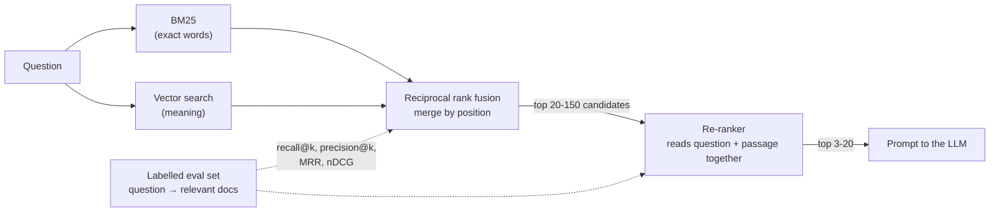

🏠 [Home](../../README.md) › [06 · RAG for Agents](./README.md) › 6.5 Re-ranking & retrieval evaluation

# 6.5 Re-ranking & retrieval evaluation

> **Difficulty:** 🔴 Advanced · **Reading time:** ~12 min · **Prerequisites:** [6.2 Embeddings & vector databases](./06.2-embeddings-and-vector-databases.md), [6.3 Chunking strategies](./06.3-chunking-strategies.md)

**In one sentence:** Combine keyword and vector search, re-rank the candidates with a model that reads the question and each passage together, and measure every change with recall@k, precision@k, MRR and nDCG on a labelled set of questions.

📑 **On this page**

- [Why does this matter?](#-why-does-this-matter)
- [The idea, in plain words](#-the-idea-in-plain-words)
- [Picture it](#-picture-it)
- [How it works, step by step](#-how-it-works-step-by-step)
- [Worked example](#-worked-example)
- [Code](#-code)
- [Common mistakes & gotchas](#-common-mistakes--gotchas)
- [Key takeaways](#-key-takeaways)
- [Try it yourself](#-try-it-yourself)
- [Further reading](#-further-reading)

## 🤔 Why does this matter?

A user pastes *"error E-4021"* into your support agent. Vector search returns pages about errors in general; the page for E-4021 is fifth. Another user types *"cancelling my subscription"*, and keyword search returns nothing, because your page says *"Cancel plan"*. You tweak the chunk size to fix one and break the other, and you only find out from complaints.

Two things fix this: better retrieval (hybrid search and re-ranking), and a way to **measure** retrieval so you know a change helped. Most [RAG](../../GLOSSARY.md#retrieval-augmented-generation-rag) failures are retrieval failures ([6.1](./06.1-rag-in-5-minutes.md)), so this is where quality is won.

## 🧠 The idea, in plain words

[Hybrid search](../../GLOSSARY.md#hybrid-search) asks two different librarians and merges their lists. One ([BM25](../../GLOSSARY.md#bm25)) matches exact words and is great with names, codes and jargon. The other (vector search) matches meaning and is great with paraphrases. Each catches what the other misses. [Reciprocal rank fusion (RRF)](../../GLOSSARY.md#reciprocal-rank-fusion-rrf) merges the lists using only positions, so you never have to compare their incompatible scores.

**Re-ranking** is a second, careful read. First-stage search is fast because it compares precomputed vectors or word counts. A [re-ranker](../../GLOSSARY.md#re-ranker) (usually a *cross-encoder*) reads the question and each candidate passage **together** and scores how well that passage answers it. That is too slow for a million passages but fine for the top 20 to 150.

**Evaluation** is a quiz with an answer key. You write questions, mark which documents are relevant to each, run the retriever, and score the ranked lists with standard metrics: [precision and recall at k](../../GLOSSARY.md#precision-and-recall-at-k), [mean reciprocal rank (MRR)](../../GLOSSARY.md#mean-reciprocal-rank-mrr) and [nDCG](../../GLOSSARY.md#ndcg). Now "did my change help?" has a number for an answer. This is the retrieval part of [evals](../../GLOSSARY.md#eval).

## 👀 Picture it



*Two cheap retrievers cast a wide net; the re-ranker picks the best few. The dotted lines are the measurements you take at each stage.*

## 🔍 How it works, step by step

### 1. Keyword search with BM25

BM25 scores a document higher when it contains the query's words, especially **rare** words (an inverse-document-frequency weight), with diminishing returns for repeats and a correction for long documents. For a query *q* and document *d*:

```text
score(d, q) = Σ over words w in q:  IDF(w) × f(w,d) × (k1 + 1) / ( f(w,d) + k1 × (1 − b + b × |d| / avgdl) )
```

`f(w,d)` is how often *w* appears in *d*, `|d|` is the document's length, `avgdl` the average length, and `k1` (often 1.2 to 2) and `b` (often 0.75) are tuning constants. It needs no model and is excellent for identifiers such as `E-4021` or `HTTP 429`.

### 2. Merge with reciprocal rank fusion

BM25 scores and cosine similarities are on different scales, so you can't just add them. RRF ([Cormack et al., 2009](https://plg.uwaterloo.ca/~gvcormac/cormacksigir09-rrf.pdf)) ignores scores and uses ranks:

```text
RRF(d) = Σ over result lists:  1 / (k + rank of d in that list)
```

`k` is a constant that softens the advantage of the very top ranks; 60 is a common default (it is Elasticsearch's default `rank_constant`). A document that is fairly high in both lists beats one that is top in one list and missing from the other.

### 3. Re-rank the top candidates

A **bi-encoder** (your [embedding](../../GLOSSARY.md#embedding) model) embeds the question and each passage *separately*, which is why passage vectors can be precomputed. A **cross-encoder** reads the question and one passage *together* and outputs a relevance score. It sees interactions such as "this passage mentions Pro plan *and* 30 days *together*", so it is usually more accurate, but it must run once per (question, passage) pair at query time. So: retrieve many cheaply, re-rank few carefully.

Options include open cross-encoder models (for example via the Sentence Transformers library) and hosted rerank APIs (Cohere and Voyage AI both offer them). An [LLM](../../GLOSSARY.md#large-language-model-llm) can also act as a re-ranker by scoring passages in a prompt, at higher cost. Anthropic's [Contextual Retrieval post](https://www.anthropic.com/research/contextual-retrieval) reports that adding a re-ranking step on top of their improved retrieval cut the top-20 retrieval failure rate from 5.7% to 1.9% in their tests (they re-ranked the top 150 down to 20).

### 4. Measure: the four metrics

You need an eval set: questions, each with the documents that are relevant to it. For nDCG, relevance can be graded (2 = answers it, 1 = useful background, 0 = not relevant). Then, for each question's ranked list:

| Metric | Definition | Question it answers |
| --- | --- | --- |
| **precision@k** | (relevant docs in the top *k*) ÷ *k* | How much of what I send the model is useful? |
| **recall@k** | (relevant docs in the top *k*) ÷ (all relevant docs for this question) | Did the right documents make it in at all? |
| **MRR** | Mean over questions of 1 ÷ (rank of the first relevant doc); 0 if none | How high is the first good result? |
| **nDCG@k** | DCG@k ÷ IDCG@k, where DCG@k = Σ<sub>i=1..k</sub> rel<sub>i</sub> ÷ log<sub>2</sub>(i + 1) and IDCG is the DCG of the perfect ordering | Are the *most* relevant docs near the top? (1.0 = ideal order) |

Average each metric over all questions. Some definitions of DCG use 2<sup>rel</sup> − 1 as the gain instead of rel; both are standard, so state which one you use.

**Which one matters for RAG?** Usually **recall@k** first: if the answer isn't in the top *k* you send to the model, nothing downstream can fix it. Then MRR or nDCG, because models pay more attention to some positions than others and you want the best passages first. Precision@k tracks how much noise (and cost) you add to the prompt.

## 💡 Worked example

[`examples/06-retrieval-eval`](../../examples/06-retrieval-eval/README.md) has 13 help-centre documents and 12 labelled queries. It scores four retrievers at *k* = 3. (Its "vector" side is a toy character-trigram embedding and its re-ranker a toy scoring function, so treat the numbers as a demonstration of the method, not of real quality.)

```text
Retriever                   recall@3   precision@3           MRR        nDCG@3
BM25                            0.79          0.33          0.79          0.77
vector (trigram toy)            0.92          0.39          0.96          0.92
hybrid (RRF)                    0.92          0.39          0.92          0.89
hybrid + re-rank                0.96          0.42          1.00          0.98
```

Let's compute one row by hand. Query: *"how long are backups kept"*, relevant: `{backups: 2}`. Hybrid search returned `[restore, backups, err-e5003]`:

```text
precision@3 = 1 relevant in top 3 / 3                 = 0.33
recall@3    = 1 found / 1 relevant                    = 1.00
RR          = 1 / rank of first relevant = 1 / 2      = 0.50
DCG@3       = 0/log2(2) + 2/log2(3) + 0/log2(4)        = 1.26
IDCG@3      = 2/log2(2)  (backups first)              = 2.00
nDCG@3      = 1.26 / 2.00                             = 0.63
```

After re-ranking, the list is `[backups, restore, err-e5003]`: RR and nDCG both become 1.0. Recall didn't change (backups was already in the top 3), but the best passage moved to the top.

Three lessons from this small run:

- **BM25 found nothing** for *"cancelling my subscription"*: no exact word overlap with "Cancel plan" or "Cancellation". The trigram vectors matched the shared spelling.
- **Hybrid was not automatically better.** For the backups query, BM25 was confidently wrong (`restore` mentions "Backups" by name), and fusion pulled that mistake to the top. On large real corpora with a real embedding model, combining embeddings with BM25 usually helps (Anthropic's post found it better than embeddings alone), but only your eval set can tell you for your data.
- **precision@3 can't reach 1.0 here**, because most queries have just one relevant document. Read metrics against what is possible.

## 💻 Code

The metrics, from [`examples/06-retrieval-eval/main.py`](../../examples/06-retrieval-eval/main.py). `ranking` is a list of doc ids, best first; `relevant` maps doc ids to grades:

```python
import math

def precision_at_k(ranking, relevant, k):
    return sum(1 for d in ranking[:k] if relevant.get(d, 0) > 0) / k

def recall_at_k(ranking, relevant, k):
    total = sum(1 for g in relevant.values() if g > 0)
    return sum(1 for d in ranking[:k] if relevant.get(d, 0) > 0) / total if total else 0.0

def reciprocal_rank(ranking, relevant):
    for rank, d in enumerate(ranking, start=1):
        if relevant.get(d, 0) > 0:
            return 1.0 / rank
    return 0.0  # MRR = the mean of this over all queries

def ndcg_at_k(ranking, relevant, k):
    def dcg(grades):
        return sum(g / math.log2(i + 2) for i, g in enumerate(grades))  # i starts at 0, so position i+1
    ideal = dcg(sorted(relevant.values(), reverse=True)[:k])
    return dcg([relevant.get(d, 0) for d in ranking[:k]]) / ideal if ideal else 0.0
```

Reciprocal rank fusion is five lines:

```python
def rrf(rankings: list[list[str]], k: int = 60) -> list[str]:
    scores: dict[str, float] = {}
    for ranking in rankings:
        for rank, d in enumerate(ranking, start=1):
            scores[d] = scores.get(d, 0.0) + 1.0 / (k + rank)
    return sorted(scores, key=lambda d: -scores[d])

hybrid = rrf([bm25.search(query), vectors.search(query)])
```

A real cross-encoder re-ranker with the Sentence Transformers library (needs `pip install sentence-transformers`; downloads a model on first use):

```python
from sentence_transformers import CrossEncoder

reranker = CrossEncoder("cross-encoder/ms-marco-MiniLM-L6-v2")
candidates = hybrid[:20]
scores = reranker.predict([(query, DOCS[d]) for d in candidates])   # one score per (query, passage) pair
reranked = [d for _, d in sorted(zip(scores, candidates), key=lambda p: -p[0])]
```

## 🚨 Common mistakes & gotchas

- **No eval set.** Without labelled queries, every change is a guess. Start with 20 to 50 real user questions and label them; grow it as you see failures ([12.4](../12-evaluation/12.4-building-an-eval-dataset.md)).
- **Labelling only one relevant document per query when there are several.** Recall then looks better than it is. Search the corpus when you label.
- **Measuring only the final answer.** If answers are wrong, retrieval metrics tell you whether to fix retrieval or generation. Measure both.
- **Comparing raw scores across retrievers.** BM25 scores and cosine similarities are not on the same scale. Fuse by rank (RRF) or normalise carefully.
- **Re-ranking too few candidates.** A re-ranker can only promote what the first stage found. If recall@100 is low, fix the first stage.
- **Ignoring latency.** A cross-encoder over 150 passages adds a model call per query. Measure the time and pick the candidate count with your eval.
- **Overfitting to a tiny eval set.** Twelve queries (like the example) show the method; they don't prove a system works. Keep a held-out set.

## ✅ Key takeaways

- BM25 catches exact words and identifiers; vector search catches meaning. Hybrid search with RRF combines them by rank.
- Re-rankers read the question and passage together: slower, more accurate, used on a short list.
- recall@k: did the right docs get in? precision@k: how much noise? MRR: how high is the first hit? nDCG: is the order right?
- Recall@k usually matters most for RAG: the model can't use what it never sees.
- No technique is guaranteed to help on your data. Measure every change.

## 🧪 Try it yourself

1. A query has relevant docs `{a: 2, b: 1}`. Your retriever returns `[x, b, a, y]`. Compute precision@2, recall@2, the reciprocal rank and nDCG@3.
2. For a query with exactly one relevant document, why are precision@1 and recall@1 always equal? Are they still equal at *k* = 3?
3. Why is RRF's constant usually large (like 60) rather than 1?

<details>
<summary>Show answer</summary>

1. precision@2 = 1/2 = 0.5 (only `b`). recall@2 = 1/2 = 0.5 (found `b`, missed `a`). RR = 1/2 = 0.5 (first relevant at rank 2). DCG@3 = 0/log2(2) + 1/log2(3) + 2/log2(4) = 0.631 + 1.0 = 1.631. IDCG@3 = 2/log2(2) + 1/log2(3) = 2 + 0.631 = 2.631. nDCG@3 = 1.631 / 2.631 ≈ **0.62**.
2. At *k* = 1 both are 1 if the top result is the relevant document and 0 otherwise (precision divides by *k* = 1, recall divides by 1 relevant document). At *k* = 3 they differ: finding the document gives recall@3 = 1 but precision@3 = 1/3. That is why precision@3 in the example stays near 0.4 even when retrieval is good.
3. With *k* = 1, rank 1 scores 1/2 and rank 2 scores 1/3: the top of each list dominates, and one confident but wrong list can win. A larger *k* flattens the differences (1/61 versus 1/62), so documents that appear in **several** lists rise. You can test both values with the example's eval set.

</details>

## 📚 Further reading

- [Contextual Retrieval](https://www.anthropic.com/research/contextual-retrieval) (Anthropic). Embeddings + BM25 + rank fusion + re-ranking, measured with recall@20 across several datasets.
- [Reciprocal Rank Fusion outperforms Condorcet and individual Rank Learning Methods](https://plg.uwaterloo.ca/~gvcormac/cormacksigir09-rrf.pdf) (Cormack, Clarke & Büttcher, 2009). The original two-page RRF paper.
- [Cross-Encoders](https://www.sbert.net/examples/cross_encoder/applications/README.html) (Sentence Transformers docs). Bi-encoders versus cross-encoders, and retrieve-then-re-rank.
- [Reciprocal rank fusion](https://www.elastic.co/docs/reference/elasticsearch/rest-apis/reciprocal-rank-fusion) (Elasticsearch docs). RRF in a production search engine, with its parameters.

<!-- FOOTER -->

---

⬅️ **Previous:** [6.4 Agentic RAG](./06.4-agentic-rag.md) ·
🏠 [Chapter home](./README.md) ·
➡️ **Next:** [07 · Planning & Reasoning → 7.1 Chain-of-thought & extended thinking](../07-planning-and-reasoning/07.1-chain-of-thought-and-extended-thinking.md)
