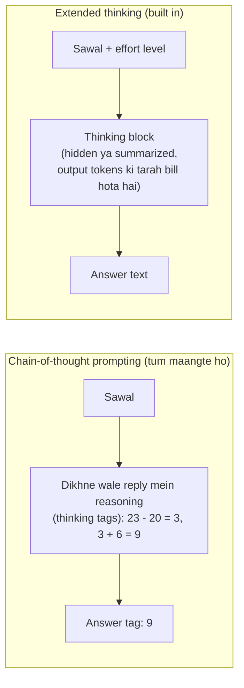

🏠 [Home](../../README.md) › [07 · Planning & Reasoning](./README.md) › 7.1 Chain-of-thought aur extended thinking

# 7.1 Chain-of-thought aur extended thinking

> **Level:** 🟢 Beginner · **Padhne ka time:** ~10 min · **Pehle padho:** [1.4 LLMs kaise kaam karte hain (bas utna jitna zaroori hai)](../01-foundations/01.4-how-llms-work.md)

**Ek line mein:** Models mushkil sawalon ka jawab tab better dete hain jab woh jawab se pehle step by step sochte hain; pehle tum yeh prompt mein maangte the ("chain-of-thought"), aur aaj ke models mein yeh built in hai ("extended thinking"), jisko ek effort setting se control karte ho.

📑 **Is page par**

- [Yeh kyun zaroori hai?](#-yeh-kyun-zaroori-hai)
- [Idea, simple words mein](#-idea-simple-words-mein)
- [Diagram se samjho](#-diagram-se-samjho)
- [Kaise kaam karta hai, step by step](#-kaise-kaam-karta-hai-step-by-step)
- [Example se samjho](#-example-se-samjho)
- [Code](#-code)
- [Aam galtiyan aur dhyan dene wali baatein](#-aam-galtiyan-aur-dhyan-dene-wali-baatein)
- [Yaad rakhne wali baatein](#-yaad-rakhne-wali-baatein)
- [Khud try karo](#-khud-try-karo)
- [Aur padhne ke liye](#-aur-padhne-ke-liye)

## 🤔 Yeh kyun zaroori hai?

Kisi se pucho *"23 apples the, 20 use ho gaye, 6 aur khareede: ab kitne hain?"* aur turant jawab maango. Kuch log jaldi mein galat number bol denge. Unhe kaagaz pe hisaab lagane do, toh lagbhag sab 9 bolenge. Shuru ke bade models bhi aise hi the. Sirf jawab maango toh multi-step sawal aksar galat karte the. Working dikhane ko bolo toh bahut saare sahi ho jaate the.

Agents ke liye reasoning optional nahi hai. [Agent loop](../../GLOSSARY.md#agent-loop) ka har step ek decision hai: kaunsa [tool](../../GLOSSARY.md#tool), kaunse arguments, kaam ho gaya ya nahi. Reasoning better hogi toh galat mod kam aayenge. Lekin reasoning mein [tokens](../../GLOSSARY.md#token), time aur paisa lagta hai. Isliye tumhe pata hona chahiye ki isko kaise badhana aur ghatana hai.

## 🧠 Idea, simple words mein

Ek [LLM](../../GLOSSARY.md#large-language-model-llm) text ek-ek token karke banata hai ([1.4](../01-foundations/01.4-how-llms-work.md)). Jo bhi token woh likhta hai, woh agle token ka input ban jaata hai. Toh agar woh pehle beech ke steps likh de, toh jawab likhte waqt un steps ka "sahara" milta hai. [Chain-of-thought (CoT)](../../GLOSSARY.md#chain-of-thought-cot) prompting bas yahi steps maangti hai.

Socho exam mein rough sheet pe calculation karna. Seedha answer likhne se galti hoti hai, rough work karke likho toh answer zyada sahi aata hai. CoT model ki rough sheet hai.

Yeh ek prompting trick ke roop mein shuru hua. [Wei et al. (2022)](https://arxiv.org/abs/2201.11903) ne models ko aise worked examples dikhaye jinme reasoning bhi thi, aur maths word problems pe accuracy kaafi badh gayi. [Kojima et al. (2022)](https://arxiv.org/abs/2205.11916) ne dekha ki sirf *"Let's think step by step"* add karne se bhi fayda hota hai.

Phir yeh models ke andar hi build ho gaya. Anthropic, OpenAI aur baaki companies ke current models ko train kiya jaata hai ki reply se pehle andar hi reason karein. Anthropic isko [extended thinking](../../GLOSSARY.md#extended-thinking) kehta hai; OpenAI in models ko *reasoning models* kehta hai. Ab tum prompt mein reasoning nahi maangte. Tum ek [reasoning effort](../../GLOSSARY.md#reasoning-effort) level set karte ho, aur us level ke andar model khud decide karta hai ki kitna sochna hai.

## 👀 Diagram se samjho



*Dono hi jawab se pehle reasoning pe extra output tokens kharch karte hain. Prompting mein reasoning normal text hota hai jisko tumhe parse karke alag nikalna padta hai. Built-in thinking mein API usko alag block mein deta hai, aur uski depth tum effort setting se control karte ho.*

## 🔍 Kaise kaam karta hai, step by step

### 1. Prompting se chain-of-thought

- **Few-shot CoT:** ek-do worked examples daalo jinke answers mein reasoning dikhti ho (yeh original Wei et al. wala tarika hai).
- **Zero-shot CoT:** ek instruction add karo, jaise *"Think step by step before answering."*
- **Structured CoT:** reasoning `<thinking>` tags mein aur result `<answer>` tags mein maango. Isse tumhara code user ko sirf answer dikha sakta hai aur baaki log kar sakta hai.
- **Self-consistency:** kai reasoning chains sample karo aur jo answer sabse zyada baar aaye woh lo ([Wang et al., 2022](https://arxiv.org/abs/2203.11171)). Zyada reliable hai, lekin cost kai guna hai.

### 2. Built-in thinking: Claude

Current Claude models pe thinking **adaptive** hai. Matlab har turn pe Claude khud decide karta hai ki sochna hai ya nahi, aur kitna. Tum isko effort parameter se steer karte ho: `output_config={"effort": ...}`, jo `low`, `medium`, `high`, `xhigh` ya `max` leta hai.

- **Claude Opus 5.5** pe thinking hamesha on rehti hai aur disable nahi ho sakti. Control effort se hota hai, aur iska default `medium` hai. (Baaki zyadatar current Claude models ka default `high` hai.)
- Thinking `thinking` content blocks mein wapas aati hai. Default mein unka `display` `"omitted"` hota hai: block aata hai lekin uska text khaali hota hai. Readable summary chahiye toh `thinking={"type": "adaptive", "display": "summarized"}` set karo. Dono case mein bill poori thinking ka hota hai, aur raw chain of thought kabhi return nahi hota.
- `usage.output_tokens_details.thinking_tokens` batata hai ki kitne output tokens thinking mein gaye.
- Tool use karne wale agents mein, agli request pe assistant ke content blocks bina badle wapas bhejo, thinking blocks ke saath.

### 3. Built-in thinking: OpenAI

OpenAI ke reasoning models bhi jawab se pehle sochte hain. Woh **reasoning tokens** use karte hain, jo output ki tarah bill hote hain aur context mein jagah lete hain, lekin text ke roop mein return nahi hote. Inhe tum Responses API mein `reasoning={"effort": ...}` se ya Chat Completions mein `reasoning_effort` se control karte ho. Supported values model pe depend karti hain, aur inme `none`, `minimal`, `low`, `medium`, `high`, `xhigh` aur `max` ho sakte hain. OpenAI reasoning models ke liye Responses API recommend karta hai. Unke docs yeh bhi bataate hain ki kuch models Chat Completions ke through [function calling](../../GLOSSARY.md#function-calling) support nahi karte.

### 4. Effort kaise chuno

Zyada effort matlab zyada thinking. Mushkil, multi-step kaam pe aksar jawab better aate hain, lekin output tokens zyada lagte hain aur reply slow hota hai. Practice mein hum yeh recommend karte hain:

| Kaam | Shuru kis effort se karo |
| --- | --- |
| Chat, classification, simple extraction, routine steps karne wale sub-agents | `low` |
| Tools ke saath typical agent steps | `medium` (Claude Opus 5.5 ka default) |
| Mushkil reasoning, complex coding, planning ([7.2](./07.2-plan-and-execute.md)) | `high` |
| Lambe autonomous runs jahan cost se zyada quality zaroori hai | `xhigh` ya `max`, sirf tab jab tumhare [evals](../../GLOSSARY.md#eval) fayda dikhayein |

Phir apne tasks pe measure karo ([chapter 12](../12-evaluation/README.md)) aur har route ke hisaab se adjust karo, sab jagah ek saath nahi.

### 5. Explicit "think step by step" kab abhi bhi kaam aata hai

Built-in thinking ne zyadatar CoT prompting ki jagah le li hai, lekin poori nahi:

- **Jin models mein built-in reasoning nahi hai**, ya jin routes pe tumne cost ke liye effort bahut kam kar diya hai. Wahan CoT instruction sasti mein thodi quality wapas la sakta hai.
- **Jab reasoning output mein chahiye**, jaise ek chhota likha hua rationale jo tum log karo, reviewer ko dikhao, ya code se check karo. Built-in thinking hidden hoti hai ya sirf summary milti hai.
- **Jab ek specific procedure follow karwana ho**: "Pehle constraints list karo, phir har option ko unke against check karo." Yeh instruction hai ki *kis cheez* ke baare mein sochna hai, aur yeh abhi bhi help karta hai.
- **Model kitni baar soche, yeh steer karna.** Anthropic ke docs kehte hain ki user message mein *"Please think hard before responding."* jaise phrases us turn pe thinking ko badhawa dete hain. Kuch models pe *kam* thinking chahiye toh effort level kam karo. Anthropic note karta hai ki prompt mein kam sochne ko bolna reliably thinking kam nahi karta.

Reasoning models ke saath jo cheez aam taur pe help nahi karti, woh hai har beech ke step ko micromanage karna. OpenAI ki guidance hai: clear goal, constraints aur output format do, aur steps model ko khud nikalne do.

## 💡 Example se samjho

Yeh Wei et al. (2022) ke Figure 1 wala problem hai. Yahan ke replies us figure jaise dikhane ke liye scripted hain (yeh kisi current model ka output nahi hai):

```text
Q: The cafeteria had 23 apples. If they used 20 to make lunch and bought 6 more, how many apples do they have?

1) Direct            answer: 27   (output tokens: 1)
2) Chain-of-thought  answer: 9    (output tokens: 35)
   reasoning kept for logs: The cafeteria started with 23 apples. They used 20, so 23 - 20 = 3. They bought 6 more, so 3 + 6 = 9.
```

Do cheezein dekho. Pehli, paper ki setting mein reasoning hi 27 (galat) aur 9 (sahi) ka fark thi. Doosri, isme lagbhag 35 guna output tokens lage (scripted run se ek rough estimate). Built-in thinking wale current model pe dono prompts shayad 9 hi return karenge. Tab cost tumhe dikhne wale reply mein nahi, `thinking_tokens` mein dikhegi.

## 💻 Code

**Prompting se chain-of-thought** (kisi bhi model ke saath chalta hai):

```python
COT_SYSTEM = (
    "Solve the problem. First think it through step by step inside <thinking></thinking> tags. "
    "Then give only the final result inside <answer></answer> tags."
)

def extract(text: str) -> tuple[str, str]:
    """Reply ko (answer, reasoning) mein todo. Tags na milen toh poora text use karo."""
    thinking = re.search(r"<thinking>(.*?)</thinking>", text, re.S)
    answer = re.search(r"<answer>(.*?)</answer>", text, re.S)
    reasoning = thinking.group(1).strip() if thinking else ""
    if answer:
        return answer.group(1).strip(), reasoning
    return re.sub(r"<thinking>.*?</thinking>", "", text, flags=re.S).strip(), reasoning
```

**Claude ke saath built-in thinking** (`ANTHROPIC_API_KEY` chahiye):

```python
import anthropic

client = anthropic.Anthropic()
response = client.messages.create(
    model="claude-opus-5-5",
    max_tokens=16000,                                          # thinking bhi isi mein count hoti hai
    thinking={"type": "adaptive", "display": "summarized"},    # default display "omitted" hai
    output_config={"effort": "high"},                          # low | medium | high | xhigh | max
    messages=[{"role": "user", "content": "The cafeteria had 23 apples. ..."}],
)
for block in response.content:
    if block.type == "thinking":
        print("Thinking summary:", block.thinking)
    elif block.type == "text":
        print("Answer:", block.text)
print("Thinking tokens:", response.usage.output_tokens_details.thinking_tokens)
```

**OpenAI ke saath reasoning effort** (`OPENAI_API_KEY` chahiye; `OPENAI_MODEL` mein koi current reasoning model set karo):

```python
import os
from openai import OpenAI

client = OpenAI()
response = client.responses.create(
    model=os.environ["OPENAI_MODEL"],
    reasoning={"effort": "high"},
    input="The cafeteria had 23 apples. ...",
)
print(response.output_text)
print("Reasoning tokens:", response.usage.output_tokens_details.reasoning_tokens)

# Chat Completions mein yahi: client.chat.completions.create(..., reasoning_effort="high")
```

## 🚨 Aam galtiyan aur dhyan dene wali baatein

- **`max_tokens` bahut kam rakhna.** Thinking output limit mein count hoti hai. Kam cap se reply beech mein soch hi raha hota hai aur khatam ho jaata hai, ya koi visible answer aane se pehle hi ruk jaata hai. Kaafi jagah chhodo, aur [stop reason](../../GLOSSARY.md#stop-reason) check karo.
- **Thinking padhne ki ummeed rakhna.** Current Claude models pe default display `"omitted"` hai, toh thinking blocks khaali text ke saath aate hain. OpenAI mein reasoning tokens return hi nahi hote. Agar chahiye toh summary maango (Claude ka `display: "summarized"`) ya likha hua rationale maango.
- **Naye models ko purani settings bhejna.** Fixed thinking budgets (`budget_tokens`) aur `{"type": "disabled"}` ko Claude Opus 5.5 400 error ke saath reject karta hai. Iski jagah effort use karo.
- **Har jagah max effort.** Aasaan steps pe isse cost aur latency kai guna badh jaati hai, fayda kam hota hai. Har route ke hisaab se tune karo.
- **Dikhne wali reasoning ko explanation maan lena.** Model ki likhi reasoning is baat ka guaranteed record nahi hai ki woh answer tak kaise pahuncha. Answers ko checks aur tools se verify karo, reasoning padh ke nahi.
- **Turns ke beech thinking blocks hata dena.** Tool loop mein assistant ka content bina badle wapas bhejo. Blocks edit ya strip karne se model ki reasoning kho sakti hai ya errors aa sakte hain.
- **Users ko reasoning dikha dena.** Prompted CoT mein reasoning reply text mein hi hoti hai. Display karne se pehle answer alag nikal lo.

## ✅ Yaad rakhne wali baatein

- Jawab se pehle reasoning karne se multi-step answers better hote hain; isme output tokens aur time lagta hai.
- Chain-of-thought prompting reply mein reasoning maangti hai; extended thinking yeh model ke andar karti hai.
- Claude: adaptive thinking, `output_config={"effort": ...}` se control hoti hai; Opus 5.5 pe hamesha on (default `medium`); display `"omitted"` rehta hai jab tak tum `"summarized"` na maango.
- OpenAI: reasoning models, `reasoning.effort` (Responses) ya `reasoning_effort` (Chat Completions) ke saath.
- Explicit CoT abhi bhi kaam aata hai: non-reasoning models, low-effort routes, dikhne wale rationale aur specific procedures ke liye.

## 🧪 Khud try karo

1. Upar wala `COT_SYSTEM` prompt use karte hue, model `<answer>` tags bhool jaata hai aur reply karta hai *"<thinking>3 + 6</thinking> So 9 apples."* `extract` kya return karega?
2. Tumhare paas ek agent hai jo support tickets classify karta hai (aasaan kaam, bahut zyada volume), aur phir mushkil tickets ke liye fix plan karta hai. Har step ke liye effort kaise set karoge?

<details>
<summary>Answer dekho</summary>

1. `("So 9 apples.", "3 + 6")`: fallback thinking block hata deta hai aur baaki ko answer ki tarah return karta hai. Tum chaaho toh missing `<answer>` tag ko error maan ke retry kar sakte ho; yeh is pe depend karta hai ki tumhe format pe kitna bharosa hai.
2. Classification: `low` effort (ya chhota model), kyunki kaam simple aur baar-baar hone wala hai, toh cost aur latency sabse important hain. Fix ki planning: `high`, kyunki galat plan uske baad ka har step barbaad karta hai. Dono ko evals se measure karo aur adjust karo: har route ka alag effort hi asli point hai.

</details>

## 📚 Aur padhne ke liye

- [Chain-of-Thought Prompting Elicits Reasoning in Large Language Models](https://arxiv.org/abs/2201.11903) (Wei et al., 2022). Original CoT paper.
- [Large Language Models are Zero-Shot Reasoners](https://arxiv.org/abs/2205.11916) (Kojima et al., 2022). "Let's think step by step" wala paper.
- [Effort](https://platform.claude.com/docs/en/build-with-claude/effort) aur [Steering thinking](https://platform.claude.com/docs/en/build-with-claude/thinking-steering-and-cost) (Anthropic docs). Har model ke effort levels, prompt se thinking badhana ya ghatana, aur thinking ka billing kaise hota hai.
- [Reasoning models](https://developers.openai.com/api/docs/guides/reasoning) (OpenAI docs). Reasoning effort, reasoning tokens, aur reasoning models ke liye prompting advice.

<!-- FOOTER -->

---

⬅️ **Pichla:** [6.5 Re-ranking aur retrieval evaluation](../06-rag-for-agents/06.5-re-ranking-and-retrieval-evaluation.md) ·
🏠 [Chapter home](./README.md) ·
➡️ **Agla:** [7.2 Plan-and-execute](./07.2-plan-and-execute.md)
