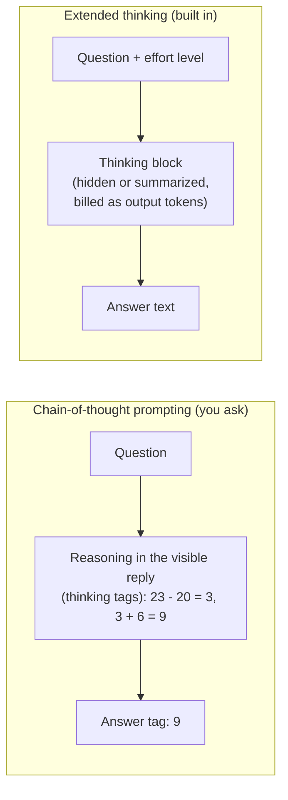

🏠 [Home](../../README.md) › [07 · Planning & Reasoning](./README.md) › 7.1 Chain-of-thought & extended thinking

# 7.1 Chain-of-thought & extended thinking

> **Difficulty:** 🟢 Beginner · **Reading time:** ~10 min · **Prerequisites:** [1.4 How LLMs work](../01-foundations/01.4-how-llms-work.md)

**In one sentence:** Models answer harder questions better when they reason step by step before answering; you used to ask for that in the prompt ("chain-of-thought"), and today's models do it built in ("extended thinking"), with an effort setting to control how much.

📑 **On this page**

- [Why does this matter?](#-why-does-this-matter)
- [The idea, in plain words](#-the-idea-in-plain-words)
- [Picture it](#-picture-it)
- [How it works, step by step](#-how-it-works-step-by-step)
- [Worked example](#-worked-example)
- [Code](#-code)
- [Common mistakes & gotchas](#-common-mistakes--gotchas)
- [Key takeaways](#-key-takeaways)
- [Try it yourself](#-try-it-yourself)
- [Further reading](#-further-reading)

## 🤔 Why does this matter?

Ask a person *"23 apples, use 20, buy 6 more: how many?"* and demand an instant answer, and some will blurt out a wrong number. Let them work it out on paper and almost everyone gets 9. Early large models behaved the same way: asked for just the answer, they often got multi-step problems wrong; asked to show their working, they got many right.

For agents, reasoning is not optional. Every step of the [agent loop](../../GLOSSARY.md#agent-loop) is a decision: which [tool](../../GLOSSARY.md#tool), which arguments, done or not. Better reasoning means fewer wrong turns. But reasoning costs [tokens](../../GLOSSARY.md#token), time and money, so you need to know how to turn it up and down.

## 🧠 The idea, in plain words

An [LLM](../../GLOSSARY.md#large-language-model-llm) produces text one token at a time ([1.4](../01-foundations/01.4-how-llms-work.md)). Every token it writes becomes input for the next. So if it writes out intermediate steps first, those steps are there to "lean on" when it writes the answer. [Chain-of-thought (CoT)](../../GLOSSARY.md#chain-of-thought-cot) prompting simply asks for those steps.

That started as a prompting trick. [Wei et al. (2022)](https://arxiv.org/abs/2201.11903) showed models worked examples that included reasoning, and accuracy on maths word problems jumped. [Kojima et al. (2022)](https://arxiv.org/abs/2205.11916) found that just adding *"Let's think step by step"* helped too.

Then it was built into the models. Current models from Anthropic, OpenAI and others are trained to reason internally before they reply. Anthropic calls this [extended thinking](../../GLOSSARY.md#extended-thinking); OpenAI calls these models *reasoning models*. You don't ask for reasoning in the prompt any more: you set a [reasoning effort](../../GLOSSARY.md#reasoning-effort) level, and the model decides how much to think within it.

## 👀 Picture it



*Both spend extra output tokens on reasoning before the answer. With prompting, the reasoning is ordinary text you must parse out. With built-in thinking, the API returns it as a separate block, and you control its depth with an effort setting.*

## 🔍 How it works, step by step

### 1. Chain-of-thought by prompting

- **Few-shot CoT:** include one or two worked examples whose answers show the reasoning (the original Wei et al. method).
- **Zero-shot CoT:** add an instruction such as *"Think step by step before answering."*
- **Structured CoT:** ask for the reasoning inside `<thinking>` tags and the result inside `<answer>` tags, so your code can show the user only the answer and log the rest.
- **Self-consistency:** sample several reasoning chains and take the majority answer ([Wang et al., 2022](https://arxiv.org/abs/2203.11171)). More reliable, several times the cost.

### 2. Built-in thinking: Claude

On current Claude models, thinking is **adaptive**: Claude decides on each turn whether and how much to think. You steer it with the effort parameter, `output_config={"effort": ...}`, which takes `low`, `medium`, `high`, `xhigh` or `max`.

- On **Claude Opus 5.5**, thinking is always on and can't be disabled; effort is the control, and its default is `medium`. (Most other current Claude models default to `high`.)
- Thinking comes back as `thinking` content blocks. By default their `display` is `"omitted"`: the block is there but its text is empty. Set `thinking={"type": "adaptive", "display": "summarized"}` to receive a readable summary. You are billed for the full thinking either way, and the raw chain of thought is never returned.
- `usage.output_tokens_details.thinking_tokens` tells you how many output tokens went to thinking.
- In tool-using agents, pass the assistant's content blocks back unchanged on the next request, thinking blocks included. (The shared wrapper in `examples/common/llm.py` does this for you.)

### 3. Built-in thinking: OpenAI

OpenAI's reasoning models also think before answering, using **reasoning tokens** that are billed as output and take up context space but are not returned as text. You control them with `reasoning={"effort": ...}` in the Responses API or `reasoning_effort` in Chat Completions. The supported values depend on the model and can include `none`, `minimal`, `low`, `medium`, `high`, `xhigh` and `max`. OpenAI recommends the Responses API for reasoning models, and its docs note that some models don't support [function calling](../../GLOSSARY.md#function-calling) through Chat Completions.

### 4. Choosing effort

Higher effort means more thinking: often better answers on hard, multi-step work, but more output tokens and slower replies. In practice, we recommend:

| Work | Effort to start with |
| --- | --- |
| Chat, classification, simple extraction, sub-agents doing routine steps | `low` |
| Typical agent steps with tools | `medium` (Claude Opus 5.5's default) |
| Hard reasoning, complex coding, planning ([7.2](./07.2-plan-and-execute.md)) | `high` |
| Long autonomous runs where quality matters more than cost | `xhigh` or `max`, only if your [evals](../../GLOSSARY.md#eval) show a gain |

Then measure on your own tasks ([chapter 12](../12-evaluation/README.md)) and adjust per route, not globally.

### 5. When explicit "think step by step" still helps

Built-in thinking has replaced most CoT prompting, but not all of it:

- **Models without built-in reasoning**, or routes where you've turned effort right down for cost. A CoT instruction can recover some quality cheaply.
- **When you need the reasoning in the output**, for example a short written rationale you log, show a reviewer, or check with code. Built-in thinking is hidden or only summarized.
- **When you need a specific procedure followed**: "First list the constraints, then check each option against them." That is an instruction about *what* to reason about, and it still helps.
- **Steering how often the model thinks.** Anthropic documents that phrases such as *"Please think hard before responding."* in a user message encourage thinking on that turn. To get *less* thinking on some models, lower the effort level: Anthropic notes that asking in the prompt to think less doesn't reliably reduce it.

What usually doesn't help with reasoning models is micromanaging every intermediate step. OpenAI's guidance is to give a clear goal, constraints and output format, and let the model work out the steps.

## 💡 Worked example

The problem from Figure 1 of Wei et al. (2022), run through [`examples/07-chain-of-thought`](../../examples/07-chain-of-thought/README.md). The offline replies are scripted to mirror that figure (they are not output from a current model):

```text
Q: The cafeteria had 23 apples. If they used 20 to make lunch and bought 6 more, how many apples do they have?

1) Direct            answer: 27   (output tokens: 1)
2) Chain-of-thought  answer: 9    (output tokens: 35)
   reasoning kept for logs: The cafeteria started with 23 apples. They used 20, so 23 - 20 = 3. They bought 6 more, so 3 + 6 = 9.
```

Two things to notice. First, the reasoning made the difference between 27 (wrong) and 9 (right) in the paper's setting. Second, it cost about 35 times the output tokens (the mock's rough estimate). On a current model with built-in thinking, both prompts would very likely return 9, and you'd see the cost in `thinking_tokens` instead of in the visible reply.

## 💻 Code

**Chain-of-thought by prompting** (works with any model), from [`examples/07-chain-of-thought/main.py`](../../examples/07-chain-of-thought/main.py):

```python
COT_SYSTEM = (
    "Solve the problem. First think it through step by step inside <thinking></thinking> tags. "
    "Then give only the final result inside <answer></answer> tags."
)

def extract(text: str) -> tuple[str, str]:
    """Split a reply into (answer, reasoning). Falls back to the whole text if tags are missing."""
    thinking = re.search(r"<thinking>(.*?)</thinking>", text, re.S)
    answer = re.search(r"<answer>(.*?)</answer>", text, re.S)
    reasoning = thinking.group(1).strip() if thinking else ""
    if answer:
        return answer.group(1).strip(), reasoning
    return re.sub(r"<thinking>.*?</thinking>", "", text, flags=re.S).strip(), reasoning
```

**Built-in thinking with Claude** (needs `ANTHROPIC_API_KEY`):

```python
import anthropic

client = anthropic.Anthropic()
response = client.messages.create(
    model="claude-opus-5-5",
    max_tokens=16000,                                          # thinking counts towards this
    thinking={"type": "adaptive", "display": "summarized"},    # default display is "omitted"
    output_config={"effort": "high"},                          # low | medium | high | xhigh | max
    messages=[{"role": "user", "content": "The cafeteria had 23 apples. ..."}],
)
for block in response.content:
    if block.type == "thinking":
        print("Thinking summary:", block.thinking)
    elif block.type == "text":
        print("Answer:", block.text)
print("Thinking tokens:", response.usage.output_tokens_details.thinking_tokens)
```

The shared wrapper sets the same effort for every call from an environment variable: `LLM_PROVIDER=anthropic ANTHROPIC_EFFORT=low python 07-chain-of-thought/main.py`.

**Reasoning effort with OpenAI** (needs `OPENAI_API_KEY`; set `OPENAI_MODEL` to a current reasoning model):

```python
import os
from openai import OpenAI

client = OpenAI()
response = client.responses.create(
    model=os.environ["OPENAI_MODEL"],
    reasoning={"effort": "high"},
    input="The cafeteria had 23 apples. ...",
)
print(response.output_text)
print("Reasoning tokens:", response.usage.output_tokens_details.reasoning_tokens)

# Chat Completions equivalent: client.chat.completions.create(..., reasoning_effort="high")
```

## 🚨 Common mistakes & gotchas

- **Setting `max_tokens` too low.** Thinking counts towards the output limit. A low cap can end a reply mid-thought, or before any visible answer. Leave generous room, and check the [stop reason](../../GLOSSARY.md#stop-reason).
- **Expecting to read the thinking.** On current Claude models the default display is `"omitted"`, so thinking blocks arrive with empty text; with OpenAI the reasoning tokens aren't returned at all. Ask for a summary (Claude's `display: "summarized"`) or a written rationale if you need one.
- **Sending old settings to new models.** Fixed thinking budgets (`budget_tokens`) and `{"type": "disabled"}` are rejected by Claude Opus 5.5 with a 400 error. Use effort instead.
- **Max effort everywhere.** It multiplies cost and latency for little gain on easy steps. Tune per route.
- **Treating visible reasoning as an explanation.** A model's written reasoning is not a guaranteed record of how it reached the answer. Verify answers with checks and tools, not by reading the reasoning.
- **Dropping thinking blocks between turns.** In a tool loop, send the assistant's content back unchanged. Editing or stripping blocks can lose the model's reasoning or cause errors.
- **Leaking the reasoning to users.** With prompted CoT, the reasoning is in the reply text. Extract the answer before you display it.

## ✅ Key takeaways

- Reasoning before answering improves multi-step answers; it costs output tokens and time.
- Chain-of-thought prompting asks for the reasoning in the reply; extended thinking does it inside the model.
- Claude: adaptive thinking, controlled by `output_config={"effort": ...}`; always on for Opus 5.5 (default `medium`); display `"omitted"` unless you ask for `"summarized"`.
- OpenAI: reasoning models with `reasoning.effort` (Responses) or `reasoning_effort` (Chat Completions).
- Explicit CoT still helps for non-reasoning models, low-effort routes, visible rationales and specific procedures.

## 🧪 Try it yourself

1. In the example, the model forgets the `<answer>` tags and replies *"<thinking>3 + 6</thinking> So 9 apples."* What does `extract` return?
2. You have an agent that classifies support tickets (easy, high volume) and then plans a fix for the hard ones. How would you set effort for each step?

<details>
<summary>Show answer</summary>

1. `("So 9 apples.", "3 + 6")`: the fallback removes the thinking block and returns the rest as the answer. You may prefer to treat a missing `<answer>` tag as an error and retry; it depends on how much you trust the format.
2. Classification: `low` effort (or a smaller model), because it is simple and frequent, so cost and latency dominate. Planning the fix: `high`, because a wrong plan wastes every step after it. Measure both with evals and adjust: per-route effort is the point.

</details>

## 📚 Further reading

- [Chain-of-Thought Prompting Elicits Reasoning in Large Language Models](https://arxiv.org/abs/2201.11903) (Wei et al., 2022). The original CoT paper.
- [Large Language Models are Zero-Shot Reasoners](https://arxiv.org/abs/2205.11916) (Kojima et al., 2022). "Let's think step by step".
- [Effort](https://platform.claude.com/docs/en/build-with-claude/effort) and [Steering thinking](https://platform.claude.com/docs/en/build-with-claude/thinking-steering-and-cost) (Anthropic docs). Effort levels per model, prompting thinking up or down, and how thinking is billed.
- [Reasoning models](https://developers.openai.com/api/docs/guides/reasoning) (OpenAI docs). Reasoning effort, reasoning tokens, and prompting advice for reasoning models.

<!-- FOOTER -->

---

⬅️ **Previous:** [6.5 Re-ranking & retrieval evaluation](../06-rag-for-agents/06.5-re-ranking-and-retrieval-evaluation.md) ·
🏠 [Chapter home](./README.md) ·
➡️ **Next:** [7.2 Plan-and-execute](./07.2-plan-and-execute.md)
