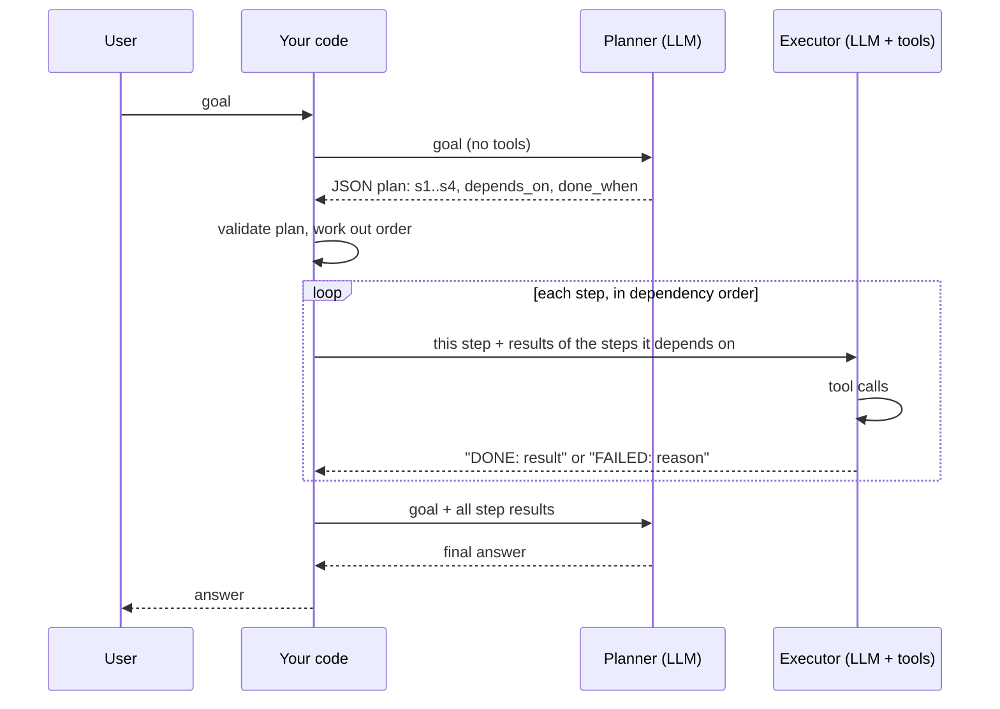

🏠 [Home](../../README.md) › [07 · Planning & Reasoning](./README.md) › 7.2 Plan-and-execute

# 7.2 Plan-and-execute

> **Difficulty:** 🟡 Intermediate · **Reading time:** ~10 min · **Prerequisites:** [7.1 Chain-of-thought & extended thinking](./07.1-chain-of-thought-and-extended-thinking.md), [2.2 ReAct explained](../02-the-agent-loop/02.2-react-explained.md)

**In one sentence:** Plan-and-execute splits an agent into a planner that writes the whole plan up front and an executor that carries it out one step at a time, which makes long tasks more focused, checkable and cheaper to run.

📑 **On this page**

- [Why does this matter?](#-why-does-this-matter)
- [The idea, in plain words](#-the-idea-in-plain-words)
- [Picture it](#-picture-it)
- [How it works, step by step](#-how-it-works-step-by-step)
- [Worked example](#-worked-example)
- [Code](#-code)
- [Common mistakes & gotchas](#-common-mistakes--gotchas)
- [Key takeaways](#-key-takeaways)
- [Try it yourself](#-try-it-yourself)
- [Further reading](#-further-reading)

## 🤔 Why does this matter?

A [ReAct](../../GLOSSARY.md#react) agent ([2.2](../02-the-agent-loop/02.2-react-explained.md)) decides one step at a time: think, act, observe, repeat. That works well for short tasks. On longer ones it can drift: it forgets part of the goal, chases a detail, repeats a search, or stops before everything is done. Nobody wrote down what "everything" was.

People handle long tasks differently. Before organising an offsite, you jot down a list: find venues, check dates, cost the lunch, add it up. Then you work through the list and tick things off. Plan-and-execute gives an agent that list.

## 🧠 The idea, in plain words

Split the job between two roles:

- The **planner** reads the goal and writes a numbered plan. It doesn't do any of the work.
- The **executor** takes one step at a time, uses [tools](../../GLOSSARY.md#tool) to complete it, and reports the result.

A final call turns the results into an answer. Your code sits in the middle: it checks the plan is valid, decides the order, passes each step only the results it needs, and keeps the log.

The idea appears in research as **Plan-and-Solve prompting** ([Wang et al., 2023](https://arxiv.org/abs/2305.04091)), which asks a model to "devise a plan" before solving, and in agent frameworks as the [plan-and-execute](../../GLOSSARY.md#plan-and-execute) pattern. It is a close cousin of the orchestrator-workers pattern ([9.4](../09-agent-design-patterns/09.4-orchestrator-workers.md)).

## 👀 Picture it



*The planner is called once at the start (and once at the end to write the answer). Each executor call sees only its own step, so its context stays small and focused.*

## 🔍 How it works, step by step

1. **Plan.** Call the model with the goal, a short description of the available tools, and instructions to reply with a structured plan. Each step has an `id`, a `task`, the ids it `depends_on`, and a `done_when` criterion ([7.3](./07.3-task-decomposition.md) covers writing good steps). Give the planner **no tools**: it should think, not act.
2. **Validate.** Parse the plan in code. Reject it if it isn't valid JSON, has duplicate or unknown ids, or has a dependency cycle. If you can, use structured outputs so the model must return valid JSON (Anthropic's `output_config.format`; OpenAI's structured outputs).
3. **Order.** Sort the steps so each runs after its dependencies. Python's standard library does this: `graphlib.TopologicalSorter`. Steps whose dependencies are all done can run in parallel.
4. **Execute.** For each step, run a small tool loop with a focused prompt: the overall goal, this step, its done-when criterion, and the results of the steps it depends on. Require a clear status at the end, such as `DONE: ...` or `FAILED: ...`.
5. **Handle failure.** Simplest: stop and report. Better: re-plan the remaining work ([7.5](./07.5-re-planning-when-things-fail.md)).
6. **Answer.** Give the goal and all step results to the model and ask for the final answer.

**When is it worth it?**

| | ReAct (step by step) | Plan-and-execute |
| --- | --- | --- |
| Best for | Short or exploratory tasks | Longer tasks whose steps you can foresee |
| Adapts to surprises | Every step | Only if you add re-planning |
| Context per call | Grows with the whole history | Small: one step plus its inputs |
| Can use a cheaper executor model | Hard | Easy: strong planner, cheaper executor |
| Visible plan for review or approval | No | Yes, before anything runs |
| Extra model calls | None | A planning call (and an answer call) |

## 💡 Worked example

A run with scripted model replies and real (fake-data) tools. Goal: *"Find a venue in Lisbon for our 12-person offsite on 2026-12-03. Total budget is EUR 1,500, including lunch at EUR 25 per person. Which venue should we pick, and what is the total cost?"*

```text
plan  s1: Find Lisbon venues that hold at least 12 people
plan  s2: Check the cheapest venue is free on 2026-12-03 (after s1)
plan  s3: Work out lunch for 12 people at EUR 25 each
plan  s4: Add venue rate and lunch, and compare with the EUR 1,500 budget (after s2, s3)
order [s1, s3] -> [s2] -> [s4]
  tool search_venues({'city': 'Lisbon', 'min_capacity': 12}) -> [{"id": "v1", "name": "Casa Azul", "city": "Lisbon", "capacity": 15, "day_rat...
done  s1: Casa Azul (v1, EUR 900/day), LX Loft (v2, EUR 1,100/day) and Tejo Hall (v3, EUR 2,000/day) hold 12+.
  tool calculator({'expression': '12 * 25'}) -> 300
done  s3: Lunch costs EUR 300.
  tool check_availability({'venue_id': 'v1', 'date': '2026-12-03'}) -> {"venue_id": "v1", "date": "2026-12-03", "available": true}
done  s2: Casa Azul (v1) is available on 2026-12-03 at EUR 900.
  tool calculator({'expression': '900 + 300'}) -> 1200
done  s4: Total is EUR 1,200, which is EUR 300 under the EUR 1,500 budget.

Answer: Book Casa Azul on 3 December: EUR 900 for the venue plus EUR 300 for lunch makes EUR 1,200, EUR 300 under budget.
```

Reading the trace:

- **The plan is a graph, not just a list.** s3 (lunch) needs nothing, so it runs in the first batch with s1. s4 waits for both s2 and s3.
- **Each executor call is focused.** When s4 runs, its prompt contains only the results of s2 and s3, the steps it depends on, not the venue list from s1.
- **The model is called 10 times:** 1 plan, 2 per step (a tool call, then the `DONE:` report), and 1 final answer. A ReAct agent might need fewer calls for this small task, but each of its calls would carry the whole growing history.

## 💻 Code

The planner prompt and the run loop. `self.llm` is any chat-model client whose `.chat(messages, system=...)` returns a reply with `.text`, and `user()` builds a user message dict:

```python
PLANNER_SYSTEM = """You are a planner. Break the user's goal into 2-6 small steps that an assistant with these
tools can carry out: search_venues, check_availability, calculator.

Reply with JSON only, in this shape:
{"steps": [{"id": "s1", "task": "...", "depends_on": [], "done_when": "..."}]}

- Each task does one thing. "done_when" says how to tell the step is finished.
- depends_on lists the ids of steps whose results this step needs. Leave it empty if none.
- Do not do the work yourself. Only plan."""


def run(self, goal: str) -> str:
    steps = self.plan(goal)                                    # 1 call, no tools; parsed and validated
    by_id = {s.id: s for s in steps}
    for batch in batches(steps):                               # dependency order (graphlib)
        for step_id in batch:                                  # independent steps: could run concurrently
            self.execute_step(goal, by_id[step_id], by_id)     # a small tool loop ending in DONE:/FAILED:
            if by_id[step_id].status == "failed":
                return f"Stopped: step {step_id} failed ({by_id[step_id].result})."
    results = "\n".join(f"- {s.id} ({s.task}): {s.result}" for s in steps)
    return self.llm.chat([user(f"Goal: {goal}\n\nStep results:\n{results}")], system=ANSWER_SYSTEM).text
```

Ordering steps by their dependencies with the standard library:

```python
from graphlib import TopologicalSorter

def batches(steps):
    sorter = TopologicalSorter({s.id: s.depends_on for s in steps})   # raises CycleError on a cycle
    sorter.prepare()
    out = []
    while sorter.is_active():
        ready = sorted(sorter.get_ready())   # all steps whose dependencies are done
        out.append(ready)
        sorter.done(*ready)
    return out                               # e.g. [["s1", "s3"], ["s2"], ["s4"]]
```

Agent frameworks can express the same pattern; see [chapter 11](../11-frameworks/README.md). The version above shows every moving part.

## 🚨 Common mistakes & gotchas

- **Trusting the plan blindly.** Plans can reference tools that don't exist, skip a step, or contain cycles. Validate in code before running anything.
- **Plans that are too detailed.** "Call search_venues with city=Lisbon" leaves the executor no room to adapt. Plan *what* to achieve; let the executor decide *how*.
- **Plans that are too vague.** "Organise the offsite" is not a step. Each step should have one outcome and a way to tell it's done ([7.3](./07.3-task-decomposition.md)).
- **No failure path.** The real world changes after you plan: a venue gets booked, an API is down. Decide in advance what happens when a step fails ([7.5](./07.5-re-planning-when-things-fail.md)).
- **Giving the executor the whole history.** That removes the main benefit. Pass only the results each step depends on.
- **Planning when the task is simple.** For a two-tool question, a planning call is pure overhead. Use ReAct or even a fixed [workflow](../../GLOSSARY.md#workflow).

## ✅ Key takeaways

- Plan-and-execute = a planner writes the whole plan; an executor does one step at a time; your code connects them.
- Make plans structured (ids, dependencies, done-when) and validate them in code.
- Run steps in dependency order; independent steps can run in parallel.
- Each executor call sees only its step and its inputs, which keeps context small and focused.
- Plans meet reality: add a failure path, ideally re-planning.

## 🧪 Try it yourself

1. In the worked example, suppose the executor's reply that finishes s2 is `"FAILED: Casa Azul is booked."` instead. What does `run` return, and how many model calls were made?
2. Add a step s5, *"Book the chosen venue"*, to the plan. What should it depend on, and what should its `done_when` say?

<details>
<summary>Show answer</summary>

1. `"Stopped: step s2 failed (Casa Azul is booked.)."` after 7 calls: 1 plan, 2 each for s1 and s3, and 2 for s2. s4 and the final answer never run. [7.5](./07.5-re-planning-when-things-fail.md) shows how to re-plan instead of stopping.
2. It should depend on **s4**, so it runs only after the total is known to be within budget (and, transitively, after s2 confirmed availability). `done_when`: *"we have a booking confirmation id for the venue on 2026-12-03"*. Because booking is a real-world action, many teams also add a human approval before it ([9.6](../09-agent-design-patterns/09.6-human-in-the-loop.md)).

</details>

## 📚 Further reading

- [Plan-and-Solve Prompting: Improving Zero-Shot Chain-of-Thought Reasoning by Large Language Models](https://arxiv.org/abs/2305.04091) (Wang et al., 2023). Ask the model to devise a plan, then carry it out.
- [LLM Powered Autonomous Agents](https://lilianweng.github.io/posts/2023-06-23-agent/) (Lilian Weng). Planning and task decomposition as core agent components.
- [Building effective agents](https://www.anthropic.com/engineering/building-effective-agents) (Anthropic). The orchestrator-workers pattern, a close relative.
- [`graphlib`](https://docs.python.org/3/library/graphlib.html) (Python docs). Topological sorting in the standard library.

<!-- FOOTER -->

---

⬅️ **Previous:** [7.1 Chain-of-thought & extended thinking](./07.1-chain-of-thought-and-extended-thinking.md) ·
🏠 [Chapter home](./README.md) ·
➡️ **Next:** [7.3 Task decomposition](./07.3-task-decomposition.md)
