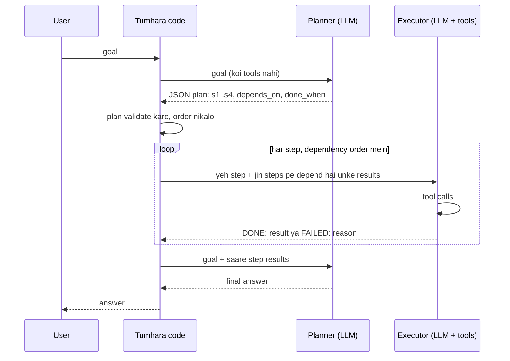

🏠 [Home](../../README.md) › [07 · Planning & Reasoning](./README.md) › 7.2 Plan-and-execute

# 7.2 Plan-and-execute

> **Level:** 🟡 Intermediate · **Padhne ka time:** ~10 min · **Pehle padho:** [7.1 Chain-of-thought aur extended thinking](./07.1-chain-of-thought-and-extended-thinking.md), [2.2 ReAct ko samjho](../02-the-agent-loop/02.2-react-explained.md)

**Ek line mein:** Plan-and-execute ek agent ko do hisson mein baantta hai: ek planner jo shuru mein hi poora plan likhta hai, aur ek executor jo usko ek-ek step karke poora karta hai; isse lambe tasks zyada focused, check karne layak aur saste ho jaate hain.

📑 **Is page par**

- [Yeh kyun zaroori hai?](#-yeh-kyun-zaroori-hai)
- [Idea, simple words mein](#-idea-simple-words-mein)
- [Diagram se samjho](#-diagram-se-samjho)
- [Kaise kaam karta hai, step by step](#-kaise-kaam-karta-hai-step-by-step)
- [Example se samjho](#-example-se-samjho)
- [Code](#-code)
- [Aam galtiyan aur dhyan dene wali baatein](#-aam-galtiyan-aur-dhyan-dene-wali-baatein)
- [Yaad rakhne wali baatein](#-yaad-rakhne-wali-baatein)
- [Khud try karo](#-khud-try-karo)
- [Aur padhne ke liye](#-aur-padhne-ke-liye)

## 🤔 Yeh kyun zaroori hai?

Ek [ReAct](../../GLOSSARY.md#react) agent ([2.2](../02-the-agent-loop/02.2-react-explained.md)) ek waqt mein ek step decide karta hai: socho, karo, dekho, dobara. Chhote tasks ke liye yeh badhiya chalta hai. Lambe tasks pe yeh bhatak sakta hai. Goal ka kuch hissa bhool jaata hai, kisi chhoti detail ke peeche lag jaata hai, ek hi search dobara karta hai, ya sab kuch hone se pehle ruk jaata hai. Kyunki kisi ne likha hi nahi tha ki "sab kuch" matlab kya hai.

Log lambe kaam alag tarike se karte hain. Offsite organise karne se pehle tum ek list bana lete ho: venues dhundho, dates check karo, lunch ka kharcha nikalo, total jodo. Phir list pe kaam karte ho aur tick lagate jaate ho. Jaise shaadi ki taiyari mein ghar wale pehle ek list banate hain (tent, caterer, card, pandit) aur phir ek-ek kaam nipta ke tick karte hain. Plan-and-execute agent ko yahi list deta hai.

## 🧠 Idea, simple words mein

Kaam ko do roles mein baanto:

- **Planner** goal padhta hai aur ek numbered plan likhta hai. Woh khud koi kaam nahi karta.
- **Executor** ek waqt mein ek step leta hai, use poora karne ke liye [tools](../../GLOSSARY.md#tool) use karta hai, aur result report karta hai.

Aakhir mein ek call results ko jod ke answer banati hai. Tumhara code beech mein baitha hai. Woh check karta hai ki plan valid hai, order decide karta hai, har step ko sirf woh results deta hai jo usko chahiye, aur log rakhta hai.

Yeh idea research mein **Plan-and-Solve prompting** ([Wang et al., 2023](https://arxiv.org/abs/2305.04091)) ke naam se aata hai, jo model ko solve karne se pehle "devise a plan" bolta hai. Agent frameworks mein yeh [plan-and-execute](../../GLOSSARY.md#plan-and-execute) pattern hai. Yeh orchestrator-workers pattern ([9.4](../09-agent-design-patterns/09.4-orchestrator-workers.md)) ka kareebi rishtedaar hai.

## 👀 Diagram se samjho



*Planner shuru mein ek baar call hota hai (aur aakhir mein ek baar answer likhne ke liye). Har executor call sirf apna step dekhti hai, isliye uska context chhota aur focused rehta hai.*

## 🔍 Kaise kaam karta hai, step by step

1. **Plan.** Model ko goal, available tools ka chhota description, aur structured plan mein reply karne ke instructions do. Har step mein ek `id`, ek `task`, jin ids pe woh `depends_on` hai, aur ek `done_when` criterion hota hai (achhe steps kaise likhein, yeh [7.3](./07.3-task-decomposition.md) mein hai). Planner ko **koi tools mat do**: usko sochna hai, kaam nahi karna.
2. **Validate.** Code mein plan parse karo. Agar valid JSON nahi hai, duplicate ya unknown ids hain, ya dependency cycle hai, toh reject karo. Ho sake toh structured outputs use karo taaki model ko valid JSON hi return karna pade (Anthropic ka `output_config.format`; OpenAI ke structured outputs).
3. **Order.** Steps ko aise sort karo ki har step apni dependencies ke baad chale. Python ki standard library yeh kar deti hai: `graphlib.TopologicalSorter`. Jin steps ki saari dependencies ho chuki hain, woh parallel chal sakte hain.
4. **Execute.** Har step ke liye ek chhota tool loop chalao, focused prompt ke saath: overall goal, yeh step, iska done-when criterion, aur jin steps pe yeh depend karta hai unke results. Aakhir mein ek clear status zaroori rakho, jaise `DONE: ...` ya `FAILED: ...`.
5. **Failure handle karo.** Sabse simple: ruko aur report karo. Better: bacha hua kaam re-plan karo ([7.5](./07.5-re-planning-when-things-fail.md)).
6. **Answer.** Goal aur saare step results model ko do aur final answer maango.

**Yeh kab worth it hai?**

| | ReAct (step by step) | Plan-and-execute |
| --- | --- | --- |
| Kiske liye best | Chhote ya explore karne wale tasks | Lambe tasks jinke steps pehle se dikh rahe hon |
| Surprises pe adapt karna | Har step pe | Sirf tab jab tum re-planning add karo |
| Har call ka context | Poori history ke saath badhta hai | Chhota: ek step aur uske inputs |
| Sasta executor model use kar sakte ho? | Mushkil | Aasaan: strong planner, sasta executor |
| Review ya approval ke liye dikhne wala plan | Nahi | Haan, kuch bhi chalne se pehle |
| Extra model calls | Koi nahi | Ek planning call (aur ek answer call) |

## 💡 Example se samjho

Scripted model replies aur real (fake-data) tools ke saath ek run. Goal: *"Find a venue in Lisbon for our 12-person offsite on 2026-12-03. Total budget is EUR 1,500, including lunch at EUR 25 per person. Which venue should we pick, and what is the total cost?"*

```text
plan  s1: Find Lisbon venues that hold at least 12 people
plan  s2: Check the cheapest venue is free on 2026-12-03 (after s1)
plan  s3: Work out lunch for 12 people at EUR 25 each
plan  s4: Add venue rate and lunch, and compare with the EUR 1,500 budget (after s2, s3)
order [s1, s3] -> [s2] -> [s4]
  tool search_venues({'city': 'Lisbon', 'min_capacity': 12}) -> [{"id": "v1", "name": "Casa Azul", "city": "Lisbon", "capacity": 15, "day_rat...
done  s1: Casa Azul (v1, EUR 900/day), LX Loft (v2, EUR 1,100/day) and Tejo Hall (v3, EUR 2,000/day) hold 12+.
  tool calculator({'expression': '12 * 25'}) -> 300
done  s3: Lunch costs EUR 300.
  tool check_availability({'venue_id': 'v1', 'date': '2026-12-03'}) -> {"venue_id": "v1", "date": "2026-12-03", "available": true}
done  s2: Casa Azul (v1) is available on 2026-12-03 at EUR 900.
  tool calculator({'expression': '900 + 300'}) -> 1200
done  s4: Total is EUR 1,200, which is EUR 300 under the EUR 1,500 budget.

Answer: Book Casa Azul on 3 December: EUR 900 for the venue plus EUR 300 for lunch makes EUR 1,200, EUR 300 under budget.
```

Trace ko aise padho:

- **Plan ek graph hai, sirf list nahi.** s3 (lunch) ko kisi cheez ki zaroorat nahi, toh woh pehle batch mein s1 ke saath chalta hai. s4, s2 aur s3 dono ka wait karta hai.
- **Har executor call focused hai.** Jab s4 chalta hai, uske prompt mein sirf s2 aur s3 ke results hote hain (jin pe woh depend karta hai), s1 wali venue list nahi.
- **Model 10 baar call hota hai:** 1 plan, har step ke 2 (ek tool call, phir `DONE:` report), aur 1 final answer. Is chhote task ke liye ReAct agent ko shayad kam calls lagti, lekin uski har call badhti hui poori history saath le ke chalti.

## 💻 Code

Planner prompt aur run loop. `self.llm` koi bhi chat-model client hai jiska `.chat(messages, system=...)` `.text` wala reply deta hai, aur `user()` ek user message dict banata hai:

```python
PLANNER_SYSTEM = """You are a planner. Break the user's goal into 2-6 small steps that an assistant with these
tools can carry out: search_venues, check_availability, calculator.

Reply with JSON only, in this shape:
{"steps": [{"id": "s1", "task": "...", "depends_on": [], "done_when": "..."}]}

- Each task does one thing. "done_when" says how to tell the step is finished.
- depends_on lists the ids of steps whose results this step needs. Leave it empty if none.
- Do not do the work yourself. Only plan."""


def run(self, goal: str) -> str:
    steps = self.plan(goal)                                    # 1 call, koi tools nahi; parse aur validate hota hai
    by_id = {s.id: s for s in steps}
    for batch in batches(steps):                               # dependency order (graphlib)
        for step_id in batch:                                  # independent steps: saath-saath chal sakte hain
            self.execute_step(goal, by_id[step_id], by_id)     # ek chhota tool loop jo DONE:/FAILED: pe khatam hota hai
            if by_id[step_id].status == "failed":
                return f"Stopped: step {step_id} failed ({by_id[step_id].result})."
    results = "\n".join(f"- {s.id} ({s.task}): {s.result}" for s in steps)
    return self.llm.chat([user(f"Goal: {goal}\n\nStep results:\n{results}")], system=ANSWER_SYSTEM).text
```

Standard library se steps ko unki dependencies ke hisaab se order karna:

```python
from graphlib import TopologicalSorter

def batches(steps):
    sorter = TopologicalSorter({s.id: s.depends_on for s in steps})   # cycle ho toh CycleError deta hai
    sorter.prepare()
    out = []
    while sorter.is_active():
        ready = sorted(sorter.get_ready())   # woh saare steps jinki dependencies ho chuki hain
        out.append(ready)
        sorter.done(*ready)
    return out                               # jaise [["s1", "s3"], ["s2"], ["s4"]]
```

Agent frameworks bhi yahi pattern bana sakte hain; [chapter 11](../11-frameworks/README.md) dekho. Upar wala version har chalta-phirta hissa saaf dikhata hai.

## 🚨 Aam galtiyan aur dhyan dene wali baatein

- **Plan pe aankh band karke bharosa karna.** Plans mein aise tools aa sakte hain jo exist hi nahi karte, koi step chhoot sakta hai, ya cycles ho sakte hain. Kuch bhi chalane se pehle code mein validate karo.
- **Bahut zyada detailed plans.** "search_venues ko city=Lisbon ke saath call karo" executor ko adapt karne ki jagah nahi deta. Plan mein *kya* achieve karna hai likho; *kaise*, yeh executor ko decide karne do.
- **Bahut vague plans.** "Offsite organise karo" koi step nahi hai. Har step ka ek outcome hona chahiye aur pata chalna chahiye ki woh ho gaya ([7.3](./07.3-task-decomposition.md)).
- **Failure ka koi raasta nahi.** Plan banane ke baad real duniya badal jaati hai: venue book ho jaata hai, API down ho jaati hai. Pehle se decide karo ki step fail hone pe kya hoga ([7.5](./07.5-re-planning-when-things-fail.md)).
- **Executor ko poori history dena.** Isse sabse bada fayda hi khatam ho jaata hai. Har step ko sirf woh results do jin pe woh depend karta hai.
- **Simple task pe planning.** Do tools wale sawal ke liye planning call sirf extra bojh hai. ReAct use karo, ya ek fixed [workflow](../../GLOSSARY.md#workflow) bhi.

## ✅ Yaad rakhne wali baatein

- Plan-and-execute = planner poora plan likhta hai; executor ek waqt mein ek step karta hai; tumhara code dono ko jodta hai.
- Plans structured rakho (ids, dependencies, done-when) aur code mein validate karo.
- Steps dependency order mein chalao; independent steps parallel chal sakte hain.
- Har executor call sirf apna step aur uske inputs dekhti hai, jisse context chhota aur focused rehta hai.
- Plans ka saamna reality se hota hai: failure ka raasta add karo, ho sake toh re-planning.

## 🧪 Khud try karo

1. Example mein maan lo s2 khatam karne wala executor reply `"FAILED: Casa Azul is booked."` aata hai. `run` kya return karega, aur kitni model calls hui hongi?
2. Plan mein ek step s5 add karo, *"Book the chosen venue"*. Yeh kis pe depend karna chahiye, aur iska `done_when` kya kehna chahiye?

<details>
<summary>Answer dekho</summary>

1. 7 calls ke baad `"Stopped: step s2 failed (Casa Azul is booked.)."`: 1 plan, s1 aur s3 ke 2-2, aur s2 ke 2. s4 aur final answer kabhi chalte hi nahi. Rukne ki jagah re-plan kaise karte hain, yeh [7.5](./07.5-re-planning-when-things-fail.md) mein hai.
2. Yeh **s4** pe depend karna chahiye, taaki yeh tabhi chale jab pata ho ki total budget ke andar hai (aur indirectly, s2 ke availability confirm karne ke baad). `done_when`: *"we have a booking confirmation id for the venue on 2026-12-03"*. Booking ek real-world action hai, isliye kai teams isse pehle human approval bhi add karti hain ([9.6](../09-agent-design-patterns/09.6-human-in-the-loop.md)).

</details>

## 📚 Aur padhne ke liye

- [Plan-and-Solve Prompting: Improving Zero-Shot Chain-of-Thought Reasoning by Large Language Models](https://arxiv.org/abs/2305.04091) (Wang et al., 2023). Model se pehle plan banwao, phir usko follow karwao.
- [LLM Powered Autonomous Agents](https://lilianweng.github.io/posts/2023-06-23-agent/) (Lilian Weng). Planning aur task decomposition, agent ke core components ke roop mein.
- [Building effective agents](https://www.anthropic.com/engineering/building-effective-agents) (Anthropic). Orchestrator-workers pattern, jo iska kareebi rishtedaar hai.
- [`graphlib`](https://docs.python.org/3/library/graphlib.html) (Python docs). Standard library mein topological sorting.

<!-- FOOTER -->

---

⬅️ **Pichla:** [7.1 Chain-of-thought aur extended thinking](./07.1-chain-of-thought-and-extended-thinking.md) ·
🏠 [Chapter home](./README.md) ·
➡️ **Agla:** [7.3 Task decomposition](./07.3-task-decomposition.md)
