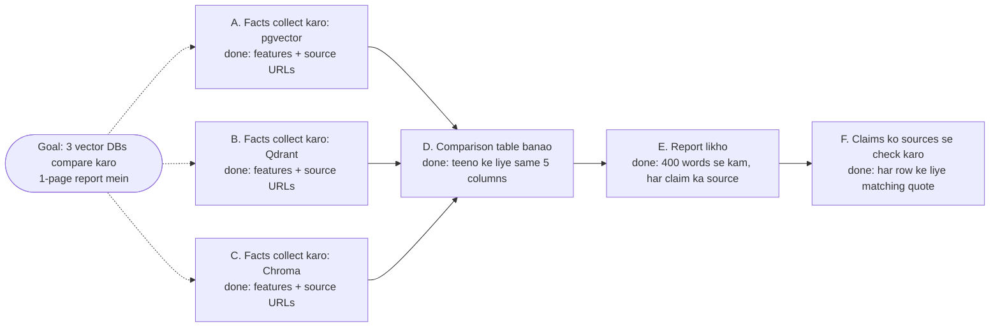

🏠 [Home](../../README.md) › [07 · Planning & Reasoning](./README.md) › 7.3 Task decomposition

# 7.3 Task decomposition

> **Level:** 🟡 Intermediate · **Padhne ka time:** ~8 min · **Pehle padho:** [7.2 Plan-and-execute](./07.2-plan-and-execute.md)

**Ek line mein:** Ek bade goal ko chhote sub-tasks mein todo, jinme har ek ka ek clear outcome aur ek "done when" test ho, aur jo dependencies se aise jude hon ki ek graph bane jisko tum schedule aur check kar sako.

📑 **Is page par**

- [Yeh kyun zaroori hai?](#-yeh-kyun-zaroori-hai)
- [Idea, simple words mein](#-idea-simple-words-mein)
- [Diagram se samjho](#-diagram-se-samjho)
- [Kaise kaam karta hai, step by step](#-kaise-kaam-karta-hai-step-by-step)
- [Example se samjho](#-example-se-samjho)
- [Code](#-code)
- [Aam galtiyan aur dhyan dene wali baatein](#-aam-galtiyan-aur-dhyan-dene-wali-baatein)
- [Yaad rakhne wali baatein](#-yaad-rakhne-wali-baatein)
- [Khud try karo](#-khud-try-karo)
- [Aur padhne ke liye](#-aur-padhne-ke-liye)

## 🤔 Yeh kyun zaroori hai?

"Teen vector databases ko compare karke ek report likho" aisa kaam hai jo koi bhi, insaan ho ya model, ek baar mein nahi karta. Agar yeh goal ek hi prompt mein de do, toh agent ek database ko jaldi-jaldi dekh lega, doosre ke baare mein details bana lega, aur bolega ho gaya. Kisi ko pata nahi chalega ki kya chhoot gaya. Kyunki kahin likha hi nahi tha ki "done" kaisa dikhta hai.

[Task decomposition](../../GLOSSARY.md#task-decomposition) ke through hi planners ([7.2](./07.2-plan-and-execute.md)), orchestrators ([9.4](../09-agent-design-patterns/09.4-orchestrator-workers.md)) aur multi-agent systems ([chapter 10](../10-multi-agent-systems/README.md)) ek bade goal ko aise kaam mein badalte hain jo tukda-tukda karke kiya, check kiya aur retry kiya ja sake. Tukdon ki quality hi result ki quality decide karti hai.

## 🧠 Idea, simple words mein

Team board pe ek achhe ticket ke baare mein socho. Uska title ek hi cheez bolta hai. Usme itna context hota hai ki bina puche kaam shuru ho jaye. Done ki clear definition hoti hai. Aur ek note hota hai ki kaunse doosre tickets pehle khatam hone chahiye. Aise tickets wala sprint apne aap chalta hai. "Isko better banao" jaise tickets wala sprint nahi chalta.

Agent ke sub-tasks ko bhi yahi teen cheezein chahiye:

1. **Ek outcome.** "Qdrant ki pricing collect karo", na ki "databases pe research karo".
2. **Ek [done criterion](../../GLOSSARY.md#done-criterion).** Ek test jo tum ya code apply kar sake: "plan names aur monthly prices ki ek table, har ek ke saath source URL".
3. **Dependencies.** Kaunse sub-tasks pehle khatam hone chahiye. Yeh sab milke ek [directed acyclic graph (DAG)](../../GLOSSARY.md#directed-acyclic-graph-dag) banate hain: prerequisites se un tasks tak arrows jinko unki zaroorat hai, aur koi loop nahi.

Ghar mein dal-chawal banane jaisa socho. Chawal bhigona aur dal dhona ek-doosre pe depend nahi karte, toh saath-saath ho sakte hain. Lekin tadka tab hi lagega jab dal pak chuki ho. Yahi dependencies hain.

## 👀 Diagram se samjho



*A, B aur C ek-doosre pe depend nahi karte, isliye parallel chal sakte hain. D tab tak shuru nahi ho sakta jab tak teeno khatam na hon. Har box batata hai ki "done" ka matlab kya hai.*

## 🔍 Kaise kaam karta hai, step by step

1. **Deliverable se shuru karo aur ulta chalo.** Final output kaisa dikhta hai? Uske theek pehle kya hona zaroori hai? Yeh puchte raho jab tak har tukda aisa na ho jaye jo ek [tool](../../GLOSSARY.md#tool) loop kar sake.
2. **Har sub-task ka size dekho.** Achha sub-task ek focused executor run mein fit hota hai (kuch tool calls), aur ek aisa result deta hai jisko tum ek sentence ya chhoti table mein bata sako. Bahut bada hoga toh gol-mol tarike se fail hoga; bahut chhota hoga toh coordination calls mein doob jaoge.
3. **Har ek ka done criterion likho.** Aise criteria prefer karo jo code check kar sake: ek number maujood hai, list mein *n* items hain, JSON validate hota hai, tests pass hote hain, har claim ka source hai. Jahan sirf judgment se kaam chale, wahan aise likho ki ek reviewer (ya ek [LLM](../../GLOSSARY.md#large-language-model-llm) judge) apply kar sake.
4. **Dependencies saaf-saaf record karo.** Ek sub-task doosre pe tabhi depend karta hai jab usko us task ka *output* chahiye. Zaroorat se zyada dependencies likhoge toh jo kaam parallel chal sakta tha woh line mein lag jayega; kam likhoge toh steps bina inputs ke chal padenge.
5. **Graph validate karo.** Har dependency id exist karti ho, koi cycle na ho, aur kuch na kuch final deliverable tak le jaaye. `graphlib.TopologicalSorter` cycles pakadta hai aur tumhe order deta hai.
6. **Decide karo kitna gehra todna hai: pehle hi ya zaroorat padne pe.** Tum shuru karne se pehle poora decompose kar sakte ho, ya kisi step ko tabhi aur todo jab woh fail ho. Research mein doosre tarike ko *as-needed decomposition* kehte hain ([ADaPT, Prasad et al., 2023](https://arxiv.org/abs/2311.05772)). Ek aur research line, *least-to-most prompting* ([Zhou et al., 2022](https://arxiv.org/abs/2205.10625)), pehle sabse aasaan sub-problems solve karti hai aur unke answers mushkil wale sub-problems mein daalti hai.

**Achhe aur bure sub-tasks:**

| Bura | Kyun | Better |
| --- | --- | --- |
| "Databases pe research karo" | Kai outcomes, koi end nahi | "pgvector ke index types aur licence collect karo, source URLs ke saath" |
| "Dhyan rakho ki achha ho" | Koi test nahi | "Report ka har claim collect kiye gaye sources mein se kisi ek ko cite kare" |
| "search ko query 'qdrant pricing' ke saath call karo" | *Kaise* karna hai woh thopta hai, adapt karne ki jagah nahi | "Qdrant Cloud ki starting monthly price dhundho" |
| "Report likho" (kisi pe depend nahi) | Facts aane se pehle hi chal jayega | "Report likho" depend kare "Comparison table banao" pe |

## 💡 Example se samjho

[7.2](./07.2-plan-and-execute.md#-example-se-samjho) wala offsite plan ek chhota decomposition hai. Yeh raha woh, us dependency graph ke saath jo code nikalta hai:

```text
s1  Find Lisbon venues that hold at least 12 people            depends on: -        done when: we have a list of venues with day rates
s2  Check the cheapest venue is free on 2026-12-03             depends on: s1       done when: one available venue and its day rate are known
s3  Work out lunch for 12 people at EUR 25 each                depends on: -        done when: the lunch total in EUR is known
s4  Add venue rate and lunch, compare with the EUR 1,500 budget  depends on: s2, s3   done when: the total is known and we know if it is within budget

order [s1, s3] -> [s2] -> [s4]
```

Isko achha decomposition kya banata hai:

- **Har ek ka ek outcome.** s3 exactly ek number deta hai. s2 ek venue aur uska rate deta hai.
- **Check karne layak "done when".** s4 ke criterion ke do hisse hain, ek total aur budget ke against haan/na. Executor ki report (*"Total is EUR 1,200, which is EUR 300 under the EUR 1,500 budget"*) saaf dikhta hai ki dono poore karti hai.
- **Imaandaar dependencies.** s3 ko venue ki zaroorat nahi, toh woh uska wait nahi karta. s4 ko venue rate aur lunch total dono chahiye, toh woh dono ka wait karta hai.

Aur kuch bhi chalne se pehle code bure decompositions reject kar deta hai:

```text
{"steps": [{"id": "a", "task": "x", "depends_on": ["b"]}, {"id": "b", "task": "y", "depends_on": ["a"]}]}
-> PlanError: Plan has a dependency cycle: ['a', 'b', 'a']

{"steps": [{"id": "a", "task": "x", "depends_on": ["zz"]}]}
-> PlanError: Step a depends on unknown steps ['zz'].
```

## 💻 Code

Data ke roop mein ek sub-task, aur woh validation jisse har plan guzarta hai (thoda simplified):

```python
@dataclass
class Step:
    id: str
    task: str                                            # ek outcome, simple words mein
    depends_on: list[str] = field(default_factory=list)  # woh ids jinke *outputs* is step ko chahiye
    done_when: str = ""                                   # kaise pata chale ki yeh khatam ho gaya
    status: str = "pending"                               # pending | done | failed
    result: str = ""


def parse_plan(text: str) -> list[Step]:
    """Planner ke JSON ko Steps mein badlo, aur jo plans execute nahi ho sakte unhe reject karo."""
    raw = json.loads(text)["steps"]
    steps = [Step(id=s["id"], task=s["task"], depends_on=list(s.get("depends_on", [])),
                  done_when=s.get("done_when", "")) for s in raw]
    ids = [s.id for s in steps]
    if not steps or len(ids) != len(set(ids)):
        raise PlanError("Plan must have at least one step and unique step ids.")
    for s in steps:
        if unknown := set(s.depends_on) - set(ids):
            raise PlanError(f"Step {s.id} depends on unknown steps {sorted(unknown)}.")
    try:
        batches(steps)                                   # andar graphlib.TopologicalSorter chalta hai
    except CycleError as exc:
        raise PlanError(f"Plan has a dependency cycle: {exc.args[1]}") from exc
    return steps
```

Jab done criterion code se check ho sakta hai, toh executor ke `DONE:` pe bharosa karne ki jagah code mein check karo. Jaise:

```python
def check_lunch_total(result: str) -> bool:
    """Done when: lunch ka total EUR mein pata hai."""
    return re.search(r"EUR\s?[\d,]+", result) is not None
```

## 🚨 Aam galtiyan aur dhyan dene wali baatein

- **Bina done criterion ke steps.** Executor jaldi hi jeet ka elaan kar dega. Har step ko ek criterion chahiye, ho sake toh machine se check hone wala.
- **Chhupi hui dependencies.** Ek step doosre ka output use karta hai lekin declare nahi karta, toh woh bahut jaldi chal jaata hai aur uske paas kaam karne ko kuch nahi hota. Har step se pucho: "shuru karne ke liye mujhe pehle se kya pata hona chahiye?"
- **Bahut saare chhote-chhote steps.** Har step mein kam se kam ek model call aur coordination lagta hai. Jo steps hamesha saath hote hain aur context share karte hain, unhe merge karo.
- **Jo dikh nahi raha usko decompose karna.** Explore karne wale kaam (debugging, open research) mein tum step 2 ka result dekhe bina step 5 nahi jaan sakte. Kuch steps aage tak plan karo, ya zaroorat padne pe decompose karo, aur re-plan ke liye taiyaar raho ([7.5](./07.5-re-planning-when-things-fail.md)).
- **Overlap karne wale sub-tasks.** Do parallel workers dono "pricing research" karte hain aur alag-alag answers laate hain. Har sub-task ka scope alag rakho.
- **Poore kaam ko check karne wala koi step nahi.** Har tukda apna test pass kar sakta hai, phir bhi jodne pe result goal se chook sakta hai. Aakhir mein original request ke against ek integration check rakho.

## ✅ Yaad rakhne wali baatein

- Achhe sub-tasks mein ek outcome, ek done criterion aur saaf dependencies hoti hain.
- Dependencies ek DAG banati hain: usko validate karo (koi cycle nahi, koi unknown id nahi) aur usi se schedule karo.
- Independent sub-tasks parallel chal sakte hain; dependent wale apne inputs ka wait karte hain.
- Aise done criteria prefer karo jo code check kar sake; reviewer ya LLM judge sirf wahan jahan judgment chahiye.
- Raasta predictable ho toh pehle hi decompose karo; na ho toh zaroorat padne pe.

## 🧪 Khud try karo

1. *"Find the three most-starred open-source vector databases on GitHub and summarise their licences"* ko done criteria aur dependencies ke saath sub-tasks mein todo. Kaunse parallel chal sakte hain?
2. Ek step kehta hai `"task": "Write the summary", "depends_on": []`. Kya galat hoga, aur kaise theek karoge?

<details>
<summary>Answer dekho</summary>

1. Ek possible answer. **s1** *GitHub pe candidate open-source vector databases unke star counts ke saath dhundho* (done: kam se kam 6 repos, star counts aur URLs ke saath). **s2** *Stars ke hisaab se top teen chuno* (s1 pe depend; done: teen repo names, sorted). **s3a/s3b/s3c** *Repo 1 / 2 / 3 ka licence dhundho* (har ek s2 pe depend; done: SPDX licence name aur LICENSE file ka link). **s4** *Summary likho* (s3a, s3b, s3c pe depend; done: teen bullet points, har ek mein name, stars aur licence). s3a, s3b aur s3c parallel chal sakte hain.
2. Yeh sabse pehle chal sakta hai, kisi bhi fact ke aane se pehle. Toh executor ke paas ya toh summarise karne ko kuch nahi hoga, ya woh content bana lega. Isko theek karne ke liye un steps pe dependency declare karo jo facts laate hain, jaise `"depends_on": ["s3a", "s3b", "s3c"]`.

</details>

## 📚 Aur padhne ke liye

- [Least-to-Most Prompting Enables Complex Reasoning in Large Language Models](https://arxiv.org/abs/2205.10625) (Zhou et al., 2022). Sub-problems mein todo, phir order mein solve karo, answers aage pass karte hue.
- [ADaPT: As-Needed Decomposition and Planning with Language Models](https://arxiv.org/abs/2311.05772) (Prasad et al., 2023). Sub-task ko tabhi todo jab executor usko na kar paaye.
- [How we built our multi-agent research system](https://www.anthropic.com/engineering/multi-agent-research-system) (Anthropic). Lead agent workers ko sub-tasks kaise samjhaata hai: objective, output format, tools aur boundaries.
- [`graphlib`](https://docs.python.org/3/library/graphlib.html) (Python docs). Topological sorting aur cycle detection.

<!-- FOOTER -->

---

⬅️ **Pichla:** [7.2 Plan-and-execute](./07.2-plan-and-execute.md) ·
🏠 [Chapter home](./README.md) ·
➡️ **Agla:** [7.4 Tree-of-thoughts (ek overview)](./07.4-tree-of-thoughts.md)
