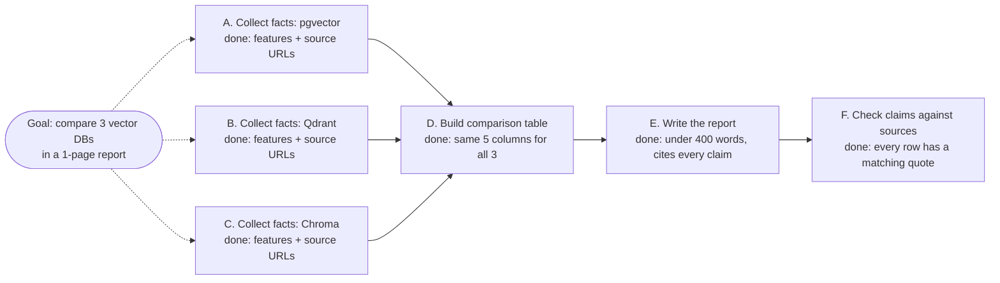

🏠 [Home](../../README.md) › [07 · Planning & Reasoning](./README.md) › 7.3 Task decomposition

# 7.3 Task decomposition

> **Difficulty:** 🟡 Intermediate · **Reading time:** ~8 min · **Prerequisites:** [7.2 Plan-and-execute](./07.2-plan-and-execute.md)

**In one sentence:** Break a big goal into small sub-tasks, each with one clear outcome and a "done when" test, connected by dependencies that form a graph you can schedule and check.

📑 **On this page**

- [Why does this matter?](#-why-does-this-matter)
- [The idea, in plain words](#-the-idea-in-plain-words)
- [Picture it](#-picture-it)
- [How it works, step by step](#-how-it-works-step-by-step)
- [Worked example](#-worked-example)
- [Code](#-code)
- [Common mistakes & gotchas](#-common-mistakes--gotchas)
- [Key takeaways](#-key-takeaways)
- [Try it yourself](#-try-it-yourself)
- [Further reading](#-further-reading)

## 🤔 Why does this matter?

"Write a report comparing three vector databases" is not something anyone, human or model, does in one go. Given that goal in one prompt, an agent may skim one database, invent details about another, and call it done. Nobody can tell what was skipped, because nothing said what "done" looked like.

[Task decomposition](../../GLOSSARY.md#task-decomposition) is how planners ([7.2](./07.2-plan-and-execute.md)), orchestrators ([9.4](../09-agent-design-patterns/09.4-orchestrator-workers.md)) and multi-agent systems ([chapter 10](../10-multi-agent-systems/README.md)) turn a big goal into work that can be done, checked, and retried piece by piece. The quality of the pieces decides the quality of the result.

## 🧠 The idea, in plain words

Think of a good ticket on a team board. It has a title that says one thing, enough context to start without asking, a clear definition of done, and a note saying which other tickets must land first. A sprint full of tickets like that runs itself. A sprint of "make it better" tickets doesn't.

Sub-tasks for an agent need the same three things:

1. **One outcome.** "Collect pricing for Qdrant", not "research the databases".
2. **A [done criterion](../../GLOSSARY.md#done-criterion).** A test you, or code, can apply: "a table with plan names and monthly prices, each with a source URL".
3. **Dependencies.** Which sub-tasks must finish first. Together they form a [directed acyclic graph (DAG)](../../GLOSSARY.md#directed-acyclic-graph-dag): arrows from prerequisites to the tasks that need them, and no loops.

## 👀 Picture it



*A, B and C don't depend on each other, so they can run in parallel. D can't start until all three finish. Every box says what "done" means.*

## 🔍 How it works, step by step

1. **Start from the deliverable and work backwards.** What does the final output look like? What must exist just before it? Keep asking until each piece is something one [tool](../../GLOSSARY.md#tool) loop can do.
2. **Size each sub-task.** A good sub-task fits in one focused executor run (a few tool calls) and produces one result you can describe in a sentence or a small table. Too big and it fails vaguely; too small and you drown in coordination calls.
3. **Write a done criterion for each.** Prefer criteria code can check: a number exists, a list has *n* items, JSON validates, tests pass, every claim has a source. Where only judgment will do, write it so a reviewer (or an [LLM](../../GLOSSARY.md#large-language-model-llm) judge) can apply it.
4. **Record dependencies explicitly.** A sub-task depends on another only if it needs that task's *output*. Over-declaring dependencies serialises work that could run in parallel; under-declaring makes steps run without their inputs.
5. **Validate the graph.** Every dependency id exists, there are no cycles, and something leads to the final deliverable. `graphlib.TopologicalSorter` finds cycles and gives you an order.
6. **Decide how deep to go: up front or as needed.** You can decompose fully before starting, or decompose a step further only when it fails. Research calls the second approach *as-needed decomposition* ([ADaPT, Prasad et al., 2023](https://arxiv.org/abs/2311.05772)). Another line of work, *least-to-most prompting* ([Zhou et al., 2022](https://arxiv.org/abs/2205.10625)), solves the easiest sub-problems first and feeds their answers into harder ones.

**Good and bad sub-tasks:**

| Bad | Why | Better |
| --- | --- | --- |
| "Research the databases" | Many outcomes, no end | "Collect pgvector's index types and licence, with source URLs" |
| "Make sure it's good" | No test | "Every claim in the report cites one of the collected sources" |
| "Call search with query 'qdrant pricing'" | Dictates *how*, leaves no room to adapt | "Find Qdrant Cloud's starting monthly price" |
| "Write the report" (depends on nothing) | Will run before the facts exist | "Write the report" depends on "Build comparison table" |

## 💡 Worked example

The offsite plan from [7.2](./07.2-plan-and-execute.md#-worked-example) is a small decomposition. Here it is with the dependency graph the code computes:

```text
s1  Find Lisbon venues that hold at least 12 people            depends on: -        done when: we have a list of venues with day rates
s2  Check the cheapest venue is free on 2026-12-03             depends on: s1       done when: one available venue and its day rate are known
s3  Work out lunch for 12 people at EUR 25 each                depends on: -        done when: the lunch total in EUR is known
s4  Add venue rate and lunch, compare with the EUR 1,500 budget  depends on: s2, s3   done when: the total is known and we know if it is within budget

order [s1, s3] -> [s2] -> [s4]
```

What makes it a good decomposition:

- **One outcome each.** s3 produces exactly one number. s2 produces one venue and its rate.
- **Checkable "done when".** s4's criterion has two parts, a total and a yes/no against the budget, and the executor's report (*"Total is EUR 1,200, which is EUR 300 under the EUR 1,500 budget"*) visibly meets both.
- **Honest dependencies.** s3 doesn't need the venue, so it doesn't wait for it. s4 needs both the venue rate and the lunch total, so it waits for both.

And the code rejects bad decompositions before anything runs:

```text
{"steps": [{"id": "a", "task": "x", "depends_on": ["b"]}, {"id": "b", "task": "y", "depends_on": ["a"]}]}
-> PlanError: Plan has a dependency cycle: ['a', 'b', 'a']

{"steps": [{"id": "a", "task": "x", "depends_on": ["zz"]}]}
-> PlanError: Step a depends on unknown steps ['zz'].
```

## 💻 Code

A sub-task as data, and the validation that every plan goes through, slightly simplified:

```python
@dataclass
class Step:
    id: str
    task: str                                            # one outcome, in plain words
    depends_on: list[str] = field(default_factory=list)  # ids whose *outputs* this step needs
    done_when: str = ""                                   # how to tell it is finished
    status: str = "pending"                               # pending | done | failed
    result: str = ""


def parse_plan(text: str) -> list[Step]:
    """Turn the planner's JSON into Steps, and reject plans we cannot execute."""
    raw = json.loads(text)["steps"]
    steps = [Step(id=s["id"], task=s["task"], depends_on=list(s.get("depends_on", [])),
                  done_when=s.get("done_when", "")) for s in raw]
    ids = [s.id for s in steps]
    if not steps or len(ids) != len(set(ids)):
        raise PlanError("Plan must have at least one step and unique step ids.")
    for s in steps:
        if unknown := set(s.depends_on) - set(ids):
            raise PlanError(f"Step {s.id} depends on unknown steps {sorted(unknown)}.")
    try:
        batches(steps)                                   # graphlib.TopologicalSorter under the hood
    except CycleError as exc:
        raise PlanError(f"Plan has a dependency cycle: {exc.args[1]}") from exc
    return steps
```

When a done criterion can be checked by code, check it in code rather than trusting the executor's `DONE:`. For example:

```python
def check_lunch_total(result: str) -> bool:
    """Done when: the lunch total in EUR is known."""
    return re.search(r"EUR\s?[\d,]+", result) is not None
```

## 🚨 Common mistakes & gotchas

- **Steps without a done criterion.** The executor will declare victory early. Every step needs one, ideally machine-checkable.
- **Hidden dependencies.** A step uses another's output without declaring it, so it runs too early with nothing to work on. Ask of each step: "what must I already know to start?"
- **Too many tiny steps.** Each step costs at least one model call plus coordination. Merge steps that always happen together and share context.
- **Decomposing what you can't foresee.** In exploratory work (debugging, open research), you can't know step 5 until you see step 2's result. Plan a few steps ahead, or decompose as needed, and expect to re-plan ([7.5](./07.5-re-planning-when-things-fail.md)).
- **Overlapping sub-tasks.** Two parallel workers both "research pricing" and produce conflicting answers. Give each sub-task a distinct scope.
- **No step that checks the whole.** Each piece can pass its own test while the combined result misses the goal. End with an integration check against the original request.

## ✅ Key takeaways

- Good sub-tasks have one outcome, a done criterion, and explicit dependencies.
- Dependencies form a DAG: validate it (no cycles, no unknown ids) and schedule from it.
- Independent sub-tasks can run in parallel; dependent ones wait for their inputs.
- Prefer done criteria code can check; use a reviewer or LLM judge only where judgment is needed.
- Decompose up front when the path is predictable; decompose as needed when it isn't.

## 🧪 Try it yourself

1. Decompose *"Find the three most-starred open-source vector databases on GitHub and summarise their licences"* into sub-tasks with done criteria and dependencies. Which can run in parallel?
2. A step says `"task": "Write the summary", "depends_on": []`. What will go wrong, and how do you fix it?

<details>
<summary>Show answer</summary>

1. One possible answer. **s1** *Find candidate open-source vector databases on GitHub with their star counts* (done: at least 6 repos with star counts and URLs). **s2** *Pick the top three by stars* (depends on s1; done: three repo names, sorted). **s3a/s3b/s3c** *Find the licence of repo 1 / 2 / 3* (each depends on s2; done: SPDX licence name plus link to the LICENSE file). **s4** *Write the summary* (depends on s3a, s3b, s3c; done: three bullet points, each with name, stars and licence). s3a, s3b and s3c can run in parallel.
2. It can run first, before any facts exist, so the executor either has nothing to summarise or invents content. Fix it by declaring the dependency on the steps that produce the facts, for example `"depends_on": ["s3a", "s3b", "s3c"]`.

</details>

## 📚 Further reading

- [Least-to-Most Prompting Enables Complex Reasoning in Large Language Models](https://arxiv.org/abs/2205.10625) (Zhou et al., 2022). Decompose into sub-problems, then solve them in order, feeding answers forward.
- [ADaPT: As-Needed Decomposition and Planning with Language Models](https://arxiv.org/abs/2311.05772) (Prasad et al., 2023). Decompose a sub-task only when the executor can't do it.
- [How we built our multi-agent research system](https://www.anthropic.com/engineering/multi-agent-research-system) (Anthropic). How a lead agent describes sub-tasks to workers: objective, output format, tools and boundaries.
- [`graphlib`](https://docs.python.org/3/library/graphlib.html) (Python docs). Topological sorting and cycle detection.

<!-- FOOTER -->

---

⬅️ **Previous:** [7.2 Plan-and-execute](./07.2-plan-and-execute.md) ·
🏠 [Chapter home](./README.md) ·
➡️ **Next:** [7.4 Tree-of-thoughts (overview)](./07.4-tree-of-thoughts.md)
