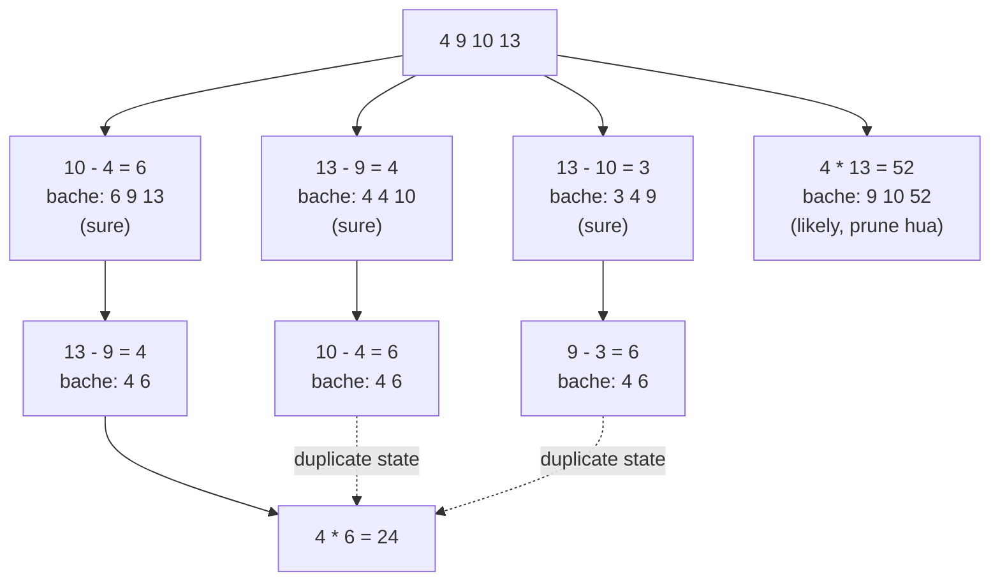

🏠 [Home](../../README.md) › [07 · Planning & Reasoning](./README.md) › 7.4 Tree-of-thoughts (ek overview)

# 7.4 Tree-of-thoughts (ek overview)

> **Level:** 🔴 Advanced · **Padhne ka time:** ~8 min · **Pehle padho:** [7.1 Chain-of-thought aur extended thinking](./07.1-chain-of-thought-and-extended-thinking.md), [7.3 Task decomposition](./07.3-task-decomposition.md)

**Ek line mein:** Tree of thoughts model ko ek saath kai adhoore solutions explore karne deta hai: unko score karo, kamzor wale hatao aur best wale se aage badho, bilkul ek search algorithm ki tarah, lekin iske badle model calls bahut zyada lagti hain.

📑 **Is page par**

- [Yeh kyun zaroori hai?](#-yeh-kyun-zaroori-hai)
- [Idea, simple words mein](#-idea-simple-words-mein)
- [Diagram se samjho](#-diagram-se-samjho)
- [Kaise kaam karta hai, step by step](#-kaise-kaam-karta-hai-step-by-step)
- [Example se samjho](#-example-se-samjho)
- [Code](#-code)
- [Aam galtiyan aur dhyan dene wali baatein](#-aam-galtiyan-aur-dhyan-dene-wali-baatein)
- [Yaad rakhne wali baatein](#-yaad-rakhne-wali-baatein)
- [Khud try karo](#-khud-try-karo)
- [Aur padhne ke liye](#-aur-padhne-ke-liye)

## 🤔 Yeh kyun zaroori hai?

Chain-of-thought ([7.1](./07.1-chain-of-thought-and-extended-thinking.md)) shuru se aakhir tak reasoning ki **ek** hi line follow karta hai. Agar pehla step hi galat choice tha, toh uske baad sab bekaar hai, aur model shayad hi kabhi peeche jaata hai. Kuch problems mein iski bhaari keemat chukani padti hai: puzzles, constraints ke saath planning, ya aisa design chunna jahan ek shuruaati decision achhe endings ka raasta band kar deta hai.

[Tree of thoughts (ToT)](../../GLOSSARY.md#tree-of-thoughts-tot), jo [Yao et al. (2023)](https://arxiv.org/abs/2305.10601) se aaya, model ko kai pehle steps try karne deta hai. Phir model judge karta hai ki kaunse promising lag rahe hain, aur sirf unhi se aage badhta hai. Paper ke sabse mushkil task, Game of 24, pe chain-of-thought prompting ke saath GPT-4 ne 4% puzzles solve kiye; tree of thoughts ke saath 74%.

## 🧠 Idea, simple words mein

Ek chess player ke baare mein socho. Woh dimaag mein aaya pehla move nahi khel deta. Woh kuch candidate moves sochta hai, imagine karta hai ki har ek kahan le jayega, jo bure lagte hain unhe chhod deta hai, aur baaki ko aur gehraai se dekhta hai. Tree of thoughts model ko yahi aadat deta hai, aur tumhara code board ka kaam karta hai:

- Ek **thought** solution ki taraf ek meaningful step hai: equation ki ek line, ek paragraph ka plan, ek design choice.
- Model current state se kai possible agle thoughts **propose** karta hai.
- Model (ya tumhara code) har nayi state ko **evaluate** karta hai: solution tak pahunchne ke chances *sure*, *likely* ya *impossible*.
- Ek **search algorithm** decide karta hai ki aage kaunsi states expand karni hain: breadth-first (har level pe best kuch rakho) ya depth-first (ek raasta tab tak follow karo jab tak fail na ho, phir peeche aao).

Jaise kisi naye sheher mein auto wale se raasta puchna. Ek galli mein ghuse, aage band mila, toh wapas mod pe aaye aur doosri galli li. Depth-first search yahi hai: ek raasta, dead end, wapas aao, agla try karo.

## 👀 Diagram se samjho



*Game of 24 pe breadth-first tree of thoughts, bilkul waise jaise neeche wala example chalata hai. 18 pehle steps mein se best teen (sab "sure" rated) rakhe jaate hain aur baaki, jaise 4 × 13, prune ho jaate hain. Teeno rakhi hui branches ek hi state "4 6" pe pahunchti hain; woh ek hi baar explore hoti hai, aur 4 × 6 = 24.*

## 🔍 Kaise kaam karta hai, step by step

1. **State aur thought define karo.** State woh hai jo ab tak tumhare paas hai (bache hue numbers, adhoora plan). Ek thought ek state se agli state tak le jaata hai.
2. **Propose.** Model se ek state se kai possible agle thoughts maango. Ya toh usko kai baar sample karo, ya ek hi call mein list maango.
3. **Jo code mein check ho sakta hai, check karo.** Rules todne wale proposals phenk do (galat arithmetic, ek number do baar use hua, invalid move). Models galtiyan karte hain; check karna sasta hai.
4. **Evaluate.** Model se har nayi state ko rate karwao, jaise *sure / likely / impossible*. Paper ka evaluator kuch steps aage dekhta tha aur "too big" ya "too small" jaise commonsense se states ko rule out karta tha. Evaluation ko zyada reliable banane ke liye usko kai baar sample bhi karta tha. Jahan bhi code check possible ho, wahan uski jagah code check use karo.
5. **Search.** **Breadth-first (BFS):** frontier ki har state expand karo, saare children score karo, best *b* rakho (yeh "breadth" hai), ek level neeche jao. **Depth-first (DFS):** best child ko neeche tak follow karo; agar koi state "impossible" score kare, toh pichle branch point pe wapas jao.
6. **Ruko.** Jab koi state solution ho, depth limit aa jaye, ya model calls ka budget khatam ho jaye.

**Cost.** Har proposal aur har evaluation ek model call hai. Game of 24 ke liye paper ka cost analysis batata hai ki ToT har puzzle pe lagbhag 5.5k generated [tokens](../../GLOSSARY.md#token) leta hai, jo karib 100 chain-of-thought attempts (6.7k tokens) ke barabar hai. Phir bhi iska success rate 100 chain-of-thought attempts ke best se zyada hai (74% vs 49%).

**Aaj yeh kahan fit hota hai.** Built-in thinking wale current models ([7.1](./07.1-chain-of-thought-and-extended-thinking.md)) ek hi call ke *andar* explore aur backtrack kar lete hain, jisse woh bahut saare problems cover ho jaate hain jinke liye ToT bana tha. Explicit tree search tab bhi apni cost vasool karta hai jab tum adhoore solutions ko model ke **bahar** check kar sako (move validate karne wala code, chalne wale tests, ek simulator), jab tum search ko control aur log karna chahte ho, ya jab tumhe bahut saare alag-alag candidates chahiye.

## 💡 Example se samjho

Paper ke example input pe breadth 3 ke saath BFS. Is run mein model ke proposer aur evaluator ki jagah chhote Python functions use hue hain (evaluator ek quick look-ahead aur kuch rules of thumb use karta hai, aur division ko ignore karta hai, isliye yeh perfect solver nahi hai):

```text
Input: 4 9 10 13

depth 1: 18 proposals, kept [6 9 13], [3 4 9], [4 4 10]
depth 2: 31 proposals, kept [4 6]
depth 3: 3 proposals, kept [24]

Model calls: 49 (one chain-of-thought attempt would be 1)

Solution:
  10 - 4 = 6 (left: 6 9 13)
  13 - 9 = 4 (left: 4 6)
  4 * 6 = 24 (left: 24)
```

Ek-ek karke dekho:

- **Depth 1.** Ek proposal call ne 18 valid pehle steps diye (code check ke baad). Har nayi state evaluate hui aur best teen rakhi gayi. `9 10 52` (4 × 13 se) jaisi states judge hui aur hata di gayi.
- **Depth 2.** Teen proposal calls (har rakhi state ke liye ek) ne 31 do-number wali states di. Sirf `4 6` se ab bhi 24 ban sakta tha, toh sirf wahi bachi.
- **Depth 3.** `4 × 6 = 24`. Solve ho gaya.
- **Cost.** Ek chhote puzzle ke liye 49 model calls. Yahi trade-off hai: mushkil search problems pe bahut zyada reliability, lekin kai guna cost pe.

## 💻 Code

Search loop:

```python
def solve(self, numbers: list[int]) -> State | None:
    frontier = [State(tuple(sorted(numbers)))]
    for depth in range(1, len(numbers)):
        # 1. PROPOSE: har state ke liye ek model call; check() galat arithmetic hata deta hai
        candidates = [child for state in frontier for child in self.propose(state)]
        # 2. EVALUATE: har nayi state ke liye ek model call -> sure (20) / likely (1) / impossible (0)
        scored = sorted(((self.evaluate(c), c) for c in set(candidates)), key=lambda p: (-p[0], p[1].steps))
        # 3. PRUNE: best `breadth` states rakho, dead ends aur duplicates chhod do
        frontier, seen = [], set()
        for value, c in scored:
            if value > 0 and c.numbers not in seen and len(frontier) < self.breadth:
                frontier.append(c)
                seen.add(c.numbers)
        if not frontier:
            return None
    return next((s for s in frontier if s.numbers == (24,)), None)
```

Yeh jo do prompts bhejta hai (paper wale prompts ki tarah hi, is example ke liye likhe gaye):

```text
Propose possible next steps for the Game of 24. Use exactly two of the numbers and one of + - * /.
Write one step per line, in this format:  a op b = c (left: remaining numbers)
Input: 4 9 10 13

Evaluate if these numbers can reach 24 using each exactly once with + - * /.
Reason briefly ("too big", "too small", or try a few combinations), then end with one word: sure, likely or impossible.
Numbers: 4 4 10
```

Original chahiye toh [authors ka code aur prompts](https://github.com/princeton-nlp/tree-of-thought-llm) public hain.

## 🚨 Aam galtiyan aur dhyan dene wali baatein

- **Jahan ek achha answer kaafi hai, wahan ToT use karna.** Zyadatar agent steps ko search ki zaroorat nahi hoti. Pehle chain-of-thought ya zyada thinking effort try karo; ToT tabhi lo jab woh fail ho aur extra calls afford kar sako.
- **Model ki arithmetic ya rule-following pe bharosa karna.** Proposals mein galtiyan hoti hain. Har thought ko code mein validate karo, jaise `check()` karta hai.
- **Noisy evaluator.** Agar "likely" aur "impossible" lagbhag random tarike se mil rahe hain, toh search achhi branches prune kar dega. Evaluation ko kai baar sample karo, ya jahan possible ho code check se replace karo.
- **Koi budget nahi.** Calls breadth × depth × (har state ke proposals) ke saath badhti hain. Maximum calls aur depth limit set karo.
- **Duplicate states.** Alag-alag raaste aksar ek hi state pe pahunchte hain (upar wala `4 6`). Deduplicate karo, warna ek hi cheez do baar explore karne ka paisa doge.
- **Latency bhool jana.** Parallel calls ke saath bhi har depth level ek round trip hai. Interactive replies ke liye ToT achha fit nahi hai.

## ✅ Yaad rakhne wali baatein

- Tree of thoughts = kai agle steps propose karo, evaluate karo, best rakho, dobara karo: adhoore solutions ke upar search.
- BFS har level pe best *b* states rakhta hai; DFS ek raasta follow karta hai aur fail hone pe backtrack karta hai.
- Paper mein ToT ne GPT-4 ka Game of 24 success 4% (chain-of-thought) se 74% kar diya, lekin kahin zyada tokens use karke.
- Yeh tab chamakta hai jab adhoore solutions check ho sakein; baaki kai cases ab built-in thinking cover kar leti hai.
- Hamesha calls ki limit rakho aur states deduplicate karo.

## 🧪 Khud try karo

1. Maan lo tum upar wala search loop `breadth=1` (greedy search) ke saath example ke input pe chalate ho. Kya ab bhi solution milega? Model calls ki ginti compare karo.
2. Yeh version `3 3 8 8` kyun solve nahi kar sakta? Tum kya badloge?

<details>
<summary>Answer dekho</summary>

1. Haan, yahan milta hai: `TreeOfThoughts(llm, breadth=1).solve([4, 9, 10, 13])` 49 ki jagah 30 model calls mein wahi solution dhundh leta hai, kyunki evaluator ka top-rated pehla step (10 − 4 = 6) solution tak le jaata hai. Greedy search utna hi achha hai jitna evaluator ka pehla choice. Zyada noisy evaluator ke saath (asli model states rate kar raha ho), breadth 1 fail ho jaata hai, jabki breadth 3 ke paas wapas jaane ke liye do aur branches hoti hain.
2. Iska ek hi solution hai 8 / (3 − 8 / 3) = 24, jisme ek fraction (8 / 3) chahiye. Cheezein simple rakhne ke liye yeh version sirf whole-number results allow karta hai (`a / b` tabhi jab poora divide ho). Numbers ke liye Python ka `fractions.Fraction` use karo, aur evaluator ko division bhi consider karne do, toh yeh theek ho jayega.

</details>

## 📚 Aur padhne ke liye

- [Tree of Thoughts: Deliberate Problem Solving with Large Language Models](https://arxiv.org/abs/2305.10601) (Yao et al., 2023). Paper, jisme BFS aur DFS variants, teen tasks, aur appendix mein cost analysis hai.
- [princeton-nlp/tree-of-thought-llm](https://github.com/princeton-nlp/tree-of-thought-llm). Authors ka code aur prompts.
- [Self-Consistency Improves Chain of Thought Reasoning in Language Models](https://arxiv.org/abs/2203.11171) (Wang et al., 2022). Simple alternative: kai chains sample karo aur vote karo.

<!-- FOOTER -->

---

⬅️ **Pichla:** [7.3 Task decomposition](./07.3-task-decomposition.md) ·
🏠 [Chapter home](./README.md) ·
➡️ **Agla:** [7.5 Jab kuch fail ho, tab re-planning](./07.5-re-planning-when-things-fail.md)
