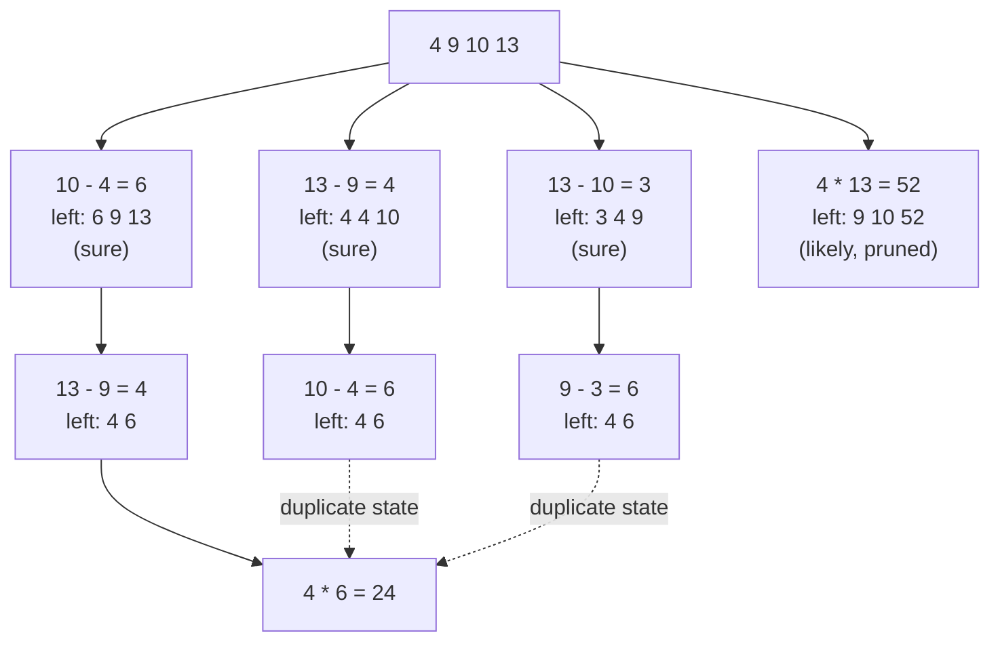

🏠 [Home](../../README.md) › [07 · Planning & Reasoning](./README.md) › 7.4 Tree-of-thoughts (overview)

# 7.4 Tree-of-thoughts (overview)

> **Difficulty:** 🔴 Advanced · **Reading time:** ~8 min · **Prerequisites:** [7.1 Chain-of-thought & extended thinking](./07.1-chain-of-thought-and-extended-thinking.md), [7.3 Task decomposition](./07.3-task-decomposition.md)

**In one sentence:** Tree of thoughts lets a model explore several partial solutions at once, score them, drop the weak ones and continue from the best, like a search algorithm, at the price of many more model calls.

📑 **On this page**

- [Why does this matter?](#-why-does-this-matter)
- [The idea, in plain words](#-the-idea-in-plain-words)
- [Picture it](#-picture-it)
- [How it works, step by step](#-how-it-works-step-by-step)
- [Worked example](#-worked-example)
- [Code](#-code)
- [Common mistakes & gotchas](#-common-mistakes--gotchas)
- [Key takeaways](#-key-takeaways)
- [Try it yourself](#-try-it-yourself)
- [Further reading](#-further-reading)

## 🤔 Why does this matter?

Chain-of-thought ([7.1](./07.1-chain-of-thought-and-extended-thinking.md)) follows **one** line of reasoning from start to finish. If the first step is a bad choice, everything after it is wasted, and the model rarely goes back. Some problems punish that: puzzles, planning with constraints, choosing a design where an early decision rules out good endings.

[Tree of thoughts (ToT)](../../GLOSSARY.md#tree-of-thoughts-tot), from [Yao et al. (2023)](https://arxiv.org/abs/2305.10601), lets the model try several first steps, judge which look promising, and continue only from those. On the paper's hardest task, the Game of 24, GPT-4 with chain-of-thought prompting solved 4% of puzzles; with tree of thoughts it solved 74%.

## 🧠 The idea, in plain words

Think of a chess player. They don't play the first move that comes to mind. They consider a few candidate moves, imagine where each leads, drop the ones that look bad, and look deeper at the rest. Tree of thoughts gives a model that habit, with your code as the board:

- A **thought** is one meaningful step towards a solution: one line of an equation, one paragraph plan, one design choice.
- The model **proposes** several possible next thoughts from the current state.
- The model (or your code) **evaluates** each new state: *sure*, *likely* or *impossible* to lead to a solution.
- A **search algorithm** decides which states to expand next: breadth-first (keep the best few at each level) or depth-first (follow one path until it fails, then backtrack).

## 👀 Picture it



*Breadth-first tree of thoughts on the Game of 24, as the example runs it. Of 18 first steps, the best three (all rated "sure") are kept and the rest, like 4 × 13, are pruned. All three kept branches reach the same state "4 6"; it is explored once, and 4 × 6 = 24.*

## 🔍 How it works, step by step

1. **Define a state and a thought.** The state is what you have so far (numbers left, a partial plan). A thought moves from one state to the next.
2. **Propose.** Ask the model for several possible next thoughts from a state, either by sampling it several times or by asking for a list in one call.
3. **Check what you can in code.** Throw away proposals that break the rules (wrong arithmetic, a number used twice, an invalid move). Models make slips; checking is cheap.
4. **Evaluate.** Ask the model to rate each new state, for example *sure / likely / impossible*. The paper's evaluator looked a few steps ahead and used commonsense such as "too big" or "too small" to rule states out, and sampled the evaluation several times to make it more reliable. Use a code check instead wherever one exists.
5. **Search.** **Breadth-first (BFS):** expand every state in the frontier, score all children, keep the best *b* (the "breadth"), go one level deeper. **Depth-first (DFS):** follow the best child down; if a state scores "impossible", backtrack to the last branch point.
6. **Stop.** At a state that is a solution, at a depth limit, or at a budget of model calls.

**Cost.** Every proposal and every evaluation is a model call. The paper's cost analysis for the Game of 24 reports about 5.5k generated [tokens](../../GLOSSARY.md#token) per puzzle for ToT, close to 100 chain-of-thought attempts (6.7k tokens), and still a higher success rate than the best of 100 chain-of-thought attempts (74% against 49%).

**Where it fits today.** Current models with built-in thinking ([7.1](./07.1-chain-of-thought-and-extended-thinking.md)) already explore and backtrack *inside* one call, which covers many problems ToT was built for. Explicit tree search still earns its cost when you can check partial solutions **outside** the model (code that validates a move, tests that run, a simulator), when you want to control and log the search, or when you need many diverse candidates.

## 💡 Worked example

[`examples/07-tree-of-thoughts`](../../examples/07-tree-of-thoughts/README.md) runs BFS with breadth 3 on the paper's example input. Offline, small Python functions stand in for the model's proposer and evaluator (the evaluator uses a quick look-ahead plus rules of thumb, and ignores division, so it is not a perfect solver):

```text
Input: 4 9 10 13

depth 1: 18 proposals, kept [6 9 13], [3 4 9], [4 4 10]
depth 2: 31 proposals, kept [4 6]
depth 3: 3 proposals, kept [24]

Model calls: 49 (one chain-of-thought attempt would be 1)

Solution:
  10 - 4 = 6 (left: 6 9 13)
  13 - 9 = 4 (left: 4 6)
  4 * 6 = 24 (left: 24)
```

Walk through it:

- **Depth 1.** One proposal call produced 18 valid first steps (after the code check). Each new state was evaluated and the best three kept. States like `9 10 52` (from 4 × 13) were judged and dropped.
- **Depth 2.** Three proposal calls (one per kept state) produced 31 two-number states. Only `4 6` could still make 24, so it alone survived.
- **Depth 3.** `4 × 6 = 24`. Solved.
- **Cost.** 49 model calls for one small puzzle. That is the trade: much more reliability on hard search problems, at many times the cost.

## 💻 Code

The search loop, from [`examples/07-tree-of-thoughts/main.py`](../../examples/07-tree-of-thoughts/main.py):

```python
def solve(self, numbers: list[int]) -> State | None:
    frontier = [State(tuple(sorted(numbers)))]
    for depth in range(1, len(numbers)):
        # 1. PROPOSE: one model call per state; check() discards invalid arithmetic
        candidates = [child for state in frontier for child in self.propose(state)]
        # 2. EVALUATE: one model call per new state -> sure (20) / likely (1) / impossible (0)
        scored = sorted(((self.evaluate(c), c) for c in set(candidates)), key=lambda p: (-p[0], p[1].steps))
        # 3. PRUNE: keep the best `breadth` states, skipping dead ends and duplicates
        frontier, seen = [], set()
        for value, c in scored:
            if value > 0 and c.numbers not in seen and len(frontier) < self.breadth:
                frontier.append(c)
                seen.add(c.numbers)
        if not frontier:
            return None
    return next((s for s in frontier if s.numbers == (24,)), None)
```

The two prompts it sends (in the same spirit as the paper's, written for this example):

```text
Propose possible next steps for the Game of 24. Use exactly two of the numbers and one of + - * /.
Write one step per line, in this format:  a op b = c (left: remaining numbers)
Input: 4 9 10 13

Evaluate if these numbers can reach 24 using each exactly once with + - * /.
Reason briefly ("too big", "too small", or try a few combinations), then end with one word: sure, likely or impossible.
Numbers: 4 4 10
```

The [authors' code and prompts](https://github.com/princeton-nlp/tree-of-thought-llm) are public if you want the originals.

## 🚨 Common mistakes & gotchas

- **Using ToT where one good answer is enough.** Most agent steps don't need search. Try chain-of-thought or higher thinking effort first; reach for ToT only when that fails and the extra calls are affordable.
- **Trusting the model's arithmetic or rule-following.** Proposals contain slips. Validate every thought in code, as `check()` does.
- **A noisy evaluator.** If "likely" and "impossible" are assigned almost at random, the search prunes good branches. Sample the evaluation several times, or replace it with a code check where possible.
- **No budget.** Calls grow with breadth × depth × (proposals per state). Set a maximum number of calls and a depth limit.
- **Duplicate states.** Different paths often reach the same state (`4 6` above). Deduplicate, or you pay to explore the same thing twice.
- **Forgetting latency.** Even with parallel calls, each depth level is a round trip. ToT is a poor fit for interactive replies.

## ✅ Key takeaways

- Tree of thoughts = propose several next steps, evaluate them, keep the best, repeat: search over partial solutions.
- BFS keeps the best *b* states per level; DFS follows one path and backtracks on failure.
- In the paper, ToT raised GPT-4's Game of 24 success from 4% (chain-of-thought) to 74%, using far more tokens.
- It shines when partial solutions can be checked; built-in thinking now covers many other cases.
- Always cap the number of calls and deduplicate states.

## 🧪 Try it yourself

1. Run the example with `breadth=1` (greedy search). Does it still find a solution? Compare the number of model calls.
2. Why can't this version solve `3 3 8 8`? What would you change?

<details>
<summary>Show answer</summary>

1. Yes, here it does: `TreeOfThoughts(llm, breadth=1).solve([4, 9, 10, 13])` finds the same solution with 30 model calls instead of 49, because the evaluator's top-rated first step (10 − 4 = 6) leads to a solution. Greedy search is only as good as the evaluator's first choice: with a noisier evaluator (a real model rating states), breadth 1 fails where breadth 3 still has two other branches to fall back on.
2. The only solution is 8 / (3 − 8 / 3) = 24, which needs a fraction (8 / 3). The example only allows whole-number results (`a / b` only if it divides exactly) to keep things simple. Using Python's `fractions.Fraction` for the numbers, and letting the evaluator consider division, would fix it.

</details>

## 📚 Further reading

- [Tree of Thoughts: Deliberate Problem Solving with Large Language Models](https://arxiv.org/abs/2305.10601) (Yao et al., 2023). The paper, with BFS and DFS variants, three tasks, and a cost analysis in the appendix.
- [princeton-nlp/tree-of-thought-llm](https://github.com/princeton-nlp/tree-of-thought-llm). The authors' code and prompts.
- [Self-Consistency Improves Chain of Thought Reasoning in Language Models](https://arxiv.org/abs/2203.11171) (Wang et al., 2022). The simpler alternative: sample many chains and vote.

<!-- FOOTER -->

---

⬅️ **Previous:** [7.3 Task decomposition](./07.3-task-decomposition.md) ·
🏠 [Chapter home](./README.md) ·
➡️ **Next:** [7.5 Re-planning when things fail](./07.5-re-planning-when-things-fail.md)
