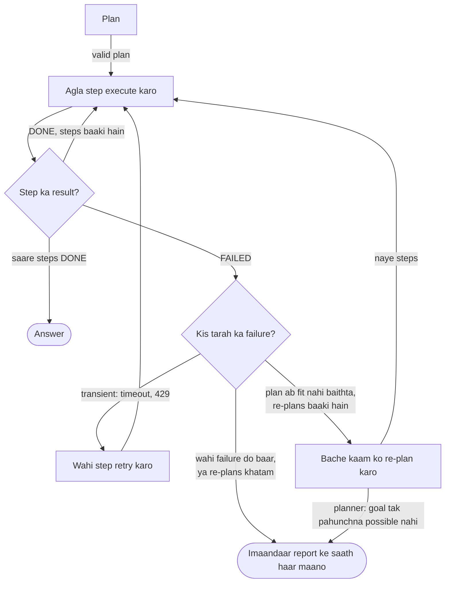

🏠 [Home](../../README.md) › [07 · Planning & Reasoning](./README.md) › 7.5 Jab kuch fail ho, tab re-planning

# 7.5 Jab kuch fail ho, tab re-planning

> **Level:** 🔴 Advanced · **Padhne ka time:** ~10 min · **Pehle padho:** [7.2 Plan-and-execute](./07.2-plan-and-execute.md), [7.3 Task decomposition](./07.3-task-decomposition.md), [2.5 Loop mein errors kaise sambhalein](../02-the-agent-loop/02.5-handling-errors-in-the-loop.md)

**Ek line mein:** Jab koi step fail hota hai, toh achha agent usko notice karta hai, jo kaam ho chuka hai usko rakhta hai, failure se jo seekha uske saath bache hue kaam ke liye planner se naya plan maangta hai, aur limits khatam hone pe imaandaari se haar maan leta hai.

📑 **Is page par**

- [Yeh kyun zaroori hai?](#-yeh-kyun-zaroori-hai)
- [Idea, simple words mein](#-idea-simple-words-mein)
- [Diagram se samjho](#-diagram-se-samjho)
- [Kaise kaam karta hai, step by step](#-kaise-kaam-karta-hai-step-by-step)
- [Example se samjho](#-example-se-samjho)
- [Code](#-code)
- [Aam galtiyan aur dhyan dene wali baatein](#-aam-galtiyan-aur-dhyan-dene-wali-baatein)
- [Yaad rakhne wali baatein](#-yaad-rakhne-wali-baatein)
- [Khud try karo](#-khud-try-karo)
- [Aur padhne ke liye](#-aur-padhne-ke-liye)

## 🤔 Yeh kyun zaroori hai?

Plans tab likhe jaate hain jab duniya ne abhi jawab nahi diya hota. Plan kehta hai *"check karo sabse sasta venue free hai"*; venue booked nikalta hai. Plan kehta hai *"config file padho"*; file kahin aur chali gayi hai. Bina recovery wala plan-and-execute agent ([7.2](./07.2-plan-and-execute.md)) pehle hi surprise pe ruk jaata hai. Jo agent aankh band karke retry karta hai, woh phir se usi deewar se takraata hai. Aur jo agent shuru se sab dobara karta hai, woh kaam kar chuke steps phenk deta hai aur unka paisa do baar bharta hai.

[Re-planning](../../GLOSSARY.md#re-planning) beech ka raasta hai: jo chala usko rakho, jo nahi chala usko badlo, aur pata ho ki kab rukna hai. Isi se plan-based agents demos ke bahar kaam ke layak bante hain.

## 🧠 Idea, simple words mein

Satnav (jaise Google Maps) tumhara ek turn miss hone pe journey ghar se dobara shuru nahi karta. Jitna chal chuke ho woh rakhta hai, jahan ho wahan se naya route nikalta hai, aur jo road abhi band mili usko avoid karta hai. Agar koi route hai hi nahi, toh tumhe bata deta hai.

Re-planning bhi aise hi kaam karti hai:

- Failure ko **notice** karo. Kisi ko toh bolna padega ki "is step ne apna done criterion poora nahi kiya".
- Khatam ho chuke steps aur unke results **rakho**.
- Bache hue kaam ko **re-plan** karo. Planner ko batao kya fail hua aur kyun, taaki naya plan problem ke around jaaye.
- Attempts ki **limit** rakho, aur limit khatam ho toh imaandaar report ke saath haar maan lo.

## 👀 Diagram se samjho



*Har failure ko naye plan ki zaroorat nahi hoti. Transient errors ko retry milta hai; jo plan ab duniya mein fit nahi baithta usko re-plan kiya jaata hai; baar-baar hone wale ya na-umeed failures run ko imaandaar report ke saath khatam karte hain.*

## 🔍 Kaise kaam karta hai, step by step

### 1. Failure pakdo

Ek step kai tarah se fail ho sakta hai, aur tumhare code ko har ek pakadna chahiye:

| Signal | Example | Kaise pakdein |
| --- | --- | --- |
| Executor khud bolta hai | `FAILED: Casa Azul is booked` | Har step report mein `DONE:`/`FAILED:` status zaroori rakho |
| Koi [tool](../../GLOSSARY.md#tool) error deta hai | Timeout, HTTP 500, unknown id | `is_error` tool results ([2.5](../02-the-agent-loop/02.5-handling-errors-in-the-loop.md)) |
| Done criterion poora nahi hua | Step "khatam" hua lekin koi total nahi bana | Result ka code check ([7.3](./07.3-task-decomposition.md)) |
| Budget khatam ho gaya | Bahut zyada tool turns, [tokens](../../GLOSSARY.md#token) ya seconds | Tumhare loop mein counters ([2.4](../02-the-agent-loop/02.4-stopping-conditions.md)) |
| Koi assumption toot gaya | Plan ne maana tha ek venue fit hoga; koi free nahi hai | Observations ko plan ke assumptions se match karo |

### 2. Decide karo: retry, re-plan ya haar maano

- **Transient** problems ke liye wahi step **retry** karo: timeouts, rate limits, ek flaky API. Backoff ke saath chhota retry budget rakho. Network ki ek chhoti si gadbad re-planning se theek nahi hoti.
- **Re-plan** tab karo jab **plan** duniya ki abhi wali haalat ke liye galat ho: koi resource available nahi, koi approach kaam nahi kar rahi, koi fact alag nikla.
- **Haar maano** jab wahi step wapas usi tarah fail ho, jab tumhare re-plans khatam ho gaye hon, ya jab planner khud bole ki goal tak nahi pahuncha ja sakta.

### 3. Sirf bacha hua kaam re-plan karo

Planner ko dobara call karo, aur yeh do:

- **goal**;
- **khatam ho chuke steps** unke results ke saath (taaki woh unpe id se build kar sake);
- **fail hua step** aur woh **kyun** fail hua.

Usko instruct karo: sirf jo bacha hai woh plan kare, khatam steps repeat na kare, fail hue step ko bina badle retry karne ki jagah approach badle, naye step ids use kare, aur agar goal tak pahunchna possible nahi toh `give_up` message ke saath reply kare. Naye plan ko bhi pehle wale ki tarah validate karo, bas khatam step ids pe dependencies allow karo.

### 4. Limits lagao

- **`max_replans`**: har run mein naye plans ki ek hard limit (2 ya 3 common hai).
- **Repeat detection**: wahi task wahi reason se do baar fail ho, matlab re-planner kuch seekh nahi raha; ruk jao.
- Saare plans milake steps, tokens aur time ka **ek total budget** ([16.5](../16-cost-and-performance/16.5-budget-limits-per-run.md)).
- **Escalation**: kuch failures naye plan ke paas nahi, insaan ke paas jaane chahiye, khaas kar irreversible actions se pehle ([9.6](../09-agent-design-patterns/09.6-human-in-the-loop.md)).

### 5. Runs ke beech seekho (optional)

Re-planning is run ko theek karti hai. Agli baar wahi failure rokne ke liye ek chhota lesson store karo ("Casa Azul December mein aksar booked rehta hai; do venues check karo") aur future runs mein planner ko do. [Reflexion (Shinn et al., 2023)](https://arxiv.org/abs/2303.11366) aise agents ko study karta hai jo failures ke baad aise verbal lessons likhte hain aur baad ke attempts mein improve karte hain; reflection chapter 08 mein hai.

## 💡 Example se samjho

7.2 wala offsite task, lekin **4 December** ko, jab sabse sasta venue pehle se booked hai. Scripted model replies aur real (fake-data) tools ke saath ek run:

```text
plan   s1: Find Lisbon venues that hold at least 12 people
plan   s2: Check the cheapest venue is free on 2026-12-04 (after s1)
plan   s3: Work out lunch for 12 people at EUR 25 each
plan   s4: Add venue rate and lunch, and compare with the EUR 1,500 budget (after s2, s3)
  tool search_venues({'city': 'Lisbon', 'min_capacity': 12}) -> [{"id": "v1", "name": "Casa Azul", "city": "Lisbon", "capacity": 15, "day_rat...
DONE   s1: Casa Azul (v1, EUR 900/day), LX Loft (v2, EUR 1,100/day) and Tejo Hall (v3, EUR 2,000/day) hold 12+.
  tool calculator({'expression': '12 * 25'}) -> 300
DONE   s3: Lunch costs EUR 300.
  tool check_availability({'venue_id': 'v1', 'date': '2026-12-04'}) -> {"venue_id": "v1", "date": "2026-12-04", "available": false}
FAILED s2: Casa Azul (v1) is already booked on 2026-12-04.
replan r1: Check the next cheapest venue, LX Loft (v2), is free on 2026-12-04 (after s1)
replan r2: Add LX Loft's rate and the lunch total, and compare with the EUR 1,500 budget (after r1, s3)
  tool check_availability({'venue_id': 'v2', 'date': '2026-12-04'}) -> {"venue_id": "v2", "date": "2026-12-04", "available": true}
DONE   r1: LX Loft (v2) is available on 2026-12-04 at EUR 1,100.
  tool calculator({'expression': '1100 + 300'}) -> 1400
DONE   r2: Total is EUR 1,400, which is EUR 100 under the EUR 1,500 budget.

Answer: Casa Azul is booked on 4 December, so pick LX Loft: EUR 1,100 for the venue plus EUR 300 for lunch makes EUR 1,400, EUR 100 under budget.
```

Step by step dekho:

1. **Pakda.** Tool ne `"available": false` return kiya, aur executor ne `FAILED:` report kiya kyunki step ka done criterion ("one available venue and its day rate are known") poora nahi hua.
2. **Rakha.** s1 (venue list) aur s3 (lunch total) pehle hi successful the. Woh khatam hi rehte hain aur **dobara nahi chalte**: poore trace mein sirf ek `search_venues` call hai.
3. **Re-plan.** Re-planner ko goal mila, s1 aur s3 ke results mile, aur yeh mila: *"FAILED step s2 (Check the cheapest venue is free on 2026-12-04): Casa Azul (v1) is already booked on 2026-12-04."* Uska naya plan approach badalta hai (agla sabse sasta venue try karo) aur s1 aur s3 ko id se reuse karta hai. Purana s4 chala gaya, uski jagah r2 aaya, jo ab LX Loft ki price use karta hai.
4. **Khatam.** Naye steps succeed hote hain aur answer venue badalne ki wajah samjhaata hai, taaki user ko pata ho ki yeh sabse sasta option kyun nahi hai.

Example ke tests bure raaste bhi cover karte hain: har venue booked (run khatam hota hai *"Gave up after 2 re-plans. Last failure: v3 is booked."* ke saath), planner ka `{"give_up": "..."}` reply, aur wahi step wahi tarah do baar fail hona.

## 💻 Code

Re-planner ke instructions aur limits ke saath run loop. [7.2](./07.2-plan-and-execute.md#-code) ki tarah, `self.llm` koi bhi chat-model client hai jiska `.chat()` `.text` wala reply deta hai, aur `user()` ek user message dict banata hai:

```python
REPLANNER_SYSTEM = """You are a planner. A step of the current plan has FAILED.
Write a new plan for the REMAINING work only.

- Do not repeat finished steps. New steps may list finished step ids in depends_on to use their results.
- Do not retry the failed step unchanged. Use what the failure tells you to change approach.
- Use new step ids (r1, r2, ...).
- If the goal cannot be reached with these tools, reply {"give_up": "<one-sentence reason>"}.

Reply with JSON only: {"steps": [{"id": "r1", "task": "...", "depends_on": [], "done_when": "..."}]}"""


def run(self, goal: str) -> str:
    self.finished = {}
    steps = self.plan(goal)
    seen_failures: set[tuple[str, str]] = set()
    for attempt in range(self.max_replans + 1):
        failed = self.execute(goal, steps)               # steps order mein chalata hai; khatam wale self.finished mein jaate hain
        if failed is None:
            break                                        # har step ho gaya
        signature = (failed.task.lower(), failed.result.lower())
        if signature in seen_failures:                   # wahi failure dobara: re-planning se fayda nahi ho raha
            return f"Gave up: step {failed.id} failed the same way twice ({failed.result})."
        seen_failures.add(signature)
        if attempt == self.max_replans:
            return f"Gave up after {self.max_replans} re-plans. Last failure: {failed.result}"
        try:
            steps = self.replan(goal, failed)            # goal + khatam results + failure aur uska reason
        except GiveUp as reason:
            return f"Gave up: {reason}"
    results = "\n".join(f"- {s.id} ({s.task}): {s.result}" for s in self.finished.values())
    return self.llm.chat([user(f"Goal: {goal}\n\nStep results:\n{results}")], system=ANSWER_SYSTEM).text
```

Example mein re-planner ko yeh prompt milta hai:

```text
Goal: Find a venue in Lisbon for our 12-person offsite on 2026-12-04. Total budget is EUR 1,500, ...

Finished steps:
- s1 (Find Lisbon venues that hold at least 12 people): Casa Azul (v1, EUR 900/day), LX Loft (v2, EUR 1,100/day) and Tejo Hall (v3, EUR 2,000/day) hold 12+.
- s3 (Work out lunch for 12 people at EUR 25 each): Lunch costs EUR 300.

FAILED step s2 (Check the cheapest venue is free on 2026-12-04): Casa Azul (v1) is already booked on 2026-12-04.
```

## 🚨 Aam galtiyan aur dhyan dene wali baatein

- **Har chhoti gadbad pe re-planning.** Timeout naye plan ki wajah nahi hai. Transient errors pehle retry karo; re-plan tab karo jab plan khud galat ho.
- **Shuru se dobara.** Khatam steps phenkne se paisa barbaad hota hai aur side effects repeat ho sakte hain (do emails, do bookings). Khatam kaam rakho aur re-planner ko do.
- **Planner ko *kyun* na batana.** "Step s2 failed" se wahi plan dobara aane ka chance hai. Reason aur woh observation bhi do jisse failure hua.
- **Koi limit nahi.** `max_replans` aur repeat detection ke bina agent hamesha re-plan karta reh sakta hai, har baar usi bekaar step ko thode alag words mein likh ke.
- **Chupke se goal badalna.** Jo re-plan chupke se goal ka hissa hata de ("budget ke andar venue nahi mila, toh budget ke bahar wala book kar diya"), woh fail hone se bhi bura hai. Re-planner se goal ke constraints rakhwao, aur koi bhi trade-off user ko batao.
- **Irreversible actions ke aas-paas re-planning.** Agar fail hue step ne pehle hi kuch kar diya (card charge kiya, message bheja), toh naye plan ko uska hisaab rakhna padega. Irreversible steps se pehle read-only checks prefer karo, aur shak ho toh insaan se pucho.

## ✅ Yaad rakhne wali baatein

- Failure ko saaf-saaf pakdo: step status, tool errors, done-criterion checks, budgets.
- Transient errors retry karo; plan duniya mein fit na baithe toh re-plan karo; koi umeed na ho toh haar maano.
- Sirf bacha hua kaam re-plan karo, khatam results aur failure reason ko input bana ke.
- Re-plans ki limit rakho, repeat failures pe ruko, aur planner ko bolne do ki goal tak nahi pahuncha ja sakta.
- User ko batao kya badla aur kyun; goal ka koi constraint chupke se mat hatao.

## 🧪 Khud try karo

1. Upar wale `run` loop mein maan lo `max_replans` 0 hai. Example wala run kya answer dega, aur kaunse behaviours kho doge (jo tumhare tests ko check karne chahiye)?
2. Har failure ko *retry*, *re-plan* ya *give up* mein classify karo: (a) venue API time out ho jaati hai; (b) Lisbon ke saare venues booked hain, aur user ne sirf Lisbon bola tha; (c) sabse sasta venue 10 logon ka hai, 12 ka nahi.

<details>
<summary>Answer dekho</summary>

1. Ab pehla failure hi run khatam kar deta hai: *"Gave up after 0 re-plans. Last failure: Casa Azul (v1) is already booked on 2026-12-04."* Re-plan wali har cheez kho jaati hai: aisa failure jo re-plan trigger kare aur phir succeed ho, re-planner ka khatam kaam aur failure dekhna, aur planner ka `give_up` bolne ka mauka. In teeno behaviours ke tests fail ho jayenge.
2. (a) **Retry**, backoff ke saath: plan theek hai, network nahi. (b) **Give up** (ideally planner `give_up` reply kare): agar har venue booked hai toh koi plan "sirf Lisbon" poora nahi kar sakta. Report karo aur options suggest karo, jaise koi aur date. (c) **Re-plan**: plan ka assumption galat tha, lekin koi aur venue fit ho sakta hai; `min_capacity=12` ke saath search karo aur agla check karo.

</details>

## 📚 Aur padhne ke liye

- [Reflexion: Language Agents with Verbal Reinforcement Learning](https://arxiv.org/abs/2303.11366) (Shinn et al., 2023). Aise agents jo failures ko agle attempt ke liye likhe hue lessons mein badalte hain.
- [ADaPT: As-Needed Decomposition and Planning with Language Models](https://arxiv.org/abs/2311.05772) (Prasad et al., 2023). Step fail ho toh usko aur todo aur dobara plan karo.
- [Building effective agents](https://www.anthropic.com/engineering/building-effective-agents) (Anthropic). Har step pe environment se "ground truth" lena, aur control rakhne ke liye stopping conditions.

<!-- FOOTER -->

---

⬅️ **Pichla:** [7.4 Tree-of-thoughts (ek overview)](./07.4-tree-of-thoughts.md) ·
🏠 [Chapter home](./README.md) ·
➡️ **Agla:** [08 · Reflection & Self-Correction → 8.1 Reflection pattern](../08-reflection-and-self-correction/08.1-the-reflection-pattern.md)
