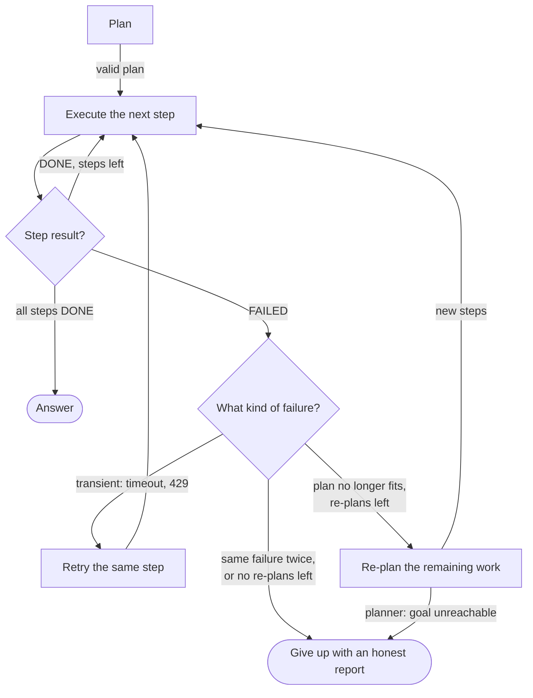

🏠 [Home](../../README.md) › [07 · Planning & Reasoning](./README.md) › 7.5 Re-planning when things fail

# 7.5 Re-planning when things fail

> **Difficulty:** 🔴 Advanced · **Reading time:** ~10 min · **Prerequisites:** [7.2 Plan-and-execute](./07.2-plan-and-execute.md), [7.3 Task decomposition](./07.3-task-decomposition.md), [2.5 Handling errors in the loop](../02-the-agent-loop/02.5-handling-errors-in-the-loop.md)

**In one sentence:** When a step fails, a good agent notices, keeps the work that succeeded, asks the planner for a new plan for what's left using what the failure taught it, and gives up honestly when limits are reached.

📑 **On this page**

- [Why does this matter?](#-why-does-this-matter)
- [The idea, in plain words](#-the-idea-in-plain-words)
- [Picture it](#-picture-it)
- [How it works, step by step](#-how-it-works-step-by-step)
- [Worked example](#-worked-example)
- [Code](#-code)
- [Common mistakes & gotchas](#-common-mistakes--gotchas)
- [Key takeaways](#-key-takeaways)
- [Try it yourself](#-try-it-yourself)
- [Further reading](#-further-reading)

## 🤔 Why does this matter?

Plans are written before the world answers back. The plan says *"check the cheapest venue is free"*; the venue is booked. The plan says *"read the config file"*; the file has moved. A plan-and-execute agent ([7.2](./07.2-plan-and-execute.md)) with no recovery stops at the first surprise. One that blindly retries hits the same wall again. One that starts over from scratch throws away the steps that worked and pays for them twice.

[Re-planning](../../GLOSSARY.md#re-planning) is the middle path: keep what worked, change what didn't, and know when to stop. It is what makes plan-based agents usable outside demos.

## 🧠 The idea, in plain words

A satnav doesn't restart your journey from home when you miss a turn. It keeps the distance you've driven, works out a new route from where you are, and avoids the road you just found closed. If there is no route at all, it tells you.

Re-planning works the same way:

- **Notice** the failure. Something has to say "this step did not meet its done criterion".
- **Keep** the finished steps and their results.
- **Re-plan** the remaining work, telling the planner what failed and why, so the new plan goes around the problem.
- **Limit** the attempts, and give up with an honest report when they run out.

## 👀 Picture it



*Not every failure needs a new plan. Transient errors get a retry; a plan that no longer fits the world gets re-planned; repeated or hopeless failures end the run with an honest report.*

## 🔍 How it works, step by step

### 1. Detect failure

A step can fail in several ways, and your code should catch each one:

| Signal | Example | How to detect |
| --- | --- | --- |
| The executor says so | `FAILED: Casa Azul is booked` | Require a `DONE:`/`FAILED:` status in every step report |
| A [tool](../../GLOSSARY.md#tool) errors | Timeout, HTTP 500, unknown id | `is_error` tool results ([2.5](../02-the-agent-loop/02.5-handling-errors-in-the-loop.md)) |
| The done criterion isn't met | The step "finished" but no total was produced | A code check of the result ([7.3](./07.3-task-decomposition.md)) |
| A budget runs out | Too many tool turns, [tokens](../../GLOSSARY.md#token) or seconds | Counters in your loop ([2.4](../02-the-agent-loop/02.4-stopping-conditions.md)) |
| An assumption breaks | The plan assumed one venue fits; none is free | Check observations against the plan's assumptions |

### 2. Decide: retry, re-plan or give up

- **Retry** the same step for **transient** problems: timeouts, rate limits, a flaky API. Use a small retry budget with backoff. Re-planning won't fix a network blip.
- **Re-plan** when the **plan** is wrong for the world as it now is: a resource is unavailable, an approach doesn't work, a fact turned out different.
- **Give up** when the same step fails the same way again, when you've used up your re-plans, or when the planner itself says the goal can't be reached.

### 3. Re-plan the remaining work only

Call the planner again with:

- the **goal**;
- the **finished steps** with their results (so it can build on them, by id);
- the **failed step** and the **reason** it failed.

Instruct it to plan only what's left, not to repeat finished steps, to change approach rather than retry the failed step unchanged, to use new step ids, and to reply with a `give_up` message if the goal is unreachable. Validate the new plan like the first one, allowing dependencies on finished step ids.

### 4. Enforce limits

- **`max_replans`**: a hard cap (2 or 3 is common) on new plans per run.
- **Repeat detection**: the same task failing with the same reason twice means the re-planner isn't learning; stop.
- **A total budget** for steps, tokens and time across all plans ([16.5](../16-cost-and-performance/16.5-budget-limits-per-run.md)).
- **Escalation**: some failures should go to a human, not to a new plan, especially before irreversible actions ([9.6](../09-agent-design-patterns/09.6-human-in-the-loop.md)).

### 5. Learn across runs (optional)

Re-planning fixes this run. To stop the same failure next time, store a short lesson ("Casa Azul is often booked in December; check two venues") and give it to the planner in future runs. [Reflexion (Shinn et al., 2023)](https://arxiv.org/abs/2303.11366) studies agents that write such verbal lessons after failures and improve on later attempts; chapter 08 covers reflection.

## 💡 Worked example

The offsite task from 7.2, but on **4 December**, when the cheapest venue is already booked. A run with scripted model replies and real (fake-data) tools:

```text
plan   s1: Find Lisbon venues that hold at least 12 people
plan   s2: Check the cheapest venue is free on 2026-12-04 (after s1)
plan   s3: Work out lunch for 12 people at EUR 25 each
plan   s4: Add venue rate and lunch, and compare with the EUR 1,500 budget (after s2, s3)
  tool search_venues({'city': 'Lisbon', 'min_capacity': 12}) -> [{"id": "v1", "name": "Casa Azul", "city": "Lisbon", "capacity": 15, "day_rat...
DONE   s1: Casa Azul (v1, EUR 900/day), LX Loft (v2, EUR 1,100/day) and Tejo Hall (v3, EUR 2,000/day) hold 12+.
  tool calculator({'expression': '12 * 25'}) -> 300
DONE   s3: Lunch costs EUR 300.
  tool check_availability({'venue_id': 'v1', 'date': '2026-12-04'}) -> {"venue_id": "v1", "date": "2026-12-04", "available": false}
FAILED s2: Casa Azul (v1) is already booked on 2026-12-04.
replan r1: Check the next cheapest venue, LX Loft (v2), is free on 2026-12-04 (after s1)
replan r2: Add LX Loft's rate and the lunch total, and compare with the EUR 1,500 budget (after r1, s3)
  tool check_availability({'venue_id': 'v2', 'date': '2026-12-04'}) -> {"venue_id": "v2", "date": "2026-12-04", "available": true}
DONE   r1: LX Loft (v2) is available on 2026-12-04 at EUR 1,100.
  tool calculator({'expression': '1100 + 300'}) -> 1400
DONE   r2: Total is EUR 1,400, which is EUR 100 under the EUR 1,500 budget.

Answer: Casa Azul is booked on 4 December, so pick LX Loft: EUR 1,100 for the venue plus EUR 300 for lunch makes EUR 1,400, EUR 100 under budget.
```

Step by step:

1. **Detect.** The tool returned `"available": false`, and the executor reported `FAILED:` because the step's done criterion ("one available venue and its day rate are known") wasn't met.
2. **Keep.** s1 (the venue list) and s3 (lunch total) had already succeeded. They stay finished and are **not rerun**: there is only one `search_venues` call in the whole trace.
3. **Re-plan.** The re-planner received the goal, the finished results of s1 and s3, and *"FAILED step s2 (Check the cheapest venue is free on 2026-12-04): Casa Azul (v1) is already booked on 2026-12-04."* Its new plan changes approach (try the next cheapest venue) and reuses s1 and s3 by id. The old s4 is gone, replaced by r2, which now uses LX Loft's price.
4. **Finish.** The new steps succeed and the answer explains the change of venue, so the user knows why it isn't the cheapest option.

The example's tests also cover the unhappy paths: every venue booked (the run ends with *"Gave up after 2 re-plans. Last failure: v3 is booked."*), the planner replying `{"give_up": "..."}`, and the same step failing the same way twice.

## 💻 Code

The re-planner's instructions and the run loop with its limits. As in [7.2](./07.2-plan-and-execute.md#-code), `self.llm` is any chat-model client whose `.chat()` returns a reply with `.text`, and `user()` builds a user message dict:

```python
REPLANNER_SYSTEM = """You are a planner. A step of the current plan has FAILED.
Write a new plan for the REMAINING work only.

- Do not repeat finished steps. New steps may list finished step ids in depends_on to use their results.
- Do not retry the failed step unchanged. Use what the failure tells you to change approach.
- Use new step ids (r1, r2, ...).
- If the goal cannot be reached with these tools, reply {"give_up": "<one-sentence reason>"}.

Reply with JSON only: {"steps": [{"id": "r1", "task": "...", "depends_on": [], "done_when": "..."}]}"""


def run(self, goal: str) -> str:
    self.finished = {}
    steps = self.plan(goal)
    seen_failures: set[tuple[str, str]] = set()
    for attempt in range(self.max_replans + 1):
        failed = self.execute(goal, steps)               # runs steps in order; finished ones go into self.finished
        if failed is None:
            break                                        # every step done
        signature = (failed.task.lower(), failed.result.lower())
        if signature in seen_failures:                   # the same failure again: re-planning isn't helping
            return f"Gave up: step {failed.id} failed the same way twice ({failed.result})."
        seen_failures.add(signature)
        if attempt == self.max_replans:
            return f"Gave up after {self.max_replans} re-plans. Last failure: {failed.result}"
        try:
            steps = self.replan(goal, failed)            # goal + finished results + the failure and its reason
        except GiveUp as reason:
            return f"Gave up: {reason}"
    results = "\n".join(f"- {s.id} ({s.task}): {s.result}" for s in self.finished.values())
    return self.llm.chat([user(f"Goal: {goal}\n\nStep results:\n{results}")], system=ANSWER_SYSTEM).text
```

The prompt the re-planner receives in the worked example:

```text
Goal: Find a venue in Lisbon for our 12-person offsite on 2026-12-04. Total budget is EUR 1,500, ...

Finished steps:
- s1 (Find Lisbon venues that hold at least 12 people): Casa Azul (v1, EUR 900/day), LX Loft (v2, EUR 1,100/day) and Tejo Hall (v3, EUR 2,000/day) hold 12+.
- s3 (Work out lunch for 12 people at EUR 25 each): Lunch costs EUR 300.

FAILED step s2 (Check the cheapest venue is free on 2026-12-04): Casa Azul (v1) is already booked on 2026-12-04.
```

## 🚨 Common mistakes & gotchas

- **Re-planning on every hiccup.** A timeout is not a reason for a new plan. Retry transient errors first; re-plan when the plan itself is wrong.
- **Starting over.** Throwing away finished steps wastes money and can repeat side effects (two emails, two bookings). Keep finished work and pass it to the re-planner.
- **Not telling the planner *why*.** "Step s2 failed" invites the same plan again. Include the reason and the observation that caused it.
- **No limits.** Without `max_replans` and repeat detection, an agent can re-plan forever, each time with a slightly reworded version of the same doomed step.
- **Silent goal changes.** A re-plan that quietly drops part of the goal ("couldn't find a venue under budget, so I booked one over budget") is worse than failing. Make the re-planner keep the goal's constraints, and report any trade-off to the user.
- **Re-planning around irreversible actions.** If a failed step already did something (charged a card, sent a message), the new plan must account for it. Prefer read-only checks before irreversible steps, and ask a human when in doubt.

## ✅ Key takeaways

- Detect failure explicitly: step status, tool errors, done-criterion checks, budgets.
- Retry transient errors; re-plan when the plan no longer fits the world; give up when it's hopeless.
- Re-plan the remaining work only, with the finished results and the failure reason as input.
- Cap re-plans, stop on repeated failures, and let the planner say the goal is unreachable.
- Tell the user what changed and why; never drop a goal constraint silently.

## 🧪 Try it yourself

1. In the `run` loop above, suppose `max_replans` is 0. What would the worked example's run answer, and which behaviours would you lose (the ones your tests should check)?
2. Classify each failure as *retry*, *re-plan* or *give up*: (a) the venue API times out; (b) all venues in Lisbon are booked, and the user said Lisbon only; (c) the cheapest venue holds 10 people, not 12.

<details>
<summary>Show answer</summary>

1. The first failure now ends the run: *"Gave up after 0 re-plans. Last failure: Casa Azul (v1) is already booked on 2026-12-04."* You lose everything that needs a re-plan: a failure that triggers a re-plan which then succeeds, the re-planner seeing finished work and the failure, and the planner's chance to say `give_up`. Tests for those three behaviours would all fail.
2. (a) **Retry**, with backoff: the plan is fine, the network isn't. (b) **Give up** (ideally the planner replies `give_up`): no plan can meet "Lisbon only" if every venue is booked. Report it and suggest options, such as another date. (c) **Re-plan**: the plan's assumption was wrong, but another venue may fit; search with `min_capacity=12` and check the next one.

</details>

## 📚 Further reading

- [Reflexion: Language Agents with Verbal Reinforcement Learning](https://arxiv.org/abs/2303.11366) (Shinn et al., 2023). Agents that turn failures into written lessons for their next attempt.
- [ADaPT: As-Needed Decomposition and Planning with Language Models](https://arxiv.org/abs/2311.05772) (Prasad et al., 2023). When a step fails, decompose it further and plan again.
- [Building effective agents](https://www.anthropic.com/engineering/building-effective-agents) (Anthropic). Getting "ground truth" from the environment at each step, and stopping conditions to keep control.

<!-- FOOTER -->

---

⬅️ **Previous:** [7.4 Tree-of-thoughts (overview)](./07.4-tree-of-thoughts.md) ·
🏠 [Chapter home](./README.md) ·
➡️ **Next:** [08 · Reflection & Self-Correction → 8.1 The reflection pattern](../08-reflection-and-self-correction/08.1-the-reflection-pattern.md)
