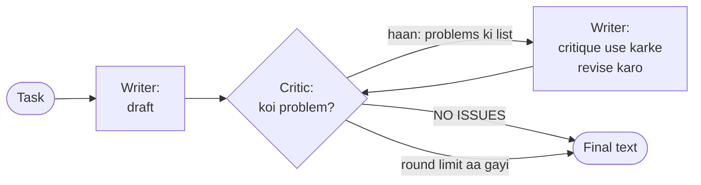
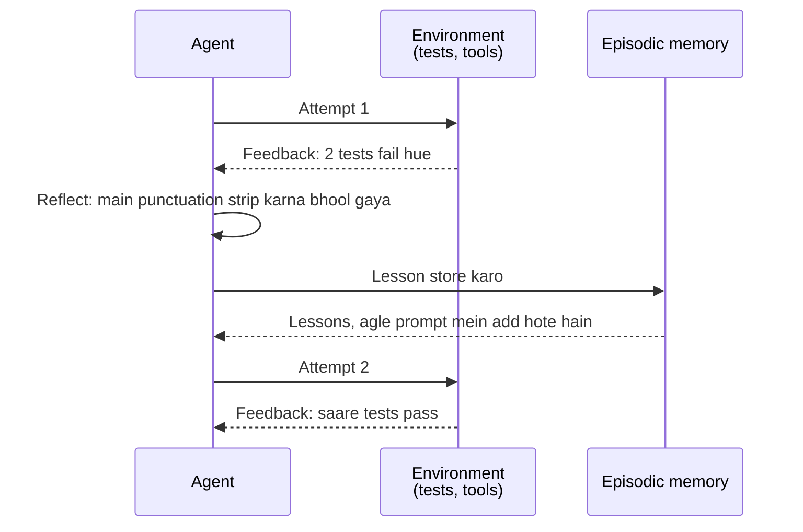

🏠 [Home](../../README.md) › [08 · Reflection & Self-Correction](./README.md) › 8.1 Reflection pattern

# 8.1 Reflection pattern

> **Level:** 🟡 Intermediate · **Padhne ka time:** ~8 min · **Pehle padho:** [1.4 LLMs kaise kaam karte hain (bas utna jitna zaroori hai)](../01-foundations/01.4-how-llms-work.md), [1.5 Agent ke andar kya-kya hota hai](../01-foundations/01.5-anatomy-of-an-agent.md)

**Ek line mein:** Reflection ka matlab hai model se ek answer ka draft likhwana, us draft ki critique karwana, aur phir usko revise karwana, taaki kisi ke dekhne se pehle output pe ek doosri nazar pad jaaye.

📑 **Is page par**

- [Yeh kyun zaroori hai?](#-yeh-kyun-zaroori-hai)
- [Idea, simple words mein](#-idea-simple-words-mein)
- [Diagram se samjho](#-diagram-se-samjho)
- [Kaise kaam karta hai, step by step](#-kaise-kaam-karta-hai-step-by-step)
- [Example se samjho](#-example-se-samjho)
- [Code](#-code)
- [Aam galtiyan aur dhyan dene wali baatein](#-aam-galtiyan-aur-dhyan-dene-wali-baatein)
- [Yaad rakhne wali baatein](#-yaad-rakhne-wali-baatein)
- [Khud try karo](#-khud-try-karo)
- [Aur padhne ke liye](#-aur-padhne-ke-liye)

## 🤔 Yeh kyun zaroori hai?

Model se apne budgeting app ke liye ek release note likhwao, aur shayad yeh mile: *"v2.3: Fixed a race condition in the CSV serializer that caused zero-byte exports."* Yeh sahi hai. Lekin customer ke liye bekaar hai. Usko nahi pata serializer kya hota hai, aur ab bhi nahi pata ki usko kuch karna hai ya nahi.

Ek insaan writer isko doosri baar padhte hi pakad leta. Models aam taur pe ek hi baar mein likhte hain: har [token](../../GLOSSARY.md#token) ek hi baar, left se right chuna jaata hai ([1.4](../01-foundations/01.4-how-llms-work.md)), aur koi wapas jaake result check nahi karta. Reflection pattern yahi doosri reading add karta hai. Isme kuch extra model calls lagti hain. Aur writing, formatting aur checklist jaisi quality problems mein yeh aksar wahi galtiyan pakad leta hai jo ek reviewer pakadta.

## 🧠 Idea, simple words mein

Ek zaroori email likhne ke baare mein socho. Tum draft likhte ho, phir usko *padhne wale ki nazar se* dobara padhte ho: "Kya mere manager ko yeh samajh aayega? Maine jo chahiye woh bola?" Problems note karte ho, theek karte ho, aur shayad ek baar aur padhte ho.

Ya school ka woh time yaad karo jab exam mein answer likhne ke baad aakhri 10 minute "revision" ke liye rakhte the. Wahi revision model ke liye reflection hai.

[Reflection](../../GLOSSARY.md#reflection) model ko yahi aadat deta hai, do roles ke saath:

- ek **writer** jo draft banata hai aur baad mein usko revise karta hai, aur
- ek **critic** jo draft ko ek checklist ke against padhta hai aur concrete problems list karta hai, ya bolta hai ki koi problem nahi hai.

Dono roles same model ho sakte hain, bas alag [system prompts](../../GLOSSARY.md#system-prompt) ke saath. Tumhara code loop chalata hai: draft, critique, revise, phir critique, aur tab ruko jab critic satisfied ho ya round limit aa jaye.

Do research papers ne is idea ko popular banaya:

- **Self-Refine** ([Madaan et al., 2023](https://arxiv.org/abs/2303.17651)) ek hi [LLM](../../GLOSSARY.md#large-language-model-llm) ko generator, feedback dene wala aur refiner teeno banata hai, aur feedback aur refinement baar-baar karta hai. Dialogue se le kar maths tak, saat tasks pe authors report karte hain ki humans aur automatic metrics dono ne in outputs ko prefer kiya, aur yeh one-step generation se average mein lagbhag 20% (absolute) better the.
- **Reflexion** ([Shinn et al., 2023](https://arxiv.org/abs/2303.11366)) [agents](../../GLOSSARY.md#agent) ke liye hai. Kisi task pe fail hue attempt ke baad agent feedback signal padhta hai (jaise failing tests, [tool](../../GLOSSARY.md#tool) errors ya task reward), ek chhota verbal "lesson" likhta hai, aur usko episodic memory mein store karta hai. Agle attempt pe yeh lessons prompt mein jaate hain. Paper HumanEval coding benchmark pe 91% pass@1 report karta hai, jabki us waqt GPT-4 ka 80% tha.

Fark dhyan se dekho. Self-Refine ka critic model ki apni raay hai. Reflexion aam taur pe bahar ki duniya se aaye signal pe reflect karta hai. Yeh fark bahut matter karta hai, aur kyun, yeh [8.4](./08.4-limits-of-self-correction.md) mein dikhaya gaya hai.

## 👀 Diagram se samjho



*Loop mein naya information sirf critique hai. Agar critic problem nahi dekh sakta, toh revise karne se woh theek nahi hogi. Doosra exit bhi dekho: critic kabhi satisfied na ho tab bhi loop hamesha khatam hota hai.*

### Reflexion, agent wala version



*Reflexion failure signal ko ek aise sentence mein badalta hai jo model agli baar use kar sake. Memory bas prompt mein text hai ([5.4](../05-memory/05.4-episodic-semantic-and-procedural-memory.md)); model ke weights nahi badalte.*

## 🔍 Kaise kaam karta hai, step by step

1. **Draft.** Model ko task aur writer prompt ke saath call karo. Draft rakh lo.
2. **Nayi conversation mein critique.** Task aur draft ko critic prompt ke saath model ko bhejo. Writer ki history mat daalo: jo critic apni hi reasoning dekhta hai, woh usko defend karne lagta hai. Critic ko ek **checklist** do (koi jargon nahi, batata ho ki user ko kya karna hai, zyada se zyada do sentences). "Kya yeh achha hai?" puchoge toh gol-mol taareef milegi; checklist doge toh specific problems milengi.
3. **Machine se check hone wala verdict maango.** Critic ya toh fixed format mein problems list kare, ya exactly `NO ISSUES` reply kare. Tumhara code is string ko strictly check kare: "No issues, but the second sentence is long" clean *nahi* hai.
4. **Revise.** Writer ko task, uska pichla draft aur critique bhejo, aur ek naya version maango jo har point theek kare.
5. **Limit ke saath repeat karo.** Step 2 pe wapas jao. Tab ruko jab critique clean ho ya fixed rounds ho jayein (do ya teen typical hai). Kisi bhi loop ki tarah isko bhi stopping condition chahiye ([2.4](../02-the-agent-loop/02.4-stopping-conditions.md)).
6. **History rakho.** Har draft aur critique store karo. Yeh tumhara sabse achha debugging tool hai, aur isse tum measure kar sakte ho ki reflection help kar bhi raha hai ya nahi.

## 💡 Example se samjho

Scripted replies ke saath ek run aisa dikhta hai:

```text
Task: Write a release note for version 2.3. It fixes the bug where CSV exports were sometimes empty.

--- draft 1
v2.3: Fixed a race condition in the CSV serializer that caused zero-byte exports.

--- critique 1
- Jargon: 'race condition', 'serializer' and 'zero-byte' mean nothing to most users.
- Does not say what the user should do if an earlier export was empty.

--- draft 2
Version 2.3 fixes a problem that sometimes made exported spreadsheets (CSV files) empty. If an export you made recently was blank, please export it again.

--- critique 2
NO ISSUES

Stopped: critic found no issues. Model calls: 4
```

Kya hua:

| Call | Role | Usne kya dekha | Usne kya banaya |
| --- | --- | --- | --- |
| 1 | Writer | Task | Developer jargon se bhara draft |
| 2 | Critic | Task + draft 1, checklist prompt | Do specific problems, har ek kisi checklist item se juda |
| 3 | Writer | Task + draft 1 + critique | Simple language wala draft, user ke liye ek action ke saath |
| 4 | Critic | Task + draft 2 | `NO ISSUES`, toh loop ruk jaata hai |

Ek ki jagah chaar calls. Hazaaron users jo release note dekhenge, uske liye yeh sasta hai. Ek internal log line ke liye yeh worth it nahi hai.

## 💻 Code

Anthropic SDK ke saath plain Python mein loop, taaki kuch bhi chhupa na rahe (`ANTHROPIC_API_KEY` chahiye):

```python
import anthropic

client = anthropic.Anthropic()

def ask(system: str, prompt: str) -> str:
    resp = client.messages.create(
        model="claude-opus-5-5", max_tokens=2000, system=system,
        messages=[{"role": "user", "content": prompt}],  # har baar ek nayi conversation
    )
    return "".join(b.text for b in resp.content if b.type == "text").strip()

WRITER = "You write short release notes for non-technical users. Reply with the note only."
CRITIC = ("Review this release note for NON-TECHNICAL users: (1) no jargon, (2) says what changed, "
          "(3) says what the user should do, (4) at most two sentences. List problems as '- ...' lines, "
          "or reply exactly: NO ISSUES")

def reflect(task: str, max_rounds: int = 3) -> str:
    draft = ask(WRITER, task)
    for _ in range(max_rounds):
        critique = ask(CRITIC, f"Task:\n{task}\n\nRelease note:\n{draft}")
        if critique.rstrip(".").upper() == "NO ISSUES":   # strict, machine se check hone wala verdict
            break
        draft = ask(WRITER, f"Task:\n{task}\n\nPrevious draft:\n{draft}\n\n"
                            f"Problems found:\n{critique}\n\nRewrite it to fix every problem.")
    return draft
```

OpenAI ke saath `ask()` ban jaata hai `client.chat.completions.create(model=..., messages=[{"role": "system", ...}, {"role": "user", ...}])`; loop bilkul same rehta hai. Real system mein har draft aur critique record bhi karo, aur loop ko ek scripted fake model ke saath test karo.

## 🚨 Aam galtiyan aur dhyan dene wali baatein

- **Vague critic.** "Isko review karo aur improvements suggest karo" hamesha *kuch na kuch* dhundh leta hai, toh loop kabhi converge nahi hota, aur text bhatakta jaata hai. **Fix:** ek chhoti, specific checklist, aur ek saaf "koi problem nahi" answer.
- **Critic ko writer ki conversation dikhana.** Woh writer ki reasoning pe atak jaata hai. **Fix:** nayi conversation mein critique karo, sirf task aur draft ke saath.
- **Koi round limit nahi.** **Fix:** do ya teen rounds, phir latest draft return karo aur log karo ki woh kabhi pass nahi hua.
- **Aise facts pe reflect karna jo model check nahi kar sakta.** Critic jargon ya missing call to action pakad sakta hai. Woh yeh nahi bata sakta ki "version 2.3" sahi version number hai ya nahi. Bina naye information ke self-critique facts aur reasoning ke liye kamzor hai ([8.4](./08.4-limits-of-self-correction.md)). **Fix:** jo bhi check ho sakta hai, uske liye real signal use karo: tests, schema, lookup ([8.3](./08.3-self-critique-with-tests.md)).
- **Requirements sirf critic mein daalna.** Agar writer ko kabhi bola hi nahi gaya "no jargon", toh tum ek aise round ka paisa doge jo achhe pehle prompt se bach jaata. **Fix:** writer ko bhi wahi checklist do; critic ko usko enforce karne do.
- **Kabhi measure na karna.** Reflection hamesha zyada cost karta hai; hamesha help nahi karta. **Fix:** examples ke set pe single call se compare karo ([chapter 12](../12-evaluation/README.md)).

## ✅ Yaad rakhne wali baatein

- Reflection = draft, critique, revise, round limit ke saath.
- Critic ko ek concrete checklist aur ek strict "no issues" answer chahiye jo code check kar sake.
- Critique nayi conversation mein karo, taaki critic text ko judge kare, apni reasoning ko nahi.
- Self-Refine model ka apna feedback use karta hai; Reflexion bahar ke feedback ko agle attempt ke liye stored lessons mein badalta hai.
- Yeh un quality problems ke liye best hai jo reader ko text mein dikhti hain, un facts ke liye nahi jo model verify nahi kar sakta.

## 🧪 Khud try karo

1. Maan lo upar wale loop ka critic kabhi `NO ISSUES` reply nahi karta, aur tum `reflect(TASK, max_rounds=2)` call karte ho. Kitni model calls hongi, aur kaunsa draft return hoga?
2. Tumhara critic aksar reply karta hai "No issues. Maybe shorten the second sentence." Tumhara code isko kaise treat kare, aur tum prompt kaise badloge?
3. Kya tum us agent step mein reflection add karoge jo user ke sawal ko SQL query mein badalta hai? Critic ki jagah, ya uske saath, kya use karoge?

<details>
<summary>Answer dekho</summary>

1. Paanch calls: ek draft, phir critique aur revision ke do rounds. Latest revision return hota hai. Snippet yeh nahi batata ki woh kyun ruka, isliye practice mein ek reason bhi return ya log karo, jaise `"hit max_rounds=2"`, taaki tum usko flag kar sako, aur exactly isi case ke liye ek test likho.
2. Clean *nahi* maano: critic ne ek problem ka naam liya hai. Isi wajah se upar `reflect()` ka check strict hai. Prompt mein critic ko bolo ki ya toh problems list kare ya exactly `NO ISSUES` reply kare aur kuch nahi. Aur decide karo ki "maybe" wale suggestions count hote hain ya nahi (aam taur pe woh checklist mein nahi hone chahiye).
3. Yahan sirf critic kamzor hai, kyunki jo problems matter karti hain (galat column, galat join) woh padh ke dikhna mushkil hai. Better: query ko read-only copy pe chalao ya `EXPLAIN` use karo, schema check karo, aur real errors wapas do. Yeh external signals ke saath self-critique hai ([8.3](./08.3-self-critique-with-tests.md)). Critic phir bhi style rules check kar sakta hai, jaise "hamesha `LIMIT` use karo".

</details>

## 📚 Aur padhne ke liye

- [Self-Refine: Iterative Refinement with Self-Feedback](https://arxiv.org/abs/2303.17651) (Madaan et al., 2023). Original draft–feedback–refine paper, saat tasks ke saath.
- [Reflexion: Language Agents with Verbal Reinforcement Learning](https://arxiv.org/abs/2303.11366) (Shinn et al., 2023). Agents ke liye reflection, jisme lessons episodic memory mein store hote hain.
- [Large Language Models Cannot Self-Correct Reasoning Yet](https://arxiv.org/abs/2310.01798) (Huang et al., 2023). Zaroori doosra paksh; reasoning ke liye reflection pe bharosa karne se pehle isko padho.
- [Building effective agents](https://www.anthropic.com/engineering/building-effective-agents) (Anthropic). Generate-and-critique loops ko baaki agent patterns ke beech jagah deta hai.

<!-- FOOTER -->

---

⬅️ **Pichla:** [7.5 Jab kuch fail ho, tab re-planning](../07-planning-and-reasoning/07.5-re-planning-when-things-fail.md) ·
🏠 [Chapter home](./README.md) ·
➡️ **Agla:** [8.2 Evaluator–optimizer loop](./08.2-evaluator-optimizer-loop.md)
