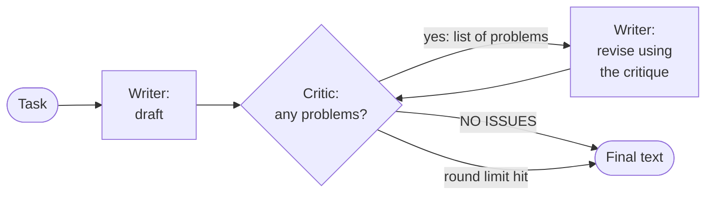
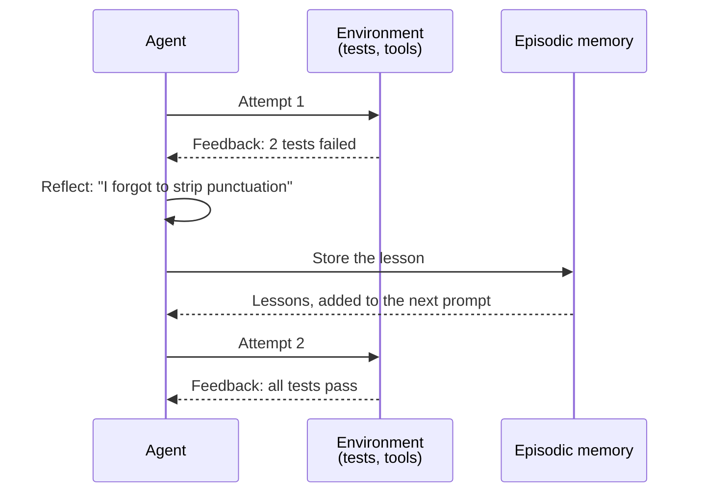

🏠 [Home](../../README.md) › [08 · Reflection & Self-Correction](./README.md) › 8.1 The reflection pattern

# 8.1 The reflection pattern

> **Difficulty:** 🟡 Intermediate · **Reading time:** ~8 min · **Prerequisites:** [1.4 How LLMs work](../01-foundations/01.4-how-llms-work.md), [1.5 Anatomy of an agent](../01-foundations/01.5-anatomy-of-an-agent.md)

**In one sentence:** Reflection means asking a model to draft an answer, critique that draft, and revise it, so the output gets a second look before anyone sees it.

📑 **On this page**

- [Why does this matter?](#-why-does-this-matter)
- [The idea, in plain words](#-the-idea-in-plain-words)
- [Picture it](#-picture-it)
- [How it works, step by step](#-how-it-works-step-by-step)
- [Worked example](#-worked-example)
- [Code](#-code)
- [Common mistakes & gotchas](#-common-mistakes--gotchas)
- [Key takeaways](#-key-takeaways)
- [Try it yourself](#-try-it-yourself)
- [Further reading](#-further-reading)

## 🤔 Why does this matter?

Ask a model to write a release note for your budgeting app and you might get: *"v2.3: Fixed a race condition in the CSV serializer that caused zero-byte exports."* It is accurate. It is also useless to a customer, who doesn't know what a serializer is and still doesn't know whether to do anything.

A human writer would catch this on a second read. Models usually write in one pass: each [token](../../GLOSSARY.md#token) is chosen once, left to right ([1.4](../01-foundations/01.4-how-llms-work.md)), and nothing goes back to check the result. The reflection pattern adds that second read. It costs a few extra model calls, and for writing, formatting and checklist-style quality problems it often catches exactly the mistakes a reviewer would.

## 🧠 The idea, in plain words

Think of writing an important email. You write a draft, then you reread it *as the recipient*: "Would my manager understand this? Did I say what I need?" You note the problems, fix them, and maybe reread once more.

[Reflection](../../GLOSSARY.md#reflection) gives a model the same habit, with two roles:

- a **writer** that produces a draft and later revises it, and
- a **critic** that reads the draft against a checklist and lists concrete problems, or says there are none.

Both roles can be the same model with different [system prompts](../../GLOSSARY.md#system-prompt). Your code runs the loop: draft, critique, revise, critique again, and stop when the critic is satisfied or a round limit is reached.

Two research papers made this idea popular:

- **Self-Refine** ([Madaan et al., 2023](https://arxiv.org/abs/2303.17651)) uses one [LLM](../../GLOSSARY.md#large-language-model-llm) as generator, feedback provider and refiner, repeating feedback and refinement. Across seven tasks, from dialogue to maths, the authors report outputs preferred by humans and automatic metrics, about 20% better on average (absolute) than one-step generation.
- **Reflexion** ([Shinn et al., 2023](https://arxiv.org/abs/2303.11366)) is aimed at [agents](../../GLOSSARY.md#agent). After a failed attempt at a task, the agent reads the feedback signal (for example, failing tests, [tool](../../GLOSSARY.md#tool) errors or a task reward), writes a short verbal "lesson", and stores it in an episodic memory. On the next attempt, those lessons go into the prompt. The paper reports 91% pass@1 on the HumanEval coding benchmark, against 80% for GPT-4 at the time.

Notice the difference. Self-Refine's critic is the model's own opinion. Reflexion usually reflects on a signal from the outside world. That difference matters a lot, and [8.4](./08.4-limits-of-self-correction.md) shows why.

## 👀 Picture it



*The critique is the only new information in the loop. If the critic can't spot a problem, revising won't fix it. Note the second exit: the loop always ends, even if the critic is never satisfied.*

### Reflexion, the agent version



*Reflexion turns a failure signal into a sentence the model can use next time. The memory is just text in the prompt ([5.4](../05-memory/05.4-episodic-semantic-and-procedural-memory.md)); no model weights change.*

## 🔍 How it works, step by step

1. **Draft.** Call the model with the task and a writer prompt. Keep the draft.
2. **Critique in a fresh conversation.** Send the task and the draft to the model with a critic prompt. Don't include the writer's history: a critic that sees its own reasoning tends to defend it. Give the critic a **checklist** (no jargon, says what the user should do, at most two sentences). "Is this good?" gets vague praise; a checklist gets specific problems.
3. **Ask for a machine-checkable verdict.** The critic must either list problems in a fixed format or reply exactly `NO ISSUES`. Your code checks that string, strictly: "No issues, but the second sentence is long" is *not* clean.
4. **Revise.** Send the writer the task, its previous draft and the critique, and ask for a new version that fixes every point.
5. **Repeat with a limit.** Go back to step 2. Stop when the critique is clean or after a fixed number of rounds (two or three is typical). Like any loop, it needs a stopping condition ([2.4](../02-the-agent-loop/02.4-stopping-conditions.md)).
6. **Keep the history.** Store every draft and critique. It's your best debugging tool, and it lets you measure whether reflection is helping at all.

## 💡 Worked example

From [`examples/08-reflection`](../../examples/08-reflection/README.md), run offline with scripted replies:

```text
Task: Write a release note for version 2.3. It fixes the bug where CSV exports were sometimes empty.

--- draft 1
v2.3: Fixed a race condition in the CSV serializer that caused zero-byte exports.

--- critique 1
- Jargon: 'race condition', 'serializer' and 'zero-byte' mean nothing to most users.
- Does not say what the user should do if an earlier export was empty.

--- draft 2
Version 2.3 fixes a problem that sometimes made exported spreadsheets (CSV files) empty. If an export you made recently was blank, please export it again.

--- critique 2
NO ISSUES

Stopped: critic found no issues. Model calls: 4
```

What happened:

| Call | Role | What it saw | What it produced |
| --- | --- | --- | --- |
| 1 | Writer | The task | A draft full of developer jargon |
| 2 | Critic | Task + draft 1, checklist prompt | Two specific problems, each tied to a checklist item |
| 3 | Writer | Task + draft 1 + critique | A plain-language draft with an action for the user |
| 4 | Critic | Task + draft 2 | `NO ISSUES`, so the loop stops |

Four calls instead of one. For a release note seen by thousands of users, that is cheap. For an internal log line, it isn't worth it.

## 💻 Code

The loop in plain Python with the Anthropic SDK, so nothing is hidden (needs `ANTHROPIC_API_KEY`):

```python
import anthropic

client = anthropic.Anthropic()

def ask(system: str, prompt: str) -> str:
    resp = client.messages.create(
        model="claude-opus-5-5", max_tokens=2000, system=system,
        messages=[{"role": "user", "content": prompt}],  # a fresh conversation every time
    )
    return resp.content[0].text.strip()

WRITER = "You write short release notes for non-technical users. Reply with the note only."
CRITIC = ("Review this release note for NON-TECHNICAL users: (1) no jargon, (2) says what changed, "
          "(3) says what the user should do, (4) at most two sentences. List problems as '- ...' lines, "
          "or reply exactly: NO ISSUES")

def reflect(task: str, max_rounds: int = 3) -> str:
    draft = ask(WRITER, task)
    for _ in range(max_rounds):
        critique = ask(CRITIC, f"Task:\n{task}\n\nRelease note:\n{draft}")
        if critique.rstrip(".").upper() == "NO ISSUES":   # strict, machine-checkable verdict
            break
        draft = ask(WRITER, f"Task:\n{task}\n\nPrevious draft:\n{draft}\n\n"
                            f"Problems found:\n{critique}\n\nRewrite it to fix every problem.")
    return draft
```

With OpenAI, `ask()` becomes `client.chat.completions.create(model=..., messages=[{"role": "system", ...}, {"role": "user", ...}])`; the loop is identical. The runnable version uses the shared wrapper, records every draft and critique, and has tests: [`examples/08-reflection/main.py`](../../examples/08-reflection/main.py).

## 🚨 Common mistakes & gotchas

- **A vague critic.** "Review this and suggest improvements" always finds *something*, so the loop never converges, and the text drifts. **Fix:** a short, specific checklist, and an explicit "no problems" answer.
- **Letting the critic see the writer's conversation.** It anchors on the writer's reasoning. **Fix:** critique in a fresh conversation with only the task and the draft.
- **No round limit.** **Fix:** two or three rounds, then return the latest draft and log that it never passed.
- **Reflecting on facts the model can't check.** A critic can spot jargon or a missing call to action. It can't tell whether "version 2.3" is the right version number. Self-critique without new information is weak for facts and reasoning ([8.4](./08.4-limits-of-self-correction.md)). **Fix:** for anything checkable, use a real signal: tests, a schema, a lookup ([8.3](./08.3-self-critique-with-tests.md)).
- **Putting requirements only in the critic.** If the writer is never told "no jargon", you pay for a round that a better first prompt would have avoided. **Fix:** give the writer the same checklist; let the critic enforce it.
- **Never measuring.** Reflection always costs more; it doesn't always help. **Fix:** compare against a single call on a set of examples ([chapter 12](../12-evaluation/README.md)).

## ✅ Key takeaways

- Reflection = draft, critique, revise, with a round limit.
- The critic needs a concrete checklist and a strict "no issues" answer that code can check.
- Critique in a fresh conversation so the critic judges the text, not its own reasoning.
- Self-Refine uses the model's own feedback; Reflexion turns outside feedback into stored lessons for the next attempt.
- It works best for quality problems a reader can see in the text, not for facts the model can't verify.

## 🧪 Try it yourself

1. In the example, script a critic that never replies `NO ISSUES` and run `reflect(llm, TASK, max_rounds=2)`. How many model calls happen, and which draft is returned?
2. Your critic often replies "No issues. Maybe shorten the second sentence." How should your code treat that, and how would you change the prompt?
3. Would you add reflection to an agent step that turns a user's question into a SQL query? What would you use instead of, or as well as, a critic?

<details>
<summary>Show answer</summary>

1. Five calls: one draft, then two rounds of critique and revision. The latest revision is returned, with `stopped_because == "hit max_rounds=2"`, so you can log or flag it. The test `test_stops_after_max_rounds_if_never_clean` checks exactly this.
2. As *not* clean: the critic did name a problem. `is_clean()` in the example is strict for this reason. In the prompt, tell the critic to either list problems or reply with exactly `NO ISSUES` and nothing else, and decide whether "maybe" suggestions count (usually they shouldn't be on the checklist).
3. A critic alone is weak here, because the problems that matter (wrong column, wrong join) are hard to see by reading. Better: run the query against a read-only copy or use `EXPLAIN`, check the schema, and feed real errors back. That is self-critique with external signals ([8.3](./08.3-self-critique-with-tests.md)). A critic can still check style rules, like "always use a `LIMIT`".

</details>

## 📚 Further reading

- [Self-Refine: Iterative Refinement with Self-Feedback](https://arxiv.org/abs/2303.17651) (Madaan et al., 2023). The original draft–feedback–refine paper, with seven tasks.
- [Reflexion: Language Agents with Verbal Reinforcement Learning](https://arxiv.org/abs/2303.11366) (Shinn et al., 2023). Reflection for agents, with lessons stored in episodic memory.
- [Large Language Models Cannot Self-Correct Reasoning Yet](https://arxiv.org/abs/2310.01798) (Huang et al., 2023). The essential counterweight; read it before relying on reflection for reasoning.
- [Building effective agents](https://www.anthropic.com/engineering/building-effective-agents) (Anthropic). Places generate-and-critique loops among the other agent patterns.

<!-- FOOTER -->

---

⬅️ **Previous:** [7.5 Re-planning when things fail](../07-planning-and-reasoning/07.5-re-planning-when-things-fail.md) ·
🏠 [Chapter home](./README.md) ·
➡️ **Next:** [8.2 The evaluator–optimizer loop](./08.2-evaluator-optimizer-loop.md)
