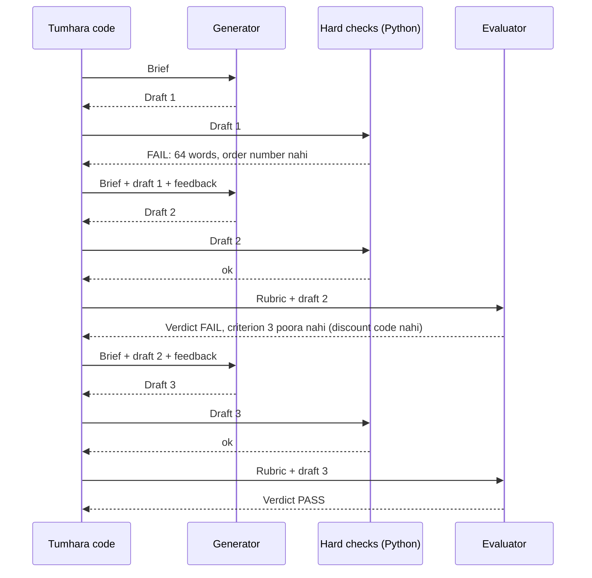

🏠 [Home](../../README.md) › [08 · Reflection & Self-Correction](./README.md) › 8.2 Evaluator–optimizer loop

# 8.2 Evaluator–optimizer loop

> **Level:** 🟡 Intermediate · **Padhne ka time:** ~10 min · **Pehle padho:** [8.1 Reflection pattern](./08.1-the-reflection-pattern.md)

**Ek line mein:** Ek model call generate karti hai, ek alag evaluator result ko rubric ke against grade karta hai aur batata hai kya theek karna hai, aur yeh loop tab tak chalta hai jab tak result pass na ho jaye ya round limit na aa jaye.

📑 **Is page par**

- [Yeh kyun zaroori hai?](#-yeh-kyun-zaroori-hai)
- [Idea, simple words mein](#-idea-simple-words-mein)
- [Diagram se samjho](#-diagram-se-samjho)
- [Kaise kaam karta hai, step by step](#-kaise-kaam-karta-hai-step-by-step)
- [Example se samjho](#-example-se-samjho)
- [Code](#-code)
- [Aam galtiyan aur dhyan dene wali baatein](#-aam-galtiyan-aur-dhyan-dene-wali-baatein)
- [Yaad rakhne wali baatein](#-yaad-rakhne-wali-baatein)
- [Khud try karo](#-khud-try-karo)
- [Aur padhne ke liye](#-aur-padhne-ke-liye)

## 🤔 Yeh kyun zaroori hai?

Tumhari support team chahti hai ki [agent](../../GLOSSARY.md#agent) late orders ke liye maafi wale emails ka draft banaye. Har email mein order number hona chahiye, chhota hona chahiye, customer ko blame kiye bina maafi maangni chahiye, nayi date batani chahiye aur ek discount code dena chahiye. Ek single prompt zyadatar time zyadatar cheezein sahi kar leta hai. Lekin "zyadatar time" ka matlab hai har mahine sau-do sau bure emails.

Reflection ([8.1](./08.1-the-reflection-pattern.md)) help karta hai, lekin jab ek hi [LLM](../../GLOSSARY.md#large-language-model-llm) dono role nibhata hai, toh woh apne hi kaam ko approve kar deta hai. Evaluator–optimizer loop roles ko theek se alag karta hai: ek call **generate** karti hai, doosri ek explicit rubric ke against **evaluate** karti hai, aur code decide karta hai ki kab rukna hai. Yeh Anthropic ke [Building effective agents](https://www.anthropic.com/engineering/building-effective-agents) mein diye [workflow](../../GLOSSARY.md#workflow) patterns mein se ek hai, aur bahut saare "achha hone tak chalte raho" systems ki reedh ki haddi hai.

## 🧠 Idea, simple words mein

Ek writer aur ek editor ke baare mein socho. Writer draft likhta hai. Editor dobara nahi likhta; woh draft ko house style guide ke against mark karta hai aur notes ke saath wapas deta hai. Writer revise karta hai. Jab editor sign off kar de, tab woh bahar jaata hai. Agar teen baar idhar-udhar ho chuka hai, toh managing editor best version chun ke aage badh jaata hai.

School wali copy checking bhi aisi hi hai. Teacher marking scheme ke hisaab se red pen se galtiyan mark karti hai, tum theek karke dobara jama karte ho. Teacher khud tumhara answer nahi likhti.

[Evaluator–optimizer](../../GLOSSARY.md#evaluator-optimizer) loop mein:

- **Generator** (yahi "optimizer" hai) likhta hai, phir feedback use karke revise karta hai.
- **Evaluator** har draft ko ek [rubric](../../GLOSSARY.md#rubric) ke against grade karta hai (pass/fail criteria ki ek chhoti list), aur ek structured verdict deta hai: pass ya fail, ek score, aur feedback jo batata hai ki har failure kaise theek karein.
- Plain Python mein **hard checks** pehle chalte hain, har us cheez ke liye jo code exactly check kar sake: word count, zaroori text, valid JSON.
- **Tumhara code** loop ka maalik hai: pass pe ruk jaata hai, ya N rounds ke baad ab tak ka best draft return karta hai, "did not pass" flag ke saath.

Isko reflection se zyada kya banata hai? Alag-alag hona. Evaluator ka apna prompt hai, woh sirf rubric aur draft dekhta hai, aur woh ek alag (ya zyada strong) model ho sakta hai. Anthropic ka post achhe fit ke do signs batata hai: insaan ka feedback output ko saaf taur pe better banata, aur model us tarah ka feedback de sakta hai.

## 👀 Diagram se samjho



*Har baat-cheet ke beech mein tumhara code baitha hai. Generator aur evaluator kabhi seedhe ek-doosre se baat nahi karte, aur paid evaluator call se pehle saste code checks chalte hain.*

## 🔍 Kaise kaam karta hai, step by step

1. **Pehle rubric likho.** Teen se chhe criteria, har ek pass/fail, har ek aisa jo dhyan se padhne wala check kar sake: "nayi delivery date batata hai", na ki "high quality hai". Yahi requirements generator ko bhi do, taaki pehle draft ko bhi fair chance mile.
2. **Rubric ko baanto.** Jo bhi code exactly check kar sake (length, zaroori strings, format), woh hard check ban jaata hai. Jisme judgement chahiye (tone, "no blame"), woh evaluator ke paas jaata hai.
3. **Generate.** Pehli call ko brief milta hai. Baad ki calls ko brief, pichla draft aur feedback milta hai.
4. **Hard checks chalao.** Agar fail hue, toh wahi feedback hai; evaluator call skip karo aur paisa bachao.
5. **Evaluate.** Rubric aur draft evaluator ko bhejo, generator ki conversation *nahi*. JSON maango, jaise `{"pass": bool, "score": int, "feedback": str}`. Jahan provider support kare wahan structured outputs use karo, aur phir bhi code mein validate karo.
6. **Fail closed.** Agar verdict parse nahi ho sakta, ya `pass` literally `true` nahi hai, toh usko fail maano. Toota hua evaluator kabhi kisi draft ko aage nahi jaane de.
7. **Ruko.** Pass pe return karo. `max_rounds` (aksar 3) ke baad sabse zyada score wala draft `passed=False` ke saath return karo, taaki caller usko ship karne ki jagah human review ke liye bhej sake ([9.6](../09-agent-design-patterns/09.6-human-in-the-loop.md)).

## 💡 Example se samjho

Scripted replies ke saath ek run aisa dikhta hai:

```text
--- round 1: 64 words -> FAIL (score 0)
Dear customer, we are very sorry. Unfortunately, due to an unexpected and highly unusual issue at our main fulfilment warehouse, which our operations team is currently investigating as a matter of priority, your recent order has been delayed. We now expect it to arrive on Friday. We truly value your business and apologise for any inconvenience this may have caused you and your family.
feedback: Too long: 64 words, the limit is 50.
Must mention the order number A-1042.

--- round 2: 29 words -> FAIL (score 60)
Hi there, I'm sorry: your order A-1042 is running 3 days late because of a problem at our warehouse. It should now arrive on Friday. We appreciate your patience.
feedback: Criterion 3 unmet: offer the code SORRY10 and say it gives 10% off.

--- round 3: 40 words -> PASS (score 95)
Hi there, I'm sorry: your order A-1042 is running 3 days late because of a problem at our warehouse. It should now arrive on Friday. As a thank-you for your patience, use code SORRY10 for 10% off your next order.
feedback: All criteria met.

Result: passed after 3 round(s).
Model calls: generator 3, evaluator 2
```

Teen cheezein dhyan do:

- **Round 1 evaluator tak pahuncha hi nahi.** Hard checks ne usko pakad liya, free mein, exact reason ke saath.
- **Round 2 ne code checks pass kiye lekin rubric fail kiya.** Promise kiya hua discount code missing hai, yeh sirf ek padhne wala notice kar sakta hai. Yahi evaluator ka kaam hai.
- **Feedback pe action liya ja sakta hai.** "Criterion 3 unmet: offer the code SORRY10 and say it gives 10% off" generator ko exactly batata hai ki kya badalna hai. "Could be better" yeh nahi batata.

## 💻 Code

Evaluator call, jisme verdict ko zabardasti ek JSON schema mein daala gaya hai. Anthropic ([structured outputs docs](https://platform.claude.com/docs/en/build-with-claude/structured-outputs)), `ANTHROPIC_API_KEY` chahiye:

```python
import json
import anthropic

VERDICT_SCHEMA = {
    "type": "object",
    "properties": {
        "pass": {"type": "boolean"},
        "score": {"type": "integer"},
        "feedback": {"type": "string"},
    },
    "required": ["pass", "score", "feedback"],
    "additionalProperties": False,
}

client = anthropic.Anthropic()
resp = client.messages.create(
    model="claude-opus-5-5",          # evaluator generator se alag model ho sakta hai
    max_tokens=1000,
    system="You grade customer-service emails against a rubric. Be strict.",
    messages=[{"role": "user", "content": f"Rubric:\n{RUBRIC}\n\nEmail to grade:\n{draft}"}],
    output_config={"format": {"type": "json_schema", "schema": VERDICT_SCHEMA}},
)
verdict = json.loads(next(b.text for b in resp.content if b.type == "text"))
```

OpenAI Chat Completions mein yahi idea `response_format` ke andar hai:

```python
from openai import OpenAI

resp = OpenAI().chat.completions.create(
    model="YOUR_OPENAI_MODEL",
    messages=[{"role": "system", "content": "You grade customer-service emails against a rubric."},
              {"role": "user", "content": f"Rubric:\n{RUBRIC}\n\nEmail to grade:\n{draft}"}],
    response_format={"type": "json_schema",
                     "json_schema": {"name": "verdict", "schema": VERDICT_SCHEMA, "strict": True}},
)
verdict = json.loads(resp.choices[0].message.content)
```

Loop khud plain Python hai, aur usko farak nahi padta ki dono taraf kaunsa model baitha hai:

```python
def optimize(generate, evaluate, *, max_rounds: int = 3) -> OptimizeResult:
    rounds, draft, feedback = [], None, None
    for _ in range(max_rounds):
        draft = generate(draft, feedback)         # pehli baar (None, None)
        verdict = evaluate(draft)                 # pehle hard checks, phir evaluator model
        rounds.append(Round(draft, verdict))
        if verdict.passed:
            return OptimizeResult(best=draft, passed=True, rounds=rounds)
        feedback = verdict.feedback
    best = max(rounds, key=lambda r: r.verdict.score)  # kuch pass nahi hua: best attempt, flag ke saath
    return OptimizeResult(best=best.draft, passed=False, rounds=rounds)
```

`generate` ek generator model ko wrap karta hai aur `evaluate` hard checks plus ek alag evaluator model ko. Test karne layak cheezein: feedback generator tak pahunchta hai, aur kharaab evaluator JSON fail count hota hai. [9.5](../09-agent-design-patterns/09.5-evaluator-optimizer.md) mein yahi function ek building block ki tarah dobara use hota hai.

## 🚨 Aam galtiyan aur dhyan dene wali baatein

- **Dhundhla rubric.** "Kya yeh achha hai?" se scores random tarike se upar-neeche hote hain. **Fix:** aise pass/fail criteria jo dhyan se padhne wala check kar sake, aur feedback jo criterion ka naam le.
- **Model se ginti karwana.** Models words ya characters ginne mein reliable nahi hain. **Fix:** jo bhi gina ja sakta hai, woh code mein hard check hai.
- **Fail open hona.** Evaluator prose return karta hai, parser gir jaata hai, aur code "koi verdict nahi" ko success maan leta hai. **Fix:** explicit `true` ke alawa sab kuch fail hai.
- **Evaluator mein generator jaise hi blind spots.** Same context wala same model apni hi style pasand karta hai. LLM judges ke biases bhi known hain, jaise lambe answers aur apne hi outputs ko favour karna ([Zheng et al., 2023](https://arxiv.org/abs/2306.05685)). **Fix:** kam se kam alag prompt aur fresh context; alag model bhi socho; verdicts ko human judgement se spot-check karo ([12.3](../12-evaluation/12.3-llm-as-judge.md)).
- **Kabhi na khatam hone wali polishing.** Har round mein ek generator call aur ek evaluator call lagti hai, aur baad ke rounds mein fayda kam hota jaata hai. **Fix:** chhota `max_rounds`, aur ek "best attempt" fallback jo saaf flag kiya gaya ho.
- **Rubric pe over-fit hona.** Generator boxes tick karna seekh jaata hai ("I apologise. Friday. SORRY10.") aur email ek form jaisa lagta hai. **Fix:** ek holistic criterion daalo ("natural lagta hai, jaise kisi insaan ne likha ho"), aur khud samples padho.

## ✅ Yaad rakhne wali baatein

- Generator likhta hai; ek alag evaluator rubric ke against grade karta hai; code decide karta hai kab rukna hai.
- Exact checks code mein rakho aur pehle chalao. Evaluator sirf judgement ke liye use karo.
- Structured verdict maango, aur parse na ho toh fail closed karo.
- Pass pe ya kuch rounds ke baad ruko; best attempt ko "pass nahi hua" flag ke saath return karo.
- Yeh tab fit hota hai jab clear criteria hon aur feedback se output saaf taur pe better hota ho.

## 🧪 Khud try karo

1. Example mein maan lo hard word limit 50 ki jagah 30 hoti, aur teen scripted drafts wahi rehte. Ab kaunse rounds fail honge, aur kya loop ab bhi pass hoga?
2. Tumhara evaluator ek hi draft ko ek run mein pass aur agle mein fail deta hai. Do changes batao jo isko zyada consistent banayein.
3. Jab kuch pass nahi hota, toh `optimize()` aakhri draft ki jagah *sabse zyada score wala* draft kyun return karta hai?

<details>
<summary>Answer dekho</summary>

1. Draft 1 (64 words) aur 3 (40 words) ab hard checks fail karte hain. Draft 2 (29 words) unhe pass karta hai lekin rubric fail karta hai. Kuch pass nahi hota, toh `optimize()` draft 2 return karta hai, jiska score sabse zyada (60) hai, `passed=False` ke saath, aur evaluator model sirf ek baar call hota hai. Asli model ke saath round 3 ko 30-word limit pata hoti (woh brief mein hai), lekin lesson wahi hai: tight rule tumhare best draft ko bhi fail bana sakta hai, toh limits soch-samajh ke set karo.
2. Inme se koi do: criteria ko concrete wording ke saath strictly pass/fail banao; overall verdict se pehle har criterion ka chhota reason maango; gine jaane wale ya exact rules hard checks mein daalo; evaluator ke liye strong model use karo; kai baar evaluate karo aur majority lo ([9.3](../09-agent-design-patterns/09.3-parallelisation.md)).
3. Revisions hamesha better nahi hote. Baad ka draft ek problem theek karke do nayi daal sakta hai. Sabse zyada score wala draft return karne se caller ko pass ke sabse kareeb wali cheez milti hai; `passed=False` flag usko batata hai ki kisi insaan se dikhwao.

</details>

## 📚 Aur padhne ke liye

- [Building effective agents](https://www.anthropic.com/engineering/building-effective-agents) (Anthropic). Evaluator–optimizer workflow aur yeh kab fit hota hai, yeh samjhaata hai.
- [Structured outputs](https://platform.claude.com/docs/en/build-with-claude/structured-outputs) (Anthropic docs). Evaluator ka verdict aise JSON mein lena jo schema se match kare.
- [Judging LLM-as-a-Judge with MT-Bench and Chatbot Arena](https://arxiv.org/abs/2306.05685) (Zheng et al., 2023). Model judges logon se kitna agree karte hain, aur unke position, verbosity aur self-enhancement biases.
- [Self-Refine](https://arxiv.org/abs/2303.17651) (Madaan et al., 2023). Is loop ka single-model version.

<!-- FOOTER -->

---

⬅️ **Pichla:** [8.1 Reflection pattern](./08.1-the-reflection-pattern.md) ·
🏠 [Chapter home](./README.md) ·
➡️ **Agla:** [8.3 Tests ke saath self-critique](./08.3-self-critique-with-tests.md)
