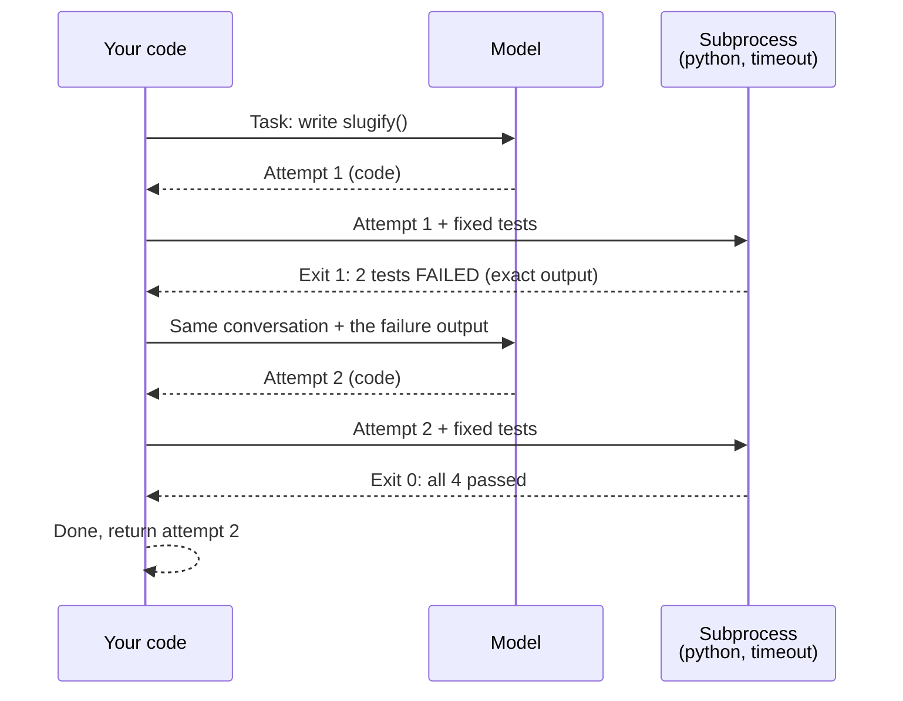

🏠 [Home](../../README.md) › [08 · Reflection & Self-Correction](./README.md) › 8.3 Self-critique with tests

# 8.3 Self-critique with tests

> **Difficulty:** 🟡 Intermediate · **Reading time:** ~10 min · **Prerequisites:** [8.1 The reflection pattern](./08.1-the-reflection-pattern.md), [3.6 Code execution as a tool](../03-tools-and-function-calling/03.6-code-execution-as-a-tool.md)

**In one sentence:** Instead of asking the model whether its work is right, check it against something real (tests, a compiler, a schema, an API) and feed the exact failures back, so each revision is driven by evidence rather than opinion.

📑 **On this page**

- [Why does this matter?](#-why-does-this-matter)
- [The idea, in plain words](#-the-idea-in-plain-words)
- [Picture it](#-picture-it)
- [How it works, step by step](#-how-it-works-step-by-step)
- [Worked example](#-worked-example)
- [Code](#-code)
- [Common mistakes & gotchas](#-common-mistakes--gotchas)
- [Key takeaways](#-key-takeaways)
- [Try it yourself](#-try-it-yourself)
- [Further reading](#-further-reading)

## 🤔 Why does this matter?

Ask a model to write a function and then ask "is this correct?", and it will usually say yes. Ask it to "check carefully" and it may invent a problem that isn't there, then "fix" working code. In both cases, it is guessing.

Now run the code against four tests. Two fail, with the exact input, the expected output and what came back. That is not a guess. Give that output to the model and it knows precisely what to fix. This is why coding [agents](../../GLOSSARY.md#agent) work as well as they do: code can be checked automatically, and test results make excellent feedback. Anthropic's [Building effective agents](https://www.anthropic.com/engineering/building-effective-agents) makes the same point about coding agents: solutions are verifiable through automated tests, and agents can iterate using test results as feedback.

## 🧠 The idea, in plain words

Think of a student doing maths homework with the answers at the back of the book. They don't ask themselves "do I feel confident?". They check the answer, and if it's wrong, they look at *where* it went wrong and try again.

[Self-correction](../../GLOSSARY.md#self-correction) works when the model gets **external feedback**: a signal from outside the model that it can't argue with. Good sources:

| Signal | What it catches | Example |
| --- | --- | --- |
| Unit tests | Wrong behaviour | `expected 'hello-world', got 'hello,-world!'` |
| Compiler, linter, type checker | Syntax and type errors | `SyntaxError: invalid syntax (line 3)` |
| Schema validation | Malformed structured output | `'amount' is a required property` |
| Running a query | Wrong SQL | `no such column: user_name` |
| A [tool](../../GLOSSARY.md#tool) or API response | Wrong assumptions about the world | `404: order 9999 not found` |

The model still writes the fix. But *what* needs fixing comes from reality, not from the model's opinion of itself. Research backs this up: the CRITIC paper ([Gou et al., 2023](https://arxiv.org/abs/2305.11738)) improves outputs by having the model verify them with tools such as search and a code interpreter, and stresses the importance of external feedback; Self-Debug ([Chen et al., 2023](https://arxiv.org/abs/2304.05128)) teaches models to debug code using execution results.

## 👀 Picture it



*The model never decides whether it is finished: the exit code does. The tests are yours, fixed in advance, and the model can't edit them.*

## 🔍 How it works, step by step

1. **Write the checks before the code.** The tests define "done". Keep them out of the model's reach: it should see their *output*, not be able to change them. (If you show the model the test source too, that is fine and often helps; just don't let it rewrite them.)
2. **Ask for code in a fixed format,** such as one fenced Python block, and extract it with a simple pattern.
3. **Run it in a separate process with a timeout.** `subprocess.run([...], timeout=10)` means an infinite loop costs you ten seconds, not your whole agent. Capture stdout and stderr.
4. **Turn the result into feedback.** Exit code 0 means pass. Otherwise, send the *end* of the output (that's where errors are), trimmed to a sensible size, with an instruction: "Fix the function."
5. **Keep the conversation.** The model should see its previous code and the failure together, so it can make a targeted change instead of starting over.
6. **Stop on pass, or after N attempts.** Three is a common limit. If it still fails, return the last attempt as failed, with the output, for a human or a higher-level agent.
7. **Sandbox it properly in production.** A subprocess with a timeout is **not** a security boundary. Model-written code can read files, use the network or delete things. Run it in a container or VM with no secrets, no network and limited resources ([13.3](../13-safety-and-guardrails/13.3-least-privilege-and-sandboxing.md)), or use a provider's hosted code-execution tool ([3.6](../03-tools-and-function-calling/03.6-code-execution-as-a-tool.md)).

## 💡 Worked example

The task: write `slugify(title)` that turns a blog title into a URL slug. Our four tests are fixed. In this run the model's two attempts are scripted, so only known-safe code runs:

```text
--- attempt 1
def slugify(title: str) -> str:
    return "-".join(title.lower().split())

test output:
FAIL slugify('Hello, World!'): expected 'hello-world', got 'hello,-world!'
FAIL slugify('Agents 101: a guide'): expected 'agents-101-a-guide', got 'agents-101:-a-guide'

--- attempt 2
import re

def slugify(title: str) -> str:
    words = re.findall(r"[a-z0-9]+", title.lower())
    return "-".join(words)

test output:
PASS: all 4 tests passed

Result: tests pass after 2 attempt(s).
```

Attempt 1 looks reasonable. A model asked "is this correct?" might well say yes: it handles spaces and case. The tests show the real gap: punctuation survives. The second message to the model contains its own code plus these two `FAIL` lines, so the fix is targeted: keep only letters and digits.

## 💻 Code

The core of the loop. Plain Python, standard library only. `llm` is any chat-model client whose `.chat()` returns a reply with `.text` and `.to_message()`, `user()` builds a user message dict, and `extract_code()` pulls out the first ```` ```python ```` block:

```python
import subprocess, sys, tempfile
from pathlib import Path

def run_tests(code: str, tests: str, timeout: float = 10.0) -> tuple[bool, str]:
    """Run the model's code followed by our tests in a fresh Python process."""
    with tempfile.TemporaryDirectory() as tmp:
        script = Path(tmp) / "check.py"
        script.write_text(code + "\n\n" + tests, encoding="utf-8")
        try:
            proc = subprocess.run(
                [sys.executable, "-I", str(script)],   # -I: isolated mode (ignores PYTHON* env vars, user site)
                cwd=tmp, capture_output=True, text=True,
                timeout=timeout,                       # kills infinite loops
            )
        except subprocess.TimeoutExpired:
            return False, f"TIMEOUT after {timeout}s"
    return proc.returncode == 0, (proc.stdout + proc.stderr)[-2000:]   # keep the end: errors are there


def solve_with_tests(llm, task: str, tests: str, max_attempts: int = 3) -> str | None:
    messages = [user(task)]
    for _ in range(max_attempts):
        reply = llm.chat(messages)
        code = extract_code(reply.text)                # first ```python block
        passed, output = run_tests(code, tests)
        if passed:
            return code
        messages += [reply.to_message(),               # the model sees its own code...
                     user(f"The tests failed:\n\n{output}\n\nFix the function.")]  # ...and the real failures
    return None                                        # give up: let a human or a higher-level agent decide
```

**Safety:** this executes model-written code. Make it refuse to run with a real model unless an explicit opt-in such as `ALLOW_CODE_EXECUTION=1` is set, and only set it inside a disposable container or VM. Let your tests run only scripted, known-safe code, including one deliberately infinite loop to prove the timeout works.

Providers also offer hosted, sandboxed code execution as a tool, so the model can run code on the provider's side; see [3.6](../03-tools-and-function-calling/03.6-code-execution-as-a-tool.md) for when that fits.

## 🚨 Common mistakes & gotchas

- **Letting the model change the tests.** If the model can edit the tests, "make the tests pass" becomes "delete the failing test". **Fix:** tests live outside the model's reach; it only sees their output.
- **Weak tests.** Tests that only cover the happy path pass weak code. The loop optimises for your tests, so they define the quality bar. **Fix:** include edge cases (punctuation, empty input, unicode) and keep adding cases when bugs slip through.
- **Feeding back too much or too little.** "Tests failed" alone gives no direction; a 5,000-line log buries the signal and costs [tokens](../../GLOSSARY.md#token). **Fix:** send the specific failing cases and the end of any traceback, trimmed.
- **No timeout.** One `while True:` and your agent hangs forever. **Fix:** always pass `timeout=` and treat a timeout as a failure with a clear message.
- **Mistaking a subprocess for a sandbox.** It isn't one. **Fix:** a container or VM with no network and no secrets, or a hosted sandbox ([13.3](../13-safety-and-guardrails/13.3-least-privilege-and-sandboxing.md)).
- **Over-fitting to visible tests.** A model can special-case the exact inputs it saw. **Fix:** keep some held-out tests that run only at the end, and review the final code.

## ✅ Key takeaways

- External feedback beats self-opinion: tests, compilers, schemas and real API responses tell the model what is actually wrong.
- Run generated code in a separate process with a timeout, and feed back the exact, trimmed failure output.
- The tests decide when you're done, not the model, and the model must not be able to edit them.
- A subprocess is not a sandbox. Isolate model-written code properly before running it for real.
- Your tests set the quality bar: the loop is only as good as what they check.

## 🧪 Try it yourself

1. Add the test case `("Café au lait", "cafe-au-lait")` to the worked example's tests. Does attempt 2 still pass? What would the model see?
2. Your loop for a SQL-writing agent keeps failing with the same error three times in a row. What would you change?
3. Name an external signal you could use to check an agent that writes product descriptions in JSON for your shop's API.

<details>
<summary>Show answer</summary>

1. No. `re.findall(r"[a-z0-9]+", ...)` drops the `é`, giving `'caf-au-lait'`. The model would see `FAIL slugify('Café au lait'): expected 'cafe-au-lait', got 'caf-au-lait'`, a precise hint to normalise accents first (for example with `unicodedata.normalize("NFKD", ...)` and dropping combining marks). A scripted run with no third attempt prepared would end as a failure; a real model would get that line as feedback and could fix it on attempt 3.
2. Detect the repetition: if the new error equals the last one, the feedback isn't helping. Options: include more context (the table schema, a sample row), switch to a stronger model for the retry, or stop early and escalate. Repeating the same failing loop only burns money ([7.5](../07-planning-and-reasoning/07.5-re-planning-when-things-fail.md)).
3. Validate the JSON against the API's schema (for example with `jsonschema` or a Pydantic model) and feed back the validation errors; better still, call the API's validation or dry-run endpoint if it has one. Both are external signals the model can't argue with.

</details>

## 📚 Further reading

- [Building effective agents](https://www.anthropic.com/engineering/building-effective-agents) (Anthropic). See "Agents in practice" on why coding agents benefit from tests as feedback.
- [CRITIC: Large Language Models Can Self-Correct with Tool-Interactive Critiquing](https://arxiv.org/abs/2305.11738) (Gou et al., 2023). Verification with tools such as search and a code interpreter.
- [Teaching Large Language Models to Self-Debug](https://arxiv.org/abs/2304.05128) (Chen et al., 2023). Code repair driven by execution feedback.
- [subprocess — Subprocess management](https://docs.python.org/3/library/subprocess.html) (Python docs). `run()`, `timeout` and `TimeoutExpired`.

<!-- FOOTER -->

---

⬅️ **Previous:** [8.2 The evaluator–optimizer loop](./08.2-evaluator-optimizer-loop.md) ·
🏠 [Chapter home](./README.md) ·
➡️ **Next:** [8.4 Limits of self-correction](./08.4-limits-of-self-correction.md)
