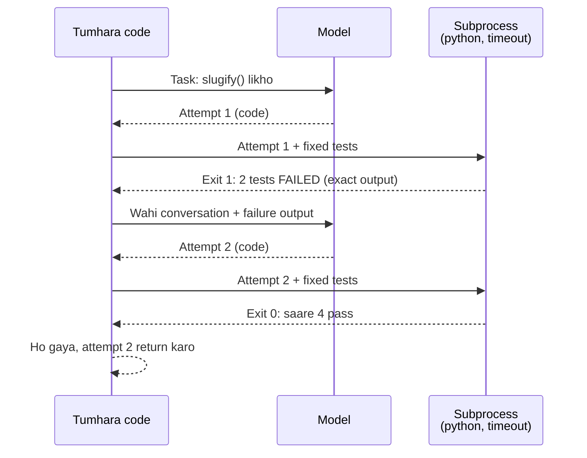

🏠 [Home](../../README.md) › [08 · Reflection & Self-Correction](./README.md) › 8.3 Tests ke saath self-critique

# 8.3 Tests ke saath self-critique

> **Level:** 🟡 Intermediate · **Padhne ka time:** ~10 min · **Pehle padho:** [8.1 Reflection pattern](./08.1-the-reflection-pattern.md), [3.6 Code execution ek tool ki tarah](../03-tools-and-function-calling/03.6-code-execution-as-a-tool.md)

**Ek line mein:** Model se yeh puchne ki jagah ki uska kaam sahi hai ya nahi, usko kisi real cheez (tests, compiler, schema, API) ke against check karo aur exact failures wapas do, taaki har revision raay se nahi, saboot se chale.

📑 **Is page par**

- [Yeh kyun zaroori hai?](#-yeh-kyun-zaroori-hai)
- [Idea, simple words mein](#-idea-simple-words-mein)
- [Diagram se samjho](#-diagram-se-samjho)
- [Kaise kaam karta hai, step by step](#-kaise-kaam-karta-hai-step-by-step)
- [Example se samjho](#-example-se-samjho)
- [Code](#-code)
- [Aam galtiyan aur dhyan dene wali baatein](#-aam-galtiyan-aur-dhyan-dene-wali-baatein)
- [Yaad rakhne wali baatein](#-yaad-rakhne-wali-baatein)
- [Khud try karo](#-khud-try-karo)
- [Aur padhne ke liye](#-aur-padhne-ke-liye)

## 🤔 Yeh kyun zaroori hai?

Model se ek function likhwao aur phir pucho "kya yeh sahi hai?", toh woh aam taur pe haan bolega. Usko "dhyan se check karo" bolo, toh ho sakta hai woh aisi problem bana le jo hai hi nahi, aur phir chalte hue code ko "fix" kar de. Dono case mein woh andaaza laga raha hai.

Ab code ko chaar tests ke against chalao. Do fail hote hain, exact input, expected output aur jo aaya, sab ke saath. Yeh andaaza nahi hai. Yeh output model ko do aur usko bilkul pata hoga ki kya theek karna hai. Isi wajah se coding [agents](../../GLOSSARY.md#agent) itna achha kaam karte hain: code automatically check ho sakta hai, aur test results bahut badhiya feedback hote hain. Anthropic ka [Building effective agents](https://www.anthropic.com/engineering/building-effective-agents) coding agents ke baare mein yahi baat kehta hai: solutions automated tests se verify ho sakte hain, aur agents test results ko feedback bana ke iterate kar sakte hain.

## 🧠 Idea, simple words mein

Ek student ke baare mein socho jo maths homework kar raha hai aur answers kitaab ke peeche diye hain. Woh khud se nahi puchta "kya mujhe confident feel ho raha hai?". Woh answer match karta hai, aur galat ho toh dekhta hai ki *kahan* galti hui, aur dobara try karta hai.

[Self-correction](../../GLOSSARY.md#self-correction) tab kaam karta hai jab model ko **external feedback** milta hai: model ke bahar se aaya ek aisa signal jisse woh behas nahi kar sakta. Achhe sources:

| Signal | Kya pakadta hai | Example |
| --- | --- | --- |
| Unit tests | Galat behaviour | `expected 'hello-world', got 'hello,-world!'` |
| Compiler, linter, type checker | Syntax aur type errors | `SyntaxError: invalid syntax (line 3)` |
| Schema validation | Bigda hua structured output | `'amount' is a required property` |
| Query chalana | Galat SQL | `no such column: user_name` |
| Koi [tool](../../GLOSSARY.md#tool) ya API response | Duniya ke baare mein galat assumptions | `404: order 9999 not found` |

Fix ab bhi model hi likhta hai. Lekin *kya* theek karna hai, woh reality batati hai, model ki apne baare mein raay nahi. Research bhi yahi kehti hai: CRITIC paper ([Gou et al., 2023](https://arxiv.org/abs/2305.11738)) model se search aur code interpreter jaise tools ke through outputs verify karwa ke unhe better banata hai, aur external feedback ki importance pe zor deta hai; Self-Debug ([Chen et al., 2023](https://arxiv.org/abs/2304.05128)) models ko execution results use karke code debug karna sikhata hai.

## 👀 Diagram se samjho



*Model kabhi decide nahi karta ki woh khatam hua ya nahi: exit code karta hai. Tests tumhare hain, pehle se fixed, aur model unhe edit nahi kar sakta.*

## 🔍 Kaise kaam karta hai, step by step

1. **Code se pehle checks likho.** Tests hi "done" define karte hain. Unhe model ki pahunch se bahar rakho: usko unka *output* dikhna chahiye, unhe badalne ka mauka nahi. (Agar tum model ko test ka source bhi dikhao, toh theek hai aur aksar help karta hai; bas usko unhe rewrite mat karne do.)
2. **Code ek fixed format mein maango,** jaise ek fenced Python block, aur ek simple pattern se nikal lo.
3. **Isko timeout ke saath alag process mein chalao.** `subprocess.run([...], timeout=10)` ka matlab hai ki ek infinite loop tumhare das second leta hai, poora agent nahi. stdout aur stderr capture karo.
4. **Result ko feedback mein badlo.** Exit code 0 matlab pass. Warna output ka *aakhri* hissa bhejo (errors wahin hote hain), theek size tak trim karke, ek instruction ke saath: "Fix the function."
5. **Conversation rakho.** Model ko apna pichla code aur failure dono saath dikhne chahiye, taaki woh shuru se likhne ki jagah ek targeted change kare.
6. **Pass pe ruko, ya N attempts ke baad.** Teen ek common limit hai. Phir bhi fail ho, toh aakhri attempt ko failed maan ke output ke saath return karo, kisi insaan ya higher-level agent ke liye.
7. **Production mein theek se sandbox karo.** Timeout wala subprocess security boundary **nahi** hai. Model ka likha code files padh sakta hai, network use kar sakta hai ya cheezein delete kar sakta hai. Isko container ya VM mein chalao jisme koi secrets na hon, network na ho aur resources limited hon ([13.3](../13-safety-and-guardrails/13.3-least-privilege-and-sandboxing.md)), ya kisi provider ka hosted code-execution tool use karo ([3.6](../03-tools-and-function-calling/03.6-code-execution-as-a-tool.md)).

Isko aise samjho jaise ghar mein naya electrician aaya ho. Tum usse nahi puchte "wiring sahi hai na?". Tum switch on karke dekhte ho ki bulb jalta hai ya nahi. Lekin MCB (sandbox) pehle se laga ke rakhte ho, taaki galti ho toh poore ghar ki light na jaaye.

## 💡 Example se samjho

Task: `slugify(title)` likho jo blog title ko URL slug mein badle. Hamare chaar tests fixed hain. Is run mein model ke dono attempts scripted hain, taaki sirf known-safe code hi chale:

```text
--- attempt 1
def slugify(title: str) -> str:
    return "-".join(title.lower().split())

test output:
FAIL slugify('Hello, World!'): expected 'hello-world', got 'hello,-world!'
FAIL slugify('Agents 101: a guide'): expected 'agents-101-a-guide', got 'agents-101:-a-guide'

--- attempt 2
import re

def slugify(title: str) -> str:
    words = re.findall(r"[a-z0-9]+", title.lower())
    return "-".join(words)

test output:
PASS: all 4 tests passed

Result: tests pass after 2 attempt(s).
```

Attempt 1 theek-thaak lagta hai. Model se pucho "kya yeh sahi hai?" toh woh shayad haan hi bolega: spaces aur case handle ho rahe hain. Tests asli kami dikhate hain: punctuation bach jaata hai. Model ko jaane wale doosre message mein uska apna code aur yeh do `FAIL` lines hain, isliye fix targeted hai: sirf letters aur digits rakho.

## 💻 Code

Loop ka core. Plain Python, sirf standard library. `llm` koi bhi chat-model client hai jiska `.chat()` `.text` aur `.to_message()` wala reply deta hai, `user()` ek user message dict banata hai, aur `extract_code()` pehla ```` ```python ```` block nikalta hai:

```python
import subprocess, sys, tempfile
from pathlib import Path

def run_tests(code: str, tests: str, timeout: float = 10.0) -> tuple[bool, str]:
    """Model ka code aur uske baad hamare tests ek naye Python process mein chalao."""
    with tempfile.TemporaryDirectory() as tmp:
        script = Path(tmp) / "check.py"
        script.write_text(code + "\n\n" + tests, encoding="utf-8")
        try:
            proc = subprocess.run(
                [sys.executable, "-I", str(script)],   # -I: isolated mode (PYTHON* env vars aur user site ignore karta hai)
                cwd=tmp, capture_output=True, text=True,
                timeout=timeout,                       # infinite loops ko khatam karta hai
            )
        except subprocess.TimeoutExpired:
            return False, f"TIMEOUT after {timeout}s"
    return proc.returncode == 0, (proc.stdout + proc.stderr)[-2000:]   # aakhri hissa rakho: errors wahin hain


def solve_with_tests(llm, task: str, tests: str, max_attempts: int = 3) -> str | None:
    messages = [user(task)]
    for _ in range(max_attempts):
        reply = llm.chat(messages)
        code = extract_code(reply.text)                # pehla ```python block
        passed, output = run_tests(code, tests)
        if passed:
            return code
        messages += [reply.to_message(),               # model apna code dekhta hai...
                     user(f"The tests failed:\n\n{output}\n\nFix the function.")]  # ...aur asli failures bhi
    return None                                        # haar maano: insaan ya higher-level agent decide kare
```

**Safety:** yeh model ka likha code execute karta hai. Isko real model ke saath tab tak chalne se mana karo jab tak ek explicit opt-in, jaise `ALLOW_CODE_EXECUTION=1`, set na ho, aur isko sirf ek disposable container ya VM ke andar set karo. Apne tests mein sirf scripted, known-safe code chalne do, jisme ek jaan-boojh ke banaya infinite loop bhi ho, taaki prove ho ki timeout kaam karta hai.

Providers bhi hosted, sandboxed code execution ek tool ki tarah dete hain, taaki model provider ki taraf code chala sake; yeh kab fit hota hai, uske liye [3.6](../03-tools-and-function-calling/03.6-code-execution-as-a-tool.md) dekho.

## 🚨 Aam galtiyan aur dhyan dene wali baatein

- **Model ko tests badalne dena.** Agar model tests edit kar sakta hai, toh "tests pass karwao" ban jaata hai "failing test delete karo". **Fix:** tests model ki pahunch se bahar rahein; woh sirf unka output dekhe.
- **Kamzor tests.** Jo tests sirf happy path cover karte hain, woh kamzor code ko bhi pass kar dete hain. Loop tumhare tests ke liye optimise karta hai, toh wahi quality bar define karte hain. **Fix:** edge cases daalo (punctuation, empty input, unicode), aur jab bhi bugs nikal jayein, naye cases add karte raho.
- **Bahut zyada ya bahut kam feedback dena.** Sirf "Tests failed" se koi direction nahi milti; 5,000-line log signal ko dabaa deta hai aur [tokens](../../GLOSSARY.md#token) kharch karta hai. **Fix:** specific failing cases aur kisi bhi traceback ka aakhri hissa bhejo, trim karke.
- **Koi timeout nahi.** Ek `while True:` aur tumhara agent hamesha ke liye atak gaya. **Fix:** hamesha `timeout=` pass karo aur timeout ko clear message ke saath failure maano.
- **Subprocess ko sandbox samajhna.** Yeh sandbox nahi hai. **Fix:** bina network aur bina secrets wala container ya VM, ya ek hosted sandbox ([13.3](../13-safety-and-guardrails/13.3-least-privilege-and-sandboxing.md)).
- **Dikhne wale tests pe over-fit hona.** Model exactly unhi inputs ke liye special case likh sakta hai jo usne dekhe. **Fix:** kuch held-out tests rakho jo sirf aakhir mein chalein, aur final code review karo.

## ✅ Yaad rakhne wali baatein

- External feedback apni raay se better hai: tests, compilers, schemas aur real API responses model ko batate hain ki asal mein kya galat hai.
- Generate hua code alag process mein timeout ke saath chalao, aur exact, trim kiya hua failure output wapas do.
- Kab khatam hua, yeh tests decide karte hain, model nahi, aur model unhe edit nahi kar paana chahiye.
- Subprocess sandbox nahi hai. Model ka likha code asli mein chalane se pehle usko theek se isolate karo.
- Tumhare tests quality bar set karte hain: loop utna hi achha hai jitna woh check karte hain.

## 🧪 Khud try karo

1. Example ke tests mein test case `("Café au lait", "cafe-au-lait")` add karo. Kya attempt 2 ab bhi pass hoga? Model ko kya dikhega?
2. SQL likhne wale agent ka tumhara loop lagaatar teen baar ek hi error se fail ho raha hai. Tum kya badloge?
3. Ek external signal batao jisse tum us agent ko check kar sako jo tumhari shop ki API ke liye JSON mein product descriptions likhta hai.

<details>
<summary>Answer dekho</summary>

1. Nahi. `re.findall(r"[a-z0-9]+", ...)` `é` ko gira deta hai, aur `'caf-au-lait'` deta hai. Model ko dikhega `FAIL slugify('Café au lait'): expected 'cafe-au-lait', got 'caf-au-lait'`, jo ek precise hint hai ki pehle accents normalise karo (jaise `unicodedata.normalize("NFKD", ...)` aur combining marks hata ke). Jis scripted run mein teesra attempt taiyaar nahi hai, woh failure pe khatam hoga; asli model ko yeh line feedback ke roop mein milegi aur woh attempt 3 mein isko theek kar sakta hai.
2. Repetition pakdo: agar naya error pichle jaisa hi hai, toh feedback help nahi kar raha. Options: zyada context do (table schema, ek sample row), retry ke liye strong model pe switch karo, ya jaldi ruk ke escalate karo. Wahi failing loop dohrane se sirf paisa jalta hai ([7.5](../07-planning-and-reasoning/07.5-re-planning-when-things-fail.md)).
3. JSON ko API ke schema ke against validate karo (jaise `jsonschema` ya ek Pydantic model se) aur validation errors wapas do; aur bhi achha, agar API ka validation ya dry-run endpoint hai toh usko call karo. Dono external signals hain jinse model behas nahi kar sakta.

</details>

## 📚 Aur padhne ke liye

- [Building effective agents](https://www.anthropic.com/engineering/building-effective-agents) (Anthropic). "Agents in practice" dekho, ki coding agents ko feedback ke roop mein tests se fayda kyun hota hai.
- [CRITIC: Large Language Models Can Self-Correct with Tool-Interactive Critiquing](https://arxiv.org/abs/2305.11738) (Gou et al., 2023). Search aur code interpreter jaise tools ke saath verification.
- [Teaching Large Language Models to Self-Debug](https://arxiv.org/abs/2304.05128) (Chen et al., 2023). Execution feedback se chalne wali code repair.
- [subprocess — Subprocess management](https://docs.python.org/3/library/subprocess.html) (Python docs). `run()`, `timeout` aur `TimeoutExpired`.

<!-- FOOTER -->

---

⬅️ **Pichla:** [8.2 Evaluator–optimizer loop](./08.2-evaluator-optimizer-loop.md) ·
🏠 [Chapter home](./README.md) ·
➡️ **Agla:** [8.4 Self-correction ki limits](./08.4-limits-of-self-correction.md)
