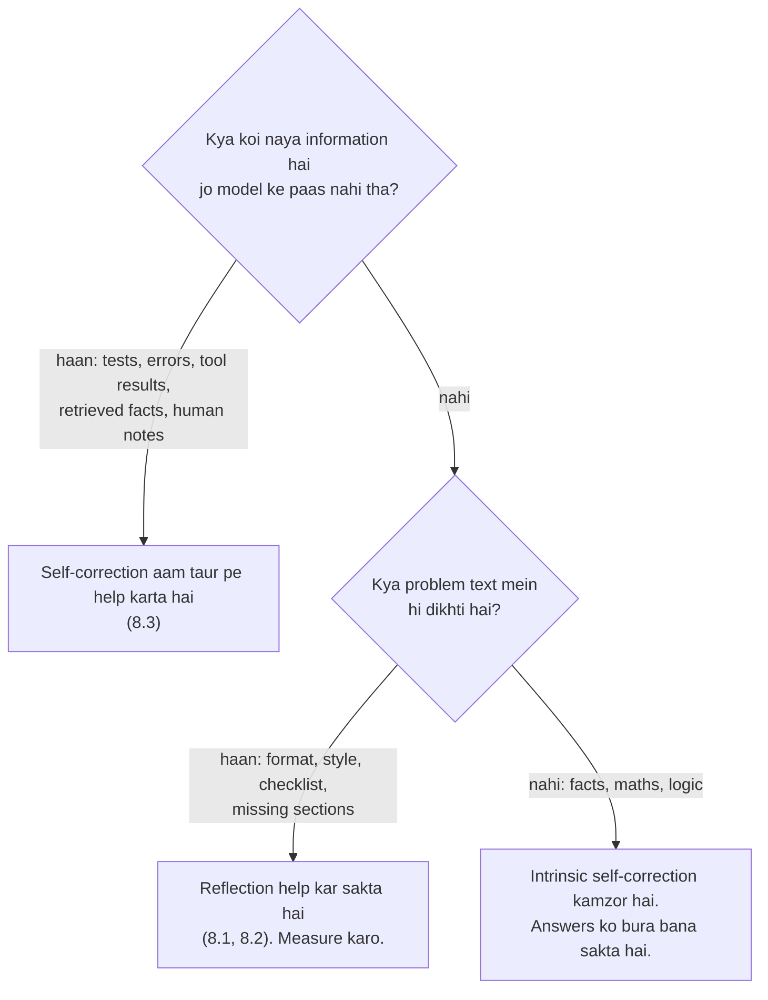

🏠 [Home](../../README.md) › [08 · Reflection & Self-Correction](./README.md) › 8.4 Self-correction ki limits

# 8.4 Self-correction ki limits

> **Level:** 🔴 Advanced · **Padhne ka time:** ~8 min · **Pehle padho:** [8.1 Reflection pattern](./08.1-the-reflection-pattern.md), [8.3 Tests ke saath self-critique](./08.3-self-critique-with-tests.md)

**Ek line mein:** Model ke bahar se koi naya information na ho, toh usse apni hi reasoning check karwana aksar help nahi karta aur sahi answers ko galat bhi bana sakta hai; isliye self-correction wahan use karo jahan real signal ya clear checklist ho, aur usko measure karo.

📑 **Is page par**

- [Yeh kyun zaroori hai?](#-yeh-kyun-zaroori-hai)
- [Idea, simple words mein](#-idea-simple-words-mein)
- [Diagram se samjho](#-diagram-se-samjho)
- [Kaise kaam karta hai, step by step](#-kaise-kaam-karta-hai-step-by-step)
- [Example se samjho](#-example-se-samjho)
- [Code](#-code)
- [Aam galtiyan aur dhyan dene wali baatein](#-aam-galtiyan-aur-dhyan-dene-wali-baatein)
- [Yaad rakhne wali baatein](#-yaad-rakhne-wali-baatein)
- [Khud try karo](#-khud-try-karo)
- [Aur padhne ke liye](#-aur-padhne-ke-liye)

## 🤔 Yeh kyun zaroori hai?

"Ek reflection step add kar do" sunne mein free ki quality lagti hai. Ek team apne [agent](../../GLOSSARY.md#agent) ke har reasoning step ke baad "Review your answer and fix any mistakes" add karti hai. Cost aadhi aur badh jaati hai. Unke test set pe accuracy *gir* jaati hai. Traces dekhne pe pata chalta hai ki model sahi answers ko galat bana raha hai, aur un galtiyon ke liye maafi maang raha hai jo usne ki hi nahi thi.

Yeh koi rare bug nahi hai. Yeh is technique ki achhi tarah documented limit hai. Self-correction kahan kaam karta hai aur kahan nahi, yeh jaanne se paisa bachta hai aur quality bhi bachi rehti hai.

## 🧠 Idea, simple words mein

Socho tum apna exam paper khud check kar rahe ho, bina textbook aur bina calculator ke. Ek laaparwaahi wali typo pakad sakte ho. Lekin agar sawal hi galat samjha tha, toh dobara padhne pe bhi galat hi samjhoge, kyunki dono kaam ek hi dimaag kar raha hai. Aur bura yeh ki agar koi baar-baar puche "pakka *sure* ho?", toh tum sahi answers bhi badalne lagoge.

Jaise exam hall se nikalte hi dost puchta hai "Q3 ka answer B tha na? Pakka?" aur tum apna sahi answer A bhi shak mein daal dete ho. Kuch naya pata nahi chala, bas pressure aaya.

Researchers [self-correction](../../GLOSSARY.md#self-correction) ke do type alag karte hain:

- **Intrinsic:** model sirf jo pehle se jaanta hai usi se apna answer check karta hai. Koi naya information nahi aata.
- **External feedback ke saath:** model ke bahar se kuch naya information aata hai, jaise failing test, compiler error, search result, kisi insaan ka note.

Yahan ka sabse important paper hai **"Large Language Models Cannot Self-Correct Reasoning Yet"** ([Huang et al., 2023](https://arxiv.org/abs/2310.01798), ICLR 2024). Reasoning benchmarks pe authors ne dekha ki external feedback ke bina models apne answers theek karne mein struggle karte hain, aur self-correction ke baad performance kabhi-kabhi *gir* jaati hai. Unhone yeh bhi paaya ki pehle ke positive results, reasoning pe Reflexion wale bhi, **oracle labels** use karte the: revise karne ka decision lene se pehle loop ko bata diya jaata tha ki answer sahi hai ya nahi. Woh oracle hatao aur gains gayab.

Baad ke ek survey ([Kamoi et al., 2024](https://arxiv.org/abs/2406.01297), TACL) ka nateeja bhi milta-julta tha: jab **reliable external feedback** available ho, tab self-correction achha kaam karta hai; sirf ek prompted [LLM](../../GLOSSARY.md#large-language-model-llm) ke feedback se unhe koi convincing success nahi mili, siwaay un tasks ke jo iske liye unusually suited the; aur jo models iske liye fine-tune kiye gaye, woh better kar sakte hain.

## 👀 Diagram se samjho



*Sabse zyada pehla sawal matter karta hai. Reasoning ki galtiyan upar se kam hi dikhti hain, isliye usi model ki, usi knowledge ke saath, doosri nazar unhe kam hi pakadti hai.*

## 🔍 Kaise kaam karta hai, step by step

Intrinsic self-correction se niraasha kyun hoti hai? Chaar wajah.

1. **Same knowledge, same blind spots.** Agar model ko pehli baar fact nahi pata tha ya koi logical step chhoot gaya tha, toh "please review" mein aisa kuch nahi hai jo usko woh knowledge de de.
2. **Prompt khud ishaara karta hai ki galti hai.** "Apne answer mein problems dhundho" se lagta hai ki problems hain. Models prompt ke ishaare ke saath chal padte hain, aur kabhi-kabhi sahi answer ko "fix" kar dete hain.
3. **[Sycophancy](../../GLOSSARY.md#sycophancy).** Human feedback pe fine-tune hue models user se agree karne lagte hain, sach ke khilaaf bhi. [Sharma et al. (2023)](https://arxiv.org/abs/2310.13548) ne yeh paanch state-of-the-art assistants mein paaya, aur iska kuch hissa us human preference data se joda jo agree karne wale answers ko reward karta hai. "Are you sure?" badalne ke liye ek halka dhakka hai; sycophantic model aksar badal deta hai.
4. **Unfair comparisons.** Huang et al. bataate hain ki self-correction extra model calls kharch karta hai, toh usko unhi calls ko kharch karne ke doosre tariko se compare karna chahiye. Unke experiments mein multi-agent debate (kai model instances ek-doosre ke answers ki critique karte hain) ne simple tarike se kharaab kiya: utne hi answers sample karo aur majority lo (self-consistency, [Wang et al., 2022](https://arxiv.org/abs/2203.11171); voting [9.3](../09-agent-design-patterns/09.3-parallelisation.md) mein dekho). Woh yeh bhi note karte hain ki jo requirements sirf feedback step mein di gayi hain, woh pehle prompt mein honi chahiye; warna "gain" bas missing instruction ki wajah se aata hai.

Toh yeh help *kab* karta hai?

| Situation | Self-correction? | Kyun |
| --- | --- | --- |
| Tests wala code, chalne wali SQL, schema wala JSON | ✅ Haan | Real failure signals ([8.3](./08.3-self-critique-with-tests.md)) |
| Answer ko ek [tool](../../GLOSSARY.md#tool) se check kar sakte ho (search, calculator, API) | ✅ Haan | Tool naya information laata hai (CRITIC-style) |
| Clear checklist ke against writing (tone, length, jargon) | 🟡 Aksar | Problems text mein dikhti hain; measure karo ([8.1](./08.1-the-reflection-pattern.md)) |
| Rubric ke saath ek alag, strong evaluator | 🟡 Aksar | Alag model, prompt aur context ([8.2](./08.2-evaluator-optimizer-loop.md)) |
| Maths, logic ya facts, bina naye input ke "review your answer" | ❌ Kam hi | Same knowledge; sahi ko galat kar sakta hai |
| Baar-baar "are you sure?" | ❌ Nahi | Sycophantic flips ko nyota deta hai |

## 💡 Example se samjho

Ek *illustrative* baat-cheet (record kiya hua run nahi), jo wahi failure dikhati hai jo Huang et al. ne bade scale pe measure kiya:

```text
User:      A notebook and a pen cost $1.10 in total. The notebook costs $1.00 more
           than the pen. How much does the pen cost?
Model:     The pen costs $0.05. (Check: notebook $1.05 + pen $0.05 = $1.10.)        ← correct

User:      Review your previous answer and find any problems with it.
Model:     Apologies, I made an error. The notebook costs $1.00, so the pen costs
           $0.10.                                                                   ← now wrong
```

Dono answers ke beech kuch naya nahi aaya. Bas ek prompt aaya jo ishaara kar raha tha ki kuch galat hai. Ab external check wala version dekho:

```text
Your code: evaluate the model's answer with a calculator tool
           notebook = pen + 1.00 → 0.05 + 1.05 = 1.10 ✓ and 1.05 - 0.05 = 1.00 ✓
Your code: the check passes, so keep the answer. No revision step at all.
```

Fix ek better review prompt nahi hai. Fix hai kisi aisi cheez se check karna jo answer jaanti ho, aur check pass ho toh revise na karna.

## 💻 Code

Self-correction step add karne se pehle measure karo ki woh *tumhare task pe* help karta hai ya nahi. Ek chhota harness (yahan Anthropic SDK pe; koi bhi provider aise hi chalega) un sawalon pe "review" step se pehle aur baad ke answers compare karta hai jinka sahi answer tumhe pata hai:

```python
import anthropic

client = anthropic.Anthropic()  # ANTHROPIC_API_KEY chahiye

def ask(messages: list[dict]) -> str:
    resp = client.messages.create(model="claude-opus-5-5", max_tokens=2000, messages=messages)
    return next(b.text for b in resp.content if b.type == "text")

def flip_stats(dataset: list[tuple[str, str]], review: str) -> dict[str, int]:
    """Har (question, correct_answer) ke liye ek baar answer lo, phir review maango. Gino kya badla."""
    stats = {"right_to_wrong": 0, "wrong_to_right": 0, "unchanged": 0}
    for question, correct in dataset:
        messages = [{"role": "user", "content": question + " Reply with the final answer only."}]
        first = ask(messages)
        messages += [{"role": "assistant", "content": first},
                     {"role": "user", "content": review + " Reply with the final answer only."}]
        second = ask(messages)
        before, after = correct in first, correct in second   # kaccha check; asli grader use karo
        if before and not after:
            stats["right_to_wrong"] += 1
        elif after and not before:
            stats["wrong_to_right"] += 1
        else:
            stats["unchanged"] += 1
    return stats

QUESTION = ("A notebook and a pen cost $1.10 in total. The notebook costs $1.00 more than the pen. "
            "How much does the pen cost?")
print(flip_stats([(QUESTION, "0.05")],   # practice mein ek nahi, sau-do sau sawal use karo
                 review="Review your previous answer and find any problems with it."))
```

Agar kuch sau examples pe `right_to_wrong`, `wrong_to_right` ke kareeb hai ya usse bada hai, toh review step tumhe nuksaan pahuncha raha hai. Dataset aur ek proper grader banana chapter 12 mein hai ([12.4](../12-evaluation/12.4-building-an-eval-dataset.md)).

## 🚨 Aam galtiyan aur dhyan dene wali baatein

- **Default se reflection add karna.** Isme har request pe calls aur latency lagti hai, aur quality gir bhi sakti hai. **Fix:** sirf wahan add karo jahan tumne gain measure kiya hai.
- **Oracle se aaye gains report karna.** Loop ko "jab answer sahi ho" tab rokna answer key use karna hai. Production mein woh tumhare paas nahi hoti. **Fix:** loop ko bilkul waise test karo jaise woh chalega, sirf un signals ke saath jo tumhare paas sach mein honge.
- **"Are you sure?" ko check banana.** Yeh sycophantic model ko answer badalne ke liye dhakelta hai. **Fix:** tool, test ya alag grader se verify karo, ya independent answers maango aur vote karo ([9.3](../09-agent-design-patterns/09.3-parallelisation.md)).
- **Kamzor baseline se compare karna.** Jo reflection loop ek call ko hara deta hai, woh same cost pe teen independent answers aur vote se haar sakta hai. **Fix:** barabar budget pe compare karo.
- **Requirements critique mein chhupana.** Agar critic "50 words se kam" check karta hai lekin pehle prompt ne yeh kabhi bola hi nahi, toh gain missing instruction se aa raha hai, reflection se nahi. **Fix:** har requirement pehle prompt mein daalo.
- **Latency ko ignore karna.** Har round user ke intezaar mein ek poori model call jodta hai. **Fix:** apne latency budget mein rounds bhi gino ([16.4](../16-cost-and-performance/16.4-latency-optimisation.md)).

## ✅ Yaad rakhne wali baatein

- Intrinsic self-correction (bina naye information ke) reasoning aur facts ke liye unreliable hai, aur sahi answers ko galat kar sakta hai (Huang et al., 2023).
- Reliable external feedback ke saath self-correction achha kaam karta hai: tests, errors, tool results, human input.
- Sycophancy ki wajah se "are you sure?" ek bura check hai.
- Kisi bhi self-correction loop ko same cost wale alternatives se compare karo, jaise voting.
- Ship karne se pehle apne task pe measure karo.

## 🧪 Khud try karo

1. Tumhara agent retrieved documents se tax ke sawalon ka jawab deta hai. Ek colleague suggest karta hai "answer ke baad model se apna answer double-check karwao". Tum iski jagah kya suggest karoge?
2. Ek paper report karta hai ki ek self-correction loop accuracy 70% se 85% kar deta hai. Loop tab rukta hai jaise hi answer reference se match ho jaye. Is result mein kya galat hai?
3. Inme se kis ke liye tum reflection step add karoge: (a) ek function jisko unit tests pass karne hain, (b) ek haiku jisme 5-7-5 syllables hone chahiye, (c) woh saal jab ek treaty sign hui?

<details>
<summary>Answer dekho</summary>

1. Check ko naya information do. Jaise: ek doosri call jo har claim ko retrieved passages ke against verify kare aur bina support wale claims flag kare (grounding check), citations jinke sources mein hone ko code verify kar sake, ya rubric ke saath ek alag evaluator. Bina kuch naye ke "double-check your answer" intrinsic self-correction hai aur cheezein bigaad bhi sakta hai.
2. Yeh ek oracle use karta hai: answer reference se match hone pe rukne ka matlab hai ki loop ko bataya ja raha hai ki woh sahi hai ya nahi. Huang et al. dikhate hain ki oracle ke bina aise gains zyadatar gayab ho jaate hain. Isko aise stopping rule ke saath dobara chalao jo sirf production mein available information use kare.
3. (a) Haan, tests ko feedback bana ke ([8.3](./08.3-self-critique-with-tests.md)). (b) Thoda: models ke liye syllables ginna galti wala kaam hai, toh jahan ho sake code se gino aur baaki ke liye critic use karo. (c) Nahi: reflection aisa kuch nahi jodta jo model pehle se nahi jaanta tha. Iski jagah search ya retrieval tool se dekh lo.

</details>

## 📚 Aur padhne ke liye

- [Large Language Models Cannot Self-Correct Reasoning Yet](https://arxiv.org/abs/2310.01798) (Huang et al., 2023). Reasoning ke liye intrinsic self-correction pe main evidence.
- [When Can LLMs Actually Correct Their Own Mistakes? A Critical Survey of Self-Correction of LLMs](https://arxiv.org/abs/2406.01297) (Kamoi et al., 2024). Yeh kab kaam karta hai, aur isko fair tarike se kaise evaluate karein.
- [Towards Understanding Sycophancy in Language Models](https://arxiv.org/abs/2310.13548) (Sharma et al., 2023). Models sach ke khilaaf user se agree kyun karte hain.
- [Self-Consistency Improves Chain of Thought Reasoning in Language Models](https://arxiv.org/abs/2203.11171) (Wang et al., 2022). "Kai sample karo, majority lo" wala baseline.

<!-- FOOTER -->

---

⬅️ **Pichla:** [8.3 Tests ke saath self-critique](./08.3-self-critique-with-tests.md) ·
🏠 [Chapter home](./README.md) ·
➡️ **Agla:** [09 · Agent Design Patterns → 9.1 Prompt chaining](../09-agent-design-patterns/09.1-prompt-chaining.md)
