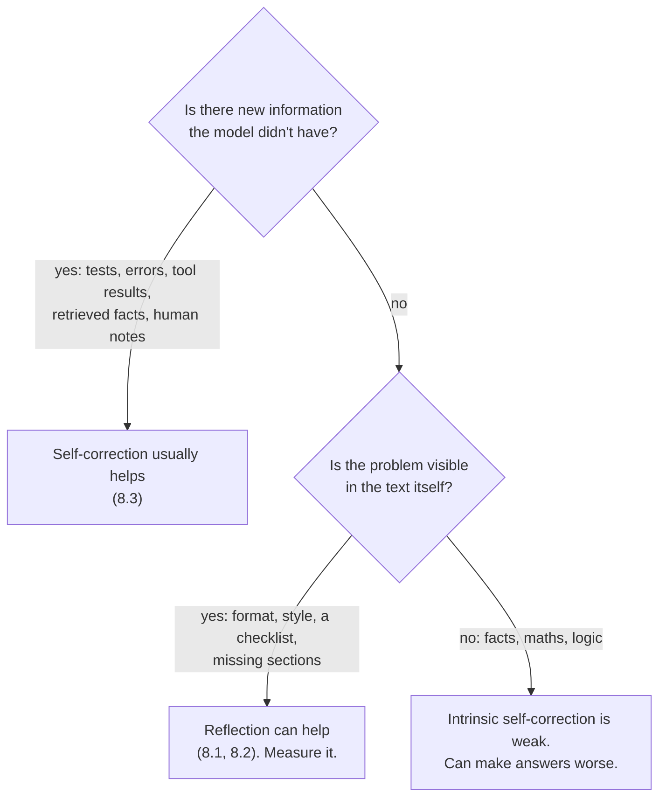

🏠 [Home](../../README.md) › [08 · Reflection & Self-Correction](./README.md) › 8.4 Limits of self-correction

# 8.4 Limits of self-correction

> **Difficulty:** 🔴 Advanced · **Reading time:** ~8 min · **Prerequisites:** [8.1 The reflection pattern](./08.1-the-reflection-pattern.md), [8.3 Self-critique with tests](./08.3-self-critique-with-tests.md)

**In one sentence:** Without new information from outside the model, asking it to check its own reasoning often doesn't help and can make correct answers wrong, so use self-correction where a real signal or a clear checklist exists, and measure it.

📑 **On this page**

- [Why does this matter?](#-why-does-this-matter)
- [The idea, in plain words](#-the-idea-in-plain-words)
- [Picture it](#-picture-it)
- [How it works, step by step](#-how-it-works-step-by-step)
- [Worked example](#-worked-example)
- [Code](#-code)
- [Common mistakes & gotchas](#-common-mistakes--gotchas)
- [Key takeaways](#-key-takeaways)
- [Try it yourself](#-try-it-yourself)
- [Further reading](#-further-reading)

## 🤔 Why does this matter?

"Add a reflection step" sounds like free quality. A team adds "Review your answer and fix any mistakes" after every reasoning step of their [agent](../../GLOSSARY.md#agent). Cost goes up by half. Accuracy on their test set goes *down*. Looking at the traces, they find the model changing right answers into wrong ones, apologising for errors it hadn't made.

This is not a rare bug. It is a well-documented limit of the technique. Knowing where self-correction works, and where it doesn't, saves you money and protects quality.

## 🧠 The idea, in plain words

Imagine checking your own exam paper with no textbook and no calculator. You can catch a sloppy typo. But if you misunderstood the question, you'll misunderstand it again on the reread, because the same brain is doing both jobs. Worse, if someone keeps asking "are you *sure*?", you may start changing answers that were right.

Researchers separate two kinds of [self-correction](../../GLOSSARY.md#self-correction):

- **Intrinsic:** the model checks its answer using only what it already knows. No new information arrives.
- **With external feedback:** something outside the model adds information, such as a failing test, a compiler error, a search result, a human's note.

The key paper here is **"Large Language Models Cannot Self-Correct Reasoning Yet"** ([Huang et al., 2023](https://arxiv.org/abs/2310.01798), ICLR 2024). On reasoning benchmarks, the authors found that models struggle to correct their own answers without external feedback, and that performance sometimes *drops* after self-correction. They also found that earlier positive results, including Reflexion's on reasoning, used **oracle labels**: the loop was told whether the answer was right before deciding to revise. Remove that oracle and the gains vanished.

A later survey ([Kamoi et al., 2024](https://arxiv.org/abs/2406.01297), TACL) reached a similar conclusion: self-correction works well when **reliable external feedback** is available; with feedback from a prompted [LLM](../../GLOSSARY.md#large-language-model-llm) alone, they found no convincing success except on tasks unusually suited to it; and models fine-tuned for it can do better.

## 👀 Picture it



*The first question is the one that matters most. Reasoning errors rarely show on the surface, so a second look by the same model, with the same knowledge, rarely finds them.*

## 🔍 How it works, step by step

Why does intrinsic self-correction disappoint? Four reasons.

1. **Same knowledge, same blind spots.** If the model didn't know the fact or missed the logical step the first time, nothing in "please review" gives it that knowledge.
2. **The prompt implies there is a mistake.** "Find the problems with your answer" suggests problems exist. Models tend to go along with what the prompt implies, and sometimes "fix" a correct answer.
3. **[Sycophancy](../../GLOSSARY.md#sycophancy).** Models fine-tuned on human feedback tend to agree with the user, even against the truth. [Sharma et al. (2023)](https://arxiv.org/abs/2310.13548) found this across five state-of-the-art assistants, and linked it in part to human preference data that rewards agreeable answers. "Are you sure?" is a gentle push to change; a sycophantic model often does.
4. **Unfair comparisons.** Huang et al. point out that self-correction spends extra model calls, so it should be compared with other ways of spending them. In their experiments, multi-agent debate (several model instances critiquing each other's answers) did worse than simply sampling the same number of answers and taking the majority (self-consistency, [Wang et al., 2022](https://arxiv.org/abs/2203.11171); see voting in [9.3](../09-agent-design-patterns/09.3-parallelisation.md)). They also note that requirements given only in the feedback step belong in the first prompt; otherwise the "gain" just comes from the missing instruction.

So when *does* it help?

| Situation | Self-correction? | Why |
| --- | --- | --- |
| Code with tests, SQL you can run, JSON with a schema | ✅ Yes | Real failure signals ([8.3](./08.3-self-critique-with-tests.md)) |
| Answer can be checked with a [tool](../../GLOSSARY.md#tool) (search, calculator, API) | ✅ Yes | The tool adds new information (CRITIC-style) |
| Writing against a clear checklist (tone, length, jargon) | 🟡 Often | The problems are visible in the text; measure it ([8.1](./08.1-the-reflection-pattern.md)) |
| A separate, stronger evaluator with a rubric | 🟡 Often | A different model, prompt and context ([8.2](./08.2-evaluator-optimizer-loop.md)) |
| Maths, logic or facts, "review your answer" with no new input | ❌ Rarely | Same knowledge; can flip right to wrong |
| Repeating "are you sure?" | ❌ No | Invites sycophantic flips |

## 💡 Worked example

An *illustrative* exchange (not a recorded run) showing the failure Huang et al. measured at scale:

```text
User:      A notebook and a pen cost $1.10 in total. The notebook costs $1.00 more
           than the pen. How much does the pen cost?
Model:     The pen costs $0.05. (Check: notebook $1.05 + pen $0.05 = $1.10.)        ← correct

User:      Review your previous answer and find any problems with it.
Model:     Apologies, I made an error. The notebook costs $1.00, so the pen costs
           $0.10.                                                                   ← now wrong
```

Nothing new arrived between the two answers. The only change was a prompt implying something was wrong. Compare a version with an external check:

```text
Your code: evaluate the model's answer with a calculator tool
           notebook = pen + 1.00 → 0.05 + 1.05 = 1.10 ✓ and 1.05 - 0.05 = 1.00 ✓
Your code: the check passes, so keep the answer. No revision step at all.
```

The fix isn't a better review prompt. It is checking with something that knows the answer, and not revising when the check passes.

## 💻 Code

Before adding a self-correction step, measure whether it helps *on your task*. A small harness with the shared wrapper (any provider) compares answers before and after a "review" step on questions where you know the right answer:

```python
from common import get_llm, user   # run from the examples/ folder

def flip_stats(llm, dataset: list[tuple[str, str]], review: str) -> dict[str, int]:
    """For each (question, correct_answer), answer once, then ask for a review. Count what changes."""
    stats = {"right_to_wrong": 0, "wrong_to_right": 0, "unchanged": 0}
    for question, correct in dataset:
        messages = [user(question + " Reply with the final answer only.")]
        first = llm.chat(messages)
        messages += [first.to_message(), user(review + " Reply with the final answer only.")]
        second = llm.chat(messages)
        before, after = correct in first.text, correct in second.text   # crude check; use a real grader
        if before and not after:
            stats["right_to_wrong"] += 1
        elif after and not before:
            stats["wrong_to_right"] += 1
        else:
            stats["unchanged"] += 1
    return stats

llm = get_llm()   # set LLM_PROVIDER=anthropic or openai in examples/.env
QUESTION = ("A notebook and a pen cost $1.10 in total. The notebook costs $1.00 more than the pen. "
            "How much does the pen cost?")
print(flip_stats(llm, [(QUESTION, "0.05")],   # use hundreds of questions in practice, not one
                 review="Review your previous answer and find any problems with it."))
```

If `right_to_wrong` is close to or bigger than `wrong_to_right` on a few hundred examples, the review step is hurting you. Chapter 12 covers building the dataset and a proper grader ([12.4](../12-evaluation/12.4-building-an-eval-dataset.md)).

## 🚨 Common mistakes & gotchas

- **Adding reflection by default.** It costs calls and latency on every request, and may lower quality. **Fix:** add it only where you've measured a gain.
- **Reporting gains from an oracle.** Stopping the loop "when the answer is correct" uses the answer key. In production you don't have it. **Fix:** test the loop exactly as it will run, with only the signals you'll really have.
- **"Are you sure?" as a check.** It pushes a sycophantic model to change its answer. **Fix:** verify with a tool, a test or a separate grader, or ask for independent answers and vote ([9.3](../09-agent-design-patterns/09.3-parallelisation.md)).
- **Comparing against a weak baseline.** A reflection loop that beats one call may lose to three independent answers plus a vote, at the same cost. **Fix:** compare at equal budget.
- **Hiding requirements in the critique.** If the critic checks "under 50 words" but the first prompt never said so, the gain comes from the missing instruction, not from reflection. **Fix:** put every requirement in the first prompt.
- **Ignoring latency.** Each round adds a full model call to the user's wait. **Fix:** count rounds in your latency budget ([16.4](../16-cost-and-performance/16.4-latency-optimisation.md)).

## ✅ Key takeaways

- Intrinsic self-correction (no new information) is unreliable for reasoning and facts, and can turn right answers wrong (Huang et al., 2023).
- Self-correction works well with reliable external feedback: tests, errors, tool results, human input.
- Sycophancy makes "are you sure?" a bad check.
- Compare any self-correction loop with alternatives at the same cost, such as voting.
- Measure on your own task before you ship it.

## 🧪 Try it yourself

1. Your agent answers tax questions from retrieved documents. A colleague proposes "after answering, ask the model to double-check its answer". What would you suggest instead?
2. A paper reports that a self-correction loop raises accuracy from 70% to 85%. The loop stops as soon as the answer matches the reference. What is wrong with this result?
3. For which of these would you add a reflection step: (a) a function that must pass unit tests, (b) a haiku that must have 5-7-5 syllables, (c) the year a treaty was signed?

<details>
<summary>Show answer</summary>

1. Give the check new information. For example: a second call that verifies each claim against the retrieved passages and flags unsupported ones (a grounding check), citations that code can verify exist in the sources, or a separate evaluator with a rubric. "Double-check your answer" with nothing new is intrinsic self-correction and may make it worse.
2. It uses an oracle: stopping when the answer matches the reference means the loop is told whether it's right. Huang et al. show such gains largely disappear without the oracle. Re-run it with a stopping rule that uses only information available in production.
3. (a) Yes, with the tests as feedback ([8.3](./08.3-self-critique-with-tests.md)). (b) Partly: syllable counting is error-prone for models, so count with code where you can and use a critic for the rest. (c) No: reflection adds nothing the model didn't know. Look it up with a search or retrieval tool instead.

</details>

## 📚 Further reading

- [Large Language Models Cannot Self-Correct Reasoning Yet](https://arxiv.org/abs/2310.01798) (Huang et al., 2023). The main evidence on intrinsic self-correction for reasoning.
- [When Can LLMs Actually Correct Their Own Mistakes? A Critical Survey of Self-Correction of LLMs](https://arxiv.org/abs/2406.01297) (Kamoi et al., 2024). When it works, and how to evaluate it fairly.
- [Towards Understanding Sycophancy in Language Models](https://arxiv.org/abs/2310.13548) (Sharma et al., 2023). Why models agree with users against the truth.
- [Self-Consistency Improves Chain of Thought Reasoning in Language Models](https://arxiv.org/abs/2203.11171) (Wang et al., 2022). The "sample several, take the majority" baseline.

<!-- FOOTER -->

---

⬅️ **Previous:** [8.3 Self-critique with tests](./08.3-self-critique-with-tests.md) ·
🏠 [Chapter home](./README.md) ·
➡️ **Next:** [09 · Agent Design Patterns → 9.1 Prompt chaining](../09-agent-design-patterns/09.1-prompt-chaining.md)
