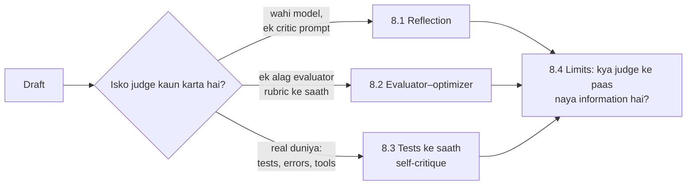

🏠 [Home](../../README.md) › 08 · Reflection & Self-Correction

# 08 · Reflection & Self-Correction

> **Padhne ka time:** ~36 min · **Level:** 🟡 Intermediate se 🔴 Advanced tak · **Pehle padho:** [01 · Foundations](../01-foundations/README.md), [02 · The Agent Loop](../02-the-agent-loop/README.md)

Models aam taur pe ek hi baar mein likhte hain aur kabhi peeche mud ke nahi dekhte. Yeh chapter dikhata hai ki ek [agent](../../GLOSSARY.md#agent) ko doosri nazar kaise dein. Ek critic jo draft review kare, ek alag evaluator jo rubric ke against grade kare, aur sabse powerful, real signals jaise test results jo exactly batate hain ki kya galat hai. Aakhir mein hum imaandaari se research dekhte hain ki self-correction kab fail hota hai, taaki tum isko wahan add karo jahan help kare aur wahan chhod do jahan na kare.

## 🎯 Is chapter mein kya seekhoge

- Reflection pattern: draft, critique, revise, round limit aur ek strict "no issues" verdict ke saath
- Self-Refine aur Reflexion: do sabse mashhoor papers ne asal mein kya kiya
- Evaluator–optimizer loop: alag generator aur evaluator, ek rubric, code mein hard checks, aur best-attempt fallback
- External feedback ke saath self-correction: generate hue code ko subprocess mein timeout ke saath tests ke against chalana, aur failures wapas dena
- Reasoning ke liye intrinsic self-correction aksar fail kyun hota hai, sycophancy isko aur bura kaise banati hai, aur kaise measure karein ki yeh help karta hai ya nahi

## 📋 Pehle se kya aana chahiye

- [1.4 LLMs kaise kaam karte hain (bas utna jitna zaroori hai)](../01-foundations/01.4-how-llms-work.md) aur [1.5 Agent ke andar kya-kya hota hai](../01-foundations/01.5-anatomy-of-an-agent.md)
- [2.4 Agent kab ruke: stopping conditions](../02-the-agent-loop/02.4-stopping-conditions.md): yahan har loop ko ek chahiye
- 8.3 ke liye kaam aayega: [3.6 Code execution ek tool ki tarah](../03-tools-and-function-calling/03.6-code-execution-as-a-tool.md)

## 👀 Chapter ek nazar mein

*Left se right padho, reliability badhti jaati hai. Judge jitna independent aur zameen se juda (grounded) hoga, correction pe utna hi bharosa kar sakte ho. Kyun, yeh page 8.4 samjhaata hai.*

## 📄 Is chapter ke pages

<!-- PAGES:START -->
| # | Page | Level | Time |
| --- | --- | --- | --- |
| 8.1 | [Reflection pattern](./08.1-the-reflection-pattern.md) — Draft, critique, revise. | 🟡 Intermediate | ~8 min |
| 8.2 | [Evaluator–optimizer loop](./08.2-evaluator-optimizer-loop.md) — Ek model generate karta hai, doosra grade karta hai, aur loop chalta rehta hai. | 🟡 Intermediate | ~10 min |
| 8.3 | [Tests ke saath self-critique](./08.3-self-critique-with-tests.md) — Raay ki jagah test results jaise real signals use karo. | 🟡 Intermediate | ~10 min |
| 8.4 | [Self-correction ki limits](./08.4-limits-of-self-correction.md) — Jab agent apni galtiyan khud theek nahi kar sakta. | 🔴 Advanced | ~8 min |
<!-- PAGES:END -->

<!-- FOOTER -->

---

⬅️ **Pichla chapter:** [07 · Planning & Reasoning](../07-planning-and-reasoning/README.md) ·
▶️ **Padhna shuru karo:** [8.1 Reflection pattern](./08.1-the-reflection-pattern.md) ·
➡️ **Agla chapter:** [09 · Agent Design Patterns](../09-agent-design-patterns/README.md)
