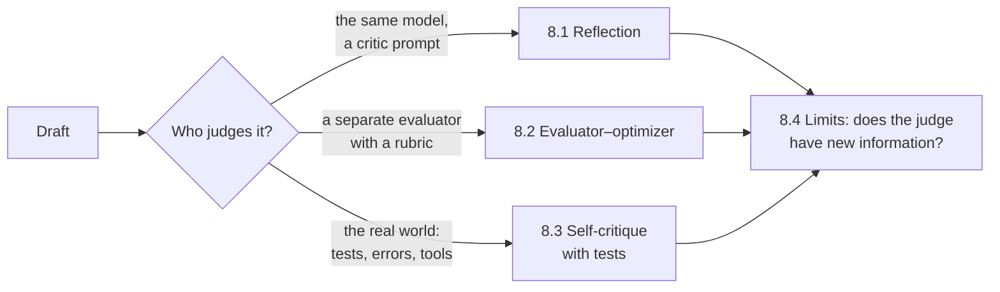

🏠 [Home](../../README.md) › 08 · Reflection & Self-Correction

# 08 · Reflection & Self-Correction

> **Estimated reading time:** ~36 min · **Difficulty:** 🟡 Intermediate to 🔴 Advanced · **Prerequisites:** [01 · Foundations](../01-foundations/README.md), [02 · The Agent Loop](../02-the-agent-loop/README.md)

Models usually write in one pass and never look back. This chapter shows how to give an [agent](../../GLOSSARY.md#agent) a second look: a critic that reviews a draft, a separate evaluator that grades against a rubric, and, most powerful of all, real signals such as test results that say exactly what is wrong. It ends with an honest look at the research on when self-correction fails, so you add it where it helps and skip it where it doesn't.

## 🎯 What you'll learn

- The reflection pattern: draft, critique, revise, with a round limit and a strict "no issues" verdict
- Self-Refine and Reflexion: what the two best-known papers actually did
- The evaluator–optimizer loop: separate generator and evaluator, a rubric, hard checks in code, and a best-attempt fallback
- Self-correction with external feedback: running generated code against tests in a subprocess with a timeout, and feeding failures back
- Why intrinsic self-correction often fails for reasoning, how sycophancy makes it worse, and how to measure whether it helps

## 📋 Prerequisites

- [1.4 How LLMs work](../01-foundations/01.4-how-llms-work.md) and [1.5 Anatomy of an agent](../01-foundations/01.5-anatomy-of-an-agent.md)
- [2.4 Stopping conditions](../02-the-agent-loop/02.4-stopping-conditions.md): every loop here needs one
- Helpful for 8.3: [3.6 Code execution as a tool](../03-tools-and-function-calling/03.6-code-execution-as-a-tool.md)

## 👀 Chapter overview

*Read left to right as rising reliability. The more independent and grounded the judge, the more you can trust the correction. Page 8.4 explains why.*

## 📄 Pages in this chapter

<!-- PAGES:START -->
| # | Page | Level | Time |
| --- | --- | --- | --- |
| 8.1 | [The reflection pattern](./08.1-the-reflection-pattern.md) — Draft, critique, revise. | 🟡 Intermediate | ~8 min |
| 8.2 | [The evaluator–optimizer loop](./08.2-evaluator-optimizer-loop.md) — One model generates, another grades, and the loop repeats. | 🟡 Intermediate | ~10 min |
| 8.3 | [Self-critique with tests](./08.3-self-critique-with-tests.md) — Use real signals like test results instead of opinions. | 🟡 Intermediate | ~10 min |
| 8.4 | [Limits of self-correction](./08.4-limits-of-self-correction.md) — When an agent cannot fix its own mistakes. | 🔴 Advanced | ~8 min |
<!-- PAGES:END -->

<!-- FOOTER -->

---

⬅️ **Previous chapter:** [07 · Planning & Reasoning](../07-planning-and-reasoning/README.md) ·
▶️ **Start reading:** [8.1 The reflection pattern](./08.1-the-reflection-pattern.md) ·
➡️ **Next chapter:** [09 · Agent Design Patterns](../09-agent-design-patterns/README.md)
