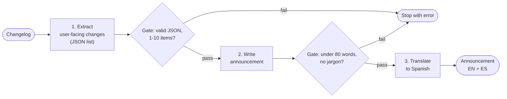

🏠 [Home](../../README.md) › [09 · Agent Design Patterns](./README.md) › 9.1 Prompt chaining

# 9.1 Prompt chaining

> **Difficulty:** 🟢 Beginner · **Reading time:** ~7 min · **Prerequisites:** [1.2 Chatbot vs workflow vs agent](../01-foundations/01.2-chatbot-vs-workflow-vs-agent.md)

**In one sentence:** Prompt chaining splits a task into a fixed sequence of steps, one LLM call each, where every step works on the previous step's output and code "gates" in between stop the chain when something looks wrong.

📑 **On this page**

- [Why does this matter?](#-why-does-this-matter)
- [The idea, in plain words](#-the-idea-in-plain-words)
- [Picture it](#-picture-it)
- [How it works, step by step](#-how-it-works-step-by-step)
- [Worked example](#-worked-example)
- [Code](#-code)
- [Common mistakes & gotchas](#-common-mistakes--gotchas)
- [Key takeaways](#-key-takeaways)
- [Try it yourself](#-try-it-yourself)
- [Further reading](#-further-reading)

## 🤔 Why does this matter?

Every Friday someone on your team turns the developer changelog into an in-app announcement, in English and Spanish. You try one big prompt: "Read this changelog, pick what users care about, write a friendly announcement under 80 words, then translate it." Sometimes it's great. Sometimes it mentions "bumped httpx", sometimes it runs to 150 words, and sometimes the Spanish version has a sentence the English one doesn't.

When it goes wrong, you can't tell which part failed. Prompt chaining fixes that by giving each part its own [LLM](../../GLOSSARY.md#large-language-model-llm) call and checking the result before moving on. It is the simplest of the patterns in this chapter, and often the only one you need.

## 🧠 The idea, in plain words

Think of an assembly line. Each station does one job well and passes its work on. An inspector stands between stations: if a part is faulty, the line stops there, instead of wasting work on it further down.

[Prompt chaining](../../GLOSSARY.md#prompt-chaining) is the same:

- **Fixed steps.** Your code decides the order in advance. This is a [workflow](../../GLOSSARY.md#workflow), not an [agent](../../GLOSSARY.md#agent): the model never chooses what happens next.
- **One job per call.** Each call has a short, focused prompt, so it is an easier task for the model, and easier for you to test.
- **[Gates](../../GLOSSARY.md#gate) between steps.** A gate is a check in plain code: is it valid JSON, under the word limit, free of banned words? If it fails, stop (or retry that step), rather than passing bad output along.

Anthropic's [Building effective agents](https://www.anthropic.com/engineering/building-effective-agents) describes this trade clearly: you accept a little more latency (several calls instead of one) in exchange for higher accuracy, because each call does an easier job. It fits tasks that split cleanly into fixed subtasks, such as writing copy and then translating it, or writing an outline, checking it, and then writing the document.

## 👀 Picture it



*Each box is one LLM call; each diamond is plain code. A failure at the first gate costs one call, not three, and tells you exactly which step broke.*

## 🔍 How it works, step by step

1. **Find the natural seams.** Look for points where the output of one job is the input of the next: extract → write → translate; outline → check → draft.
2. **Give each step a narrow prompt.** Step 1 doesn't need to know about the 80-word limit; step 3 doesn't need the changelog.
3. **Make intermediate output structured.** JSON lists or fixed headings are easy for gates to check and for the next step to read.
4. **Pass only what the next step needs.** Step 2 gets the clean list, not the noisy changelog. Smaller inputs mean lower cost and fewer distractions.
5. **Gate in code.** Parse, count, search for banned words, compare against a schema. Gates are free, fast and deterministic. Raise a clear error naming the step and the rule.
6. **Decide what a failure does.** Stop the chain, retry that one step (with the gate's message as feedback), or hand off to a person. Retry at most once or twice.
7. **Log each step.** Inputs, outputs and gate results per step make failures easy to find.

## 💡 Worked example

From [`examples/09-prompt-chaining`](../../examples/09-prompt-chaining/README.md). The input changelog:

```text
- fix(export): CSV export no longer drops rows with emoji (#812)
- chore(deps): bump httpx 0.27 -> 0.28
- feat(budgets): monthly budgets can now roll over unused money
- refactor(api): split accounts service into two modules
- feat(ui): dark mode for the reports page
```

The run, offline:

```text
step 1 extract   -> 3 user-facing changes (gate passed)
step 2 write     -> 33 words (gate passed)
step 3 translate -> done

English:
New this week: unused money in your monthly budgets can now roll over to next month, the reports page has a dark mode, and CSV exports keep every row, even ones with emoji.

Spanish:
Novedades de esta semana: el dinero que no uses en tus presupuestos mensuales ahora puede pasar al mes siguiente, la página de informes tiene modo oscuro y las exportaciones CSV conservan todas las filas, incluso las que tienen emojis.
```

Step 1 dropped the dependency bump and the refactor, and returned `["CSV exports now keep rows that contain emoji", "Unused budget money can roll over to the next month", "The reports page has a dark mode"]`. Step 2 never saw "chore(deps)", so it couldn't leak it. If step 1 had replied with prose instead of JSON, the chain would have stopped after one call with `Chain stopped: step 1 did not return JSON: ...`. The tests check exactly that.

## 💻 Code

The chain is ordinary Python: call, check, call, check. From [`examples/09-prompt-chaining/main.py`](../../examples/09-prompt-chaining/main.py), slightly shortened:

```python
class GateFailed(Exception):
    """A check between two steps failed, so the chain stopped."""

def gate_changes(text: str) -> list[str]:
    try:
        changes = json.loads(text)
    except json.JSONDecodeError as exc:
        raise GateFailed(f"step 1 did not return JSON: {exc}") from exc
    if not isinstance(changes, list) or not 1 <= len(changes) <= 10:
        raise GateFailed("step 1 must return a list of 1 to 10 changes")
    return changes

def run_chain(llm, changelog: str) -> ChainResult:
    # Step 1: extract (one narrow job, structured output)
    raw = llm.chat([user(f"Changelog:\n{changelog}")],
                   system="Keep only changes a USER would notice, in plain words. Reply with a JSON list of strings.").text
    changes = gate_changes(raw)                                    # gate 1

    # Step 2: write (gets only the clean list)
    bullets = "\n".join(f"- {c}" for c in changes)
    announcement = llm.chat([user(f"Changes:\n{bullets}")],
                            system="Write a friendly in-app announcement in under 80 words.").text
    gate_announcement(announcement)                                # gate 2: length, no jargon

    # Step 3: translate (one job)
    translation = llm.chat([user(announcement)], system="Translate into Spanish. Reply with the translation only.").text
    return ChainResult(changes, announcement, translation)
```

Nothing here needs a framework. The `llm` object is the shared wrapper, so the same chain runs on Anthropic, OpenAI or `MockLLM`. With the raw SDKs, each `llm.chat(...)` is one `client.messages.create(...)` or `client.chat.completions.create(...)` call ([1.4](../01-foundations/01.4-how-llms-work.md#-code)).

## 🚨 Common mistakes & gotchas

- **Chaining when one call would do.** Three calls cost roughly three times the latency. **Fix:** try one well-written prompt first; chain only when it measurably fails ([9.7](./09.7-choosing-a-pattern.md)).
- **No gates.** Without checks, a bad step 1 silently ruins every later step, and you pay for all of them. **Fix:** at least a format check after any step whose output another step depends on.
- **Gates that ask an LLM.** A gate that is itself a model call is slow and can be wrong. **Fix:** keep gates in code where possible; if you need judgement, that's an evaluator ([8.2](../08-reflection-and-self-correction/08.2-evaluator-optimizer-loop.md)).
- **Passing the whole history to every step.** It adds cost and lets earlier noise leak through. **Fix:** pass only what the next step needs.
- **Errors that compound.** If each of three steps is right 95% of the time, the chain is fully right about 86% of the time ([compounding errors](../../GLOSSARY.md#compounding-errors)). **Fix:** gates catch the failures you can detect; keep chains short.
- **Splitting work that isn't sequential.** If steps don't depend on each other, run them at the same time ([9.3](./09.3-parallelisation.md)).

## ✅ Key takeaways

- A prompt chain is a fixed sequence of focused LLM calls; code, not the model, decides the order.
- Gates in plain code between steps stop bad output early and show exactly where things broke.
- Each step gets only what it needs, which cuts cost and prevents leaks.
- You trade some latency for accuracy and debuggability.
- Start with one prompt; chain when it measurably fails.

## 🧪 Try it yourself

1. In the example, script step 2 to return "We refactored the accounts service and bumped deps." What happens, and how many model calls are made?
2. Add a step 4 that writes a push-notification title of at most 40 characters. Where would you put its gate, and what would it check?
3. A teammate says: "Let's just give one prompt all three instructions; it's cheaper." When is that the right call?

<details>
<summary>Show answer</summary>

1. Gate 2 raises `GateFailed("announcement contains internal jargon: 'refactor'")` and the chain stops after two calls; step 3 never runs. The test `test_gate_rejects_jargon_in_the_announcement` covers this.
2. After step 4: check `len(title) <= 40`, that it isn't empty, and perhaps that it contains no internal words. Step 4's input should be the English announcement, not the changelog. Since step 3 and step 4 both depend only on step 2, they could also run in parallel.
3. When one prompt meets your quality bar on a representative set of inputs. It is cheaper and faster. Chaining earns its keep when the single prompt fails in ways you can't fix by editing it, or when you need to check or log intermediate results.

</details>

## 📚 Further reading

- [Building effective agents](https://www.anthropic.com/engineering/building-effective-agents) (Anthropic). Prompt chaining with gates, and when to use it.
- [Agent patterns cookbook](https://github.com/anthropics/claude-cookbooks/tree/main/patterns/agents) (Anthropic). Reference notebooks for the basic workflow patterns.
- [OpenAI Agents SDK](https://openai.github.io/openai-agents-python/) (OpenAI docs). How one framework expresses these building blocks; compare it with the plain code once you have built them by hand ([chapter 11](../11-frameworks/README.md)).

<!-- FOOTER -->

---

⬅️ **Previous:** [8.4 Limits of self-correction](../08-reflection-and-self-correction/08.4-limits-of-self-correction.md) ·
🏠 [Chapter home](./README.md) ·
➡️ **Next:** [9.2 Routing](./09.2-routing.md)
