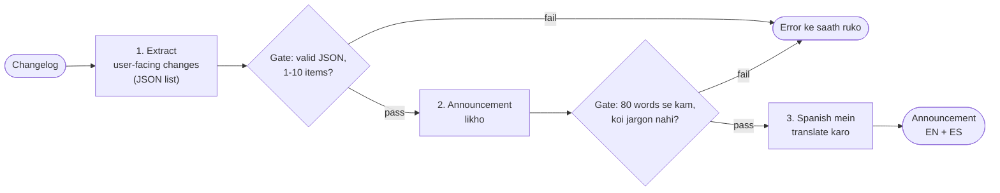

🏠 [Home](../../README.md) › [09 · Agent Design Patterns](./README.md) › 9.1 Prompt chaining

# 9.1 Prompt chaining

> **Level:** 🟢 Beginner · **Padhne ka time:** ~7 min · **Pehle padho:** [1.2 Chatbot, workflow aur agent mein farak](../01-foundations/01.2-chatbot-vs-workflow-vs-agent.md)

**Ek line mein:** Prompt chaining ek task ko fixed steps ki line mein tod deta hai, har step ek LLM call. Har step pichle step ke output par kaam karta hai, aur beech mein code ke "gates" chain ko rok dete hain jab kuch galat dikhe.

📑 **Is page par**

- [Yeh kyun zaroori hai?](#-yeh-kyun-zaroori-hai)
- [Idea, simple words mein](#-idea-simple-words-mein)
- [Diagram se samjho](#-diagram-se-samjho)
- [Kaise kaam karta hai, step by step](#-kaise-kaam-karta-hai-step-by-step)
- [Example se samjho](#-example-se-samjho)
- [Code](#-code)
- [Aam galtiyan aur dhyan dene wali baatein](#-aam-galtiyan-aur-dhyan-dene-wali-baatein)
- [Yaad rakhne wali baatein](#-yaad-rakhne-wali-baatein)
- [Khud try karo](#-khud-try-karo)
- [Aur padhne ke liye](#-aur-padhne-ke-liye)

## 🤔 Yeh kyun zaroori hai?

Har Friday tumhari team ka koi banda developer changelog ko in-app announcement mein badalta hai, English aur Spanish dono mein. Tum ek bada prompt try karte ho: "Read this changelog, pick what users care about, write a friendly announcement under 80 words, then translate it." Kabhi result badhiya aata hai. Kabhi usmein "bumped httpx" aa jata hai. Kabhi woh 150 words tak chala jata hai. Aur kabhi Spanish version mein aisa sentence hota hai jo English mein hai hi nahi.

Jab kuch galat hota hai, tum bata nahi pate ki kaunsa hissa fail hua. Prompt chaining yeh problem solve karta hai. Har hisse ko apni alag [LLM](../../GLOSSARY.md#large-language-model-llm) call milti hai, aur aage badhne se pehle result check hota hai. Is chapter ke patterns mein yeh sabse simple hai, aur aksar sirf isi ki zaroorat hoti hai.

## 🧠 Idea, simple words mein

Ek assembly line socho. Har station ek kaam achhe se karta hai aur apna kaam aage pass kar deta hai. Stations ke beech ek inspector khada hai. Agar koi part kharab hai, toh line wahin ruk jati hai. Aage us par kaam barbaad nahi hota.

Ghar ka example lo: chai banana. Pehle paani ubaalo, phir patti daalo, phir doodh, phir cheeni. Har step ke baad tum dekhte ho ki sab theek hai. Agar doodh phat gaya, toh tum wahin ruk jaate ho, cheeni daal ke waste nahi karte.

[Prompt chaining](../../GLOSSARY.md#prompt-chaining) bhi aisa hi hai:

- **Fixed steps.** Order tumhara code pehle se decide karta hai. Yeh ek [workflow](../../GLOSSARY.md#workflow) hai, [agent](../../GLOSSARY.md#agent) nahi. Model kabhi decide nahi karta ki aage kya hoga.
- **Har call ka ek kaam.** Har call ka prompt chhota aur focused hota hai. Isliye model ke liye task aasaan hota hai, aur tumhare liye test karna bhi.
- **Steps ke beech [gates](../../GLOSSARY.md#gate).** Gate ek check hai, plain code mein. Kya yeh valid JSON hai? Word limit ke andar hai? Banned words toh nahi hain? Agar check fail ho, toh ruk jao (ya wahi step retry karo). Kharab output aage mat bhejo.

Anthropic ka [Building effective agents](https://www.anthropic.com/engineering/building-effective-agents) is trade-off ko clearly samjhata hai. Tum thodi zyada latency accept karte ho (ek ki jagah kai calls), aur badle mein accuracy badhti hai, kyunki har call ka kaam aasaan hota hai. Yeh un tasks ke liye fit hai jo saaf-saaf fixed subtasks mein toot jaate hain. Jaise copy likhna aur phir use translate karna. Ya outline likhna, use check karna, aur phir document likhna.

## 👀 Diagram se samjho



*Har box ek LLM call hai. Har diamond plain code hai. Pehle gate par fail hone se sirf ek call ka kharcha hota hai, teen ka nahi. Aur tumhe exactly pata chal jata hai ki kaunsa step toota.*

## 🔍 Kaise kaam karta hai, step by step

1. **Natural joints dhundo.** Woh jagah dekho jahan ek kaam ka output agle kaam ka input hai: extract → write → translate; outline → check → draft.
2. **Har step ko narrow prompt do.** Step 1 ko 80-word limit ke baare mein jaanne ki zaroorat nahi. Step 3 ko changelog ki zaroorat nahi.
3. **Beech ka output structured rakho.** JSON lists ya fixed headings ko gates aasani se check kar lete hain, aur agla step aasani se padh leta hai.
4. **Agle step ko sirf utna do jitna use chahiye.** Step 2 ko saaf list milti hai, noisy changelog nahi. Chhota input matlab kam cost aur kam distraction.
5. **Gate code mein lagao.** Parse karo, count karo, banned words search karo, schema se compare karo. Gates free, fast aur deterministic hote hain. Saaf error raise karo jismein step aur rule ka naam ho.
6. **Decide karo ki failure par kya hoga.** Chain rok do, sirf woh ek step retry karo (gate ka message feedback ke roop mein deke), ya kisi insaan ko de do. Zyada se zyada ek ya do baar retry karo.
7. **Har step log karo.** Har step ke inputs, outputs aur gate results log hon, toh failures dhundna aasaan ho jata hai.

## 💡 Example se samjho

Input changelog yeh hai:

```text
- fix(export): CSV export no longer drops rows with emoji (#812)
- chore(deps): bump httpx 0.27 -> 0.28
- feat(budgets): monthly budgets can now roll over unused money
- refactor(api): split accounts service into two modules
- feat(ui): dark mode for the reports page
```

Scripted replies ke saath ek run aisa dikhta hai:

```text
step 1 extract   -> 3 user-facing changes (gate passed)
step 2 write     -> 33 words (gate passed)
step 3 translate -> done

English:
New this week: unused money in your monthly budgets can now roll over to next month, the reports page has a dark mode, and CSV exports keep every row, even ones with emoji.

Spanish:
Novedades de esta semana: el dinero que no uses en tus presupuestos mensuales ahora puede pasar al mes siguiente, la página de informes tiene modo oscuro y las exportaciones CSV conservan todas las filas, incluso las que tienen emojis.
```

Step 1 ne dependency bump aur refactor hata diye, aur yeh return kiya: `["CSV exports now keep rows that contain emoji", "Unused budget money can roll over to the next month", "The reports page has a dark mode"]`. Step 2 ne "chore(deps)" kabhi dekha hi nahi, isliye woh use leak kar hi nahi sakta tha. Agar step 1 JSON ki jagah normal text mein jawab deta, toh chain ek call ke baad hi ruk jaati, is message ke saath: `Chain stopped: step 1 did not return JSON: ...`. Tests exactly yahi check karte hain.

## 💻 Code

Chain normal Python hai: call, check, call, check. Thoda chhota karke:

```python
class GateFailed(Exception):
    """Do steps ke beech ka check fail hua, isliye chain ruk gayi."""

def gate_changes(text: str) -> list[str]:
    try:
        changes = json.loads(text)
    except json.JSONDecodeError as exc:
        raise GateFailed(f"step 1 did not return JSON: {exc}") from exc
    if not isinstance(changes, list) or not 1 <= len(changes) <= 10:
        raise GateFailed("step 1 must return a list of 1 to 10 changes")
    return changes

def run_chain(llm, changelog: str) -> ChainResult:
    # Step 1: extract (ek narrow kaam, structured output)
    raw = llm.chat([user(f"Changelog:\n{changelog}")],
                   system="Keep only changes a USER would notice, in plain words. Reply with a JSON list of strings.").text
    changes = gate_changes(raw)                                    # gate 1

    # Step 2: write (sirf saaf list milti hai)
    bullets = "\n".join(f"- {c}" for c in changes)
    announcement = llm.chat([user(f"Changes:\n{bullets}")],
                            system="Write a friendly in-app announcement in under 80 words.").text
    gate_announcement(announcement)                                # gate 2: length, koi jargon nahi

    # Step 3: translate (ek kaam)
    translation = llm.chat([user(announcement)], system="Translate into Spanish. Reply with the translation only.").text
    return ChainResult(changes, announcement, translation)
```

Isme kisi framework ki zaroorat nahi. `llm` koi bhi chat-model client hai jiska `.chat(messages, system=...)` ek reply return karta hai jismein `.text` ho. `user()` ek user message dict banata hai. Isliye wahi chain Anthropic, OpenAI ya tests mein scripted fake model par chal sakti hai. Raw SDKs ke saath, har `llm.chat(...)` ek `client.messages.create(...)` ya `client.chat.completions.create(...)` call hai ([1.4](../01-foundations/01.4-how-llms-work.md#-code)).

## 🚨 Aam galtiyan aur dhyan dene wali baatein

- **Jab ek call kaafi ho, tab bhi chain banana.** Teen calls mein lagbhag teen guna latency lagti hai. **Fix:** pehle ek achha likha hua prompt try karo. Chain tabhi banao jab woh measurably fail ho ([9.7](./09.7-choosing-a-pattern.md)).
- **Koi gate nahi.** Checks ke bina, ek kharab step 1 chupchaap aage ke saare steps bigaad deta hai, aur tum sabka paisa dete ho. **Fix:** jis step ke output par koi aur step depend karta hai, uske baad kam se kam ek format check lagao.
- **Gates jo LLM se poochte hain.** Agar gate khud ek model call hai, toh woh slow hai aur galat bhi ho sakta hai. **Fix:** jahan ho sake gates code mein rakho. Agar judgement chahiye, toh woh evaluator hai ([8.2](../08-reflection-and-self-correction/08.2-evaluator-optimizer-loop.md)).
- **Har step ko poori history dena.** Isse cost badhti hai aur pehle ka noise aage leak hota hai. **Fix:** agle step ko sirf utna do jitna use chahiye.
- **Galtiyan jo jud jaati hain.** Agar teen steps mein se har ek 95% time sahi hai, toh poori chain lagbhag 86% time hi poori sahi hogi ([compounding errors](../../GLOSSARY.md#compounding-errors)). **Fix:** gates woh failures pakadte hain jo detect ho sakti hain. Chains chhoti rakho.
- **Aisa kaam todna jo sequential nahi hai.** Agar steps ek doosre par depend nahi karte, toh unhe ek saath chalao ([9.3](./09.3-parallelisation.md)).

## ✅ Yaad rakhne wali baatein

- Prompt chain focused LLM calls ki ek fixed line hai. Order code decide karta hai, model nahi.
- Steps ke beech plain code wale gates kharab output ko jaldi rok dete hain, aur exactly dikhate hain ki kahan toota.
- Har step ko sirf utna milta hai jitna use chahiye. Isse cost kam hoti hai aur leaks rukte hain.
- Tum thodi latency dete ho, aur badle mein accuracy aur debug karne ki aasani milti hai.
- Ek prompt se shuru karo. Chain tab banao jab woh measurably fail ho.

## 🧪 Khud try karo

1. Maan lo step 2 return karta hai "We refactored the accounts service and bumped deps." Kya hoga, aur kitni model calls hongi?
2. Ek step 4 jodo jo zyada se zyada 40 characters ka push-notification title likhe. Uska gate kahan lagaoge, aur woh kya check karega?
3. Ek teammate kehta hai: "Let's just give one prompt all three instructions; it's cheaper." Kab yeh sahi decision hai?

<details>
<summary>Answer dekho</summary>

1. Gate 2 `GateFailed("announcement contains internal jargon: 'refactor'")` raise karta hai aur chain do calls ke baad ruk jaati hai. Step 3 kabhi nahi chalta. Iske liye alag test likhna worth it hai.
2. Step 4 ke baad: check karo `len(title) <= 40`, ki woh khaali nahi hai, aur shayad yeh bhi ki usmein koi internal words nahi hain. Step 4 ka input English announcement hona chahiye, changelog nahi. Kyunki step 3 aur step 4 dono sirf step 2 par depend karte hain, woh parallel mein bhi chal sakte hain.
3. Jab ek prompt representative inputs ke set par tumhara quality bar poora kar de. Woh sasta aur fast hai. Chaining tab kaam ki hai jab single prompt aise fail ho jo prompt edit karke theek na ho, ya jab tumhe beech ke results check ya log karne hon.

</details>

## 📚 Aur padhne ke liye

- [Building effective agents](https://www.anthropic.com/engineering/building-effective-agents) (Anthropic). Gates ke saath prompt chaining, aur ise kab use karna hai.
- [Agent patterns cookbook](https://github.com/anthropics/claude-cookbooks/tree/main/patterns/agents) (Anthropic). Basic workflow patterns ke reference notebooks.
- [OpenAI Agents SDK](https://openai.github.io/openai-agents-python/) (OpenAI docs). Ek framework in building blocks ko kaise express karta hai. Jab tum inhe haath se bana lo, tab plain code se compare karo ([chapter 11](../11-frameworks/README.md)).

<!-- FOOTER -->

---

⬅️ **Pichla:** [8.4 Self-correction ki limits](../08-reflection-and-self-correction/08.4-limits-of-self-correction.md) ·
🏠 [Chapter home](./README.md) ·
➡️ **Agla:** [9.2 Routing](./09.2-routing.md)
