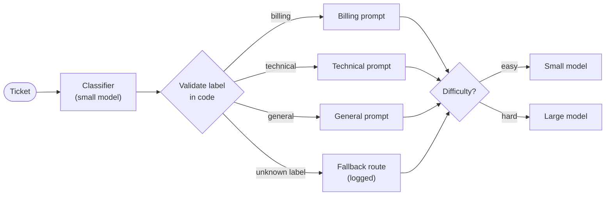

🏠 [Home](../../README.md) › [09 · Agent Design Patterns](./README.md) › 9.2 Routing

# 9.2 Routing

> **Difficulty:** 🟢 Beginner · **Reading time:** ~7 min · **Prerequisites:** [9.1 Prompt chaining](./09.1-prompt-chaining.md)

**In one sentence:** Routing classifies each input first, checks that the label is valid, and then sends the input to the handler (prompt, tools or model) built for that kind of input.

📑 **On this page**

- [Why does this matter?](#-why-does-this-matter)
- [The idea, in plain words](#-the-idea-in-plain-words)
- [Picture it](#-picture-it)
- [How it works, step by step](#-how-it-works-step-by-step)
- [Worked example](#-worked-example)
- [Code](#-code)
- [Common mistakes & gotchas](#-common-mistakes--gotchas)
- [Key takeaways](#-key-takeaways)
- [Try it yourself](#-try-it-yourself)
- [Further reading](#-further-reading)

## 🤔 Why does this matter?

Your support assistant has one big [system prompt](../../GLOSSARY.md#system-prompt). You add careful rules for billing ("never promise a refund"), and the technical answers get stiffer. You add detailed troubleshooting steps, and simple questions like "do you have a student discount?" get a numbered checklist. Every fix for one kind of question makes another worse. And every question, however simple, runs on your most expensive model.

Routing separates the kinds of input so each gets a prompt tuned for it, and so easy questions can go to a smaller, cheaper, faster model.

## 🧠 The idea, in plain words

Think of a hospital's front desk. A receptionist asks a couple of questions and sends you to the right place: the pharmacy, a GP, or the emergency room. The receptionist doesn't treat anyone. They classify, quickly and cheaply, and the specialists do the work.

[Routing](../../GLOSSARY.md#routing) has two parts:

1. A **classifier** reads the input and returns a label from a fixed set, such as `billing`, `technical` or `general`, and perhaps a difficulty, `easy` or `hard`. It can be a small [LLM](../../GLOSSARY.md#large-language-model-llm), or a traditional classifier if you have training data.
2. A **dispatcher** in plain code looks the label up and calls the matching handler: its own prompt, its own [tools](../../GLOSSARY.md#tool), its own model.

Anthropic's [Building effective agents](https://www.anthropic.com/engineering/building-effective-agents) gives two typical uses: sending different customer-service queries (general questions, refunds, technical support) to different downstream prompts and tools, and sending easy or common questions to smaller, cheaper models while harder ones go to more capable models. It works when the categories are distinct and the classification can be done accurately.

## 👀 Picture it



*Two decisions: the category picks the prompt, and the difficulty picks the model. The validation diamond is plain code, and it is what stops one odd label from crashing your app or reaching a handler it shouldn't.*

## 🔍 How it works, step by step

1. **Define a small, fixed set of labels.** Each label should map to a meaningfully different handler. If two labels would get the same treatment, merge them.
2. **Classify with structured output.** Ask for JSON with an `enum` of allowed values. Use structured outputs where the provider has them, so the reply matches the schema.
3. **Validate anyway.** Normalise small slips (`"Billing."` → `billing`). Replace anything unknown or unparseable with a **fallback** route, and log it. Count how often the fallback fires: that is your classifier's error rate, visible.
4. **Choose a safe fallback.** When unsure, go to the most general handler on the more capable model, or to a human. Never default to the most powerful *tools* (like refunds).
5. **Dispatch.** A dictionary lookup from label to handler. The handler gets the original input, not the classifier's reasoning.
6. **Route by difficulty for cost.** A second label, or a separate rule (input length, customer tier), picks the model. Small models are much cheaper: on Anthropic's [pricing page](https://platform.claude.com/docs/en/about-claude/pricing), Claude Haiku 5.5 costs $0.10 / $0.50 per million input / output [tokens](../../GLOSSARY.md#token) (for prompts up to 100,000 tokens) against $4 / $20 for Claude Opus 5.5 (as of November 2026). Chapter 16 goes deeper on [model routing](../16-cost-and-performance/16.3-model-routing.md).
7. **Evaluate the classifier on its own.** Build a labelled set of real inputs and measure accuracy per label. A wrong route gives a confident answer from the wrong specialist.

## 💡 Worked example

A run with scripted replies looks like this:

```text
Ticket: I was charged twice for my March subscription. Can you fix it?
  route -> billing / easy -> small model
  reply -> Sorry about the double charge. I've passed this to a billing specialist, who will check your March payments and confirm the refund of any duplicate.

Ticket: Since updating to 2.3, the Android app crashes every time I sync my bank. I've reinstalled twice.
  route -> technical / hard -> large model
  reply -> Thanks for the details. 1) Tell me your Android version. 2) Open Settings > Sync and note the bank name. 3) Turn off battery optimisation for the app and try once more.

Ticket: Do you offer a student discount?
  route -> general / easy -> small model   [invalid label {"category": "sales", "difficulty": "easy"}, used fallback]
  reply -> I can't confirm discounts from here. You can see every current plan under Settings > Plans, and our sales team can tell you about any student offers.
```

- Ticket 1: the classifier returned `"Billing"` with a capital letter. Validation normalised it; still a valid route.
- Ticket 2: technical and hard, so it got the troubleshooting prompt on the large model.
- Ticket 3: the classifier invented a category, `sales`. Validation caught it, used the `general` fallback, and flagged it. Without validation, `CATEGORIES["sales"]` would have raised a `KeyError`.

## 💻 Code

The classifier call with an enum-constrained schema. Anthropic (needs `ANTHROPIC_API_KEY`):

```python
import json
import anthropic

ROUTE_SCHEMA = {
    "type": "object",
    "properties": {
        "category": {"type": "string", "enum": ["billing", "technical", "general"]},
        "difficulty": {"type": "string", "enum": ["easy", "hard"]},
    },
    "required": ["category", "difficulty"],
    "additionalProperties": False,
}

client = anthropic.Anthropic()
resp = client.messages.create(
    model="claude-haiku-5-5",                 # a small, cheap model is enough to classify
    max_tokens=200,
    system="Classify the customer support ticket.",
    messages=[{"role": "user", "content": ticket}],
    output_config={"format": {"type": "json_schema", "schema": ROUTE_SCHEMA}},
)
route = json.loads(next(b.text for b in resp.content if b.type == "text"))
```

OpenAI Chat Completions, same schema:

```python
from openai import OpenAI

resp = OpenAI().chat.completions.create(
    model="YOUR_SMALL_OPENAI_MODEL",
    messages=[{"role": "system", "content": "Classify the customer support ticket."},
              {"role": "user", "content": ticket}],
    response_format={"type": "json_schema",
                     "json_schema": {"name": "route", "schema": ROUTE_SCHEMA, "strict": True}},
)
route = json.loads(resp.choices[0].message.content)
```

Validation and dispatch are plain Python. `classifier` and each entry in `models` are chat-model clients whose `.chat(messages, system=...)` returns a reply with `.text`, and `user()` builds a user message dict:

```python
def parse_route(text: str) -> Route:
    """Normalise small slips; replace anything unknown with the fallback."""
    try:
        data = json.loads(text)
        category = str(data.get("category", "")).strip().strip(".").lower()
        difficulty = str(data.get("difficulty", "")).strip().strip(".").lower()
    except (json.JSONDecodeError, AttributeError):
        return Route(FALLBACK_CATEGORY, FALLBACK_DIFFICULTY, False, text)
    valid = category in CATEGORIES and difficulty in DIFFICULTIES
    return Route(category if category in CATEGORIES else FALLBACK_CATEGORY,
                 difficulty if difficulty in DIFFICULTIES else FALLBACK_DIFFICULTY, valid, text)

def route_ticket(ticket: str, classifier, models: dict) -> Routed:
    route = parse_route(classifier.chat([user(ticket)], system=CLASSIFIER_SYSTEM).text)
    tier = DIFFICULTIES[route.difficulty]                      # "easy" -> "small", "hard" -> "large"
    answer = models[tier].chat([user(ticket)], system=CATEGORIES[route.category]).text
    return Routed(route, tier, answer)
```

Even with a schema-enforced classifier, keep `parse_route`: it costs nothing, and it protects you when you switch providers, models or turn structured outputs off.

## 🚨 Common mistakes & gotchas

- **Trusting the label.** Models sometimes invent categories, add punctuation, or explain themselves. **Fix:** validate against the fixed set and fall back safely.
- **A dangerous fallback.** Unknown input defaulting to the refund handler is an incident waiting to happen. **Fix:** fall back to the most general, least privileged handler, or a human.
- **Too many labels.** Fifteen fine-grained categories are hard to classify accurately and mostly get the same handling. **Fix:** a handful of labels that lead to genuinely different handlers.
- **Classifying with the biggest model.** You pay the most for the easiest job. **Fix:** a small model, or a traditional classifier when you have labelled data.
- **Never measuring routing accuracy.** End-to-end tests can hide a classifier that sends 10% of billing tickets to the general handler. **Fix:** a labelled set and per-label accuracy ([12.4](../12-evaluation/12.4-building-an-eval-dataset.md)), plus a dashboard of fallback rates.
- **Overlapping categories.** "My payment failed and now the app crashes" is both billing and technical. **Fix:** decide a priority order, allow a multi-label route that runs both handlers ([9.3](./09.3-parallelisation.md)), or escalate.

## ✅ Key takeaways

- Routing = classify, validate, dispatch. The classifier labels; plain code decides.
- Separate handlers let you tune prompts for one kind of input without hurting others.
- Always validate the label and use a safe, logged fallback.
- Route easy inputs to smaller models: they can be many times cheaper and faster.
- Measure classifier accuracy on its own, per label.

## 🧪 Try it yourself

1. In the code above, what route does a ticket take if the classifier replies `I think this is about billing`? Why is that the chosen fallback?
2. You want to add a `refund` category that can call an `issue_refund` tool. What should change, and what extra safety would you add?
3. 70% of your 10,000 daily tickets are easy. Each uses about 1,000 input and 300 output tokens. Roughly what does routing easy tickets to Claude Haiku 5.5 instead of Claude Opus 5.5 save per day? (Use the prices above and ignore the classifier's own cost.)

<details>
<summary>Show answer</summary>

1. `general / hard`, flagged invalid. `parse_route` can't parse JSON, so it uses `FALLBACK_CATEGORY = "general"` and `FALLBACK_DIFFICULTY = "hard"`: when you don't know what the ticket is, give it the most general prompt and the more capable model, never a specialised handler with powerful tools.
2. Add `refund` to `CATEGORIES` with its own prompt, add it to the classifier's allowed labels (and schema enum), and give only that handler the `issue_refund` tool. Add a human approval gate for refunds above a limit ([9.6](./09.6-human-in-the-loop.md)), and make sure the fallback can never reach this route.
3. 7,000 easy tickets × 1,000 input tokens = 7M input; × 300 = 2.1M output. Opus 5.5: 7 × $4 + 2.1 × $20 = $28 + $42 = $70. Haiku 5.5: 7 × $0.10 + 2.1 × $0.50 = $0.70 + $1.05 = $1.75. Saving about $68 a day, roughly 97% on those tickets, before the classifier's own (small) cost.

</details>

## 📚 Further reading

- [Building effective agents](https://www.anthropic.com/engineering/building-effective-agents) (Anthropic). Routing, and when classification is accurate enough to use it.
- [Structured outputs](https://platform.claude.com/docs/en/build-with-claude/structured-outputs) (Anthropic docs). Constraining a classifier's reply to a JSON schema.
- [Pricing](https://platform.claude.com/docs/en/about-claude/pricing) (Anthropic docs). Current per-model prices, for working out what routing saves.
- [Agent patterns cookbook](https://github.com/anthropics/claude-cookbooks/tree/main/patterns/agents) (Anthropic). The `basic_workflows` notebook includes a routing example.

<!-- FOOTER -->

---

⬅️ **Previous:** [9.1 Prompt chaining](./09.1-prompt-chaining.md) ·
🏠 [Chapter home](./README.md) ·
➡️ **Next:** [9.3 Parallelisation (sectioning & voting)](./09.3-parallelisation.md)
