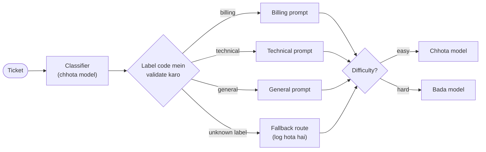

🏠 [Home](../../README.md) › [09 · Agent Design Patterns](./README.md) › 9.2 Routing

# 9.2 Routing

> **Level:** 🟢 Beginner · **Padhne ka time:** ~7 min · **Pehle padho:** [9.1 Prompt chaining](./09.1-prompt-chaining.md)

**Ek line mein:** Routing har input ko pehle classify karta hai, check karta hai ki label valid hai, aur phir input ko us handler (prompt, tools ya model) ke paas bhejta hai jo usi type ke input ke liye bana hai.

📑 **Is page par**

- [Yeh kyun zaroori hai?](#-yeh-kyun-zaroori-hai)
- [Idea, simple words mein](#-idea-simple-words-mein)
- [Diagram se samjho](#-diagram-se-samjho)
- [Kaise kaam karta hai, step by step](#-kaise-kaam-karta-hai-step-by-step)
- [Example se samjho](#-example-se-samjho)
- [Code](#-code)
- [Aam galtiyan aur dhyan dene wali baatein](#-aam-galtiyan-aur-dhyan-dene-wali-baatein)
- [Yaad rakhne wali baatein](#-yaad-rakhne-wali-baatein)
- [Khud try karo](#-khud-try-karo)
- [Aur padhne ke liye](#-aur-padhne-ke-liye)

## 🤔 Yeh kyun zaroori hai?

Tumhare support assistant ka ek bada [system prompt](../../GLOSSARY.md#system-prompt) hai. Tum billing ke liye careful rules daalte ho ("never promise a refund"), aur technical jawab stiff ho jaate hain. Tum detailed troubleshooting steps daalte ho, aur "do you have a student discount?" jaise simple sawal ka jawab bhi numbered checklist ban jata hai. Ek type ke sawal ka har fix doosre type ko bigaad deta hai. Aur har sawal, chahe kitna bhi simple ho, tumhare sabse mehenge model par chalta hai.

Routing alag-alag type ke inputs ko alag kar deta hai. Har type ko uske hisaab se tuned prompt milta hai. Aur aasaan sawal chhote, saste aur fast model par ja sakte hain.

## 🧠 Idea, simple words mein

Hospital ka front desk socho. Receptionist do-teen sawal poochta hai aur tumhe sahi jagah bhej deta hai: pharmacy, GP, ya emergency room. Receptionist kisi ka ilaaj nahi karta. Woh jaldi aur saste mein classify karta hai, aur kaam specialists karte hain.

[Routing](../../GLOSSARY.md#routing) ke do hisse hain:

1. Ek **classifier** input padhta hai aur ek fixed set se label return karta hai, jaise `billing`, `technical` ya `general`, aur shayad difficulty bhi, `easy` ya `hard`. Yeh ek chhota [LLM](../../GLOSSARY.md#large-language-model-llm) ho sakta hai, ya agar training data hai toh ek traditional classifier.
2. Plain code mein ek **dispatcher** label dekhta hai aur matching handler ko call karta hai: uska apna prompt, apne [tools](../../GLOSSARY.md#tool), apna model.

Anthropic ka [Building effective agents](https://www.anthropic.com/engineering/building-effective-agents) do typical uses batata hai. Pehla: alag-alag customer-service queries (general sawal, refunds, technical support) ko alag downstream prompts aur tools ke paas bhejna. Doosra: aasaan ya common sawal chhote, saste models ko bhejna, aur mushkil sawal zyada capable models ko. Yeh tab kaam karta hai jab categories saaf alag hon aur classification accurately ho sake.

## 👀 Diagram se samjho



*Do decisions hain: category prompt chunti hai, aur difficulty model chunti hai. Validation wala diamond plain code hai. Yahi ek ajeeb label ko tumhari app crash karne se, ya galat handler tak pahunchne se rokta hai.*

## 🔍 Kaise kaam karta hai, step by step

1. **Labels ka chhota, fixed set banao.** Har label ek sach mein alag handler tak le jaana chahiye. Agar do labels ka treatment same hai, toh unhe merge kar do.
2. **Structured output se classify karo.** Allowed values ka `enum` rakh ke JSON maango. Jahan provider structured outputs deta hai, wahan use karo, taaki reply schema se match kare.
3. **Phir bhi validate karo.** Chhoti galtiyan normalise karo (`"Billing."` → `billing`). Jo bhi unknown ya unparseable ho, use **fallback** route se replace karo, aur log karo. Gino ki fallback kitni baar chala. Yahi tumhare classifier ka error rate hai, jo ab dikh raha hai.
4. **Safe fallback chuno.** Jab doubt ho, toh capable model par sabse general handler ke paas bhejo, ya kisi insaan ke paas. Kabhi bhi default mein sabse powerful *tools* (jaise refunds) wale handler par mat bhejo.
5. **Dispatch karo.** Label se handler tak ek dictionary lookup. Handler ko original input milta hai, classifier ka reasoning nahi.
6. **Cost ke liye difficulty se route karo.** Ek doosra label, ya alag rule (input length, customer tier), model chunta hai. Chhote models bahut saste hain. Anthropic ke [pricing page](https://platform.claude.com/docs/en/about-claude/pricing) par, Claude Haiku 5.5 ka rate $0.10 / $0.50 per million input / output [tokens](../../GLOSSARY.md#token) hai (100,000 tokens tak ke prompts ke liye), jabki Claude Opus 5.5 ka $4 / $20 (November 2026 tak). Chapter 16 [model routing](../16-cost-and-performance/16.3-model-routing.md) ko aur gehraai se dekhta hai.
7. **Classifier ko alag se evaluate karo.** Real inputs ka ek labelled set banao aur har label ki accuracy measure karo. Galat route ka matlab hai galat specialist se confident jawab.

Kirana dukaan wala example socho. Chhota-mota saman (biscuit, maggi) counter wala ladka de deta hai. Udhaar ya hisaab ki baat ho toh seth ji khud dekhte hain. Har customer ko seth ji ke paas bhejoge toh unka time (yaani mehenga model) barbaad hoga.

## 💡 Example se samjho

Scripted replies ke saath ek run aisa dikhta hai:

```text
Ticket: I was charged twice for my March subscription. Can you fix it?
  route -> billing / easy -> small model
  reply -> Sorry about the double charge. I've passed this to a billing specialist, who will check your March payments and confirm the refund of any duplicate.

Ticket: Since updating to 2.3, the Android app crashes every time I sync my bank. I've reinstalled twice.
  route -> technical / hard -> large model
  reply -> Thanks for the details. 1) Tell me your Android version. 2) Open Settings > Sync and note the bank name. 3) Turn off battery optimisation for the app and try once more.

Ticket: Do you offer a student discount?
  route -> general / easy -> small model   [invalid label {"category": "sales", "difficulty": "easy"}, used fallback]
  reply -> I can't confirm discounts from here. You can see every current plan under Settings > Plans, and our sales team can tell you about any student offers.
```

- Ticket 1: classifier ne capital letter ke saath `"Billing"` return kiya. Validation ne use normalise kar diya. Route phir bhi valid hai.
- Ticket 2: technical aur hard, isliye use bade model par troubleshooting prompt mila.
- Ticket 3: classifier ne ek nayi category bana di, `sales`. Validation ne use pakda, `general` fallback use kiya, aur flag kiya. Validation ke bina, `CATEGORIES["sales"]` ek `KeyError` raise kar deta.

## 💻 Code

Enum-constrained schema ke saath classifier call. Anthropic (`ANTHROPIC_API_KEY` chahiye):

```python
import json
import anthropic

ROUTE_SCHEMA = {
    "type": "object",
    "properties": {
        "category": {"type": "string", "enum": ["billing", "technical", "general"]},
        "difficulty": {"type": "string", "enum": ["easy", "hard"]},
    },
    "required": ["category", "difficulty"],
    "additionalProperties": False,
}

client = anthropic.Anthropic()
resp = client.messages.create(
    model="claude-haiku-5-5",                 # classify karne ke liye chhota, sasta model kaafi hai
    max_tokens=200,
    system="Classify the customer support ticket.",
    messages=[{"role": "user", "content": ticket}],
    output_config={"format": {"type": "json_schema", "schema": ROUTE_SCHEMA}},
)
route = json.loads(next(b.text for b in resp.content if b.type == "text"))
```

OpenAI Chat Completions, same schema ke saath:

```python
from openai import OpenAI

resp = OpenAI().chat.completions.create(
    model="YOUR_SMALL_OPENAI_MODEL",
    messages=[{"role": "system", "content": "Classify the customer support ticket."},
              {"role": "user", "content": ticket}],
    response_format={"type": "json_schema",
                     "json_schema": {"name": "route", "schema": ROUTE_SCHEMA, "strict": True}},
)
route = json.loads(resp.choices[0].message.content)
```

Validation aur dispatch plain Python hain. `classifier` aur `models` ki har entry chat-model clients hain jinka `.chat(messages, system=...)` ek reply return karta hai jismein `.text` ho. `user()` ek user message dict banata hai:

```python
def parse_route(text: str) -> Route:
    """Chhoti galtiyan normalise karo; jo bhi unknown ho use fallback se replace karo."""
    try:
        data = json.loads(text)
        category = str(data.get("category", "")).strip().strip(".").lower()
        difficulty = str(data.get("difficulty", "")).strip().strip(".").lower()
    except (json.JSONDecodeError, AttributeError):
        return Route(FALLBACK_CATEGORY, FALLBACK_DIFFICULTY, False, text)
    valid = category in CATEGORIES and difficulty in DIFFICULTIES
    return Route(category if category in CATEGORIES else FALLBACK_CATEGORY,
                 difficulty if difficulty in DIFFICULTIES else FALLBACK_DIFFICULTY, valid, text)

def route_ticket(ticket: str, classifier, models: dict) -> Routed:
    route = parse_route(classifier.chat([user(ticket)], system=CLASSIFIER_SYSTEM).text)
    tier = DIFFICULTIES[route.difficulty]                      # "easy" -> "small", "hard" -> "large"
    answer = models[tier].chat([user(ticket)], system=CATEGORIES[route.category]).text
    return Routed(route, tier, answer)
```

Schema-enforced classifier ke saath bhi `parse_route` rakho. Iska koi kharcha nahi hai, aur yeh tab bachata hai jab tum provider ya model badlo, ya structured outputs off kar do.

## 🚨 Aam galtiyan aur dhyan dene wali baatein

- **Label par aankh band karke bharosa.** Models kabhi-kabhi nayi categories bana dete hain, punctuation laga dete hain, ya explanation de dete hain. **Fix:** fixed set ke against validate karo aur safely fallback karo.
- **Khatarnak fallback.** Unknown input ka default refund handler ho, toh incident hona bas time ki baat hai. **Fix:** sabse general, sabse kam privilege wale handler par fallback karo, ya insaan ke paas.
- **Bahut zyada labels.** Pandrah fine-grained categories ko accurately classify karna mushkil hai, aur zyada tar ka handling same hi hota hai. **Fix:** kuch hi labels rakho jo sach mein alag handlers tak le jaayein.
- **Sabse bade model se classify karna.** Sabse aasaan kaam ke liye sabse zyada paisa. **Fix:** chhota model, ya labelled data ho toh traditional classifier.
- **Routing accuracy kabhi measure na karna.** End-to-end tests ek aise classifier ko chhupa sakte hain jo 10% billing tickets general handler ko bhej raha hai. **Fix:** labelled set aur har label ki accuracy ([12.4](../12-evaluation/12.4-building-an-eval-dataset.md)), saath mein fallback rates ka dashboard.
- **Overlap karti categories.** "My payment failed and now the app crashes" billing bhi hai aur technical bhi. **Fix:** priority order decide karo, multi-label route allow karo jo dono handlers chalaye ([9.3](./09.3-parallelisation.md)), ya escalate karo.

## ✅ Yaad rakhne wali baatein

- Routing = classify, validate, dispatch. Classifier label lagata hai; decision plain code leta hai.
- Alag handlers se tum ek type ke input ke liye prompt tune kar sakte ho, baaki ko nuksan pahunchaye bina.
- Label hamesha validate karo aur safe, logged fallback use karo.
- Aasaan inputs chhote models ko bhejo: woh kai guna saste aur fast ho sakte hain.
- Classifier ki accuracy alag se, har label ke liye, measure karo.

## 🧪 Khud try karo

1. Upar wale code mein, agar classifier reply kare `I think this is about billing`, toh ticket kaunsa route lega? Yahi fallback kyun chuna gaya hai?
2. Tum ek `refund` category jodna chahte ho jo `issue_refund` tool call kar sake. Kya badalna chahiye, aur kaunsi extra safety jodoge?
3. Tumhare roz ke 10,000 tickets mein se 70% aasaan hain. Har ek mein lagbhag 1,000 input aur 300 output tokens lagte hain. Aasaan tickets ko Claude Opus 5.5 ki jagah Claude Haiku 5.5 par route karne se roz lagbhag kitna bachega? (Upar wale prices use karo aur classifier ka apna cost ignore karo.)

<details>
<summary>Answer dekho</summary>

1. `general / hard`, invalid flag ke saath. `parse_route` JSON parse nahi kar pata, isliye `FALLBACK_CATEGORY = "general"` aur `FALLBACK_DIFFICULTY = "hard"` use karta hai. Jab tumhe pata hi nahi ki ticket kis baare mein hai, toh use sabse general prompt aur zyada capable model do. Kabhi bhi powerful tools wala specialised handler mat do.
2. `CATEGORIES` mein `refund` uske apne prompt ke saath jodo. Classifier ke allowed labels (aur schema enum) mein bhi jodo. `issue_refund` tool sirf usi handler ko do. Ek limit se upar ke refunds ke liye human approval gate lagao ([9.6](./09.6-human-in-the-loop.md)), aur pakka karo ki fallback kabhi is route tak na pahunche.
3. 7,000 aasaan tickets × 1,000 input tokens = 7M input; × 300 = 2.1M output. Opus 5.5: 7 × $4 + 2.1 × $20 = $28 + $42 = $70. Haiku 5.5: 7 × $0.10 + 2.1 × $0.50 = $0.70 + $1.05 = $1.75. Roz lagbhag $68 ki bachat, un tickets par lagbhag 97%, classifier ke apne (chhote) cost se pehle.

</details>

## 📚 Aur padhne ke liye

- [Building effective agents](https://www.anthropic.com/engineering/building-effective-agents) (Anthropic). Routing, aur kab classification itna accurate hai ki ise use kiya jaa sake.
- [Structured outputs](https://platform.claude.com/docs/en/build-with-claude/structured-outputs) (Anthropic docs). Classifier ke reply ko JSON schema tak limit karna.
- [Pricing](https://platform.claude.com/docs/en/about-claude/pricing) (Anthropic docs). Har model ke current prices, yeh calculate karne ke liye ki routing kitna bachata hai.
- [Agent patterns cookbook](https://github.com/anthropics/claude-cookbooks/tree/main/patterns/agents) (Anthropic). `basic_workflows` notebook mein routing ka example hai.

<!-- FOOTER -->

---

⬅️ **Pichla:** [9.1 Prompt chaining](./09.1-prompt-chaining.md) ·
🏠 [Chapter home](./README.md) ·
➡️ **Agla:** [9.3 Parallelisation (sectioning aur voting)](./09.3-parallelisation.md)
