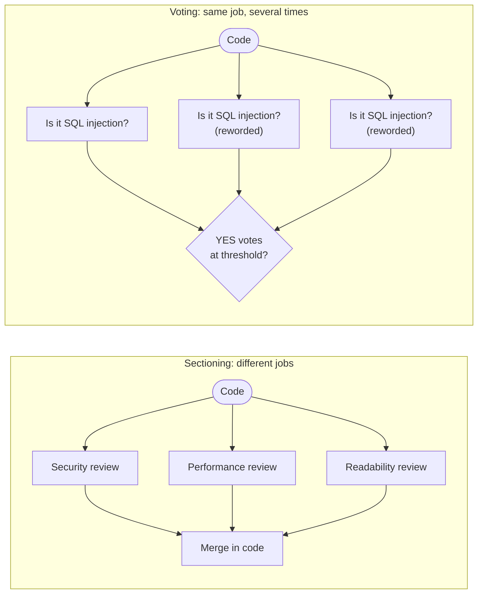

🏠 [Home](../../README.md) › [09 · Agent Design Patterns](./README.md) › 9.3 Parallelisation (sectioning & voting)

# 9.3 Parallelisation (sectioning & voting)

> **Difficulty:** 🟡 Intermediate · **Reading time:** ~8 min · **Prerequisites:** [9.1 Prompt chaining](./09.1-prompt-chaining.md)

**In one sentence:** Parallelisation runs several independent LLM calls at the same time and combines their results in code, either by splitting a job into different parts (sectioning) or by asking the same question several times and counting the answers (voting).

📑 **On this page**

- [Why does this matter?](#-why-does-this-matter)
- [The idea, in plain words](#-the-idea-in-plain-words)
- [Picture it](#-picture-it)
- [How it works, step by step](#-how-it-works-step-by-step)
- [Worked example](#-worked-example)
- [Code](#-code)
- [Common mistakes & gotchas](#-common-mistakes--gotchas)
- [Key takeaways](#-key-takeaways)
- [Try it yourself](#-try-it-yourself)
- [Further reading](#-further-reading)

## 🤔 Why does this matter?

You ask one [LLM](../../GLOSSARY.md#large-language-model-llm) call to review a pull request for security, performance *and* readability. It writes a solid paragraph about naming and misses the SQL injection on line 2. Asking for everything at once spreads the model's attention thin.

You split it into three focused reviews and run them one after another. Better results, but three times the wait. Run them **at the same time** instead and you get focused reviews in roughly the time of one.

And for a high-stakes yes/no question ("is this a vulnerability?"), one answer is a coin you flipped once. Asking several times and counting gives you a more reliable decision, and a measure of how sure you can be.

## 🧠 The idea, in plain words

Think of marking an exam. **Sectioning:** three teachers each mark a different section at the same time, and the totals are added up. **Voting:** for a borderline essay, three teachers each mark the *same* essay, and the majority grade stands.

[Parallelisation](../../GLOSSARY.md#parallelisation) has those two forms, both described in Anthropic's [Building effective agents](https://www.anthropic.com/engineering/building-effective-agents):

- **Sectioning:** break a task into **different**, independent subtasks and run them in parallel. Examples from the post: one call answers the user while another screens the request for inappropriate content (a [guardrail](../../GLOSSARY.md#guardrail)); or several calls each evaluate a different aspect of an output.
- **Voting:** run the **same** task several times to get diverse outputs, then aggregate. Examples: several prompts each review code for vulnerabilities and flag problems; or several checks on whether content is inappropriate, with a vote threshold that balances false positives and false negatives.

The calls are independent: none needs another's output. Your code fans out, waits for all of them, and then combines the results with plain logic (merge, sum, majority, "any flag").

Voting has a well-known research cousin: **self-consistency** ([Wang et al., 2022](https://arxiv.org/abs/2203.11171)) samples several reasoning paths for one question and takes the most common final answer, which improved accuracy on reasoning benchmarks over a single chain of thought.

## 👀 Picture it



*In both, the calls in the middle column run at the same time. The difference is what they do: different questions (sectioning) or the same question (voting). The combining step is plain code.*

## 🔍 How it works, step by step

1. **Check the calls are independent.** If call B needs call A's output, that's a chain ([9.1](./09.1-prompt-chaining.md)), not parallel work.
2. **Write one focused prompt per section.** "Look ONLY for security problems" beats one prompt with three jobs.
3. **Fan out with threads.** LLM calls spend nearly all their time waiting on the network, so Python threads are enough: `concurrent.futures.ThreadPoolExecutor` ([docs](https://docs.python.org/3/library/concurrent.futures.html)). If your app is async, `asyncio.gather` with the providers' async clients does the same job.
4. **Cap concurrency.** `max_workers` limits how many calls are in flight. Providers enforce rate limits; 50 simultaneous calls can turn into 50 rate-limit errors ([15.5](../15-production-and-deployment/15.5-rate-limits-and-fallbacks.md)).
5. **Handle failures one by one.** One failed call must not lose the other results. Collect each result or its exception, and decide what a missing section means.
6. **Combine in code.** Sectioning: merge or concatenate in a fixed order. Voting: parse each reply into a vote, count, and compare with a threshold. Unparseable replies count as abstentions, not votes.
7. **Diversify votes.** If the model gives nearly the same answer every time, five votes are one vote paid for five times. Reword the prompt across voters, or use different models.

Cost and latency: sectioning into three calls costs roughly what three sequential calls would (more total [tokens](../../GLOSSARY.md#token) than one combined call, since the input is repeated), but the wait is about as long as the slowest call. Voting with *n* voters costs about *n* times one call.

## 💡 Worked example

The code under review:

```python
def find_user(db, name):
    rows = db.execute(f"SELECT * FROM users WHERE name = '{name}'")
    for row in rows:
        if row["name"] == name:
            return row
```

A run with scripted replies. Each scripted reply sleeps 0.5 s to stand in for network time:

```text
SECTIONING: three focused reviews of the same code
  [security] - SQL injection: `name` is put straight into the query. Use a parameterised query.
  [performance] - Fetches every column and filters in Python. Select only needed columns and let SQL filter.
  [readability] - Returns None silently when no user matches. Say so in a docstring or raise an error.
  time: sequential 1.5s, parallel 0.5s

VOTING: 'is this SQL injection?' asked 5 times, flag at 3 or more YES
  YES 3, NO 1, abstain 1 -> flagged: True
```

- **Sectioning:** the same three focused calls took 1.5 s one after another and 0.5 s at once. Each reviewer found one real issue in its own area.
- **Voting:** three voters said YES, one said NO ("looks like an internal helper"), one hedged ("Possibly, it depends on the driver") and was counted as an abstention. With a threshold of 3, the code is flagged. With 4, it wouldn't be. The threshold is your dial between false positives and false negatives.

## 💻 Code

The fan-out helper, standard library only:

```python
from concurrent.futures import ThreadPoolExecutor

def run_parallel(fn, items, *, max_workers: int = 8, timeout: float = 120) -> list:
    """Call fn(item) for every item concurrently. Results keep input order; a failure becomes its exception."""
    with ThreadPoolExecutor(max_workers=max_workers) as pool:
        futures = [pool.submit(fn, item) for item in items]
        results = []
        for future in futures:
            try:
                results.append(future.result(timeout=timeout))
            except Exception as exc:          # one failed call must not lose the others
                results.append(exc)
        return results
```

Sectioning and voting are then a few lines each:

```python
def sectioned_review(llm, code: str) -> dict[str, str]:
    aspects = ["security", "performance", "readability"]
    results = run_parallel(lambda a: review_aspect(llm, code, a), aspects)
    return {a: (r if isinstance(r, str) else f"(review failed: {r})") for a, r in zip(aspects, results)}

def vote(llm, code: str, *, n: int = 5, threshold: int = 3) -> VoteResult:
    prompts = [VOTE_PROMPTS[i % len(VOTE_PROMPTS)] for i in range(n)]      # reworded prompts for diversity
    replies = run_parallel(lambda q: llm.chat([user(f"{q}\n\nCode:\n{code}")],
                                              system="Answer YES or NO first, then one sentence.").text, prompts)
    counts = Counter(parse_vote(r) if isinstance(r, str) else "ABSTAIN" for r in replies)
    return VoteResult(counts["YES"], counts["NO"], counts["ABSTAIN"], counts["YES"] >= threshold)
```

`llm` is any chat-model client whose `.chat(messages, system=...)` returns a reply with `.text`, and `user()` builds a user message dict, so this works with Anthropic, OpenAI or a scripted fake model. With raw SDKs, each worker would make its own `client.messages.create(...)` or `client.chat.completions.create(...)` call. Don't confuse this with **parallel tool calls** ([3.5](../03-tools-and-function-calling/03.5-parallel-tool-calls.md)), where *one* model reply asks for several [tools](../../GLOSSARY.md#tool) at once; here *your code* decides to make several model calls at once.

## 🚨 Common mistakes & gotchas

- **Parallelising dependent steps.** If one call needs another's output, running them together gives garbage. **Fix:** draw the dependencies first; only independent calls go in parallel.
- **No concurrency cap.** Firing 100 calls at once hits rate limits and makes things slower. **Fix:** a sensible `max_workers`, plus retries with backoff.
- **Losing everything to one failure.** `list(pool.map(...))` raises on the first exception. **Fix:** collect each future's result or exception separately, as `run_parallel` does.
- **Votes that aren't independent.** The same prompt to the same model often gives the same answer, especially on models where you can't raise the [temperature](../../GLOSSARY.md#temperature). **Fix:** reworded prompts, different models, or different context per voter.
- **Counting unparseable replies.** "Possibly" is not a YES. **Fix:** strict parsing; treat anything else as an abstention, and watch the abstention rate.
- **Forgetting the cost.** Five voters cost five calls on every request. **Fix:** vote only where a wrong answer is expensive (security, moderation, high-stakes decisions).
- **Expecting a speed-up from CPU-bound work.** Threads help because calls wait on the network. Heavy local processing needs processes instead.

## ✅ Key takeaways

- Parallelisation runs independent LLM calls at the same time, then combines them in plain code.
- Sectioning splits a job into different focused parts; voting repeats the same job and counts.
- Threads (`ThreadPoolExecutor`) are enough for network-bound LLM calls; cap concurrency and handle failures per call.
- Latency drops to about the slowest call; cost does not drop.
- A vote threshold is a dial between false positives and false negatives. Make votes diverse.

## 🧪 Try it yourself

1. In `run_parallel`, what would happen if you used `list(pool.map(fn, items))` and the second call raised an exception?
2. A moderation system flags a message if *any* of three checks (hate, self-harm, spam) says yes. Is that sectioning or voting, and what is the threshold?
3. When would you choose three focused sectioned calls over one call that does all three reviews?

<details>
<summary>Show answer</summary>

1. `map` returns results in order and re-raises the exception when you reach the failed item, so `list(...)` raises and you lose the results of the calls that succeeded. That's why `run_parallel` collects each future's result inside its own `try`.
2. Sectioning: the three checks ask different questions. The combine rule is "any flag", a threshold of 1 out of 3, which favours catching problems over avoiding false alarms. (Voting would be asking the *same* check three times.)
3. When the single call misses things in one area (as in the worked example), when you want to tune or evaluate each aspect separately, or when each aspect needs different context or tools. One combined call is fine, and cheaper, if it reliably covers all three on your test set.

</details>

## 📚 Further reading

- [Building effective agents](https://www.anthropic.com/engineering/building-effective-agents) (Anthropic). Sectioning and voting, with examples of each.
- [concurrent.futures — Launching parallel tasks](https://docs.python.org/3/library/concurrent.futures.html) (Python docs). `ThreadPoolExecutor`, `submit`, `map` and futures.
- [Self-Consistency Improves Chain of Thought Reasoning in Language Models](https://arxiv.org/abs/2203.11171) (Wang et al., 2022). The research version of voting.
- [Agent patterns cookbook](https://github.com/anthropics/claude-cookbooks/tree/main/patterns/agents) (Anthropic). The `basic_workflows` notebook includes a parallel example.

<!-- FOOTER -->

---

⬅️ **Previous:** [9.2 Routing](./09.2-routing.md) ·
🏠 [Chapter home](./README.md) ·
➡️ **Next:** [9.4 Orchestrator–workers](./09.4-orchestrator-workers.md)
