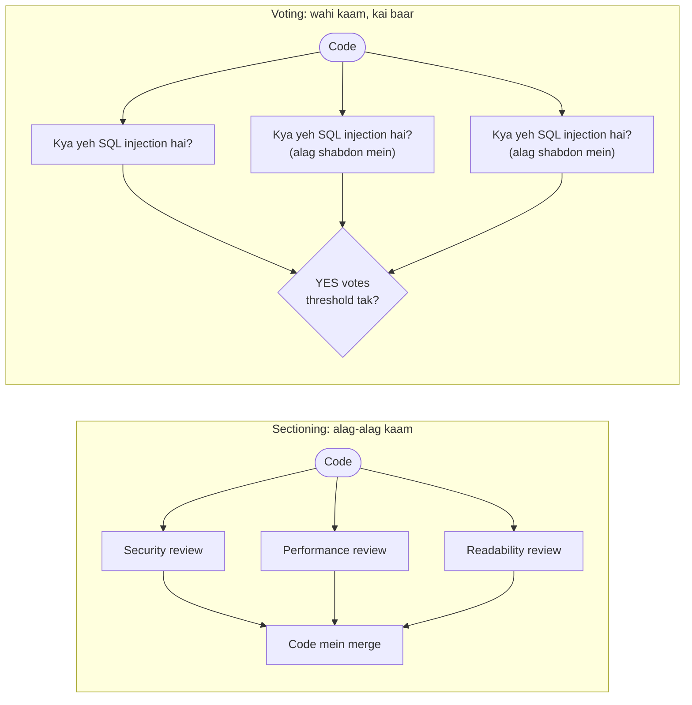

🏠 [Home](../../README.md) › [09 · Agent Design Patterns](./README.md) › 9.3 Parallelisation (sectioning aur voting)

# 9.3 Parallelisation (sectioning aur voting)

> **Level:** 🟡 Intermediate · **Padhne ka time:** ~8 min · **Pehle padho:** [9.1 Prompt chaining](./09.1-prompt-chaining.md)

**Ek line mein:** Parallelisation kai independent LLM calls ek saath chalata hai aur unke results code mein combine karta hai. Ya toh kaam ko alag-alag hisson mein tod ke (sectioning), ya ek hi sawal kai baar pooch ke aur jawab gin ke (voting).

📑 **Is page par**

- [Yeh kyun zaroori hai?](#-yeh-kyun-zaroori-hai)
- [Idea, simple words mein](#-idea-simple-words-mein)
- [Diagram se samjho](#-diagram-se-samjho)
- [Kaise kaam karta hai, step by step](#-kaise-kaam-karta-hai-step-by-step)
- [Example se samjho](#-example-se-samjho)
- [Code](#-code)
- [Aam galtiyan aur dhyan dene wali baatein](#-aam-galtiyan-aur-dhyan-dene-wali-baatein)
- [Yaad rakhne wali baatein](#-yaad-rakhne-wali-baatein)
- [Khud try karo](#-khud-try-karo)
- [Aur padhne ke liye](#-aur-padhne-ke-liye)

## 🤔 Yeh kyun zaroori hai?

Tum ek [LLM](../../GLOSSARY.md#large-language-model-llm) call se pull request ka review karwaate ho: security, performance *aur* readability, teeno. Woh naming par ek badhiya paragraph likh deta hai, aur line 2 par SQL injection miss kar deta hai. Sab kuch ek saath maangne se model ka dhyan bikhar jata hai.

Tum ise teen focused reviews mein tod dete ho aur ek ke baad ek chalate ho. Results behtar, lekin wait teen guna. Agar inhe **ek saath** chalao, toh focused reviews lagbhag ek review ke time mein mil jaate hain.

Aur high-stakes yes/no sawal ke liye ("is this a vulnerability?"), ek jawab matlab ek baar uchhala hua sikka. Kai baar poochke ginne se decision zyada reliable hota hai, aur yeh bhi pata chalta hai ki tum kitne sure ho sakte ho.

## 🧠 Idea, simple words mein

Exam ki copies check karna socho. **Sectioning:** teen teachers ek saath alag-alag section check karte hain, aur marks jod diye jaate hain. **Voting:** ek borderline essay ko teen teachers *wahi* essay check karte hain, aur majority wala grade final hota hai.

[Parallelisation](../../GLOSSARY.md#parallelisation) ke yahi do roop hain. Dono Anthropic ke [Building effective agents](https://www.anthropic.com/engineering/building-effective-agents) mein bataye gaye hain:

- **Sectioning:** task ko **alag-alag**, independent subtasks mein todo aur parallel mein chalao. Post ke examples: ek call user ko jawab deta hai jabki doosra request ko inappropriate content ke liye screen karta hai (ek [guardrail](../../GLOSSARY.md#guardrail)). Ya kai calls output ke alag-alag aspects evaluate karte hain.
- **Voting:** **wahi** task kai baar chalao taaki alag-alag outputs milein, phir unhe aggregate karo. Examples: kai prompts code ko vulnerabilities ke liye review karte hain aur problems flag karte hain. Ya content inappropriate hai ya nahi, iske kai checks, aur ek vote threshold jo false positives aur false negatives ke beech balance banata hai.

Calls independent hain: kisi ko doosre ka output nahi chahiye. Tumhara code fan out karta hai, sabka wait karta hai, aur phir plain logic se results combine karta hai (merge, sum, majority, "any flag").

Voting ka ek famous research cousin hai: **self-consistency** ([Wang et al., 2022](https://arxiv.org/abs/2203.11171)). Yeh ek sawal ke liye kai reasoning paths sample karta hai aur sabse common final answer leta hai. Isse reasoning benchmarks par ek single chain of thought ke mukable accuracy behtar hui.

## 👀 Diagram se samjho



*Dono mein, beech wale column ke calls ek saath chalte hain. Fark yeh hai ki woh kya karte hain: alag sawal (sectioning) ya wahi sawal (voting). Combine karne wala step plain code hai.*

## 🔍 Kaise kaam karta hai, step by step

1. **Check karo ki calls independent hain.** Agar call B ko call A ka output chahiye, toh woh chain hai ([9.1](./09.1-prompt-chaining.md)), parallel kaam nahi.
2. **Har section ke liye ek focused prompt likho.** "Look ONLY for security problems" ek teen-kaam wale prompt se behtar hai.
3. **Threads se fan out karo.** LLM calls ka lagbhag saara time network ka wait karne mein jata hai, isliye Python threads kaafi hain: `concurrent.futures.ThreadPoolExecutor` ([docs](https://docs.python.org/3/library/concurrent.futures.html)). Agar tumhari app async hai, toh providers ke async clients ke saath `asyncio.gather` yahi kaam karta hai.
4. **Concurrency par cap lagao.** `max_workers` limit karta hai ki ek waqt mein kitni calls chal rahi hain. Providers rate limits lagate hain. 50 calls ek saath bhejoge toh 50 rate-limit errors mil sakte hain ([15.5](../15-production-and-deployment/15.5-rate-limits-and-fallbacks.md)).
5. **Failures ko ek-ek karke handle karo.** Ek call fail hone se baaki results nahi khone chahiye. Har result ya uska exception collect karo, aur decide karo ki missing section ka kya matlab hai.
6. **Code mein combine karo.** Sectioning: fixed order mein merge ya concatenate karo. Voting: har reply ko vote mein parse karo, gino, aur threshold se compare karo. Jo reply parse na ho, woh abstention hai, vote nahi.
7. **Votes mein variety lao.** Agar model har baar lagbhag wahi jawab deta hai, toh paanch votes asal mein ek hi vote hai jiska paisa paanch baar diya. Voters ke beech prompt ke shabd badlo, ya alag models use karo.

Cost aur latency: teen calls mein sectioning ka cost lagbhag teen sequential calls jitna hai (ek combined call se zyada total [tokens](../../GLOSSARY.md#token), kyunki input repeat hota hai). Lekin wait lagbhag sabse slow call jitna hi hota hai. *n* voters ke saath voting ka cost lagbhag ek call ka *n* guna hai.

Food delivery app socho. Tumne teen alag restaurants se order kiya. Agar teeno ek ke baad ek bante, toh bahut der lagti. Teeno ek saath bante hain, toh total wait sabse slow restaurant jitna hai. Lekin bill teeno ka dena padta hai.

## 💡 Example se samjho

Review ho raha code:

```python
def find_user(db, name):
    rows = db.execute(f"SELECT * FROM users WHERE name = '{name}'")
    for row in rows:
        if row["name"] == name:
            return row
```

Scripted replies ke saath ek run. Har scripted reply network time dikhane ke liye 0.5 s sleep karta hai:

```text
SECTIONING: three focused reviews of the same code
  [security] - SQL injection: `name` is put straight into the query. Use a parameterised query.
  [performance] - Fetches every column and filters in Python. Select only needed columns and let SQL filter.
  [readability] - Returns None silently when no user matches. Say so in a docstring or raise an error.
  time: sequential 1.5s, parallel 0.5s

VOTING: 'is this SQL injection?' asked 5 times, flag at 3 or more YES
  YES 3, NO 1, abstain 1 -> flagged: True
```

- **Sectioning:** wahi teen focused calls ek ke baad ek 1.5 s mein hue, aur ek saath 0.5 s mein. Har reviewer ne apne area mein ek asli issue pakda.
- **Voting:** teen voters ne YES kaha, ek ne NO ("looks like an internal helper"), aur ek gol-mol bola ("Possibly, it depends on the driver"), jise abstention gina gaya. Threshold 3 ke saath code flag hota hai. 4 ke saath nahi hota. Threshold tumhara dial hai false positives aur false negatives ke beech.

## 💻 Code

Fan-out helper, sirf standard library:

```python
from concurrent.futures import ThreadPoolExecutor

def run_parallel(fn, items, *, max_workers: int = 8, timeout: float = 120) -> list:
    """Har item ke liye fn(item) ek saath call karo. Results input order mein rehte hain; failure uska exception ban jata hai."""
    with ThreadPoolExecutor(max_workers=max_workers) as pool:
        futures = [pool.submit(fn, item) for item in items]
        results = []
        for future in futures:
            try:
                results.append(future.result(timeout=timeout))
            except Exception as exc:          # ek failed call se baaki results nahi khone chahiye
                results.append(exc)
        return results
```

Phir sectioning aur voting dono kuch hi lines ke hain:

```python
def sectioned_review(llm, code: str) -> dict[str, str]:
    aspects = ["security", "performance", "readability"]
    results = run_parallel(lambda a: review_aspect(llm, code, a), aspects)
    return {a: (r if isinstance(r, str) else f"(review failed: {r})") for a, r in zip(aspects, results)}

def vote(llm, code: str, *, n: int = 5, threshold: int = 3) -> VoteResult:
    prompts = [VOTE_PROMPTS[i % len(VOTE_PROMPTS)] for i in range(n)]      # variety ke liye alag shabdon wale prompts
    replies = run_parallel(lambda q: llm.chat([user(f"{q}\n\nCode:\n{code}")],
                                              system="Answer YES or NO first, then one sentence.").text, prompts)
    counts = Counter(parse_vote(r) if isinstance(r, str) else "ABSTAIN" for r in replies)
    return VoteResult(counts["YES"], counts["NO"], counts["ABSTAIN"], counts["YES"] >= threshold)
```

`llm` koi bhi chat-model client hai jiska `.chat(messages, system=...)` ek reply return karta hai jismein `.text` ho, aur `user()` ek user message dict banata hai. Isliye yeh Anthropic, OpenAI ya scripted fake model, sab ke saath chalta hai. Raw SDKs ke saath, har worker apni `client.messages.create(...)` ya `client.chat.completions.create(...)` call karega. Ise **parallel tool calls** ([3.5](../03-tools-and-function-calling/03.5-parallel-tool-calls.md)) se confuse mat karna. Wahan *ek* model reply ek saath kai [tools](../../GLOSSARY.md#tool) maangta hai. Yahan *tumhara code* decide karta hai ki kai model calls ek saath karni hain.

## 🚨 Aam galtiyan aur dhyan dene wali baatein

- **Dependent steps ko parallel karna.** Agar ek call ko doosre ka output chahiye, toh dono ko saath chalane se kachra milega. **Fix:** pehle dependencies draw karo. Sirf independent calls parallel mein jaayein.
- **Concurrency par koi cap nahi.** 100 calls ek saath bhejne se rate limits lagte hain aur cheezein slow ho jaati hain. **Fix:** sensible `max_workers`, saath mein backoff ke saath retries.
- **Ek failure mein sab kuch kho dena.** `list(pool.map(...))` pehle exception par hi raise kar deta hai. **Fix:** har future ka result ya exception alag se collect karo, jaise `run_parallel` karta hai.
- **Votes jo independent nahi hain.** Same model ko same prompt aksar same jawab deta hai, khaaskar un models par jahan tum [temperature](../../GLOSSARY.md#temperature) nahi badha sakte. **Fix:** alag shabdon wale prompts, alag models, ya har voter ko alag context.
- **Unparseable replies ko ginna.** "Possibly" YES nahi hai. **Fix:** strict parsing. Baaki sab ko abstention maano, aur abstention rate par nazar rakho.
- **Cost bhool jaana.** Paanch voters matlab har request par paanch calls. **Fix:** voting sirf wahan karo jahan galat jawab mehenga pade (security, moderation, high-stakes decisions).
- **CPU-bound kaam se speed-up expect karna.** Threads isliye madad karte hain kyunki calls network ka wait karti hain. Heavy local processing ke liye processes chahiye.

## ✅ Yaad rakhne wali baatein

- Parallelisation independent LLM calls ek saath chalata hai, phir unhe plain code mein combine karta hai.
- Sectioning kaam ko alag focused hisson mein todta hai; voting wahi kaam repeat karke ginta hai.
- Network-bound LLM calls ke liye threads (`ThreadPoolExecutor`) kaafi hain. Concurrency cap karo aur har call ki failure alag handle karo.
- Latency ghat ke lagbhag sabse slow call jitni ho jaati hai; cost nahi ghatta.
- Vote threshold false positives aur false negatives ke beech ka dial hai. Votes mein variety rakho.

## 🧪 Khud try karo

1. `run_parallel` mein, agar tum `list(pool.map(fn, items))` use karte aur doosri call exception raise karti, toh kya hota?
2. Ek moderation system message ko flag karta hai agar teen checks (hate, self-harm, spam) mein se *koi bhi* yes kahe. Yeh sectioning hai ya voting, aur threshold kya hai?
3. Kab tum ek call jo teeno reviews kare, uski jagah teen focused sectioned calls chunoge?

<details>
<summary>Answer dekho</summary>

1. `map` results order mein return karta hai aur failed item par pahunchte hi exception dobara raise karta hai. Isliye `list(...)` raise karta hai aur jo calls successful thi unke results bhi kho jaate hain. Isi liye `run_parallel` har future ka result uske apne `try` ke andar collect karta hai.
2. Sectioning: teeno checks alag sawal poochte hain. Combine rule hai "any flag", yaani 3 mein se 1 ka threshold. Yeh false alarms se bachne ke bajaye problems pakadne ko zyada importance deta hai. (Voting tab hota jab *wahi* check teen baar poocha jaata.)
3. Jab single call kisi ek area mein cheezein miss karti hai (jaise worked example mein), jab tum har aspect ko alag se tune ya evaluate karna chahte ho, ya jab har aspect ko alag context ya tools chahiye. Agar ek combined call tumhare test set par teeno ko reliably cover kar leti hai, toh woh theek hai, aur sasti bhi.

</details>

## 📚 Aur padhne ke liye

- [Building effective agents](https://www.anthropic.com/engineering/building-effective-agents) (Anthropic). Sectioning aur voting, dono ke examples ke saath.
- [concurrent.futures — Launching parallel tasks](https://docs.python.org/3/library/concurrent.futures.html) (Python docs). `ThreadPoolExecutor`, `submit`, `map` aur futures.
- [Self-Consistency Improves Chain of Thought Reasoning in Language Models](https://arxiv.org/abs/2203.11171) (Wang et al., 2022). Voting ka research version.
- [Agent patterns cookbook](https://github.com/anthropics/claude-cookbooks/tree/main/patterns/agents) (Anthropic). `basic_workflows` notebook mein ek parallel example hai.

<!-- FOOTER -->

---

⬅️ **Pichla:** [9.2 Routing](./09.2-routing.md) ·
🏠 [Chapter home](./README.md) ·
➡️ **Agla:** [9.4 Orchestrator–workers](./09.4-orchestrator-workers.md)
